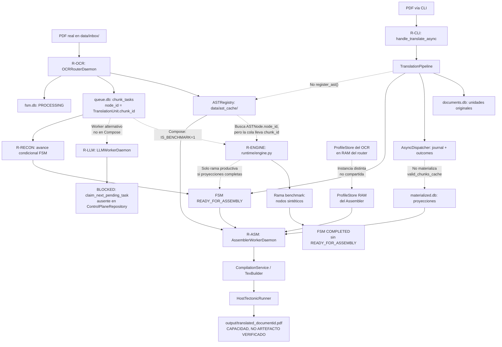
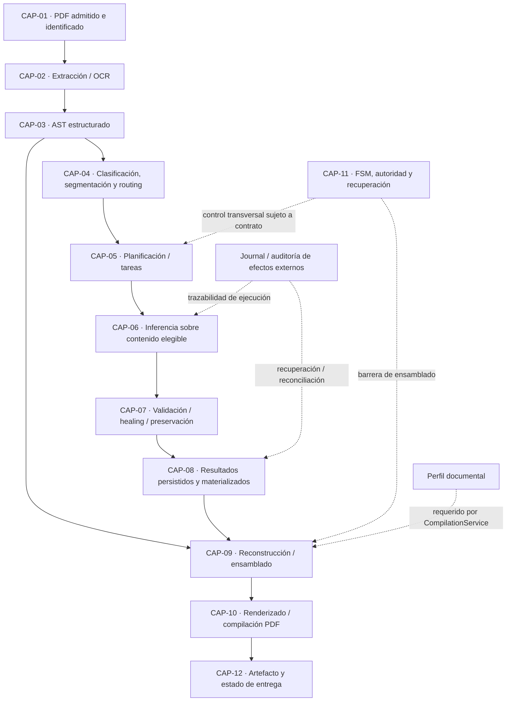
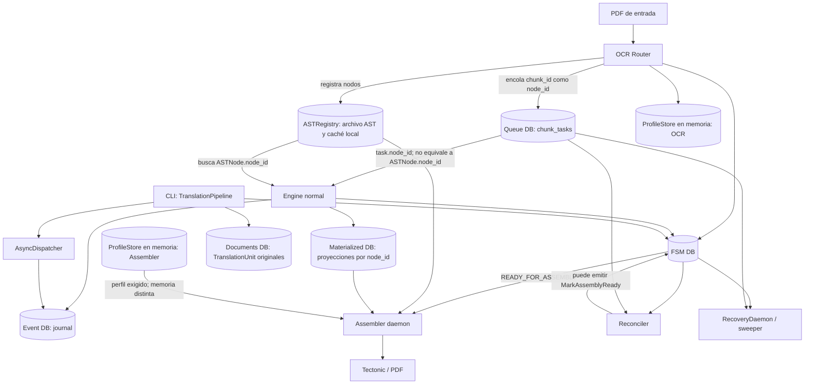
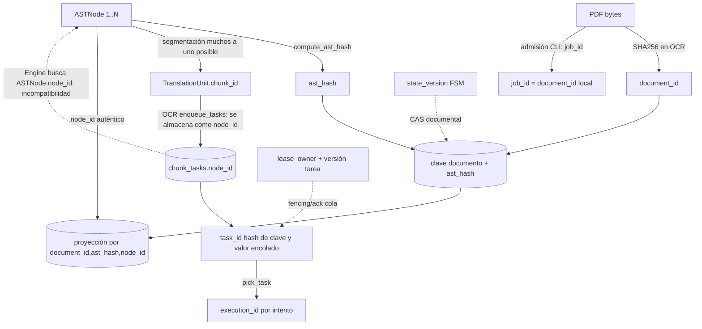
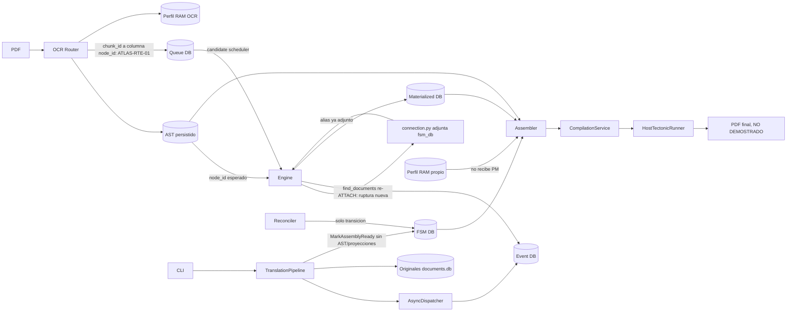
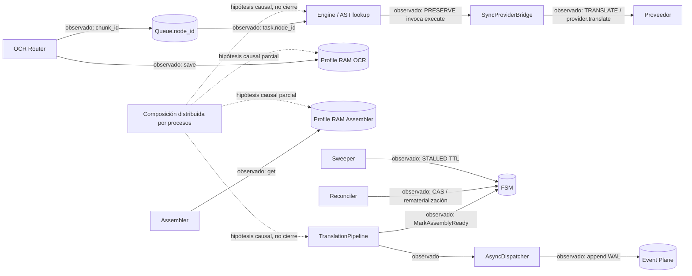
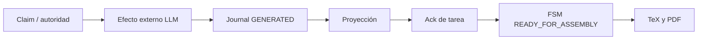
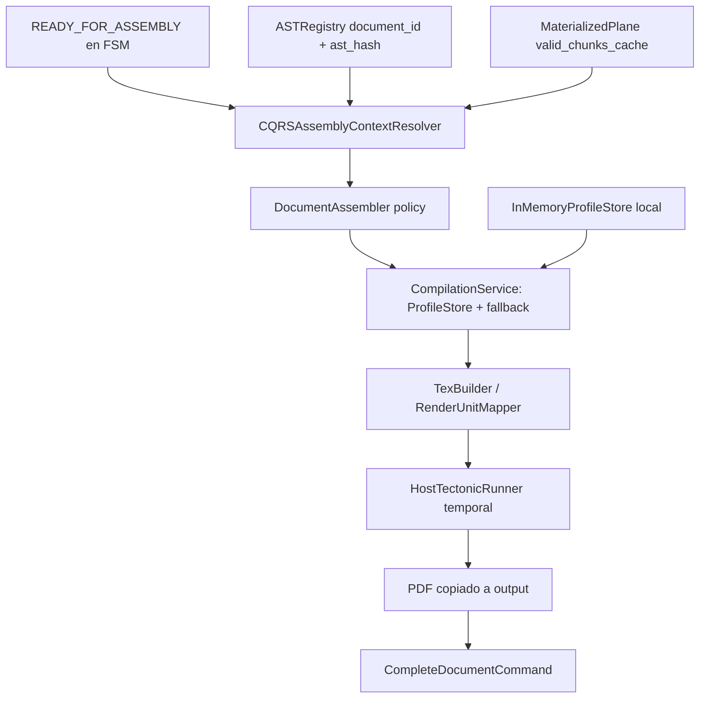
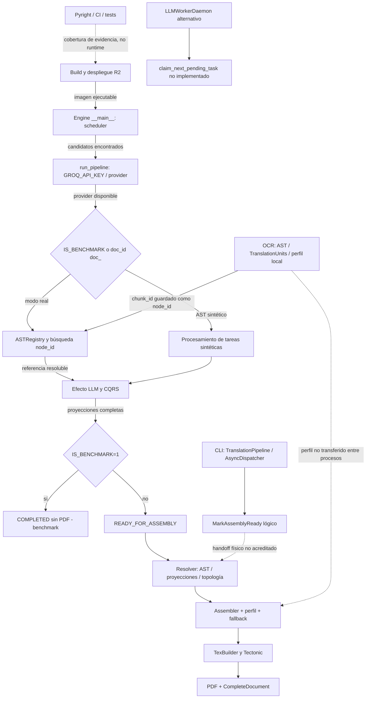

# Production Pipeline Execution Atlas

## Reconstrucción AS-IS, viabilidad de componentes y reconciliación del motor PDF → PDF

**Versión:** 0.2.15
**Estado:** IN_PROGRESS — investigación forense  
**Fecha de apertura:** 2026-10-14  
**Fecha de congelamiento:** N/A  
**Unidad:** Pipeline Stabilization & Architectural Reconciliation  
**Autoridad:** Architecture Board (autoridad decisoria posterior; este HITO solo produce evidencia)  
**Tipo de artefacto:** Forensic Flow Audit / Reconciliation HITO — alta complejidad  
**Ubicación:** `docs/architecture/adr/pipeline-stabilization/00-foundation/`  
**Identificador HITO:** pendiente de asignación conforme a la unidad aprobada  
**Baseline de código investigada:** commit `95ef8a38614a1416484593fbd734443e57a74369`  
**Commit documental consultado:** `380cafd91ac0e69f94a8aa237e83125cd6346504` (Charter, Atlas esqueleto y handoffs; no implica por sí solo identidad de árboles de código).  
**Charter de referencia:** `PIPELINE_STABILIZATION_AUDIT_CHARTER.md` v0.1.0, `DRAFT` (verificado en el commit documental `380cafd91ac0e69f94a8aa237e83125cd6346504`; propuestas y criterios sujetos a aprobación del Board).  
**Metodología:** `docs/architecture/1.2_METH_FOR_FORENSIC_HITOs.md` (archivo leído; cabecera interna: `METHODOLOGY_FOR_FORENSIC_HITOs.md`, v1.2.0 FROZEN)  
**Naturaleza:** evidencia forense AS-IS, read-only; no especificación TO-BE, ADR, NADR ni Execution Plan.  
**Mandato:** reconstruir y contrastar las rutas CLI, OCR→Engine→Assembler y OCR→LLMWorkerDaemon→Assembler hasta el PDF traducido; documentar sus contratos, discontinuidades y capacidades reutilizables.  
**Alcance de esta actualización:** Documento en revisión.

### Changelog

| Versión | Fecha | Descripción |
|---|---|---|
| 0.1.0 | 2026-10-14 | Creación del esqueleto del Atlas. |
| 0.2.0 | 2026-10-14 | Primera población forense de §0–§2 por inspección estática del commit fijado y reconciliación histórica; sin prueba E2E dinámica. |
| 0.2.1 | 2026-10-14 | Cotejo del Charter DRAFT; registro transversal de instrumentación Pyright/CI, reconciliación P7-H06, candidatos E2E-0 y propuestas D-1 a D-3. Sin aprobación normativa ni E2E ejecutado. |
| 0.2.2 | 2026-10-14 | Población forense de §3: mapa funcional, matriz CAP-01 a CAP-12, brechas de integración y clasificación preliminar de implementaciones; sin E2E ni selección canónica. |
| 0.2.3 | 2026-10-14 | Reconstrucción estática de §4: conexiones efectivas, linaje de identidades, fronteras entre procesos, primeras rupturas y fallos enmascarados. Sin ejecución E2E ni decisión canónica. |
| 0.2.4 | 2026-10-14 | Población estática y normativa de §5.1–§5.15: componentes e instrumentos separados, matrices de viabilidad y rutas, mapa de dependencias, reconciliación con NADR FROZEN y GAPs F18; hallazgo provisional ATLAS-RTE-07 sobre doble ATTACH en scheduler y propagación a §§2/4. Sin E2E ni elección canónica. |
| 0.2.5 | 2026-10-15 | Cinco correcciones localizadas: (1) SyncProviderBridge con riesgo de integridad científica ALTO; (2) alcance probatorio preciso de ATLAS-RTE-07; (3) síntesis cualitativa sin prescribir secuencias; (4) correspondencia parcial de SegmenterService/StrategyRouter; (5) autoridad pre-efecto en AsyncDispatcher. Ajustes transversales en §3.2, §4.5 y §7.3. Sin reescritura de §5 ni decisiones de arquitectura. |
| 0.2.6 | 2026-10-14 | Población forense de §6: taxonomía, 12 comparaciones, 7 análisis causales, controles negativos y dependencias con §7. Cuatro precisiones sobre prioridad, autoridad pre-efecto y alcance del daemon. Sin decisiones de consolidación ni retiro |
| 0.2.7 | 2026-10-14 | Población forense estática y reconciliación normativa de §7.1–§7.6: obligaciones FROZEN vs DRAFT/PROPOSED, composición real, identidad, SQLite/lease, autoridad pre-efecto, incertidumbre y reintentos, idempotencia de materialización, replay contextual, preservación CLI/Engine, reconstrucción y PDF. 12 controles contractuales, 14 verificaciones propuestas y ajustes focalizados de §6. Sin E2E-0, sin decisiones D-1..D-7, sin remediación de código. |
| 0.2.8 | 2026-10-15 | Dos precisiones menores a §7: (1) CTR-05 distingue semántica SQL demostrada de incidente productivo no demostrado; (2) TranslationStrategyRouter confirma ausencia en pipeline_factory/dispatcher pero deja abierta verificación de consumidores indirectos. Ajustes transversales a §6 mantenidos. Sin decisiones de arquitectura ni E2E. |
| 0.2.9 | 2026-10-14 | §8 completada estáticamente: 22 claves locales de condición/riesgo con precondición, primera frontera, rutas y fallos enmascarados; grafo condicional, clasificación A?/B?/C, matriz por ruta y 10 testigos de verificación. Distinción Compose golden standalone/overlay y Pyright/CI como gate de evidencia, no del runtime. Sin decisiones de convergencia, remediación ni E2E-0. |
| 0.2.10 | 2026-10-15 | Cuatro precisiones a §8: (1) alcance de despliegue B8-01 condicionado al procedimiento efectivo; (2) doble prioridad B8-12 (diagnóstico vs contractual FROZEN); (3) nota de concurrencia en grafo Mermaid; (4) matriz de priorización de testigos y coordinación de dos carriles (AS-IS y diagnóstico) sin posponer E2E-0. Sin decisiones de arquitectura ni ejecución dinámica. |
| 0.2.11 | 2026-10-15 | Población de §9 (Dynamic Execution & E2E Evidence) en versión compacta: protocolo de autoridad, 13 checkpoints (CP-00..12), clasificación A/B/C, testigos W referenciados a §8, FI-00..07 y L3 diferidos. Incluye plantilla, esquema JSON y verificador auxiliares. Todas las corridas NO EJECUTADAS. Sin modificar Charter, código ni decisiones FROZEN. |
| 0.2.12 | 2026-10-15 | Población forense de §10: matriz CAP-01…12 y estado por ruta, activos aprovechables solo en alcance estático, fronteras desconectadas, controles negativos de duplicación, docket D-1…D-7 y riesgos residuales. Readiness de producto NOT DEMONSTRATED; E2E-0 y testigos NO EJECUTADOS. Sin selección canónica, disposiciones KEEP/RETIRE, decisiones ni cambios funcionales. |
| 0.2.13 | 2026-10-15 | Población forense de §11: registro federado de fuentes y modalidades; trazabilidad de enlaces L-01…14 hacia CAP/CTR/B8/W sin duplicar hallazgos; reconciliación delta de P1/P7, GAP-0.2-01/DF-34, F18.2 RESOLVED y Charter; hipótesis abiertas con prueba falsable y límites de cierre. Sin nuevos E-/GAP-IDs, E2E-0, decisiones canónicas ni cambios funcionales. |
| 0.2.14 | 2026-10-15 | Población de §12: dictamen forense estático sin certificación PDF→PDF; matriz de completitud y techos de inferencia; derivación federada a registros históricos, testigos y docket D-1…D-7; checklist de congelamiento conforme a 1.2_METH §8 y declaración expresa de no cierre formal. E2E-0/L0/L2/L3 NO EJECUTADOS; sin nuevos folios E-/GAP-, severidades, disposiciones KEEP/RETIRE, decisiones ni cambios funcionales. |
| 0.2.15 | 2026-10-16 | Reconciliación editorial post-auditoría de consistencia (informe sobre commit 99a3e493, v0.2.14): renombrado de HITO_{ID} a PRODUCTION_PIPELINE_EXECUTION_ATLAS.md; actualización de tabla de progreso §0.4 al corte efectivo; sustitución de metadatos «Versión propuesta v0.2.XX» por «Integración documental» en §§9, 11 y 12; eliminación de párrafos obsoletos sobre cabecera 0.2.11 (§§10.6.2, 12.4.2); eliminación de footer «Fin del esqueleto v0.1.0»; nota de límite de gobernanza tras changelog; registro de identidad formal como DECISION REQUIRED (DOC-01). Sin cambios funcionales, sin decisiones D-1…D-7, sin E2E-0. |

**Límite de gobernanza:** este Atlas no modifica el Charter v0.1.0 `DRAFT` ni supone la aprobación de D-1…D-7. Las conclusiones de §§0–12 son evidencia forense provisional y no sustituyen la formalización de la unidad, la caracterización E2E-0 o el acto de cierre del HITO.


---

# 0. PROTOCOLO DE LECTURA Y ESTADO DE INVESTIGACIÓN

## 0.1 Finalidad

Reconstruir el pipeline **productivo real** del repositorio para traducir un PDF científico y generar un PDF de salida, evaluar la viabilidad de componentes y localizar conexiones rotas, implementaciones competidoras e incompatibilidades contractuales. El benchmark y el pipeline de Continuous Verification se estudian solo donde afecten la ruta de producto o creen confusiones de alcance.

El documento no pretende inventariar exhaustivamente todas las clases, repetir las auditorías P1–P7 ni convertir el resultado en instrucciones inmediatas de refactor.

## 0.2 Separación de hechos y decisiones

- **OBSERVED:** hecho verificado directamente en código, configuración, tests o ejecución, citando la modalidad de prueba. En este corte, `OBSERVED-STATIC` indica lectura del código/configuración, **no ejecución dinámica**.
- **REQUIRED:** obligación contractual apoyada en fuente normativa efectivamente identificada; se cita regla precisa cuando corresponda. No se reemplazan obligaciones vigentes por expectativas históricas.
- **UNKNOWN / TO BE VERIFIED:** no acreditado todavía; incluye hipótesis plausibles sin descartar rutas alternativas.
- **DECISION REQUIRED:** alternativa o contradicción para Architecture Board, **sin resolverla en este HITO**.
- **DECISION PREVIA:** resolución histórica descrita por ADR/NADR/handoff. No equivale a ejecución vigente ni a resultado de prueba actual.

Los IDs `R-*`, `CAP-*` y `ATLAS-RTE-*` aquí son **etiquetas locales provisionales de trabajo**. La asignación definitiva de HITO, evidencias (`E-{HITO}-{NNN}`), gaps (`GAP-{HITO}-{NN}`), severidad y findings se realizará conforme a `1.2_METH_FOR_FORENSIC_HITOs.md`; no se inventará un número de HITO antes de aprobarlo. Las disposiciones de conservación/integración/retiro no están autorizadas por este documento.

**Gobernanza:** el Charter §3 propone D-1 (un contrato canónico PDF→PDF), D-2 (convergencia basada en E2E-0) y D-3 (caracterización previa). Su estado en la fuente consultada es **DRAFT, pendiente de aprobación**. Ninguna propuesta se trata aquí como decisión FROZEN ni se elige un motor ganador. El término «Opción C» requiere referencia a un acto de aprobación si se pretende atribuirle fuerza decisoria.

## 0.3 Reglas de investigación

1. Fijar la observación al commit `95ef8a38614a1416484593fbd734443e57a74369`.
2. Diferenciar **archivo presente**, **componente instanciado**, **ruta alcanzable**, **ruta configurada**, **ejecución dinámica** y **resultado PDF verificado**.
3. No inferir un PDF traducido válido a partir de un nombre de archivo, un reporte de tests, una transición FSM ni el código que invoca Tectonic.
4. Citar **archivo, símbolo y líneas**, a través de enlaces anclados al commit. Las referencias históricas solo prueban lo declarado en su fecha.
5. Reconciliar P1/P7 con los handoffs F17-BIS antes de reutilizar diagnósticos; si se corrige una observación, indicar *históricamente corregida* y validar el código actual.
6. Clasificar una ruta como **BLOCKED-STATIC** solo ante contradicción local demostrada. No inferir imposibilidad absoluta para todas las configuraciones imaginables.
7. Mantener separados el AST y las identidades de producto (`document_id`, `ast_hash`, `node_id`, `chunk_id`) de la identidad del oráculo del benchmark.
8. No convertir `KEEP`, `CONNECT`, `REPAIR`, `CONSOLIDATE` o `RETIRE CANDIDATE` en decisiones o tareas de implementación.
9. Conservar las hipótesis no resueltas como `TO BE VERIFIED` hasta revisar mecanismos alternativos o realizar pruebas reproducibles.
10. No introducir infraestructura distribuida ni recomendaciones TO-BE bajo la apariencia de análisis AS-IS.

## 0.4 Progreso del Atlas v0.2.14 — corte documental 2026-10-15

| Superficie | Población documental | Estado probatorio / pendiente |
|---|---|---|
| Frontera de producto y capacidades (§§1 y 3) | **POBLADO — ESTÁTICO** | CAP-01…12 identificadas; cobertura E2E no acreditada. |
| Rutas de entrada y composición (§2) | **POBLADO — ESTÁTICO** | Rutas/variantes diferenciadas; configuración efectivamente ejecutada sin prueba. |
| Conectividad, linaje e identidades (§4) | **POBLADO — ESTÁTICO** | L-01…14; primeras rupturas condicionadas a precondiciones; ejecución integrada desconocida. |
| Roles y viabilidad (§5) | **POBLADO — CLASIFICACIÓN CANDIDATA** | Sin decisiones formales KEEP/RETIRE y sin comprobación completa de consumidores indirectos. |
| Duplicación y mecanismos causales (§6) | **POBLADO — ESTÁTICO** | DUP-01…12 con controles negativos; no equivalen a doce defectos. |
| Contratos (§7) | **POBLADO — CONTRASTE ESTÁTICO** | CTR-01…12; garantías dinámicas, incertidumbre y preservación pendientes. |
| Bloqueantes/topología (§8) | **POBLADO — ESTÁTICO** | B8-01…22 y W-01…10 definidos; algunas condiciones corroboradas con SQLite aislado; sin E2E. |
| Protocolo L0–L3 (§9) | **POBLADO — NO EJECUTADO** | PF-01…12, CP-00…12 y W previstos; owner/Charter/PDF/egress pendientes. |
| Readiness, fuentes y cierre (§§10–12) | **POBLADO — PROVISIONAL** | Trazabilidad y límites documentados; `FROZEN` y readiness no acreditados. |
| Evidencia dinámica y decisiones | **NO DISPONIBLE / NO AUTORIZADA EN ESTE CORTE** | E2E-0, L0–L3 sin ejecutar; D-1…D-7 pendientes del Board. |

## 0.5 Fuentes y calidad de evidencia de este corte

**Código y configuración, fuente primaria (commit fijo):** `apps/cli/main.py`, `apps/bootstrap/pipeline_factory.py`, `apps/bootstrap/provider_stack_factory.py`, `core/pipeline/orchestrator.py`, `apps/llm_workers/dispatcher.py`, `apps/llm_workers/__main__.py`, `apps/ocr_router/__main__.py`, `runtime/engine.py`, `apps/daemons/reconciler.py`, `apps/compiler/__main__.py`, `core/compiler/{context_resolver,service,assembler}.py`, `apps/compiler/tectonic_runner.py`, `core/chunking/semantic_chunking.py`, `core/ast/{registry,hashing}.py`, `infra/db/{control_repo,materialized_repo,document_repository,fsm_repository,profile_store}.py`, `core/execution/handlers.py` y `docker-compose.yml`.

**Contexto histórico, no evidencia directa de funcionamiento actual:** auditorías P1 y P7, HITO 4.5, HITO 6.1, handoffs F17-BIS Fases 1–4 (GitHub), Fases 5–6 (adjuntos de conversación) y F18.1 (adjunto). La Fase 1 declaró la separación intencional de la fase lógica y el ensamblado físico, el `provider_stack_factory` compartido y la eliminación de stages de layout obsoletos; F18.1 declaró mecanismos de admission, backpressure y shutdown en `LLMWorkerDaemon`. Se contrastan estas afirmaciones con el código, sin presuponer que las rutas quedaron E2E certificadas.

**Instrumentación de verificación:** `pyrightconfig.json` contiene solo exclusiones; `pyproject.toml` configura `strict`; `ci.yml` invoca Pyright sin `-p` y selecciona tests por markers. El Charter H-02/H-03 reporta mediciones locales (0 frente a 105 errores; 191/1014 tests); **no reproducidas en esta sesión**. Esto limita el valor de los gates como prueba E2E, sin anular sus resultados para el alcance efectivamente ejecutado.

**Límites:** inspección estática desde GitHub; sin lectura confiable del historial de generación del archivo `translated_c17cb80d...pdf` mencionado por una tercera IA; sin ejecución de Docker, Tectonic, proveedor LLM ni prueba dinámica; el Charter sí se verificó en el commit documental `380cafd9`, pero no existía en el commit base `95ef8a38`. El documento metodológico sí fue accesible desde `docs/architecture/1.2_METH_FOR_FORENSIC_HITOs.md`.

**Base:** Atlas local §0–2 v0.2.1, §3 v0.2.2, §4 v0.2.3 corregida. **Cambios exclusivamente documentales**; no aplicar comandos sobre código productivo. `ATLAS-RTE-07` es identificador **local provisional**, NO evidencia formal `E-{U}.{H}-NNN` ni severidad aprobada. Baseline funcional `95ef8a38`; inspección en `380cafd9`. La comparación de commits demuestra que entre ambos no cambiaron archivos de código funcional.

---

# 1. PRODUCT EXECUTION BOUNDARY

## 1.1 Qué constituye el producto

**Entrada:** PDF científico/técnico real, identificado y admitido para procesamiento.  
**Transformación esperada:** ingesta; extracción y AST plano; normalización, clasificación y segmentación; routing y selección de texto traducible; traducción con preservación de fórmulas, código y elementos estructurales; validación/healing; persistencia recuperable; ensamblado y compilación.  
**Salida:** **archivo PDF traducido real**, localizable, asociado a la identidad documental y con estado final coherente. La creación física del PDF no demuestra por sí sola fidelidad científica, y una FSM en `COMPLETED` sin artefacto verificable no satisface por sí sola el producto.

**OBSERVED-STATIC:** el Assembler llama `HostTectonicRunner.compile()` con `output_filename=f"translated_{doc_id}.pdf"` y destino por defecto `output/`. Esto muestra una **capacidad de producir PDF**, no un resultado probado en esta revisión. [C-ASM] [C-TEX]

## 1.2 Capacidades necesarias

El estado siguiente describe **evidencia de implementación**, no aceptación funcional de la capacidad.

| ID | Capacidad | Necesaria para PDF → PDF | Contrato / fuente a contrastar | Estado AS-IS en este corte |
|---|---|---|---|---|
| CAP-01 | Admisión e identidad documental | Sí | `PROJECT_SCOPE`; contratos de identidad F17-BIS/F18 | **IMPLEMENTADA POR RUTAS, DIVERGENTE:** CLI usa `job_<stem>` por defecto; OCR usa SHA-256 del PDF. [C-CLI] [C-OCR] |
| CAP-02 | Extracción PDF / OCR | Sí, según documento/provider | `build_extraction_pipeline()`; obligaciones de extracción aplicables | **IMPLEMENTADA ESTÁTICAMENTE:** CLI y OCR invocan parser; fidelidad de casos reales no certificada aquí. [C-FACTORY] [C-OCR] |
| CAP-03 | Construcción y normalización AST | Sí | `PROJECT_SCOPE`, principios AST plano, reglas de normalización | **IMPLEMENTACIÓN PRESENTE:** ASTRegistry persiste JSON; CLI aplica clasificación/enriquecimiento; integración entre rutas incompleta. [C-AST] [C-ORCH] |
| CAP-04 | Segmentación, routing y chunking | Sí; semántica específica por contrato | Semántica de `TranslationUnit`, `ASTNode` y routing; detalle pendiente | **IMPLEMENTADO CON DISCONTINUIDAD:** OCR encola `chunk_id`; Engine busca `node_id` en ASTRegistry. [C-OCR] [C-CHUNK] [C-ENGINE] |
| CAP-05 | Planificación y ejecución de tareas | Según modo de ejecución | FSM/lease/autoridad F17-BIS y F18 | **RUTAS DIFERENTES:** Engine usa `pick_task`; LLM daemon invoca API inexistente en repositorio concreto. [C-QUEUE] [C-LLM] |
| CAP-06 | Inferencia LLM | Sí | Provider stack, presupuestos y prompts | **IMPLEMENTACIÓN PRESENTE:** CLI tiene AsyncDispatcher; Engine/LLM daemon usan SyncProviderBridge. Ejecución real no probada. [C-DISP] [C-ENGINE] |
| CAP-07 | Validación, healing y preservación | Sí | Principios y NADRs aplicables por cotejar | **PARCIALMENTE OBSERVADA:** CLI inyecta validación/healing; políticas del Engine y daemon difieren; equivalencia científica pendiente. [C-FACTORY] [C-ENGINE] |
| CAP-08 | Persistencia y materialización | Según contratos productivos y separación de procesos | Contratos CQRS, eventos y recuperación | **IMPLEMENTACIÓN PRESENTE, INTEGRACIÓN INCOMPLETA:** CLI usa `documents.db` y event journal; Engine escribe `materialized.db`; Assembler consume proyecciones por `node_id`. [C-ORCH] [C-DISP] [C-MAT] |
| CAP-09 | Reconstrucción y ensamblado | Sí | NADR-06 §5.3 citado en código/handoff Fase 1 | **IMPLEMENTADO CON PRECONDICIONES NO SATISFECHAS:** requiere AST completo, proyecciones y perfil accesibles. [C-ASM] [C-COMP] |
| CAP-10 | Renderizado y compilación PDF | Sí | NADR-09 §5.2 según código | **IMPLEMENTACIÓN PRESENTE:** `CompilationService` produce TeX; `HostTectonicRunner` llama a binario externo; ejecución real pendiente. [C-COMP] [C-TEX] |
| CAP-11 | FSM, autoridad y recuperación | Obligatoria según contratos de la ruta | NADR-09, F18 INV-JOURNAL; verificación específica pendiente | **PARCIAL:** FSM y reconciliador existen; continuidad efectiva entre planos y recovery E2E no probados. [C-FSM] [C-RECON] |
| CAP-12 | Entrega del artefacto y estado final | Sí | Contrato de producto/Charter por cotejar | **CÓDIGO DE COMPILACIÓN Y `CompleteDocumentCommand` PRESENTE; entrega real NO ACREDITADA.** [C-ASM] |

**Nota sobre benchmark:** el `OracleSemanticIdentityCalculator` y `manifest_hash` cumplen funciones del sistema de verificación científica. No deben confundirse sin prueba con la clave `(document_id, ast_hash)` que intercambian OCR Router, Engine y Assembler. El HITO de Fase 3 distinguió los propósitos de `compute_ast_hash()` y de la identidad semántica del oráculo.

## 1.3 Exclusiones

Quedan fuera del objetivo de certificación de este Atlas: recalibración del corpus de benchmark, experimentación de extractores F19–F21, optimizaciones no bloqueantes, rediseño de infraestructura distribuida y decisiones de arquitectura TO-BE. **Excepción justificada:** `IS_BENCHMARK=1` debe auditarse porque altera directamente el comportamiento de un servicio definido en Compose como `llm_worker`.

## 1.4 Condición funcional mínima

**FUENTE PREREGISTRADA — Charter v0.1.0 DRAFT, §6.1 y §6.2; no `REQUIRED` aprobado todavía.** E2E-0 es una prueba de **caracterización AS-IS, no remediación**, por cada ruta con entrada documental: PDF versionado y con hash verificable; proveedor determinista controlado; resultado clasificado como **(A)** PDF final válido, **(B)** producto parcial con etapa de fallo identificada, o **(C)** fallo con causa y traza. La selección del PDF concreto corresponde al Board.

La matriz propuesta para una futura ruta canónica contempla: raíz de composición identificada y sin atajos de benchmark; proveedor controlado y posteriormente proveedor real con presupuesto autorizado; trazabilidad documento/AST/chunk/nodo/tarea/intento; persistencia recuperable entre procesos; preservación de fórmulas, código e imágenes; PDF ensamblado desde resultados materializados; estado final coherente; commit, entorno, configuración y comandos registrados. **No son criterios de cierre ya aprobados ni evidencia de cumplimiento actual.**

**Candidatos:** el Charter menciona PDFs `doc_01` a `doc_07` en `tests/corpus/canonical/pdf/` y hashes en `manifest.json`. Un reporte de inspección local adicional señala **seis PDFs versionados**, cifra **pendiente de corroborar** mediante inventario completo del árbol Git y verificación de hashes. No se designa todavía un caso oficial ni se generan PDFs nuevos por necesidad inferida.

**Estado E2E al corte:** **NO ACREDITADO**. La inspección estática no equivale a E2E-0 ni prueba que cualquier ruta sea irreparable. Ver §9.1–§9.2 para el registro de entorno y ensayos futuros.

---

# 2. PRODUCTION ENTRY POINTS & COMPETING EXECUTION ROUTES

## 2.1 Descubrimiento de puntos de entrada

La unidad funcional a evaluar no es un solo script, sino **una secuencia de procesos y autoridades**. `TranslationPipeline` y `runtime/engine.py` no ingieren y compilan ambos por sí mismos; `LLMWorkerDaemon` es un ejecutor alternativo de tareas, no un pipeline autónomo PDF→PDF.

| Ruta | Entry point candidato | Mecanismo de arranque observado | ¿Configurado en Compose auditado? | ¿Ejecuta trabajo según código? | ¿Produce PDF? |
|---|---|---|---|---|---|
| R-CLI | `apps/cli/main.py::handle_translate_async()` | Comando CLI (`main()` → handler) | **No** en Compose inspeccionado | **Sí, tiene ruta estática** de parseo, chunking, AsyncDispatcher y FSM; dinámica no verificada | **No directamente**: devuelve `PipelineResult(document=None, assembly_report=None)`; continuidad al Assembler no acreditada. [C-CLI] [C-ORCH] |
| R-ENGINE | `runtime/engine.py::__main__` / `run_pipeline()` | Sondeo de documentos pendientes en `queue.db` | **Sí**, servicio `llm_worker` | **Sí, ruta estática**, `pick_task`→procesador→WAL→proyección→ack; rota para IDs OCR ordinarios | **No directamente**; rama productiva puede emitir `MarkAssemblyReadyCommand`, pero Compose fuerza benchmark. [C-ENGINE] [C-COMPOSE] |
| R-LLM | `apps/llm_workers/__main__.py::LLMWorkerDaemon.run()` | Ejecutable por `python -m apps.llm_workers` / módulo | **No**, Compose usa Engine | **BLOCKED-STATIC:** llama a `claim_next_pending_task()` inexistente en el repositorio instanciado | **No directamente**; posible avance FSM depende de reconciliación, aún sin viabilidad productiva. [C-LLM] [C-QUEUE] |
| R-OCR | `apps/ocr_router/__main__.py::OCRRouterDaemon.run()` | Watcher de `data/inbox/*.pdf` | **Sí**, servicio `ocr_router` | **Sí, ruta estática:** parsea PDF, perfila, registra AST, encola tareas y transiciona FSM | **No**; es etapa de entrada. [C-OCR] [C-COMPOSE] |
| R-ASM | `apps/compiler/__main__.py::AssemblerWorkerDaemon.run()` | Sondeo de FSM `READY_FOR_ASSEMBLY` | **Sí**, servicio `assembler` | **Sí, ruta estática:** resuelve contexto, intenta compilación y marca finalización | **Puede compilar**, pero depende de proyecciones, perfil y Tectonic; sin resultado E2E acreditado. [C-ASM] [C-COMP] |
| R-RECON | `apps/daemons/reconciler.py::ReconcilerDaemon.run()` | Servicio de reconciliación | **Sí**, servicio `reconciler` | Detecta ciertos documentos `PROCESSING` cuyas tareas están completas y emite `MarkAssemblyReadyCommand` | No; solo avanza FSM. [C-RECON] [C-COMPOSE] |
| R-OTHER | `runtime/sweeper.py`, `infra/db/bootstrap.py` | Compose | **Sí**, servicios auxiliares | Relevancia operativa presente; análisis funcional profundo **TO BE VERIFIED** | No acreditado; no se clasifican como pipeline completo. |

**Advertencia de alcance:** el hecho de que Docker Compose declare un servicio es `OBSERVED-STATIC CONFIGURATION`; **no se han ejecutado contenedores** ni constatado arranque satisfactorio del mismo.

## 2.2 Grafo AS-IS de rutas competidoras



**Leyenda:** flecha sólida = dependencia o invocación explícita en código (sin prueba dinámica); flecha punteada = enlace condicionado, incompatible o no demostrado, según su etiqueta. Este dibujo **no contiene ninguna flecha etiquetada como ejecución dinámica probada**. Los nodos `READY_FOR_ASSEMBLY` y `output/` describen capacidades/estados programados, no una ejecución E2E confirmada. El flujo de benchmark está deliberadamente visible porque el Compose auditado lo selecciona.

**Limitación del diagrama:** en OCR la cola contiene tareas identificadas mediante `chunk_id` y el motor accede a nodos AST mediante `node_id`; el gráfico no presupone que esta traducción de identidades exista. La aparente convergencia en el Assembler no implica continuidad funcional.

**Precondición adicional del grafo:** la conexión de `R-ENGINE` a `queue.db` pasa por el scheduler descrito en `ATLAS-RTE-07`, susceptible a doble `ATTACH fsm_db` cuando ya existe el alias. Las flechas posteriores al Engine indican conexiones codificadas pero potencialmente inalcanzables desde ese arranque.

## 2.3 Composición e infraestructura por ruta

### 2.3.1 R-CLI: `handle_translate_async()` → `TranslationPipeline`

- **Composición:** CLI construye `PromptBuilder`, límites de presupuesto, cuota SQLite y provider stack mediante `build_provider_stack()`. `build_pipeline()` crea `AsyncDispatcher`, extracción, `SQLiteDocumentRepository`, FSMStateStore/DocumentCommandHandler y validación pre-LLM. La composición está parcialmente centralizada; no significa composición íntegramente uniforme entre rutas. [C-CLI] [C-FACTORY]
- **Identidad:** `job_id` = argumento explícito o `job_{Path(source_path).stem}`; el orquestador asigna `job.document_id = job.job_id` y calcula `ast_hash` sobre nodos procesados. Se debe reconciliar con la identidad SHA-256 de OCR, sin concluir automáticamente que una es incorrecta. [C-CLI] [C-ORCH]
- **Flujo efectivo programado:** parser → clasificación y validación → enriquecimiento → `chunker.chunk()` → `document_repository.save_batch(job.job_id, translation_units)` → `dispatcher.dispatch(...)` → `MarkAssemblyReadyCommand` → `PipelineResult(document=None, assembly_report=None)`. [C-ORCH]
- **Datos producidos:** `documents.db` almacena payloads originales; AsyncDispatcher crea eventos en `event.db` y outcomes en memoria. El cuerpo inspeccionado de `AsyncDispatcher` **no llama a** `MaterializedPlaneRepository.upsert_projection()`. El orquestador **no llama a** `ASTRegistry.register_ast()` ni a `ControlPlaneRepository.enqueue_tasks()`. [C-DISP] [C-ORCH]
- **Primer límite acreditado para entrega asíncrona:** la orden `READY_FOR_ASSEMBLY` no garantiza que el Assembler pueda cargar AST, proyecciones y perfil de esa ejecución. El pipeline lógico cumple su frontera histórica de Fase 1, pero el **traspaso material completo no está conectado** en los símbolos inspeccionados.
- **Último resultado observable por código:** informe FinOps de CLI y `PipelineResult`, no ruta física al PDF. [C-CLI]

### 2.3.2 R-OCR: entrada compartida del despliegue de daemons

- **Arranque:** servicio `ocr_router` ejecuta `apps/ocr_router/__main__.py`; sondea `data/inbox/*.pdf`. [C-COMPOSE] [C-OCR]
- **Identidad y persistencia:** `document_id = sha256(bytes del PDF)`, `ast_hash = compute_ast_hash(raw_ast)`, `ASTRegistry.register_ast()` guarda JSON bajo `data/ast_cache/{document_id}.{ast_hash}.ast.json`; FSM inicializa el documento. [C-OCR] [C-AST]
- **Chunking y cola:** `build_semantic_chunks_as_units()` genera `TranslationUnit.chunk_id`; OCR pasa dichos IDs a `ControlPlaneRepository.enqueue_tasks()` cuyo campo persistido se denomina `node_id`. Un `chunk_id` no es, por contrato, `ASTNode.node_id`; el chunker usa un formato `chunk_{índice}_{rango}_{hash}` o `isolated_{...}`. [C-OCR] [C-CHUNK] [C-QUEUE]
- **Perfil:** calcula `InferredDocumentProfile`, pero lo almacena en `InMemoryProfileStore` local del proceso OCR. Una nota del código reconoce que el perfil debería persistirse junto al AST o viajar por metadata para que el Assembler lo consuma. **No se observa esa transferencia**. [C-OCR] [C-PROFILE]
- **Primera incompatibilidad de datos OCR→Engine, posterior al scheduler:** `TranslationUnit.chunk_id` se guarda en `chunk_tasks.node_id`, que el Engine utiliza para buscar `ASTNode.node_id`: `ATLAS-RTE-01`. **No afirmar que ésta es la primera excepción cronológica del daemon:** el arranque de Engine tiene una ruptura anterior en la doble vinculación SQLite del alias `fsm_db` (`ATLAS-RTE-07`; §2.3.3). Ambas son observaciones estáticas independientes, sin E2E ejecutado.

### 2.3.3 R-ENGINE: `runtime/engine.py`

- **Arranque real configurado:** Compose ejecuta `python runtime/engine.py` y fija `IS_BENCHMARK: "1"` para el servicio `llm_worker`. [C-COMPOSE]
- **Scheduler y primera ruptura bajo bootstrap habitual (`ATLAS-RTE-07`):** `runtime/engine.py::__main__` abre `queue.db` con `get_connection()` y llama `ControlPlaneRepository.find_documents_with_pending_chunks()`. En `infra/db/connection.py`, `get_connection()` hace automáticamente `ATTACH DATABASE ... AS fsm_db` para la base de cola cuando `fsm.db` existe. El método `find_documents_with_pending_chunks()` repite `ATTACH DATABASE ... AS fsm_db` sin consultar `PRAGMA database_list`. SQLite rechaza la segunda vinculación con `OperationalError: database fsm_db is already in use` (reproducido en una prueba aislada de `sqlite3`, **no** en un E2E del repositorio). Esto puede impedir la selección de documentos **antes** de `pick_task`, tanto en modo normal como benchmark, cuando el alias ya está adjunto. Fuentes: [`connection.py` #L23–L68](https://github.com/RDsanchez-git/translator_pdf/blob/380cafd91ac0e69f94a8aa237e83125cd6346504/infra/db/connection.py#L23-L68), [`control_repo.py` #L225–L265](https://github.com/RDsanchez-git/translator_pdf/blob/380cafd91ac0e69f94a8aa237e83125cd6346504/infra/db/control_repo.py#L225-L265), [`engine.py` #L399–L442](https://github.com/RDsanchez-git/translator_pdf/blob/380cafd91ac0e69f94a8aa237e83125cd6346504/runtime/engine.py#L399-L442).
- **Composición:** `run_pipeline()` abre `fsm.db`, `queue.db`, `event.db`, `materialized.db`; construye `ControlPlaneRepository`, FSM, ASTRegistry, `build_provider_stack()` y `SyncProviderBridge`. Requiere `GROQ_API_KEY`. En el servicio Compose inspeccionado se define `GEMINI_API_KEY` ficticia; la fuente de `GROQ_API_KEY` en la imagen/entorno aún debe verificarse. [C-ENGINE] [C-COMPOSE]
- **Rama de benchmark:** con `IS_BENCHMARK=1` se construyen nodos AST sintéticos identificados a partir de IDs de tareas, y al completar las proyecciones la FSM pasa a `COMPLETED` **sin** emitir `MarkAssemblyReadyCommand`. El Assembler solo sondea `READY_FOR_ASSEMBLY`. Este comportamiento invalida usar el Compose literal como prueba de traducción de PDFs reales. [C-ENGINE] [C-FSM]
- **Rama productiva alternativa (sin benchmark):** carga ASTRegistry, obtiene tareas mediante `pick_task()`, usa `task.node_id` como clave para el nodo AST, escribe WAL/proyecciones y `acknowledge_execution()`. Si todas las proyecciones requeridas están disponibles, emite `MarkAssemblyReadyCommand`. **Esa rama existe, pero queda interrumpida por la divergencia de IDs con OCR** en la configuración observada; no hay ejecución dinámica acreditada. [C-ENGINE] [C-OCR]
- **Resultado:** no llama directamente a Tectonic; cuando opera la rama productiva, entrega una transición FSM. Cuando opera el Compose literal, puede alcanzar `COMPLETED` sintético sin PDF.

### 2.3.4 R-LLM: `LLMWorkerDaemon`

- **Arranque:** módulo ejecutable con composition root propio en `apps/llm_workers/__main__.py`; inicializa provider stack, SyncProviderBridge, admisión, backpressure, observabilidad, cancelación y shutdown. Esto concuerda con el handoff F18.1, **pero el servicio `llm_worker` de Compose no lo ejecuta**. [C-LLM] [C-COMPOSE]
- **Bloqueo previo al primer procesamiento:** `run()` llama `self.control.claim_next_pending_task(self.node_id, self.worker_type)`; el objeto construido es `ControlPlaneRepository`, cuya API inspeccionada carece de ese método. Cuando falta un nodo, `_process_task()` llama además `mark_task_failed()`, también inexistente en ese repositorio. Sí existen `pick_task()`, `abandon_execution()` y `mark_task_completed()`; no se presume equivalencia de contratos ni se propone renombrarlos. [C-LLM] [C-QUEUE]
- **Conexión posterior potencial:** produce WAL/proyecciones mediante código de procesamiento de nodos y marca tareas completadas; la transición documental podría depender de `ReconcilerDaemon`. No obstante, el error de adquisición de tarea impide clasificarlo como worker productivo equivalente a Engine. [C-LLM] [C-RECON]
- **Resultado:** capacidad de procesamiento implementada parcialmente; **BLOCKED-STATIC** con el repositorio concretamente instanciado; no PDF directo.

### 2.3.5 R-RECON y R-ASM: finalización compartida

- **Reconciler:** consulta documentos `PROCESSING` con tareas marcadas `COMPLETED` y, tras un umbral temporal y liderazgo, emite `MarkAssemblyReadyCommand`. No sintetiza proyecciones ni repara la distinción `chunk_id/node_id` por sí solo. [C-RECON]
- **Assembler:** consulta `FSMRepository.find_next_ready_for_assembly()`; ejecuta `CQRSAssemblyContextResolver.resolve()` que exige AST desde ASTRegistry y proyecciones desde `materialized.db` por `node_id` y `projection_version`; `CompilationService.compile_document()` exige perfil documental. [C-ASM] [C-CTX] [C-COMP]
- **Fallo de perfil entre procesos:** OCR crea un `InMemoryProfileStore` y el Assembler crea **otro**. `CompilationService` ejecuta `profile_store.get(document_id)` y, si no encuentra perfil, lanza `ProfileNotFoundError`. El fallback posterior en el servicio se refiere a **payloads de nodos sin proyección**, no al perfil. No hay base para afirmar que “los snapshots sugieren que el fallback de perfil funciona”. [C-OCR] [C-ASM] [C-PROFILE] [C-COMP]
- **Compilación disponible:** `HostTectonicRunner` ejecuta `tectonic` y copia el PDF a `output/translated_{document_id}.pdf`; no se ha comprobado presencia del binario, calidad del TeX ni generación real. [C-ASM] [C-TEX]
- **Conclusión estática:** existe **capacidad de ensamblado**, no evidencia de continuidad desde el PDF de entrada hasta el archivo final en el despliegue auditado.

## 2.4 Matriz comparativa de rutas

**Convención:** `IMPLEMENTADO` = existe comportamiento codificado; `BLOCKED` = incompatibilidad estática observada; `NO ACREDITADO` = no hay prueba de ejecución/producto; `N/A` = fuera de responsabilidad de ese ejecutor. Los tres ejecutores se complementan o compiten con OCR/Assembler: la tabla no los trata como pipelines integrales independientes.

| Dimensión | CLI / TranslationPipeline | Engine (Compose) | LLMWorkerDaemon | Observación |
|---|---|---|---|---|
| Identidad documental | `job_<stem>` o argumento; `document_id = job_id` | Recibe `(document_id, ast_hash)` de cola | Lee `(document_id, ast_hash)` de tarea | OCR usa SHA-256 del PDF; divergencia entre entradas. |
| Extracción / AST | Parseo directo; sin `register_ast()` visto | No extrae; carga ASTRegistry o fabrica AST sintético si benchmark | No extrae; lee ASTRegistry por `node_id` | OCR es el productor AST en despliegue daemon. |
| Contexto de inferencia | AsyncDispatcher + PromptBuilder + contexto resuelto | SyncProviderBridge + PromptBuilder | SyncProviderBridge + PromptBuilder | `build_provider_stack()` compartido, **no equivale a rutas científicamente idénticas**. |
| Validación / healing | Pipelines explícitos de validación/healing en dispatcher | Normalización y preservación selectiva en Engine; equivalencia no demostrada | Normalización, caché/replay; equivalencia no demostrada | Comparación detallada pendiente §4/§7. |
| Persistencia | `documents.db` original + `event.db`; sin `materialized.db` observado | `event.db` + `materialized.db` + `queue.db` | Diseñado para journal, proyecciones y control; adquisición rota | Assembler depende de proyecciones por node_id. |
| Control FSM | Emite `StartParsing`, `StartProcessing`, `MarkAssemblyReady` | FSM y `MarkAssemblyReady` solo en ruta no-benchmark | No emite `MarkAssemblyReady` en código principal auditado | Reconciler puede avanzar FSM condicionalmente. |
| Leases / autoridad | FSM CAS; no cola distribuida en ruta CLI | `pick_task`, lease y ack/abandon | Heartbeat/fencing implementados; `claim_next_pending_task` inexistente | No es correcto equiparar las APIs. |
| Ensamblado PDF | Delegado; continuidad de datos **no acreditada** | Delegado; Compose benchmark evita READY | Delegado; worker **BLOCKED** | `AssemblerWorkerDaemon` es pieza física común. |
| Recuperación | FSMStateStore; continuidad multi-proceso no demostrada | Recuperación parcial `FAILED_RETRYABLE` y reconciler | Cancelación/shutdown y leases; adquisición bloqueada | Recovery durable E2E sin certificar. |
| Primer breakpoint estático | Ausencia de persistencia/registro requeridos por Assembler | OCR encola chunk_id pero Engine busca node_id; además modo benchmark | API `claim_next_pending_task()` inexistente | Todos convergen en un Assembler con perfil no compartido. |
| PDF producido sobre commit | **NO ACREDITADO** | **NO ACREDITADO** | **NO ACREDITADO** | Ninguna ruta ha superado prueba E2E dinámica en esta auditoría. |

## 2.5 Hallazgos de divergencia entre rutas

Estos **no son todavía GAPs normativos numerados** ni disposiciones para refactor. Se formalizarán con IDs de evidencia, severidad, Required y fuente normativa en las secciones de registro/consolidación una vez se asigne el HITO.

| ID local | Hallazgo OBSERVED-STATIC | Evidencia | Consecuencia acreditada / límite |
|---|---|---|---|
| ATLAS-RTE-01 | OCR guarda `chunk_id` como `chunk_tasks.node_id`, pero Engine usa el valor para indexar `ASTNode.node_id`. | [C-OCR] [C-CHUNK] [C-QUEUE] [C-ENGINE] | Incompatibilidad para chunks cuyos IDs difieran de IDs AST; procesamiento/ensamblado productivo interrumpido en esa ruta. No se presupone adaptador no inspeccionado. |
| ATLAS-RTE-02 | Perfil inferido se guarda solo en la instancia local de `InMemoryProfileStore` del OCR; Assembler crea instancia diferente y exige perfil. | [C-OCR] [C-PROFILE] [C-ASM] [C-COMP] | En Compose separado por procesos, el perfil no cruza esa frontera. `ProfileNotFoundError` si se alcanzan las precondiciones anteriores. |
| ATLAS-RTE-03 | Compose configura `IS_BENCHMARK=1`; Engine crea nodos sintéticos y marca `COMPLETED` sin `READY_FOR_ASSEMBLY`. | [C-COMPOSE] [C-ENGINE] [C-FSM] | El Compose literal no permite acreditar PDF real→PDF traducido mediante el Assembler. |
| ATLAS-RTE-04 | `LLMWorkerDaemon` invoca `claim_next_pending_task()` y `mark_task_failed()`, ausentes de `ControlPlaneRepository` instanciado. | [C-LLM] [C-QUEUE] | Ruptura estática de API de adquisición/fallo. Además, no es el módulo seleccionado en Compose. |
| ATLAS-RTE-05 | CLI emite `MarkAssemblyReady` sin materializar proyecciones ni registrar AST en las autoridades que consume Assembler. | [C-ORCH] [C-DISP] [C-AST] [C-MAT] [C-ASM] | Finalización lógica y señal FSM no acreditan compilación física. La separación de responsabilidades es histórica e intencional; **el gap es de continuidad de datos**, no el carácter asíncrono. |
| ATLAS-RTE-06 | Instrumentación: `pyrightconfig.json` con exclusiones coexiste con `strict` en `pyproject.toml`; el CI invoca `pyright` sin `-p` y selecciona tests por markers. El Charter H-02/H-03 reporta 0/105 errores según invocación y 191/1014 tests seleccionados. | [C-PYCONF] [C-PYPROJ] [C-CI] [CH-H02-H03] | **Riesgo transversal de cobertura/representatividad:** los gates inspeccionados no certifican integración PDF→PDF. Las cifras son resultados locales del owner consignados en el Charter, no reproducidos aquí; no se invalidan indiscriminadamente todos los gates históricos. |
| ATLAS-RTE-07 | Con `fsm.db` existente, `get_connection(queue.db)` adjunta `fsm_db` y `ControlPlaneRepository.find_documents_with_pending_chunks()` intenta `ATTACH` del mismo alias otra vez. `runtime/engine.py::__main__` ejecuta esa secuencia antes de `run_pipeline()`. | [`infra/db/connection.py` #L23–L68](https://github.com/RDsanchez-git/translator_pdf/blob/380cafd91ac0e69f94a8aa237e83125cd6346504/infra/db/connection.py#L23-L68), [`infra/db/control_repo.py` #L225–L265](https://github.com/RDsanchez-git/translator_pdf/blob/380cafd91ac0e69f94a8aa237e83125cd6346504/infra/db/control_repo.py#L225-L265), [`runtime/engine.py` #L399–L442](https://github.com/RDsanchez-git/translator_pdf/blob/380cafd91ac0e69f94a8aa237e83125cd6346504/runtime/engine.py#L399-L442) | **INCOMPATIBLE-STATIC; SQLite aislado reproducido**: el scheduler puede fallar antes de reclamar tareas; no confirma fallo de aplicación reproducido en E2E. `ATLAS-RTE-01` sigue siendo una ruptura posterior independiente. |

**Alcance probatorio de ATLAS-RTE-07:** la secuencia de dos operaciones `ATTACH DATABASE ... AS fsm_db` sobre una misma conexión se ha identificado en el código y el rechazo del alias duplicado se ha reproducido en SQLite aislado. No se ha ejecutado el daemon completo. La conclusión de primera ruptura se condiciona a que la conexión del scheduler llegue con `fsm_db` ya adjunta, según el flujo de inicialización inspeccionado. Deben verificarse los paths efectivos, la inicialización de bases y el comportamiento del bucle ante la excepción. La captura de la excepción no acredita recuperación funcional. `ATLAS-RTE-01` permanece como incompatibilidad independiente y posterior.

**Reconciliación histórica — P7-H06 / Charter H-18:** `core/execution/handlers.py` utiliza `cmd.ast_hash` en la operación auditada; `unknown_ast_hash` aparece como referencia histórica en un comentario. El defecto descrito no permanece en ese punto de implementación (**RESUELTO en inspección estática**); cobertura dinámica pendiente. No se registra como bloqueante vigente. Véase §11.3. [C-HANDLER] [CH-H18]

**Nota de gobernanza:** el Charter §3 D-1 a D-3 plantea una convergencia hacia un contrato de ejecución único, con elección posterior basada en E2E-0. Son **propuestas DRAFT**, no un veredicto de este Atlas ni autorización para retirar componentes. El registro primario de decisiones y su estado se ubicará en §10.5.

**Hipótesis por verificar antes de cerrar el Atlas:**

1. Identificar si existen adaptadores alternativos entre `TranslationUnit.chunk_id` y `ASTNode.node_id`, y bajo qué ruta/configuración se usan. 
2. Revisar otros manifests, scripts y `Dockerfile` para determinar si existe un despliegue productivo separado del Compose benchmark, así como la procedencia de `GROQ_API_KEY`.
3. Comprobar si hay un mecanismo vigente de hidratar/reinferir el perfil documental en Assembler al margen de `CompilationService` y su composition root inspeccionados.
4. Rastrear el consumidor efectivo de los outcomes del AsyncDispatcher y la materialización de nodos, incluyendo event replay/rematerialización y referencias cruzadas entre `document_id`, `ast_hash`, `node_id`, `chunk_id`.
5. Verificar el material físico `translated_c17cb80d...pdf` mencionado por una respuesta de terceros: commit/fecha de generación, input, comando, configuración, logs y contenido. **No se aceptará como prueba E2E por mera existencia.**
6. Preparar posteriormente una ejecución controlada con PDF real, provider/fixture autorizado y Tectonic disponible, sin tocar código ni redefinir la baseline científica.

### Índice de referencias primarias ancladas al commit (citado en §0–§2)

El prefijo común de las referencias es `https://github.com/RDsanchez-git/translator_pdf/blob/95ef8a38614a1416484593fbd734443e57a74369/`.

| Ref. | Archivo y rango / símbolo |
|---|---|
| [C-CLI] | [`apps/cli/main.py#L52-L179`](https://github.com/RDsanchez-git/translator_pdf/blob/95ef8a38614a1416484593fbd734443e57a74369/apps/cli/main.py#L52-L179) — `handle_translate_async()` |
| [C-FACTORY] | [`apps/bootstrap/pipeline_factory.py#L81-L156`](https://github.com/RDsanchez-git/translator_pdf/blob/95ef8a38614a1416484593fbd734443e57a74369/apps/bootstrap/pipeline_factory.py#L81-L156) — `build_pipeline()` |
| [C-STACK] | [`apps/bootstrap/provider_stack_factory.py#L23-L79`](https://github.com/RDsanchez-git/translator_pdf/blob/95ef8a38614a1416484593fbd734443e57a74369/apps/bootstrap/provider_stack_factory.py#L23-L79) — `build_provider_stack()` |
| [C-ORCH] | [`core/pipeline/orchestrator.py#L66-L279`](https://github.com/RDsanchez-git/translator_pdf/blob/95ef8a38614a1416484593fbd734443e57a74369/core/pipeline/orchestrator.py#L66-L279) — `TranslationPipeline.execute()` |
| [C-DISP] | [`apps/llm_workers/dispatcher.py#L138-L369`](https://github.com/RDsanchez-git/translator_pdf/blob/95ef8a38614a1416484593fbd734443e57a74369/apps/llm_workers/dispatcher.py#L138-L369) — `AsyncDispatcher._worker/dispatch` |
| [C-OCR] | [`apps/ocr_router/__main__.py#L74-L163`](https://github.com/RDsanchez-git/translator_pdf/blob/95ef8a38614a1416484593fbd734443e57a74369/apps/ocr_router/__main__.py#L74-L163) — `_process_document` y [`#L197-L233`](https://github.com/RDsanchez-git/translator_pdf/blob/95ef8a38614a1416484593fbd734443e57a74369/apps/ocr_router/__main__.py#L197-L233) — composición |
| [C-CHUNK] | [`core/chunking/semantic_chunking.py#L65-L130`](https://github.com/RDsanchez-git/translator_pdf/blob/95ef8a38614a1416484593fbd734443e57a74369/core/chunking/semantic_chunking.py#L65-L130) — `TranslationUnit.chunk_id` |
| [C-AST] | [`core/ast/registry.py#L10-L114`](https://github.com/RDsanchez-git/translator_pdf/blob/95ef8a38614a1416484593fbd734443e57a74369/core/ast/registry.py#L10-L114) — AST cache/disco/indexación |
| [C-QUEUE] | [`infra/db/control_repo.py#L10-L228`](https://github.com/RDsanchez-git/translator_pdf/blob/95ef8a38614a1416484593fbd734443e57a74369/infra/db/control_repo.py#L10-L228) — API, `enqueue_tasks`, `pick_task`, `mark_task_completed` |
| [C-ENGINE] | [`runtime/engine.py#L49-L442`](https://github.com/RDsanchez-git/translator_pdf/blob/95ef8a38614a1416484593fbd734443e57a74369/runtime/engine.py#L49-L442) — `run_pipeline` y `__main__`; especial atención a L114–139, L182–195, L302–341 |
| [C-LLM] | [`apps/llm_workers/__main__.py#L144-L430`](https://github.com/RDsanchez-git/translator_pdf/blob/95ef8a38614a1416484593fbd734443e57a74369/apps/llm_workers/__main__.py#L144-L430) — `LLMWorkerDaemon`; composición L430–581 |
| [C-RECON] | [`apps/daemons/reconciler.py#L35-L74`](https://github.com/RDsanchez-git/translator_pdf/blob/95ef8a38614a1416484593fbd734443e57a74369/apps/daemons/reconciler.py#L35-L74) — `_sweep_fsm_stalls` |
| [C-FSM] | [`infra/db/fsm_repository.py#L81-L94`](https://github.com/RDsanchez-git/translator_pdf/blob/95ef8a38614a1416484593fbd734443e57a74369/infra/db/fsm_repository.py#L81-L94) — `find_next_ready_for_assembly` |
| [C-ASM] | [`apps/compiler/__main__.py#L61-L180`](https://github.com/RDsanchez-git/translator_pdf/blob/95ef8a38614a1416484593fbd734443e57a74369/apps/compiler/__main__.py#L61-L180) — `AssemblerWorkerDaemon`; composición L230–290 |
| [C-CTX] | [`core/compiler/context_resolver.py#L39-L125`](https://github.com/RDsanchez-git/translator_pdf/blob/95ef8a38614a1416484593fbd734443e57a74369/core/compiler/context_resolver.py#L39-L125) — `CQRSAssemblyContextResolver.resolve` |
| [C-COMP] | [`core/compiler/service.py#L43-L103`](https://github.com/RDsanchez-git/translator_pdf/blob/95ef8a38614a1416484593fbd734443e57a74369/core/compiler/service.py#L43-L103) — `CompilationService.compile_document` |
| [C-MAT] | [`infra/db/materialized_repo.py#L6-L59`](https://github.com/RDsanchez-git/translator_pdf/blob/95ef8a38614a1416484593fbd734443e57a74369/infra/db/materialized_repo.py#L6-L59) — proyecciones |
| [C-PROFILE] | [`infra/db/profile_store.py#L1-L18`](https://github.com/RDsanchez-git/translator_pdf/blob/95ef8a38614a1416484593fbd734443e57a74369/infra/db/profile_store.py#L1-L18) — almacén en memoria |
| [C-TEX] | [`apps/compiler/tectonic_runner.py#L25-L104`](https://github.com/RDsanchez-git/translator_pdf/blob/95ef8a38614a1416484593fbd734443e57a74369/apps/compiler/tectonic_runner.py#L25-L104) — `HostTectonicRunner.compile` |
| [C-COMPOSE] | [`docker-compose.yml#L52-L172`](https://github.com/RDsanchez-git/translator_pdf/blob/95ef8a38614a1416484593fbd734443e57a74369/docker-compose.yml#L52-L172) — servicios y configuración, especialmente L114–146 |
| [C-PYCONF] | [`pyrightconfig.json`](https://github.com/RDsanchez-git/translator_pdf/blob/380cafd91ac0e69f94a8aa237e83125cd6346504/pyrightconfig.json) — configuración de exclusiones. |
| [C-PYPROJ] | [`pyproject.toml#L86-L102`](https://github.com/RDsanchez-git/translator_pdf/blob/380cafd91ac0e69f94a8aa237e83125cd6346504/pyproject.toml#L86-L102) — configuración Pyright `strict`. |
| [C-CI] | [`.github/workflows/ci.yml#L36-L38`](https://github.com/RDsanchez-git/translator_pdf/blob/380cafd91ac0e69f94a8aa237e83125cd6346504/.github/workflows/ci.yml#L36-L38) y [`#L98-L138`](https://github.com/RDsanchez-git/translator_pdf/blob/380cafd91ac0e69f94a8aa237e83125cd6346504/.github/workflows/ci.yml#L98-L138) — Pyright y selección de tests. |
| [C-HANDLER] | [`core/execution/handlers.py#L145-L153`](https://github.com/RDsanchez-git/translator_pdf/blob/380cafd91ac0e69f94a8aa237e83125cd6346504/core/execution/handlers.py#L145-L153) — `cmd.ast_hash` y comentario histórico. |
| [CH-H02-H03] | [`PIPELINE_STABILIZATION_AUDIT_CHARTER.md`, §5 H-02/H-03](https://github.com/RDsanchez-git/translator_pdf/blob/380cafd91ac0e69f94a8aa237e83125cd6346504/docs/architecture/adr/pipeline-stabilization/00-foundation/PIPELINE_STABILIZATION_AUDIT_CHARTER.md) — resultados locales reportados, no reejecutados. |
| [CH-H18] | Mismo Charter, §5 H-18 — reconciliación histórica `unknown_ast_hash`. |
| [CH-E2E] | Mismo Charter, §6.1–§6.2 — criterios preregistrados propuestos para E2E-0 y saneamiento. |

---

**ESTADO DE INVESTIGACIÓN DE §0–§2:** `POPULATED — STATIC FORENSIC EVIDENCE; OPEN FOR DYNAMIC RECONCILIATION`. **No equivale a `FROZEN`, a un PASS del sistema ni a una decisión sobre el motor definitivo.**

**Nota:** Las referencias [C-PYCONF], [C-PYPROJ], [C-CI], [C-HANDLER] y [CH-*] se anclan al commit documental 380cafd9 porque los archivos citados no existían en el commit base de código 95ef8a38. No implican identidad de árboles de código entre ambos commits.

---

# 3. CANONICAL CAPABILITY SKELETON

**Alcance y criterio epistémico.** «Canonical» nombra aquí el **conjunto de capacidades que un recorrido de producto debe satisfacer**, no una ruta de ejecución designada ni una raíz de composición aprobada. El inventario describe implementaciones observadas en código al commit base `95ef8a38614a1416484593fbd734443e57a74369` y distingue **presencia**, **integración comprobable estáticamente** y **ejecución E2E acreditada**. Ninguna ruta tiene E2E PDF→PDF demostrado en este corte. Las capacidades CAP-01 a CAP-12 remiten a §1.2; la selección de un motor corresponde al Board, conforme al estado de aprobación de D-1 a D-3 del Charter.

## 3.1 Mapa funcional de alto nivel



**Interpretación:** el diagrama representa **dependencias funcionales del producto**, no un recorrido actualmente conectado. En particular, no afirma que un `TranslationUnit.chunk_id` pueda resolver un `ASTNode.node_id`, que el journal se convierta automáticamente en proyección, ni que un perfil en memoria se comparta entre procesos. Las fronteras, cardinalidades e identidades concretas se reconstruirán en §4. Un proveedor controlado y uno real corresponden a modalidades de prueba distintas del Charter DRAFT §6, no a rutas que ya hayan pasado E2E.

**Nota sobre el arco FSM→tareas:** esa arista representa una **dependencia de capacidad**, no una garantía implementada de forma uniforme. En la ruta CLI se observan comandos de estado sin el mismo control de leases que en la ruta de daemons; en la ruta desplegada por Compose, la FSM avanza mediante Engine y Reconciler bajo condiciones distintas. Las diferencias efectivas se documentan en §2.2–§2.4 y se reconstruyen en §4.1–§4.3. Este diagrama no incorpora detalles de implementación: esos pertenecen al grafo AS-IS de §2.2.

## 3.2 Tabla de capacidades e implementaciones candidatas

**Leyenda de conectividad:** `LOCAL` = conexión visible dentro de una ruta; `PARCIAL` = sólo una parte de la cadena satisfecha; `INCOMPATIBLE-STATIC` = ruptura identificada entre productores/consumidores inspeccionados; `UNKNOWN` = no verificada. **No significa que el componente esté aprobado para conservación.**

| Capacidad | Implementaciones presentes / candidatas observadas | Ruta(s) inspeccionadas | Conectividad AS-IS / alcance de evidencia | Estado E2E |
|---|---|---|---|---|
| **CAP-01 Admisión e identidad** | `apps/cli/main.py`; `apps/ocr_router/__main__.py`; inicialización en `FSMRepository` | CLI; OCR→daemons | **PARCIAL**: CLI deriva `job_id`; OCR deriva `document_id` de SHA-256 de bytes. No se verificó un contrato unificado de identidad entre entradas. | NO ACREDITADO |
| **CAP-02 Extracción PDF/OCR** | `build_extraction_pipeline()` / `PdfParserAdapter`; parser instanciado por OCR Router | CLI; OCR | **LOCAL**: llamadas a `parser.parse(...)` visibles en ambas rutas; fidelidad de extracción no medida. | NO ACREDITADO |
| **CAP-03 AST** | `ASTNode`, `compute_ast_hash`, `ASTRegistry` | CLI; OCR; Engine; Assembler | **PARCIAL**: OCR registra AST; CLI construye/procesa nodos y hash pero no registra AST en la autoridad leída por Assembler en su flujo inspeccionado. | NO ACREDITADO |
| **CAP-04 Clasificación/segmentación/routing** | `SemanticNodeClassifier`, `HierarchicalContextEnricher`, `chunker.chunk()`; `build_semantic_chunks_as_units()` | CLI; OCR | **PARCIAL / INCOMPATIBLE-STATIC**: OCR encola `TranslationUnit.chunk_id` como ID de tarea donde Engine consulta un `ASTNode` por `node_id`. No se ha localizado en esa ruta un adaptador que resuelva la cardinalidad chunk→nodos. Divergencia documentada en §2.5 como **ATLAS-RTE-01**; §4 determinará si existe adaptador en alguna ruta alternativa. | NO ACREDITADO |
| **CAP-05 Planificación/ejecución de tareas** | `ControlPlaneRepository`, `runtime/engine.py`, `LLMWorkerDaemon`, `AsyncDispatcher` | Engine; LLM daemon; CLI | **PARCIAL / INCOMPATIBLE-STATIC**: Engine usa cola; el daemon alternativo invoca métodos ausentes del repositorio instanciado; CLI despacha asincrónicamente sin el mismo handoff de cola/materialización. | NO ACREDITADO |
| **CAP-06 Inferencia LLM** | `build_provider_stack()`, `AsyncDispatcher`; processor en Engine; processor en LLM daemon | CLI; Engine; LLM daemon | **LOCAL / UNKNOWN**: hay caminos de invocación en código. Configuración, claves, presupuesto, llamadas reales y equivalencia de comportamiento no acreditados; Compose base usa benchmark. | NO ACREDITADO |
| **CAP-07 Validación, healing y PRESERVE** | `build_validation_pipeline()`, `build_healing_pipeline()`, validación pre-LLM; `SyncProviderBridge` como procesador de Engine y del daemon | CLI; Engine; LLM daemon | **PARCIAL / INCOMPATIBLE-STATIC (Engine):** `runtime/engine.py` etiqueta determinados nodos `PRESERVE` pero llama `SyncProviderBridge.execute(target_node)`; éste crea un `TranslationUnit` de tipo `TRANSLATE` y llama `provider.translate(envelope)`. No se acreditó interceptación posterior ni ausencia de cambios científicos. Daño real y cumplimiento final de preservación: `UNKNOWN`; Charter H-17 a reconciliar. Riesgo de integridad científica ALTO documentado en §5.6. [C-ENGINE] [S4-16] | NO ACREDITADO |
| **CAP-08 Persistencia y materialización** | `SQLiteDocumentRepository`, `EventPlaneRepository`, `MaterializedPlaneRepository`, AST cache, FSM y queue DBs | CLI; OCR; Engine; Assembler | **INCOMPATIBLE-STATIC** en handoffs inspeccionados: CLI persiste originales y journal pero no genera las proyecciones requeridas por Assembler; OCR mantiene perfil en `InMemoryProfileStore` independiente del Assembler. | NO ACREDITADO |
| **CAP-09 Reconstrucción/ensamblado** | `CQRSAssemblyContextResolver`, `CompilationService`, ensamblador y `RenderUnitMapper` | Assembler daemon | **LOCAL / DEPENDIENTE**: Assembler dispone de servicio de compilación y consulta AST/proyecciones/perfil; la cadena upstream no suministra todos esos insumos en las rutas examinadas. | NO ACREDITADO |
| **CAP-10 Renderizado PDF** | `HostTectonicRunner.compile()` / Tectonic | Assembler | **LOCAL / CONDICIONADO**: invocación y ruta de salida codificadas; disponibilidad de Tectonic, compilación exitosa y validez de un PDF resultante no comprobadas. | NO ACREDITADO |
| **CAP-11 FSM/autoridad/recuperación** | `FSMRepository`, `DocumentCommandHandler`, `ControlPlaneRepository`, `apps/daemons/reconciler.py`; mecanismos de lease en implementación alternativa | CLI; OCR; Engine; Reconciler; daemon | **PARCIAL**: transiciones y conciliación presentes; benchmark puede marcar `COMPLETED` sin `READY_FOR_ASSEMBLY`; Reconciler no materializa perfiles ni repara IDs/proyecciones. Los mecanismos de autoridad de F18.1 no quedan acreditados en la ruta desplegada. | NO ACREDITADO |
| **CAP-12 Entrega y estado final** | `CompleteDocumentCommand`, `HostTectonicRunner` (archivo de salida), retorno de CLI (`PipelineResult`) | Assembler; CLI; Engine benchmark | **PARCIAL**: existe programación para generar archivo y estado final; la CLI devuelve resultado lógico sin PDF; benchmark declara `COMPLETED` sin ensamblado real. No hay entrega end-to-end reproducida. | NO ACREDITADO |

**Referencias de inspección:** [C-CLI], [C-FACTORY], [C-ORCH], [C-DISP], [C-OCR], [C-CHUNK], [C-AST], [C-QUEUE], [C-ENGINE], [C-LLM], [C-RECON], [C-FSM], [C-ASM], [C-CTX], [C-COMP], [C-MAT], [C-PROFILE], [C-TEX], [C-COMPOSE] y la nueva **[C-BRIDGE]** (`apps/llm_workers/sync_bridge.py` — `SyncProviderBridge.execute()`; rango de líneas a fijar contra el commit base al integrar el índice de §2). Los rótulos de conectividad califican **la ruta inspeccionada**, no la viabilidad absoluta de cada implementación.

## 3.3 Capacidades sin implementación acreditada

Aquí **no se afirma que falten clases o módulos**. Se enumeran capacidades para las cuales **no se acreditó una integración completa de producto**, pese a existir piezas locales:

| Brecha de acreditación | Evidencia estática actual | Información necesaria para §4 / §7 / §9 |
|---|---|---|
| **Identidad referencial de punta a punta (CAP-01/03/04/05)** | `chunk_id` de tareas de OCR no coincide con clave `node_id` que consulta Engine; CLI y OCR construyen `document_id` con reglas diferentes. | Cardinalidad chunk↔nodo, metadata por nodo, invariantes de `ast_hash` y mapas de claves efectivamente persistidos. |
| **Transferencia durable de resultados traducidos (CAP-05/08/09)** | El flujo inspeccionado de `AsyncDispatcher` no materializa proyecciones consultadas por Assembler; cola y proyección son autoridades distintas. | Contrato de `MaterializedPlaneRepository.upsert_projection`, punto de invocación real en cada ruta, claves y transacción. |
| **Perfil documental disponible entre procesos (CAP-08/09)** | OCR y Assembler construyen instancias separadas de `InMemoryProfileStore`; `CompilationService` exige perfil y falla si no existe. | Posible mecanismo alternativo de hidratación/reinferencia, backing store y claves por documento. |
| **Cadena integrada de ensamblado y entrega (CAP-09/10/12)** | Hay resolver de contexto, compilación y runner físico, pero faltan dependencias en rutas de entrada inspeccionadas. | E2E-0 A/B/C por ruta, condiciones de instalación de Tectonic, prueba de apertura y procedencia de PDF. |
| **Garantías de ejecución activas en despliegue (CAP-05/11)** | Compose selecciona Engine con `IS_BENCHMARK=1`; `LLMWorkerDaemon` no es el servicio lanzado y tiene llamadas API incompatibles. | Matriz de manifests, overrides y variables reales; tests de lease/fencing/recovery sobre ruta ejecutable. |
| **Preservación científica integrada (CAP-07/09)** | Engine envía nodos `PRESERVE` (fórmulas, código, imágenes) a `SyncProviderBridge.execute()` → unidad `TRANSLATE` → `provider.translate()`, sin bypass acreditado en la cadena inspeccionada; CLI aplica validación/healing pero la preservación en salida física no está probada. | Si existe interceptación posterior (caché, validación, mapper) que evite la llamada externa para nodos `PRESERVE`; E2E comparando fórmulas/código/imágenes en el PDF de salida; contraste con el contrato de preservación aplicable en §7.5. |

**Condición de clasificación:** estas son **brechas de demostración o conectividad**, no «capacidades inexistentes» ni un dictamen de retirar componentes. §4 determinará las primeras rupturas; §8 las relaciones causales; §9 la evidencia dinámica aún ausente. La medición de calidad científica queda fuera del alcance fijado en el Charter §4.2.

## 3.4 Implementaciones sin capacidad productiva justificada

La existencia de implementaciones alternativas, aisladas o históricas **no autoriza declarar código muerto**. Para esta sección se requiere separar tres situaciones:

| Implementación o comportamiento | Situación observada | Interpretación admisible / verificación pendiente |
|---|---|---|
| `LLMWorkerDaemon` como segundo ejecutor | No lanzado por el Compose base inspeccionado; emplea llamadas ausentes de la instancia `ControlPlaneRepository`. | **Participación productiva no acreditada; incompatibilidad estática local**. No se decide retiro ni absorción antes de revisar otros despliegues y contratos. [C-LLM] [C-QUEUE] [C-COMPOSE] |
| Rama benchmark en `runtime/engine.py` | El Compose base activa `IS_BENCHMARK=1`, genera nodos sintéticos y llega a estado final sin la vía ordinaria de ensamblado. | **Comportamiento de medición que afecta el arranque configurado**, no evidencia de producto PDF→PDF. Diferenciar benchmark legítimo de contaminación de ruta operativa. [C-ENGINE] [C-COMPOSE] |
| Procesamiento lógico de CLI sin PDF físico | `TranslationPipeline` separa el trabajo de traducción y emite barrera FSM sin artefacto PDF en el retorno. | **Responsabilidad parcial justificada históricamente**; el gap identificado es el handoff incompleto hacia Assembler, no la ausencia intencional de PDF síncrono. [C-ORCH] [C-DISP] |
| Reconciler | Detecta condiciones de progreso por FSM y tareas completas para emitir transición a ensamblado. | **Función productiva potencialmente justificada**, pero no es materializador ni reparador de identidades o perfiles; no clasificar como sustituto de las capacidades faltantes. [C-RECON] |
| Código y configuraciones de Pyright/CI | Configuración y selección de tests no ejercitan directamente ninguna capacidad PDF→PDF. | **Instrumentos transversales de verificación**, no implementaciones competidoras del motor; su alcance y representatividad se tratan con registro primario en §8.1/§9.6 (`ATLAS-RTE-06`). [C-PYCONF] [C-PYPROJ] [C-CI] |

**Observación confirmada en este corte (redundancia estática, aún no hallazgo):** en `apps/ocr_router/__main__.py` se observan dos llamadas consecutivas a `self.ast_registry.register_ast(document_id, ast_hash, raw_ast)` ([C-OCR], alrededor de líneas 121–125) con **argumentos idénticos y sin transformación intermedia**. La implementación inspeccionada de `ASTRegistry.register_ast()` reemplaza la entrada de caché y escribe el mismo archivo lógico mediante archivo temporal y `os.replace()`. Por tanto, el efecto estático esperable es **sobrescribir dos veces el mismo destino con un payload equivalente**, no la creación de dos AST divergentes. No está acreditado que la doble serialización/escritura sea inocua ante fallos parciales, ni que algún consumidor dependa de esa redundancia. Se mantiene como **redundancia estática comprobada, con severidad y relevancia productiva por determinar en §4**; no se registra como ATLAS-RTE-07 hasta demostrar su efecto.

**Resultado provisional de §3:** `POPULATED — STATIC CAPABILITY MAP; INTEGRATION AND E2E OPEN`. No se designa componente canónico, ni disposición KEEP/RETIRE, ni nivel de readiness. §3 **no queda forensemente cerrada**: permanece abierta a la reconciliación de §4 y a la evidencia E2E-0. Continuar en §4 con identidad, contratos de almacenamiento, primeras rupturas y fallos posteriores enmascarados.


---

# 4. EXECUTION CONNECTIVITY & DATA LINEAGE

> **Estado del bloque:** POPULATED / PARTIALLY VERIFIED — lectura estática del código en `380cafd91ac0e69f94a8aa237e83125cd6346504` (commit documental posterior a la baseline funcional `95ef8a38614a1416484593fbd734443e57a74369`). **Sin prueba E2E, sin certificación de ruta desplegada.** Las referencias `[L-*]` son identificadores locales de enlaces, no evidencias formales `E-{U}.{H}-NNN`. «La comparación de commits acredita que entre la baseline funcional y la revisión documental no se modificaron archivos de código funcional; solo `.gitignore` y documentosl; por ello, no se infieren equivalencias entre ellos. Los contratos normativos detallados siguen sujetos a contraste final.

## 4.1 Mapa de conexiones efectivas

La unidad de observación es **productor → almacenamiento/interfaz → consumidor**, no la coexistencia de módulos. En la tabla, `OBSERVED-STATIC` certifica llamadas o escrituras leídas en código, **no su éxito en ejecución**; `INCOMPATIBLE-STATIC` identifica un desacople observable entre contratos; `UNVERIFIED` indica que aún no hay prueba suficiente de continuidad.



**Advertencias de lectura:** las flechas muestran operaciones previstas en el código, no una corrida integrada; no hay flecha de `PROF_A` a `PROF_B` porque el almacenamiento es local a cada instancia/proceso. La rama `IS_BENCHMARK=1` del Engine crea nodos sintéticos y puede transicionar directamente a `COMPLETED` sin ensamblado; no representa una ruta de producto PDF → PDF. El diagrama omite expresamente un enlace persistente del CLI al `ASTRegistry`, a `chunk_tasks` y a `valid_chunks_cache`, porque no está acreditado en la composición inspeccionada.

| ID | Enlace | Datos / clave en origen → consumo | Estado AS-IS | Referencia |
|---|---|---|---|---|
| L-01 | PDF → OCR Router | `data/inbox/*.pdf` → SHA-256 de bytes como `document_id`; `parser.parse()` | OBSERVED-STATIC | [S4-01] |
| L-02 | OCR Router → AST Registry | `(document_id, ast_hash, raw_ast)` → `data/ast_cache/{document_id}.{ast_hash}.ast.json` y caché local | OBSERVED-STATIC; escritura duplicada idéntica | [S4-01], [S4-03] |
| L-03 | AST → segmentación | `raw_ast` → `TranslationUnit` y `chunk_id` determinístico | OBSERVED-STATIC | [S4-01], [S4-02] |
| L-04 | Segmentación → cola | `ordered_chunk_ids` → `enqueue_tasks(..., nodes)` → columna `chunk_tasks.node_id` | **INCOMPATIBLE-STATIC** para consumidores que esperan `ASTNode.node_id`; ATLAS-RTE-01 | [S4-01], [S4-04] |
| L-05 | Cola/AST → Engine | `pick_task()` retorna `TaskLease.node_id` y Engine ejecuta `ast_index[node_id]` | **INCOMPATIBLE-STATIC** en ruta OCR→Engine normal cuando los IDs son distintos; primer fallo esperado `KeyError` dentro de tarea | [S4-04], [S4-05] |
| L-06 | Engine → journal y materialización | `EventPlaneRepository.append_wal(execution_id, document_id, node_id,...)`; `upsert_projection(document_id,ast_hash,node_id,...)`; ack de tarea | OBSERVED-STATIC, condicionado a resolver L-05 | [S4-05], [S4-06] |
| L-07 | Proyecciones + AST → Assembler | `CQRSAssemblyContextResolver.resolve()` exige AST válido y obtiene proyecciones por `node_id`, versión | OBSERVED-STATIC como consulta; datos compatibles de punta a punta **UNVERIFIED** | [S4-07], [S4-03], [S4-06] |
| L-08 | Perfil inferido → CompilationService | OCR guarda perfil en `InMemoryProfileStore`; Assembler crea *otra* instancia y `compile_document()` hace `get(document_id)` obligatorio | **INCOMPATIBLE-STATIC** entre procesos independientes; ATLAS-RTE-02 | [S4-01], [S4-08], [S4-09] |
| L-09 | Assembler → TeX → PDF/FSM | `CompilationService` → `HostTectonicRunner.compile()` → `output/translated_{doc_id}.pdf` → `CompleteDocumentCommand` | OBSERVED-STATIC; PDF final ejecutado **UNVERIFIED** | [S4-08], [S4-10] |
| L-10 | CLI → documentos y dispatcher | `TranslationUnit` → `SQLiteDocumentRepository.save_batch()`; `AsyncDispatcher.dispatch()`; evento FSM de ensamblado | OBSERVED-STATIC; no demuestra materialización CQRS para Assembler; ATLAS-RTE-05 | [S4-11], [S4-12] |
| L-11 | LLMWorkerDaemon → cola | invoca `claim_next_pending_task()` y `mark_task_failed()` sobre `ControlPlaneRepository`, que no los define | **INCOMPATIBLE-STATIC** en la composición inspeccionada; ATLAS-RTE-04 | [S4-13], [S4-04] |
| L-12 | Reconciler → FSM | observa documentos `PROCESSING`, tareas completadas y antigüedad; emite `MarkAssemblyReadyCommand` | OBSERVED-STATIC como forward progress condicional; no repara L-04/L-08 | [S4-14] |
| L-13 | Sweeper → FSM y archivos WAL | checkpoints de DB y transición de documentos `STALLED` a fallo mediante comando CAS | OBSERVED-STATIC como mantenimiento; no reconstituye perfil ni mapa chunk↔node | [S4-15] |
| L-14 | `get_connection(queue.db)` → scheduler `find_documents_with_pending_chunks()` | Primer método adjunta `fsm_db` si existe; segundo intenta adjuntar de nuevo el mismo alias | **INCOMPATIBLE-STATIC / primera ruptura en arranque Engine bajo configuración habitual**; ATLAS-RTE-07 | [S4-20], [S4-21], [S4-22] |

## 4.2 Contratos de identidad

**No debe modelarse `document_id → ast_hash → chunk_id → node_id → task_id → execution_id` como una transformación lineal.** Son claves de distinta cardinalidad y finalidad: el documento identifica una ingesta; el hash identifica una versión del AST; el AST contiene numerosos nodos; un chunk puede agregar varios nodos; las tareas son registros de planificación, y las ejecuciones son intentos. La conversión chunk↔node **no está acreditada** en el trayecto OCR→Engine.

| Campo | Generador observado | Persistencia/propagación | Consumidor / invariante relevante | Estado |
|---|---|---|---|---|
| `document_id` | OCR: SHA-256 de los bytes del PDF; CLI: `job_id` definido en admisión | Clave en FSM, cola, AST y proyecciones; CLI almacena por `job.job_id` | Debe coincidir *literalmente* entre procesos para compartir registros | Dos estrategias observadas; equivalencia no acreditada [S4-01], [S4-11] |
| `job_id` | CLI/admisión | `job.document_id = job.job_id` en `TranslationPipeline` | Estado y repositorio documental de la CLI | Identidad local de CLI, no derivación SHA-256 equivalente [S4-11] |
| `ast_hash` | `compute_ast_hash(raw_ast)` en OCR; CLI computa sobre sus nodos procesados antes de enrichment | Clave compuesta con `document_id` en AST, FSM, cola y proyecciones | Debe referirse al mismo AST/versionado en productor y consumidor | Métodos/estados de AST no demostrados equivalentes [S4-01], [S4-11] |
| `ASTNode.node_id` | Extractor / AST | Clave real del mapa en `ASTRegistry`; clave que requiere Assembler y proyecciones | `ASTRegistry.get_node()` / `get_document_ast()`; Engine `ast_index[node_id]` | OBSERVED-STATIC [S4-03], [S4-05], [S4-07] |
| `TranslationUnit.chunk_id` | `build_semantic_chunks_as_units()`; patrón `chunk_...` o `isolated_...` | OCR lo envía como argumento `nodes` a `enqueue_tasks()` | Es una identidad de unidad semántica, no necesariamente de un nodo individual | Ruptura de cardinalidad/namespace [S4-02], [S4-01] |
| `chunk_tasks.node_id` | `enqueue_tasks()` lo llena con cada elemento recibido | Columna `node_id` de `queue.db` | `TaskLease.node_id` consumido como AST `node_id` | **No hay conversión de chunk a nodos** en el enlace inspeccionado [S4-04] |
| `task_id` | SHA-256 truncado de `document_id:ast_hash:node` con prefijo `task_` | PK de `chunk_tasks` | Lease, ack, retry, fencing | Vinculado a la identidad **que se encoló**, incluso si fue un `chunk_id` [S4-04] |
| `execution_id` | `pick_task()`: timestamp más fragmento UUID, por reclamación | `chunk_tasks.execution_id`; journal de Engine | Correlación de intento y efecto externo, no identidad estable del nodo | OBSERVED-STATIC; múltiples intentos posibles [S4-04], [S4-05] |
| `state_version` documental | FSM; se lee antes de emitir comandos | Estado por `(document_id,ast_hash)` | CAS / `expected_version` para transiciones documentales | **Control de concurrencia, no identidad** [S4-05], [S4-08], [S4-14] |
| `state_version` de tarea | Columna de `chunk_tasks`, utilizada por `mark_task_completed()` | `queue.db` | Verificación de fencing por lease + versión de tarea | **Distinto ámbito** del `state_version` de FSM; no asumir que son el mismo contador [S4-04] |
| `owner_id` / `lease_owner` | Emisor de comando / trabajador que reclama | FSM y cola según operación | Autoridad del comando, renovación y acuse del lease | Distinguir dueño documental de dueño de tarea; semántica normativa pendiente §7 [S4-04], [S4-05] |

**Mapa relacional (no secuencia temporal única):**



**Pendiente de caracterización §9:** comprobar sobre un PDF versionado el conjunto real `{chunk_id}` frente a `{ASTNode.node_id}`, la cardinalidad de cada chunk, la coherencia de los hashes entre rutas y la correspondencia de registros en cada plano. No inferir igualdad porque un chunk aislado cubra un único nodo.

## 4.3 Fronteras críticas entre procesos

| Frontera | Productor / artefacto | Consumidor / recuperación | Diagnóstico estático | Verificación pendiente |
|---|---|---|---|---|
| OCR → Engine (AST) | `ASTRegistry.register_ast()` serializa a `data/ast_cache` y guarda caché local | Engine crea otro `ASTRegistry`, carga por `(document_id,ast_hash)` desde archivo | Existe una ruta de recuperación **en disco**, condicionada a misma ruta física/montaje y hash | Comprobar volúmenes, cwd, permisos, lectura desde proceso nuevo, integridad topológica [S4-03], [S4-05] |
| OCR → Engine (planificación) | `queue.db.chunk_tasks`: columna `node_id` recibe `chunk_id` | Engine `pick_task()` y `ast_index[task.node_id]` | Incompatibilidad de namespace, ATLAS-RTE-01 | Medir primera tarea real y existencia de adaptador alternativo [S4-01], [S4-04], [S4-05] |
| OCR → Assembler (perfil) | `InMemoryProfileStore.save()` del Router | Instancia `InMemoryProfileStore()` nueva en el proceso del compilador | **No hay persistencia compartida de perfil** en la composición observada, ATLAS-RTE-02 | Buscar mecanismo de hidratación no identificado / prueba entre procesos [S4-01], [S4-08], [S4-09] |
| Engine → Assembler (materialización) | Engine `upsert_projection()` en `materialized.db` bajo `node_id` | Resolver solicita proyecciones para `ASTNode.node_id` con versión exigida | La interfaz es compatible **si** las tareas se alinean con nodos AST y se generan proyecciones suficientes | Ejecutar con la misma base/volumen y revisar faltantes, versión, duplicados [S4-05], [S4-06], [S4-07] |
| CLI → Assembler (AST/proyecciones) | CLI persiste `TranslationUnit` original en `documents.db`, ejecuta dispatcher y emite FSM `READY_FOR_ASSEMBLY` | Resolver de Assembler necesita AST en registry y proyecciones materializadas | Handoff de datos insuficiente en la ruta inspeccionada: **no está acreditada la escritura de ambos artefactos**; ATLAS-RTE-05 | Buscar consumidores/adaptadores alternativos y ejecutar caracterización CLI [S4-11], [S4-12], [S4-07] |
| Cualquier ruta → PDF físico | Assembler obtiene contexto, perfil y TeX; HostTectonicRunner ejecuta Tectonic | PDF en `COMPILER_OUTPUT_DIR` y `CompleteDocumentCommand` | Implementación física presente, pero condiciones previas no satisfechas de forma acreditada | Tectonic, TeX, volumen salida, PDF válido, estado terminal y reproducibilidad [S4-08], [S4-10] |
| Worker daemon → ControlPlaneRepository | Daemon llama métodos de claim/failure | Instancia repositorio sin dichos métodos | Interfaz incompatible observada, ATLAS-RTE-04 | Determinar si hay otro adaptador inyectado en ejecución no inspeccionada [S4-13], [S4-04] |

**Detalle de doble registro AST:** `OCRRouterDaemon._process_document()` llama consecutivamente dos veces a `register_ast(document_id, ast_hash, raw_ast)` sin mutación intermedia del argumento. `ASTRegistry.register_ast()` reemplaza la caché bajo la misma clave y escribe el mismo destino con `os.replace()`; por tanto, el efecto nominal es una escritura redundante, no dos AST distintos. No se afirma inocuidad absoluta frente a I/O fallido o carreras ni se abre un bloqueante nuevo sin más evidencia. [S4-01], [S4-03].

**Precaución de persistencia:** `ASTRegistry` usa archivo durable *relativo al workspace* y caché local; `InMemoryProfileStore` solo memoria local; `SQLiteDocumentRepository`, `ControlPlaneRepository`, FSM y `MaterializedPlaneRepository` son almacenes SQLite distintos. La existencia de persistencia en cada uno no demuestra que sus IDs, directorios de trabajo, versiones y transiciones sean coherentes entre contenedores.

## 4.4 Primer punto de ruptura por ruta

| Ruta caracterizada | Último tramo respaldado estáticamente | Primera ruptura o precondición identificada | Efecto downstream | Estatus |
|---|---|---|---|---|
| **OCR Router → Engine normal → Assembler** | OCR registra AST/chunks y encola tareas; `engine.py::__main__` intenta descubrir documentos en `queue.db` | **Primero:** doble `ATTACH` del alias `fsm_db` en el scheduler con FSM inicializada (`ATLAS-RTE-07`). **Después, si el scheduler se supera:** `chunk_tasks.node_id=chunk_id` no corresponde necesariamente a `ASTNode.node_id` (`ATLAS-RTE-01`) | No se acredita reclamación, materialización ni PDF; además subsiste perfil no compartido (`ATLAS-RTE-02`) | INCOMPATIBLE-STATIC; reproducción aislada solo de la semántica SQLite |
| **Compose base con Engine benchmark** | `IS_BENCHMARK=1` configurado; ruta sintética programada | **Antes de la rama benchmark:** mismo scheduler susceptible a `ATLAS-RTE-07`. **Si se alcanza `run_pipeline`:** nodos sintéticos y transición `COMPLETED` sin Assembler (`ATLAS-RTE-03`) | Estado terminal sintético no constituye PDF traducido | OBSERVED-STATIC; no E2E |
| **CLI → AsyncDispatcher → Assembler** | Parser, transformaciones AST, chunking, `save_batch`, dispatch y `MarkAssemblyReadyCommand` | No se identifica handoff del AST a `ASTRegistry` ni de resultados al plano materializado requerido por Assembler (ATLAS-RTE-05) | Resolver puede carecer del contexto; `document=None` es un handoff intencional, **no por sí solo un defecto** | INCOMPATIBLE-STATIC de composición inspeccionada, efectos dinámicos sin verificar |
| **LLMWorkerDaemon standalone** | Construcción del daemon y bucle de admisión | Primer `claim_next_pending_task()` no definido en el `ControlPlaneRepository` instanciado (ATLAS-RTE-04) | No acredita procesamiento ni proyecciones ni ensamblado | INCOMPATIBLE-STATIC; no consta lanzamiento en Compose inspeccionado |
| **Assembler daemon standalone** | Poll FSM `READY_FOR_ASSEMBLY`; resolver carga AST/proyecciones | Sin datos de AST/proyección adecuados, el resolver falla; aun con ellos, `CompilationService` exige perfil en instancia local nueva | No está demostrado que construya PDF a partir de salida OCR/CLI | Condicional; múltiples precondiciones sin acreditar |
| **Reconciler / Sweeper** | Reconciler adelanta FSM cuando **todas** las tareas de un documento están `COMPLETED`; Sweeper hace mantenimiento y fallo por timeout | No reparan claves `chunk_id`/`node_id`, materialización faltante ni perfil | Una transición administrativa no significa ensamblabilidad | OBSERVED-STATIC; recuperación integral UNVERIFIED |

**Orden de precedencia:** la tabla registra la primera ruptura según el tramo inspeccionado; no prueba que sea el primer fallo cronológico de una ejecución real. Variables de entorno, claves, build, volumen o disponibilidad de proveedor pueden fallar **antes**. Esas precondiciones instrumentales pertenecen también a §9.1 y al Charter H-07/H-09, y no deben omitirse en E2E-0.

## 4.5 Fallos ocultos detrás de una primera ruptura

| Ruptura primaria | Fallo posterior independiente ya visible en código | Lo que NO permite concluir | Seguimiento |
|---|---|---|---|
| Autoridad pre-efecto en AsyncDispatcher | Después del efecto externo: journal y materialización; NADR-F18-03 exige autoridad previa | Que el journal posterior satisfaga el contrato de autoridad pre-efecto | §5.15, §7.3, §9.3 |
| Doble `ATTACH fsm_db` en scheduler (`ATLAS-RTE-07`) | Después del arranque: incompatibilidad de `chunk_id/node_id` (`ATLAS-RTE-01`); perfil separado (`ATLAS-RTE-02`); benchmark que evita el Assembler (`ATLAS-RTE-03`) | Que subsanar el scheduler resuelva las dependencias posteriores | §2.3.3, §5.8, §7.2, §8.2, §9.3 |
| Cola con `chunk_id` leído como `node_id` | Perfil OCR/Assembler en memorias distintas; contexto CQRS condicionado a `node_id` y versión | Que arreglar el identificador produzca automáticamente PDF | §7.2, §7.6, §8.2, §9.3 |
| CLI sin handoff CQRS acreditado | ProfileStore del Assembler sin hidratación; fallback de payload exige metadatos y repositorio verificable | Que `MarkAssemblyReadyCommand` certifique disponibilidad de materializaciones | §4.3, §7.4, §8.1 |
| LLM daemon no puede reclamar tareas con interfaz actual | `mark_task_failed()` ausente en rama de fallo; cumplimiento real de leases, fencing y cancelación por ejecutar | Que la implementación de garantías F18.1 equivalga a ejecución desplegada | §7.3, §9.3, §11.3 |
| Engine con rama `PRESERVE` | `SyncProviderBridge.execute()` construye `TranslationUnit` tipo `TRANSLATE` y llama a `provider.translate()` | Que PRESERVE esté aislado del proveedor; tampoco que ya se haya observado alteración de fórmulas en E2E | §7.5, §8.1, §9.3 |
| Benchmark Engine termina `COMPLETED` | El Assembler espera `READY_FOR_ASSEMBLY`; el PDF no queda acreditado | Que un gate de estado terminal certifique PDF→PDF | §8.1, §9.2, §9.6 |
| Reconciler promueve FSM | No crea AST, proyecciones ni perfil documental | Que recuperación de estado sea recuperación de datos | §7.4, §8.2 |

**Nota transversal de verificación (ATLAS-RTE-06):** la configuración inspeccionada de Pyright y la selección por *markers* del CI limitan lo que puede inferirse de sus resultados. El Charter DRAFT H-02/H-03 recoge una divergencia local de 0 frente a 105 errores según la configuración y una selección de 191 de 1014 pruebas; esas mediciones no fueron reproducidas en esta investigación. Este hallazgo **no demuestra la causa histórica específica** por la que cada incompatibilidad de §4 pasó inadvertida, ni invalida globalmente los gates anteriores: establece que sus resultados no bastan para acreditar integración PDF → PDF. Registro primario: §2.5, ATLAS-RTE-06; evaluación de riesgo y cobertura prevista en §8.1 y §9.6. Véanse [S4-17] y [S4-18].

### Preguntas de cierre dinámico (sin diseño de remediación)

1. ¿Cuáles son los conjuntos y cardinalidades efectivos de `chunk_id`, `ASTNode.node_id` y `chunk_tasks.node_id` después de una ingesta real? ¿Hay consumidores o adaptadores adicionales?
2. ¿Puede un proceso nuevo cargar AST, tareas, proyecciones y perfil mediante los mismos `(document_id,ast_hash)`? Registrar rutas físicas y volúmenes, no solo clases.
3. ¿En qué punto exacto falla cada entrada de E2E-0 y con qué traza, según las categorías `(A) PDF válido / (B) parcial / (C) fallo` del Charter **DRAFT** §6.1?
4. ¿Cuál es el comportamiento de `PRESERVE` frente al proveedor real/controlado? Inspección adicional del provider stack, pruebas de no traducción y preservación efectiva de artefactos; separar el *llamado* de su *efecto*.
5. ¿Se entregan al assembler proyecciones completas y compatibles, perfil persistido y payload original verificable? ¿Tectonic produce PDF válido y estado consistente?
6. ¿Se respetan las versiones **documental** y **de tarea** durante claims/acks, cancelaciones, reconciliación y finalización? Verificación contractual detallada en §7, tras traza de §4.

### Índice de fuentes §4 (enlaces inmutables)

Las fuentes siguientes sustentan **observaciones estáticas**; por sí solas no acreditan ejecución. Prefijo común de commit: `380cafd91ac0e69f94a8aa237e83125cd6346504`.

- **[S4-01]** [`apps/ocr_router/__main__.py`, ingesta, perfil, AST, queue](https://github.com/RDsanchez-git/translator_pdf/blob/380cafd91ac0e69f94a8aa237e83125cd6346504/apps/ocr_router/__main__.py#L74-L162).
- **[S4-02]** [`core/chunking/semantic_chunking.py`, generación de IDs](https://github.com/RDsanchez-git/translator_pdf/blob/380cafd91ac0e69f94a8aa237e83125cd6346504/core/chunking/semantic_chunking.py#L65-L130).
- **[S4-03]** [`core/ast/registry.py`, persistencia/lectura por ASTNode.node_id](https://github.com/RDsanchez-git/translator_pdf/blob/380cafd91ac0e69f94a8aa237e83125cd6346504/core/ast/registry.py#L10-L114).
- **[S4-04]** [`infra/db/control_repo.py`, encolado, leases y fencing](https://github.com/RDsanchez-git/translator_pdf/blob/380cafd91ac0e69f94a8aa237e83125cd6346504/infra/db/control_repo.py#L10-L170).
- **[S4-05]** [`runtime/engine.py`, lectura de tarea, ejecución y transiciones](https://github.com/RDsanchez-git/translator_pdf/blob/380cafd91ac0e69f94a8aa237e83125cd6346504/runtime/engine.py#L49-L345).
- **[S4-06]** [`infra/db/materialized_repo.py`, proyección por clave/v](https://github.com/RDsanchez-git/translator_pdf/blob/380cafd91ac0e69f94a8aa237e83125cd6346504/infra/db/materialized_repo.py#L6-L59).
- **[S4-07]** [`core/compiler/context_resolver.py`, AST y proyecciones](https://github.com/RDsanchez-git/translator_pdf/blob/380cafd91ac0e69f94a8aa237e83125cd6346504/core/compiler/context_resolver.py#L39-L135).
- **[S4-08]** [`apps/compiler/__main__.py`, FSM, contexto y composición](https://github.com/RDsanchez-git/translator_pdf/blob/380cafd91ac0e69f94a8aa237e83125cd6346504/apps/compiler/__main__.py#L61-L290).
- **[S4-09]** [`core/compiler/service.py`, perfil obligatorio y fallback](https://github.com/RDsanchez-git/translator_pdf/blob/380cafd91ac0e69f94a8aa237e83125cd6346504/core/compiler/service.py#L58-L105), [`infra/db/profile_store.py`](https://github.com/RDsanchez-git/translator_pdf/blob/380cafd91ac0e69f94a8aa237e83125cd6346504/infra/db/profile_store.py).
- **[S4-10]** [`apps/compiler/tectonic_runner.py`, compilación física](https://github.com/RDsanchez-git/translator_pdf/blob/380cafd91ac0e69f94a8aa237e83125cd6346504/apps/compiler/tectonic_runner.py#L25-L104).
- **[S4-11]** [`core/pipeline/orchestrator.py`, ruta CLI](https://github.com/RDsanchez-git/translator_pdf/blob/380cafd91ac0e69f94a8aa237e83125cd6346504/core/pipeline/orchestrator.py#L105-L285), [`apps/cli/main.py`](https://github.com/RDsanchez-git/translator_pdf/blob/380cafd91ac0e69f94a8aa237e83125cd6346504/apps/cli/main.py).
- **[S4-12]** [`apps/llm_workers/dispatcher.py`, dispatch de unidades](https://github.com/RDsanchez-git/translator_pdf/blob/380cafd91ac0e69f94a8aa237e83125cd6346504/apps/llm_workers/dispatcher.py#L138-L369).
- **[S4-13]** [`apps/llm_workers/__main__.py`, daemon y llamadas al repo](https://github.com/RDsanchez-git/translator_pdf/blob/380cafd91ac0e69f94a8aa237e83125cd6346504/apps/llm_workers/__main__.py#L225-L335).
- **[S4-14]** [`apps/daemons/reconciler.py`, forward progress](https://github.com/RDsanchez-git/translator_pdf/blob/380cafd91ac0e69f94a8aa237e83125cd6346504/apps/daemons/reconciler.py#L35-L75).
- **[S4-15]** [`runtime/sweeper.py`, mantenimiento y CAS](https://github.com/RDsanchez-git/translator_pdf/blob/380cafd91ac0e69f94a8aa237e83125cd6346504/runtime/sweeper.py#L15-L95).
- **[S4-16]** [`apps/llm_workers/sync_bridge.py`, PRESERVE → Translate API](https://github.com/RDsanchez-git/translator_pdf/blob/380cafd91ac0e69f94a8aa237e83125cd6346504/apps/llm_workers/sync_bridge.py#L40-L100).
- **[S4-17]** [`PIPELINE_STABILIZATION_AUDIT_CHARTER.md`, DRAFT, §§5–7](https://github.com/RDsanchez-git/translator_pdf/blob/380cafd91ac0e69f94a8aa237e83125cd6346504/docs/architecture/adr/pipeline-stabilization/00-foundation/PIPELINE_STABILIZATION_AUDIT_CHARTER.md).
- **[S4-18]** [`.github/workflows/ci.yml`, Pyright y selección pytest](https://github.com/RDsanchez-git/translator_pdf/blob/380cafd91ac0e69f94a8aa237e83125cd6346504/.github/workflows/ci.yml#L36-L138), [Charter DRAFT, H-02/H-03](https://github.com/RDsanchez-git/translator_pdf/blob/380cafd91ac0e69f94a8aa237e83125cd6346504/docs/architecture/adr/pipeline-stabilization/00-foundation/PIPELINE_STABILIZATION_AUDIT_CHARTER.md).
- **[S4-19]** [`pyrightconfig.json`](https://github.com/RDsanchez-git/translator_pdf/blob/380cafd91ac0e69f94a8aa237e83125cd6346504/pyrightconfig.json), [`pyproject.toml` § tool.pyright](https://github.com/RDsanchez-git/translator_pdf/blob/380cafd91ac0e69f94a8aa237e83125cd6346504/pyproject.toml#L86-L104).
- **[S4-20]** [`infra/db/connection.py`, ATTACH automático al abrir queue.db](https://github.com/RDsanchez-git/translator_pdf/blob/380cafd91ac0e69f94a8aa237e83125cd6346504/infra/db/connection.py#L23-L68).
- **[S4-21]** [`infra/db/control_repo.py`, segundo ATTACH](https://github.com/RDsanchez-git/translator_pdf/blob/380cafd91ac0e69f94a8aa237e83125cd6346504/infra/db/control_repo.py#L225-L265).
- **[S4-22]** [`runtime/engine.py`, scheduler](https://github.com/RDsanchez-git/translator_pdf/blob/380cafd91ac0e69f94a8aa237e83125cd6346504/runtime/engine.py#L399-L442).
- **[S4-23]** [Diff baseline `95ef8a38` → documental `380cafd9`](https://github.com/RDsanchez-git/translator_pdf/compare/95ef8a38614a1416484593fbd734443e57a74369...380cafd91ac0e69f94a8aa237e83125cd6346504).

**Resultado provisional de §4:** existen mecanismos implementados para persistir AST, tareas, journal y proyecciones, y un ensamblador físico. La continuidad real entre esos mecanismos **no está acreditada**; se observaron incompatibilidades específicas de identidad, interfaz y frontera de procesos. Este bloque no elige ruta canónica, no certifica E2E ni propone cambios de código.

---

# # 5. COMPONENT ROLE, CRITICALITY & VIABILITY MATRIX

> **Estado del bloque:** `POPULATED / PARTIALLY VERIFIED — STATIC FORENSIC REVIEW`. Baseline funcional: `95ef8a38614a1416484593fbd734443e57a74369`; inspección documental y estática: `380cafd91ac0e69f94a8aa237e83125cd6346504`. `git compare` muestra tres commits posteriores, con cambios únicamente en `.gitignore` y documentación, sin archivos de código funcional modificados [S5-01]. **Sin ejecución integrada E2E ni autorización de cambios de código.** Las clasificaciones son por ruta y contrato, no decisiones del Board. Los identificadores `S5-*` son referencias de fuente locales, no IDs formales `E-{U}.{H}-NNN`.

## 5.1 Finalidad

Determinar la función, criticidad, conectividad, compatibilidad contractual y **viabilidad candidata** de las implementaciones relevantes para PDF → PDF, evitando equiparar código existente, ejecución alcanzable y producto demostrado. La unidad principal es módulo/archivo; cuando sea necesario, se distingue un método o rama del mismo archivo. Esta sección consume §2–§4 y el corpus normativo vigente, pero **no selecciona** motor canónico, no autoriza `KEEP/RETIRE` y no certifica funcionamiento E2E.

Los **dos conjuntos** son: **A**, componentes del pipeline y su infraestructura; **B**, instrumentos de construcción, verificación y configuración. La rama benchmark no es un componente independiente: se evalúa como comportamiento del Engine y como contaminante posible del arranque configurado.

## 5.2 Criterios de evaluación

Para cada caso distinguir: **rol** (R1–R7), **capacidad** (CAP-01–12), **criticidad funcional** (C0–C3), **integración por ruta** (`REACHABLE`, `BROKEN`, `DISCONNECTED`, `UNKNOWN`; `EXECUTED` reservado para evidencia dinámica), **contrato vigente** (NADR/ADR FROZEN, frente a DRAFT), **interfaz productor→consumidor**, **evidencia** y **disposición candidata**. Una obligación de capacidad no convierte una implementación concreta en insustituible.

Grados de evidencia usados: `OBSERVED-STATIC` (código/schema/config inspeccionado), `REPORTED-DYNAMIC` (resultado del owner documentado pero no reproducido aquí), `INFERRED` (consecuencia condicionada), `UNKNOWN` (sin prueba suficiente). Un `RESOLVED` histórico acredita el alcance que describen sus fuentes, **no automáticamente** conformidad E2E actual. No se transfiere un GAP de F18.0 a la lista de bloqueantes vigentes sin verificar su delta [S5-02] [S5-03] [S5-04].

**Normativa aplicable verificada:** NADR-F18-01 v1.0.3 (frontera identidad científica/operacional); F18-02 v1.0.1 (bounded execution, admission, cancellation); F18-03 v1.1.0 (autoridad **persistida antes** de un efecto externo, incertidumbre); F18-04 v1.1.1 (persistencia, idempotencia, coherencia); F18-05 v1.3.0 (observabilidad y límites probatorios), todos `FROZEN`. NADR-F17BIS-08 está `FROZEN` y rige CQRS/reconciliación; NADR-F17BIS-11 permanece **DRAFT** y no impone por sí solo la elección de una raíz canónica [S5-05] [S5-06] [S5-07] [S5-08]. F18_DC01_DECISION v1.0.0 `FROZEN` decidió conservar el **modelo híbrido de concurrencia** evaluado, no elegir cuál ruta completa PDF→PDF será canónica [S5-09].

## 5.3 Clasificación por rol arquitectónico

Se preservan las categorías originales: **R1** Entry Point; **R2** Composition Root; **R3** Orchestrator/Coordinator; **R4** Capability Service; **R5** Algorithm/Policy; **R6** Infrastructure Adapter; **R7** Contract/Model. Los roles son descriptivos; un archivo puede tener un rol secundario. `runtime/engine.py` combina R1/R2/R3 con acceso directo a repositorios; `apps/llm_workers/__main__.py` combina R1/R3; `apps/compiler/__main__.py` combina R1/R2/R3. La superposición por sí misma no decide consolidación.

## 5.4 Clasificación por criticidad productiva

- **C0 — Critical Path Blocker:** la *capacidad* es imprescindible para completar una ruta PDF→PDF; no afirma exclusividad del componente concreto.
- **C1 — Mandatory Production Guarantee:** propiedad obligatoria de contrato FROZEN que puede no impedir la mera generación de un PDF (autoridad, aislamiento científico, idempotencia, etc.).
- **C2 — Conditional / Replaceable:** implementación reemplazable o auxiliar, sin demostración de que esta instancia sea indispensable.
- **C3 — Non-Product Scope:** instrumentos o comportamientos de benchmark, nunca evidencia de producto completo.
- **UNKNOWN:** no hay fundamento suficiente para criticidad concreta.

Las etiquetas C0–C3 **no son** las severidades P0–P2 de la metodología. En la matriz, la criticidad se asigna respecto de la capacidad/escenario indicado, con cautela ante implementaciones alternativas.

## 5.5 Clasificación por estado de integración

- `EXECUTED`: requiere una traza dinámica identificada; **ningún componente queda acreditado como parte de un E2E PDF→PDF en esta investigación**.
- `REACHABLE`: llamada/configuración estática desde una entrada, sin prueba de éxito.
- `BROKEN`: incompatibilidad estática en una frontera específica.
- `DISCONNECTED`: ausencia de consumidor acreditado **solo dentro del alcance ya inspeccionado**; no significa código muerto.
- `UNKNOWN`: aún no se investigó suficientemente la conexión relevante.

Las notas de ruta en §5.6 y §5.7 prevalecen sobre cualquier etiqueta agregada. **Primera ruptura adicional descubierta:** `get_connection(queue.db)` puede hacer `ATTACH ... AS fsm_db` y `ControlPlaneRepository.find_documents_with_pending_chunks()` intenta repetir el mismo alias; bajo la configuración con FSM inicializada el scheduler del Engine puede fallar antes de procesar tareas. La duplicación de alias fue comprobada en una reproducción **aislada de SQLite**, no mediante una corrida del daemon [S5-10] [S5-11] [S5-12]. Registrar como `ATLAS-RTE-07` (etiqueta local provisional) en §2.5 y actualizar §2.3 y §4.4; `ATLAS-RTE-01` (`chunk_id`→`node_id`) sigue siendo un fallo posterior independiente.

## 5.6 Matriz principal de clasificación y viabilidad

**Grupo A — componentes de ejecución y contratos.** `R` = `REACHABLE` por lectura estática, `B` = `BROKEN` en ruta indicada; `U` = aún no acreditada participación suficiente. No hay `EXECUTED` acreditado en producto integrado. Las disposiciones son **candidatas condicionadas**, no elecciones finales.

| Componente / símbolo | Rol | CAP | Crit. | Integración observada por ruta | Disposición candidata / condición | Evidencia |
|---|---|---|---|---|---|---|
| `apps/cli/main.py::handle_translate_async` | R1/R2 | 01,06 | C0* | R: CLI; construye stack LLM y job; sin entrega física en esa llamada | **UNDETERMINED**; interfaz de entrada útil, ruta no acreditada | [S5-13] |
| `apps/bootstrap/pipeline_factory.py::build_pipeline` | R2 | 02,05–08,11 | C1 | R: CLI; parser, dispatcher, FSM, documents/event DB | **UNDETERMINED**; no confundir existencia de factory con raíz única aprobada | [S5-14] |
| `core/pipeline/orchestrator.py::TranslationPipeline` | R3 | 02–08,11 | C0* | B: señal FSM de assembly sin registrar AST/proyecciones CQRS | **CONNECT CANDIDATE** para frontera pendiente; selección de ruta no decidida | [S5-15] |
| `apps/llm_workers/dispatcher.py::AsyncDispatcher` | R4 | 05–07 | C1 | R: CLI; traduce, valida/healing, journal; no `upsert_projection` en flujo inspeccionado | **CONNECT / CONTRACT REVIEW CANDIDATE**; confrontar autoridad pre-efecto F18-03 | [S5-16] [S5-06] |
| `apps/ocr_router/__main__.py::OCRRouterDaemon` | R1/R3 | 01–05,08 | C0* | B: encola `chunk_id` como `node_id`; perfil en RAM | **REPAIR / CONNECT CANDIDATE**; dos fronteras distintas | [S5-17] |
| `runtime/engine.py::run_pipeline` y `__main__` | R1/R2/R3 | 05,06,08,11 | C0* | B: scheduler por doble `ATTACH`, luego identidad chunk/nodo; variante benchmark elude assembly | **REPAIR / CONSOLIDATE BAJO EVALUACIÓN**; no elegir sustituto | [S5-12] [S5-18] |
| `apps/llm_workers/__main__.py::LLMWorkerDaemon` | R1/R3 | 05,06,08,11 | C1 | B: `claim_next_pending_task` / `mark_task_failed` no definidos en repo inyectado; no arranque en Compose base | **REPAIR / CONSOLIDATE / UNDETERMINED**; **no** RETIRE por API rota | [S5-19] [S5-20] |
| `apps/llm_workers/sync_bridge.py::SyncProviderBridge` | R6/R4 | 06,07 | C1; **riesgo de integridad científica ALTO — OBSERVED-STATIC** | R: Engine y daemon; `execute` siempre construye unidad TRANSLATE y llega a `provider.translate` incluso desde Engine/PRESERVE | **CONTRACT REVIEW / ISOLATION VERIFICATION CANDIDATE**; en la ruta Engine, los nodos etiquetados `PRESERVE` alcanzan `SyncProviderBridge.execute()`, que construye una unidad `TRANSLATE` e invoca `provider.translate()`. No se acredita un bypass del proveedor. El cumplimiento efectivo de preservación y la existencia de interceptación posterior siguen sin verificarse. Requiere contraste con H-17, §7.5 y pruebas de preservación de contenido científico. El riesgo no es intrínseco al bridge sino a la combinación política de Engine → llamada al bridge → proveedor. [S5-21] [S5-09] |
| `core/chunking/semantic_chunking.py` | R4/R5 | 04 | C0* | R: OCR; `chunk_id` de cardinalidad variable respecto de ASTNode | **KEEP/CONNECT BAJO EVALUACIÓN**; adaptar identidad no está autorizado aún | [S5-22] |
| `core/segmenter/service.py::SegmenterService` | R4/R5 | 03,04 | C2 | U: clase/factory presentes; consumidor productivo no confirmado | **UNDETERMINED**; investigar llamadas antes de alegar código muerto | [S5-23] |
| `core/routing/router.py::StrategyRouter` | R5 | 04,07 | C2 | U: política pura identificada; inyección productiva no acreditada | **UNDETERMINED** | [S5-24] |
| `core/chunking/policies.py` | R5 | 04 | C2 | U: políticas disponibles; composición efectiva no demostrada | **UNDETERMINED** | [S5-25] |
| `core/ast/registry.py::ASTRegistry` | R6 | 03,08 | C0* | R: OCR→disco, Engine/Assembler→lectura por `(doc,hash,node)`; registro doble en OCR | **KEEP CANDIDATE** como capacidad de almacenamiento; verificación de workspace y semántica | [S5-26] |
| `core/execution/ports.py` | R7 | 05,08,11 | C1 | R: define `ControlPlanePort`, `TaskLease`, `EventPlanePort`, `MaterializedPlanePort`; desacople frente a daemon | **KEEP CANDIDATE** como contrato; revisar divergencia de consumidores | [S5-27] |
| `infra/db/control_repo.py::ControlPlaneRepository` | R6 | 05,08,11 | C0* | B: scheduler doble `ATTACH`; API daemon divergente; lease/fencing de tarea existentes | **REPAIR / CONTRACT RECONCILIATION CANDIDATE**; no añadir métodos por reflejo | [S5-11] [S5-27] |
| `infra/db/connection.py` + `bootstrap.py` | R6/R2 | 08,11 | C0* | R: WAL/NORMAL, cuatro schemas; B: efecto conjunto de `ATTACH` y re-`ATTACH` | **REPAIR / CONTRACT REVIEW CANDIDATE**; verificar paths y bootstrap APP_ROOT | [S5-10] [S5-28] |
| `infra/db/event_repo.py::EventPlaneRepository` | R6 | 08,11 | C1 | R: journal/replay SQLite; escritura posterior al efecto externo | **KEEP / CONTRACT REVIEW CANDIDATE**; R1 F18-03 no se satisface solo por post-journal | [S5-29] [S5-06] |
| `infra/db/materialized_repo.py` | R6 | 08,09 | C0* | R: Engine→proyecciones por nodo; Assembler→consulta; CLI no produce la misma escritura | **CONNECT CANDIDATE** entre productor y consumidor | [S5-30] |
| `infra/db/profile_store.py::InMemoryProfileStore` | R6 | 08,09 | C0* | B: OCR y Assembler crean stores separados sin backing compartido | **CONNECT / REPAIR CANDIDATE**; ya antecedido por GAP-0.2-01 y DF-34 | [S5-31] [S5-02] |
| `infra/db/fsm_repository.py` + handlers | R6/R4 | 05,11,12 | C1 | R: transiciones documentales CAS; `state_version` diferente al de tarea | **KEEP / CONTRACT REVIEW CANDIDATE** | [S5-32] [S5-33] |
| `apps/daemons/reconciler.py` | R1/R3 | 11 | C1 | R: promueve a assembly si tareas completas y documento estancado; no recupera perfil/proyecciones | **KEEP/CONNECT BAJO EVALUACIÓN**; no sustituye reconciliación de datos | [S5-34] |
| `runtime/sweeper.py::RecoveryDaemon` | R1/R3 | 11 | C1 | R: WAL checkpoint, `STALLED`→FailDocument CAS | **KEEP/CONTRACT REVIEW BAJO EVALUACIÓN**; no repara chunk↔nodo ni profile | [S5-35] |
| `apps/compiler/__main__.py::AssemblerWorkerDaemon` | R1/R2/R3 | 09,10,12 | C0* | R: consume FSM READY, AST, proyecciones, perfil y Tectonic; B en handoffs upstream | **CONNECT/REPAIR CANDIDATE** para fronteras; servicio ensamblador presente | [S5-36] |
| `core/compiler/context_resolver.py` + `service.py` | R4 | 08,09 | C0* | R: requiere AST y proyecciones; perfil obligatorio; fallback verificado por original | **KEEP/CONTRACT REVIEW CANDIDATE**; sin ejecución integrada acreditada | [S5-37] [S5-38] |
| `apps/compiler/tectonic_runner.py::HostTectonicRunner` | R6 | 10,12 | C0* | R: subprocess `tectonic --untrusted`; éxito físico sin E2E verificado | **KEEP CANDIDATE**, condicionado a instalación/render real | [S5-39] |

`C0*`: criticidad **de la función que presta en una ruta**, no indispensabilidad exclusiva del archivo. `KEEP CANDIDATE` expresa utilidad estructural provisional, **no** cumplimiento contractual/E2E demostrado. `REPAIR/CONNECT` son alternativas analíticas, no plan de implementación. Los módulos de validación/healing en CLI se muestran en §5.7 para evitar confundir una pareja de servicios con un único tratamiento productivo.

**Grupo B — instrumentos y configuraciones (no reciben disposiciones de componentes).**

| Instrumento | Hallazgo verificado / fuente dinámica | Clase provisional | Límite probatorio |
|---|---|---|---|
| Pyright (`pyrightconfig.json`, `pyproject.toml`) | Precedencia de configuración y diferencia 0/105 errores **reportada** por el owner en Charter H-02 | `MISCONFIGURED / REPORTED-DYNAMIC` | El efecto en cada gate histórico no está causalmente demostrado [S5-40] |
| CI `ci.yml` | Ejecución de Pyright sin `-p`; tests filtrados por markers; 191/1014 **reportado** en Charter H-03 | `INSUFFICIENT COVERAGE` para E2E | No prueba que todos los otros tests sean inútiles; CI además depende de regression-gates [S5-41] |
| `continuous-verification.yml` | Workflow separado para perfil FULL sobre main | `UNVERIFIED` como prueba E2E del motor | Verificación científica ≠ ensamblado PDF → PDF [S5-42] |
| Compose base y rama `IS_BENCHMARK=1` | `llm_worker` lanza Engine sintético; finaliza sin assembly normal | `MISCONFIGURED` respecto a caracterización productiva PDF→PDF | Su finalidad experimental no se condena [S5-43] |
| `docker-compose.golden.yml` | Override fija benchmark=0, pero usa `GEMINI_API_KEY` y el Engine exige `GROQ_API_KEY` | `INCOMPATIBLE-STATIC / CONDITIONED` | No constituye un despliegue completo ni certificación real [S5-43] [S5-44] |
| `Dockerfile` | `COPY requirements.txt` aunque archivo no figura en árbol versionado de este commit | `BUILD PRECONDITION MISSING` (estático) | Un fallo de `docker build` aún no fue reproducido [S5-45] |
| Tests llamados `test_real_e2e.py` / `test_e2e_walking_skeleton.py` | Utilizan `MagicMock` y/o proveedor simulado | `PARTIAL INTEGRATION EVIDENCE` | Nombres de tests no acreditan proveedor real ni PDF físico entregado [S5-46] |
| `tests/test_fencing.py` | Archivo vacío en árbol Git | `INSUFFICIENT DIRECT TEST EVIDENCE` | No equivale a inexistencia global de tests de fencing [S5-47] |

## 5.7 Route Participation Matrix

Leyenda del esqueleto: `E` ejecutado dinámicamente (no acreditado aquí), `R` ruta estática plausible/cableada, `B` conexión incompatible, `—` no participante en el arranque inspeccionado, `?` sin inspección suficiente. Una celda puede contener `R/B`: implementación invocada o presente, pero su *handoff* correspondiente es incompatible. **Este mapa no asigna canonicidad.**

| Componente | CLI | Engine | LLM daemon | OCR Router | Assembler | Reconciler/Sweeper | Benchmark |
|---|---|---|---|---|---|---|---|
| `pipeline_factory` / `TranslationPipeline` | R | — | — | ? | — | — | ? |
| `AsyncDispatcher` / validación / healing | R | — | — | — | — | — | R/? |
| `OCRRouterDaemon` | — | — | — | R/B | — | — | — |
| `ASTRegistry` | B (handoff ausente) | R/B | R/B | R | R | — | R (sintético) |
| `SemanticChunker` (OCR) | — | — | — | R | — | — | — |
| `ControlPlaneRepository` | — | R/B | R/B | R | R | R | R/B |
| `EventPlaneRepository` | R | R | R | — | — | — | R |
| `MaterializedPlaneRepository` | B (sin upsert acreditado) | R/B | R/B | — | R | — | R |
| `InMemoryProfileStore` | — | — | — | R/B | R/B | — | — |
| `DocumentCommandHandler` / FSM | R | R | ? | R | R | R | R |
| `SyncProviderBridge` | — | R | R | — | — | — | R |
| `CompilationService` | — | — | — | — | R/B upstream | — | — |
| `HostTectonicRunner` | — | — | — | — | R | — | — |
| `SegmenterService`, `StrategyRouter`, policies | ? | ? | ? | ? | ? | — | ? |

Las celdas `B` referidas a handoff no significan que el módulo por sí solo esté defectuoso. `—` tampoco significa ausencia global de consumidores dinámicos. La evidencia primaria de rutas está en §2 y §4; esta matriz no duplica sus findings.

## 5.8 Critical Execution Dependency Map



**Lectura:** es un grafo de dependencias de código/configuración y de incompatibilidades, **no una traza ejecutada**. La conexión `get_connection`→`find_documents_with_pending_chunks` agrega `ATLAS-RTE-07`, un punto de ruptura más temprano que el descrito antes en §4.4 para la entrada Engine; ambos hallazgos son independientes y deben reconciliarse sin borrar ATLAS-RTE-01. `state_version` de documento y de tarea son dominios diferentes [S5-48].

### Matriz productor → consumidor (contrato de datos)

| Productor | Salida / clave | Consumidor | Expectativa | Estado |
|---|---|---|---|---|
| OCR semantic chunking | `TranslationUnit.chunk_id` | queue→Engine | `ASTNode.node_id` | **B**; cardinalidad/namespace distinto — ATLAS-RTE-01 |
| OCR profiling | `InferredDocumentProfile` en dict local | Assembler/CompilationService | `get(document_id)` desde nuevo proceso | **B** — ATLAS-RTE-02 / GAP-0.2-01 |
| CLI dispatcher | `DispatchResult` + eventos WAL con `node_id=chunk_id` | AssemblyContextResolver | AST registrable y proyecciones por `node_id` | **B**, handoff no acreditado — ATLAS-RTE-05 |
| Engine (si procesa tarea) | evento + `upsert_projection(document_id,ast_hash,node_id,...)` | ContextResolver | proyecciones de nodos AST para versión requerida | Condicional al scheduler y a IDs |
| FSM/cola | `document_id`, `ast_hash`, `state_version` documental/tarea | Engine, reconciler, assembler | CAS con versión del dominio correcto | Parcial, dinámica pendiente |
| Assembler | TeX de `CompilationService` | Tectonic | TeX compilable + `tectonic` instalable | R, éxito no acreditado |

## 5.9 Disposiciones candidatas de viabilidad

Se mantienen los seis términos del esqueleto (`KEEP`, `CONNECT`, `REPAIR`, `CONSOLIDATE`, `RETIRE CANDIDATE`, `UNDETERMINED`), **siempre con sufijo CANDIDATE cuando no haya decisión**. No se asigna `RETIRE CANDIDATE` definitivo a ningún componente importante: no se ha agotado el análisis de consumidores externos, garantías FROZEN y reemplazos capaces de satisfacerlas. La decisión DC-01 sobre el modelo híbrido ya FROZEN constituye una restricción importante frente a retiradas o reescrituras del bridge; no resuelve la selección de ruta canónica [S5-09].

## 5.10 Componentes desconectados potencialmente aprovechables

`SegmenterService`, `StrategyRouter` y `core/chunking/policies.py` tienen implementaciones concretas inspeccionadas, pero esta revisión no ha acreditado su inserción en la composición productiva concreta. Se mantienen en `UNDETERMINED`; no hay prueba suficiente para calificarlos de inútiles o muertos [S5-23] [S5-24] [S5-25]. `LLMWorkerDaemon` contiene admisión, backpressure, heartbeat de lease y fencing F18.1, pero sus llamadas de adquisición/fallo no coinciden con `ControlPlaneRepository`: su posible aprovechamiento depende de contratos y composición, no de preferencia por daemon o CLI [S5-19] [S5-20]. El Reconciler posee valor potencial en reconciliación de FSM, pero **no sustituye recuperación de proyecciones ni perfil** [S5-34].

**Candidatos funcionales no acreditados como consumidores productivos:** `SegmenterService`, `StrategyRouter` y las políticas de chunking presentan responsabilidades concretas relacionadas con segmentación, normalización, selección de canal y límites estructurales. La revisión actual no acredita su participación efectiva en las rutas examinadas ni equivalencia contractual completa con CAP-03/CAP-04. `UNDETERMINED` representa una hipótesis de desconexión o superposición por contrastar mediante búsqueda de consumidores, composition roots y tests. Su análisis se deriva a §6 y §7, sin declarar código muerto ni prescribir su conexión.

## 5.11 Responsabilidades duplicadas e implementaciones competidoras

1. **Planificación/ejecución:** `TranslationPipeline`+`AsyncDispatcher`, `runtime/engine.py` y `LLMWorkerDaemon` superponen ejecución o despacho, pero no proporcionan garantías equivalentes. Diferencias: journal vs materialización, cola/lease, validación/healing, timeout/cancelación, PRESERVE y selección por Compose.
2. **Composition roots:** CLI, Engine, OCR y Assembler construyen infraestructuras de forma independiente. NADR-F17BIS-11 propone raíz única, pero está `DRAFT`; la divergencia observada es real y su resolución corresponde al Board [S5-08].
3. **Semántica de identidades y preservación:** OCR planifica por chunks; Engine materializa por nodos. `SyncProviderBridge.execute` construye unidad `TRANSLATE` incluso al ser invocado desde política `PRESERVE` de Engine. Esto es **riesgo comprobable de cableado**, no demostración de daño científico real [S5-21] [S5-18].
4. **Persistencia y reconciliación:** Engine y Dispatcher generan eventos, pero no ofrecen en las rutas examinadas idéntico contrato de autoridad durable, ni idénticas fuentes para las proyecciones finales. No reducir la diferencia a nombres de clases.

El análisis causal/TO-BE no se resuelve aquí; se remite a §6–§8.

## 5.12 Componentes vacíos, históricos o aparentemente muertos

El registro F18.2 mantiene `DF-18.2-03` `REVIEW_REQUIRED` para archivos vacíos (`event_log.py`, `invariants.py`, `job_model.py`, `config.py`, `time.py`, `redis/queues.py`, `api/server.py`); su lista procede del Register y aún debe reconciliarse con el árbol actual antes de atribuir estado individual [S5-04]. `tests/test_fencing.py` está vacío, mientras existen otras pruebas relacionadas con ejecución; **no** generalizar «no hay tests de fencing» [S5-47]. La rama benchmark de Engine y scripts de evaluación son instrumentos, no componentes muertos por no renderizar un PDF de producto.

## 5.13 Riesgos de eliminación y dependencias ocultas

Antes de proponer retiro deben investigarse consumidores directos e indirectos, scripts/`__main__`, Compose/overrides, imports dinámicos, pruebas de garantías 18.1, preservación científica y fuentes de journal/lease. Particularmente:

- Retirar `SyncProviderBridge` sin confrontar DC-01 FROZEN y NADR-F18-02 sería normativamente precipitado.
- Retirar `LLMWorkerDaemon` puede eliminar capacidades de admisión/cancelación/visibilidad desarrolladas en F18.1, pese a su API actualmente incompatible.
- Retirar o reemplazar repositorios SQLite puede alterar fencing (`chunk_tasks.state_version`), `execution_id`, idempotencia y compatibilidad de esquemas; `schema.sql` legado difiere de `schema_queue.sql` versionado y ejecutado por bootstrap [S5-28] [S5-48].
- Modificar política de persistencia WAL/NORMAL o inferir durabilidad ante pérdida de energía contradice los límites explícitos de NADR-F18-04 [S5-07].
- Dar por resuelto `DF-34` no está justificado: mantiene disposición `DEFERRED_CONDITIONAL` con trigger de coste de re-inferencia pendiente, mientras la frontera concreta OCR→Assembler sigue sin perfil común [S5-04] [S5-31].

## 5.14 Resumen de viabilidad del repositorio productivo

**Resultado de esta iteración:** hay capacidades y componentes concretos para extracción, AST, ejecución, journal, materialización, FSM, ensamblado y compilación; **no** existe evidencia dinámica de una ruta PDF→PDF completa. Las incompatibilidades se distribuyen en **scheduler**, **identidad**, **materialización**, **perfil entre procesos**, **tratamiento de PRESERVE**, **contratos de worker/puertos** y **configuración del despliegue**. La evaluación de componentes no está cerrada y las disposiciones de §5.6 no son un inventario exhaustivo de todo el repositorio.

No se calculan porcentajes de readiness ni totales definitivos por categoría: las etiquetas son condicionales, algunos registros agrupan módulos y algunos componentes participan en más de una ruta. Los recuentos formales se efectuarán cuando la selección del universo auditado y la trazabilidad `E-{U}.{H}-NNN` queden aprobadas. La fuente histórica F18 HITO_0.10 contiene **una discrepancia interna en el desglose de severidades de sus 25 GAPs**: síntesis `3 P0/15 P1/7 P2` frente a lista nominal `3 P0/18 P1/4 P2`. Ambos totalizan 25; corresponde anotar la discrepancia sin modificar el documento `FROZEN` ni adoptar uno de los desgloses sin reconciliación [S5-02].

**Síntesis cualitativa para el Board — OBSERVED-STATIC:** se identificaron implementaciones candidatas asociadas a las doce capacidades CAP-01–CAP-12, con grados de integración y cumplimiento diferentes. Ninguna de las rutas examinadas dispone todavía de acreditación E2E PDF→PDF. Las rupturas conocidas afectan a configuración y despliegue, inicialización del scheduler, contratos de identidad, persistencia y materialización, perfil documental entre procesos, preservación científica y autoridad de ejecución. Esta distribución permite definir verificaciones focalizadas, pero no establece por sí misma una secuencia de saneamiento ni una ruta canónica. Las prioridades de remediación y las decisiones D-1–D-7 permanecen sujetas a la gobernanza del Charter.

## 5.15 Conclusiones forenses y cuestiones derivadas

**OBSERVED-STATIC:**

1. La configuración base despliega Engine en benchmark y no `LLMWorkerDaemon`; el Engine puede fallar por segundo `ATTACH` (`ATLAS-RTE-07`) antes de cualquier `pick_task` si `fsm_db` ya está adjunta [S5-10] [S5-11] [S5-12] [S5-43].
2. Aunque se resolviera ese fallo, permanecen el desacople `chunk_id`/`node_id` y la discontinuidad de perfil entre OCR y Assembler (ATLAS-RTE-01/02).
3. `AsyncDispatcher` registra `execution_id` y journal post-efecto, pero **en el método inspeccionado** no se observa autoridad durable por intento persistida antes de `provider.translate()`. Dado NADR-F18-03 §5.1 R1–R4 y `DF-18.2-01 RESOLVED`, corresponde una **reconciliación normativa específica**: verificar si otra autoridad durable externa al dispatcher satisface esas reglas para la ruta CLI. No revocar todavía el cierre histórico sin esa prueba [S5-06] [S5-16] [S5-04].
4. La conservación de `PRESERVE` en Engine no está garantizada por su condición de enrutamiento: la llamada posterior llega a `provider.translate()`; el impacto real y cualquier interceptación posterior siguen `UNKNOWN`.
5. El DRAFT del Charter no aprueba D-1 a D-7. El NADR-F17BIS-11 también está DRAFT; por ello, elegir ruta o retirar una implementación sigue siendo `DECISION REQUIRED`.

**REQUIRED — NADR-F18-03 §5.1 R1–R4:** toda ejecución externa debe estar precedida por autoridad recuperable y vigente, con identidad de intento separada de la científica.

**OBSERVED-STATIC:** `AsyncDispatcher._worker()` genera `execution_id`, consulta replay, invoca al proveedor y registra el resultado después. En ese método no se identifica la persistencia previa de autoridad por intento.

**UNKNOWN:** si una capa anterior de la ruta CLI establece autoridad recuperable que satisface el contrato para ese mismo intento.

**DECISION / VERIFICATION REQUIRED:** reconciliar `DF-18.2-01 RESOLVED` con la cadena de autoridad real, sin revocar el cierre histórico ni declarar incumplimiento integral antes de inspeccionar la composición completa.

**UNKNOWN / TO BE VERIFIED:** ejecución de E2E-0 por owner, bootstrap Docker real, pruebas de pérdida de lease, existencia de perfil recuperable en alguna composición adicional, tolerancia de ensamblado, preservación de fórmulas/activos en PDF, comandos/entorno reproducibles y efectos reales del provider. `NADR-F18-04`/`NADR-F18-05` citan `NADR-F18-03 v1.2.0` en algunos pasajes, mientras el archivo F18-03 inspeccionado declara v1.1.0: **inconsistencia de referencia documental a reconciliar, sin modificar los FROZEN** [S5-06] [S5-07]. También debe evitarse confundir la «Opción C» coloquial de convergencia de la unidad con la **Opción C (multi-process) rechazada por DC-01 FROZEN** [S5-09].

**DERIVACIONES:** registrar `ATLAS-RTE-07` en §2.5 y actualizar primera ruptura Engine en §§2.3/4.4; anotar incompatibilidad `ATTACH` en §8 con severidad formal pendiente; reconciliar DF-18.2-01, DF-18.2-04, DF-34 y H-17 contra §§7 y 11; diseñar pruebas de cobertura de frontera y E2E-0 con condiciones del Charter **DRAFT**. No se autoriza saneamiento, elección canónica ni eliminación.

### Índice de fuentes §5 (enlaces inmutables)

Todas las rutas de código y documentación se han inspeccionado con `ref=380cafd91ac0e69f94a8aa237e83125cd6346504`. Las observaciones históricas se atribuyen a los documentos que las consignan, no a ejecuciones realizadas en esta revisión.

- **[S5-01]** [Comparación `95ef8a38...380cafd9`](https://github.com/RDsanchez-git/translator_pdf/compare/95ef8a38614a1416484593fbd734443e57a74369...380cafd91ac0e69f94a8aa237e83125cd6346504).
- **[S5-02]** [HITO F18 Gap Matrix 0.10, 25 GAPs normalizados](https://github.com/RDsanchez-git/translator_pdf/blob/380cafd91ac0e69f94a8aa237e83125cd6346504/docs/architecture/adr/phase-18/00-foundation/HITO_0.10_Architecture_Gap_Matrix_Consolidated.md#L103-L145).
- **[S5-03]** [FASE_18_DEFERRED_FINDINGS_REGISTER, F18.1 COMPLETED](https://github.com/RDsanchez-git/translator_pdf/blob/380cafd91ac0e69f94a8aa237e83125cd6346504/docs/architecture/adr/phase-18/reviews/FASE_18_DEFERRED_FINDINGS_REGISTER.md#L408-L440).
- **[S5-04]** [FASE_18.2_DEFERRED_FINDINGS_REGISTER, IN_PROGRESS, Wave 1.1 y DF-34](https://github.com/RDsanchez-git/translator_pdf/blob/380cafd91ac0e69f94a8aa237e83125cd6346504/docs/architecture/adr/phase-18/reviews/FASE_18.2_DEFERRED_FINDINGS_REGISTER.md#L386-L480).
- **[S5-05]** [NADR-F18-01 v1.0.3 FROZEN](https://github.com/RDsanchez-git/translator_pdf/blob/380cafd91ac0e69f94a8aa237e83125cd6346504/docs/architecture/adr/phase-18/NADR/NADR-F18-01.md); [NADR-F18-02 v1.0.1 FROZEN](https://github.com/RDsanchez-git/translator_pdf/blob/380cafd91ac0e69f94a8aa237e83125cd6346504/docs/architecture/adr/phase-18/NADR/NADR-F18-02.md).
- **[S5-06]** [NADR-F18-03 v1.1.0 FROZEN, §5.1 autoridad pre-efecto](https://github.com/RDsanchez-git/translator_pdf/blob/380cafd91ac0e69f94a8aa237e83125cd6346504/docs/architecture/adr/phase-18/NADR/NADR-F18-03.md#L102-L146).
- **[S5-07]** [NADR-F18-04 v1.1.1 FROZEN](https://github.com/RDsanchez-git/translator_pdf/blob/380cafd91ac0e69f94a8aa237e83125cd6346504/docs/architecture/adr/phase-18/NADR/NADR-F18-04.md); [NADR-F18-05 v1.3.0 FROZEN](https://github.com/RDsanchez-git/translator_pdf/blob/380cafd91ac0e69f94a8aa237e83125cd6346504/docs/architecture/adr/phase-18/NADR/NADR-F18-05.md).
- **[S5-08]** [NADR-F17BIS-11, DRAFT, §§4–5](https://github.com/RDsanchez-git/translator_pdf/blob/380cafd91ac0e69f94a8aa237e83125cd6346504/docs/architecture/adr/phase-17-bis/NADR/NADR_11_Composition_Root_Hexagonal_Boundaries.md#L66-L109); [NADR-F17BIS-08, FROZEN, §5](https://github.com/RDsanchez-git/translator_pdf/blob/380cafd91ac0e69f94a8aa237e83125cd6346504/docs/architecture/adr/phase-17-bis/NADR/NADR_08_Distributed_Execution_Plane_CQRS.md#L75-L104).
- **[S5-09]** [F18_DC01_DECISION, modelo híbrido ratificado](https://github.com/RDsanchez-git/translator_pdf/blob/380cafd91ac0e69f94a8aa237e83125cd6346504/docs/architecture/adr/phase-18/reports/F18_DC01_DECISION.md#L1-L35).
- **[S5-10]** [`infra/db/connection.py`, ATTACH automático](https://github.com/RDsanchez-git/translator_pdf/blob/380cafd91ac0e69f94a8aa237e83125cd6346504/infra/db/connection.py#L23-L68).
- **[S5-11]** [`infra/db/control_repo.py`, segundo ATTACH](https://github.com/RDsanchez-git/translator_pdf/blob/380cafd91ac0e69f94a8aa237e83125cd6346504/infra/db/control_repo.py#L225-L265).
- **[S5-12]** [`runtime/engine.py`, arranque scheduler](https://github.com/RDsanchez-git/translator_pdf/blob/380cafd91ac0e69f94a8aa237e83125cd6346504/runtime/engine.py#L399-L442).
- **[S5-13]** [`apps/cli/main.py`](https://github.com/RDsanchez-git/translator_pdf/blob/380cafd91ac0e69f94a8aa237e83125cd6346504/apps/cli/main.py#L52-L179).
- **[S5-14]** [`apps/bootstrap/pipeline_factory.py`](https://github.com/RDsanchez-git/translator_pdf/blob/380cafd91ac0e69f94a8aa237e83125cd6346504/apps/bootstrap/pipeline_factory.py#L81-L156).
- **[S5-15]** [`core/pipeline/orchestrator.py`](https://github.com/RDsanchez-git/translator_pdf/blob/380cafd91ac0e69f94a8aa237e83125cd6346504/core/pipeline/orchestrator.py#L190-L278).
- **[S5-16]** [`apps/llm_workers/dispatcher.py`, pre/post efecto](https://github.com/RDsanchez-git/translator_pdf/blob/380cafd91ac0e69f94a8aa237e83125cd6346504/apps/llm_workers/dispatcher.py#L138-L270).
- **[S5-17]** [`apps/ocr_router/__main__.py`](https://github.com/RDsanchez-git/translator_pdf/blob/380cafd91ac0e69f94a8aa237e83125cd6346504/apps/ocr_router/__main__.py#L74-L162).
- **[S5-18]** [`runtime/engine.py`, tareas/preservación y benchmark](https://github.com/RDsanchez-git/translator_pdf/blob/380cafd91ac0e69f94a8aa237e83125cd6346504/runtime/engine.py#L105-L345).
- **[S5-19]** [`apps/llm_workers/__main__.py`, worker y lease](https://github.com/RDsanchez-git/translator_pdf/blob/380cafd91ac0e69f94a8aa237e83125cd6346504/apps/llm_workers/__main__.py#L144-L430).
- **[S5-20]** [`infra/db/control_repo.py`, interfaz real](https://github.com/RDsanchez-git/translator_pdf/blob/380cafd91ac0e69f94a8aa237e83125cd6346504/infra/db/control_repo.py#L10-L228).
- **[S5-21]** [`apps/llm_workers/sync_bridge.py`, unidad TRANSLATE/provider.translate](https://github.com/RDsanchez-git/translator_pdf/blob/380cafd91ac0e69f94a8aa237e83125cd6346504/apps/llm_workers/sync_bridge.py#L45-L102).
- **[S5-22]** [`core/chunking/semantic_chunking.py`](https://github.com/RDsanchez-git/translator_pdf/blob/380cafd91ac0e69f94a8aa237e83125cd6346504/core/chunking/semantic_chunking.py#L65-L130).
- **[S5-23]** [`core/segmenter/service.py`](https://github.com/RDsanchez-git/translator_pdf/blob/380cafd91ac0e69f94a8aa237e83125cd6346504/core/segmenter/service.py).
- **[S5-24]** [`core/routing/router.py`](https://github.com/RDsanchez-git/translator_pdf/blob/380cafd91ac0e69f94a8aa237e83125cd6346504/core/routing/router.py).
- **[S5-25]** [`core/chunking/policies.py`](https://github.com/RDsanchez-git/translator_pdf/blob/380cafd91ac0e69f94a8aa237e83125cd6346504/core/chunking/policies.py).
- **[S5-26]** [`core/ast/registry.py`](https://github.com/RDsanchez-git/translator_pdf/blob/380cafd91ac0e69f94a8aa237e83125cd6346504/core/ast/registry.py#L10-L114).
- **[S5-27]** [`core/execution/ports.py`, Protocols/TaskLease](https://github.com/RDsanchez-git/translator_pdf/blob/380cafd91ac0e69f94a8aa237e83125cd6346504/core/execution/ports.py#L30-L108).
- **[S5-28]** [`infra/db/bootstrap.py`, schemas usados](https://github.com/RDsanchez-git/translator_pdf/blob/380cafd91ac0e69f94a8aa237e83125cd6346504/infra/db/bootstrap.py#L12-L55); [`schema_queue.sql`](https://github.com/RDsanchez-git/translator_pdf/blob/380cafd91ac0e69f94a8aa237e83125cd6346504/infra/db/schema_queue.sql); [`schema.sql` legado](https://github.com/RDsanchez-git/translator_pdf/blob/380cafd91ac0e69f94a8aa237e83125cd6346504/infra/db/schema.sql).
- **[S5-29]** [`infra/db/event_repo.py`](https://github.com/RDsanchez-git/translator_pdf/blob/380cafd91ac0e69f94a8aa237e83125cd6346504/infra/db/event_repo.py#L1-L75).
- **[S5-30]** [`infra/db/materialized_repo.py`](https://github.com/RDsanchez-git/translator_pdf/blob/380cafd91ac0e69f94a8aa237e83125cd6346504/infra/db/materialized_repo.py#L6-L59).
- **[S5-31]** [`infra/db/profile_store.py`](https://github.com/RDsanchez-git/translator_pdf/blob/380cafd91ac0e69f94a8aa237e83125cd6346504/infra/db/profile_store.py); [`CompilationService`](https://github.com/RDsanchez-git/translator_pdf/blob/380cafd91ac0e69f94a8aa237e83125cd6346504/core/compiler/service.py#L58-L77).
- **[S5-32]** [`infra/db/fsm_repository.py`](https://github.com/RDsanchez-git/translator_pdf/blob/380cafd91ac0e69f94a8aa237e83125cd6346504/infra/db/fsm_repository.py#L22-L110).
- **[S5-33]** [`core/execution/handlers.py`](https://github.com/RDsanchez-git/translator_pdf/blob/380cafd91ac0e69f94a8aa237e83125cd6346504/core/execution/handlers.py).
- **[S5-34]** [`apps/daemons/reconciler.py`](https://github.com/RDsanchez-git/translator_pdf/blob/380cafd91ac0e69f94a8aa237e83125cd6346504/apps/daemons/reconciler.py#L35-L74).
- **[S5-35]** [`runtime/sweeper.py`](https://github.com/RDsanchez-git/translator_pdf/blob/380cafd91ac0e69f94a8aa237e83125cd6346504/runtime/sweeper.py#L1-L95).
- **[S5-36]** [`apps/compiler/__main__.py`](https://github.com/RDsanchez-git/translator_pdf/blob/380cafd91ac0e69f94a8aa237e83125cd6346504/apps/compiler/__main__.py#L61-L290).
- **[S5-37]** [`core/compiler/context_resolver.py`](https://github.com/RDsanchez-git/translator_pdf/blob/380cafd91ac0e69f94a8aa237e83125cd6346504/core/compiler/context_resolver.py#L39-L135).
- **[S5-38]** [`core/compiler/service.py`](https://github.com/RDsanchez-git/translator_pdf/blob/380cafd91ac0e69f94a8aa237e83125cd6346504/core/compiler/service.py#L43-L103).
- **[S5-39]** [`apps/compiler/tectonic_runner.py`](https://github.com/RDsanchez-git/translator_pdf/blob/380cafd91ac0e69f94a8aa237e83125cd6346504/apps/compiler/tectonic_runner.py#L25-L104).
- **[S5-40]** [`pyrightconfig.json`](https://github.com/RDsanchez-git/translator_pdf/blob/380cafd91ac0e69f94a8aa237e83125cd6346504/pyrightconfig.json); [`pyproject.toml` strict](https://github.com/RDsanchez-git/translator_pdf/blob/380cafd91ac0e69f94a8aa237e83125cd6346504/pyproject.toml#L86-L104); [Charter H-02/H-03 DRAFT](https://github.com/RDsanchez-git/translator_pdf/blob/380cafd91ac0e69f94a8aa237e83125cd6346504/docs/architecture/adr/pipeline-stabilization/00-foundation/PIPELINE_STABILIZATION_AUDIT_CHARTER.md).
- **[S5-41]** [`.github/workflows/ci.yml`](https://github.com/RDsanchez-git/translator_pdf/blob/380cafd91ac0e69f94a8aa237e83125cd6346504/.github/workflows/ci.yml#L1-L138).
- **[S5-42]** [`.github/workflows/continuous-verification.yml`](https://github.com/RDsanchez-git/translator_pdf/blob/380cafd91ac0e69f94a8aa237e83125cd6346504/.github/workflows/continuous-verification.yml).
- **[S5-43]** [`docker-compose.yml` / `docker-compose.golden.yml`](https://github.com/RDsanchez-git/translator_pdf/blob/380cafd91ac0e69f94a8aa237e83125cd6346504/docker-compose.yml#L52-L172).
- **[S5-44]** [`docker-compose.golden.yml`, proveedor y override](https://github.com/RDsanchez-git/translator_pdf/blob/380cafd91ac0e69f94a8aa237e83125cd6346504/docker-compose.golden.yml#L33-L46).
- **[S5-45]** [`Dockerfile`, dependencias](https://github.com/RDsanchez-git/translator_pdf/blob/380cafd91ac0e69f94a8aa237e83125cd6346504/Dockerfile#L23-L31).
- **[S5-46]** [`tests/integration/test_real_e2e.py`](https://github.com/RDsanchez-git/translator_pdf/blob/380cafd91ac0e69f94a8aa237e83125cd6346504/tests/integration/test_real_e2e.py); [`test_e2e_walking_skeleton.py`](https://github.com/RDsanchez-git/translator_pdf/blob/380cafd91ac0e69f94a8aa237e83125cd6346504/tests/integration/test_e2e_walking_skeleton.py).
- **[S5-47]** [`tests/test_fencing.py`, archivo vacío](https://github.com/RDsanchez-git/translator_pdf/blob/380cafd91ac0e69f94a8aa237e83125cd6346504/tests/test_fencing.py).
- **[S5-48]** [`schema_queue.sql`, versión de tarea](https://github.com/RDsanchez-git/translator_pdf/blob/380cafd91ac0e69f94a8aa237e83125cd6346504/infra/db/schema_queue.sql#L1-L18); [`schema_fsm.sql`, versión de documento](https://github.com/RDsanchez-git/translator_pdf/blob/380cafd91ac0e69f94a8aa237e83125cd6346504/infra/db/schema_fsm.sql#L1-L14).

**Fin del reemplazo de §5. Conservar §6 en adelante sin modificaciones.**

---

# 6. ARCHITECTURAL DUPLICATION & ROOT-CAUSE ANALYSIS

> **Estado:** `POPULATED / PARTIALLY VERIFIED — STATIC FORENSIC REVIEW`; **sin ejecución dinámica integrada**. Baseline funcional `95ef8a38614a1416484593fbd734443e57a74369`; fuentes inspeccionadas en `380cafd91ac0e69f94a8aa237e83125cd6346504` (la comparación entre ambos commits no registró cambios de código funcional). Este bloque **no** elige ruta canónica, no dispone componentes para retiro, no reabre por sí mismo findings cerrados ni modifica el Charter `DRAFT`. `S6-*` son referencias documentales, **no** IDs formales de evidencia. `DUP-01` a `DUP-12` son claves locales de análisis, **no** nuevos GAPs. [S6-01] [S6-02]

**Tipo:** exclusivamente documental; los cambios son sugeridos para el documento integrado del usuario. No alteran el Charter, el código productivo ni los ID formales de evidencia. Base de §6: v0.2.6. Fuente adicional: nueva inspección estática de §7 sobre `core/chunking/semantic_chunking.py`, `apps/llm_workers/dispatcher.py`, `core/prompting/intent_mapper.py` y `apps/llm_workers/routing.py`. [S6-13], [S6-31], [S6-12].

## 6.1 Responsabilidades duplicadas

### 6.1.1 Unidad de análisis y criterios de discriminación

La unidad analítica es una **responsabilidad observable bajo un contrato**, no la semejanza entre nombres de archivos o la cantidad de clases. Se contrastan: (i) alcance funcional y granularidad (`ASTNode`, `TranslationUnit`, tarea, documento, intento); (ii) productor→consumidor y claves intercambiadas; (iii) autoridad de estado y persistencia; (iv) rutas de entrada y composición efectiva; (v) garantías normativas; (vi) diferencias de comportamiento y pruebas disponibles.

Se distinguen **cuatro fenómenos**, potencialmente coexistentes pero no intercambiables:

| Fenómeno | Prueba mínima | Lo que **no** demuestra |
|---|---|---|
| **Duplicación funcional** | Dos implementaciones realizan una operación sustancialmente equivalente, con entradas y resultados comparables | Que una sea inútil o pueda eliminarse |
| **Divergencia contractual** | Las fronteras que pretenden conectarse utilizan identidades, DTOs, estados o garantías incompatibles | Que la incompatibilidad provenga necesariamente de código duplicado |
| **Multiplicidad de estado/autoridad** | Instancias independientes representan el mismo dato lógico, o dos productores intentan gobernar una transición | Que los planos CQRS especializados deban fusionarse |
| **Alternativa legítima / complementariedad** | Responsabilidades distintas o variantes justificadas por contexto/contrato; evidencia de fronteras compatibles | Que todo uso de rutas diferentes sea automáticamente válido |

**Regla antifalso-positivo:** estar **en la misma ruta no implica duplicación** (una etapa puede transformar lo producido por otra); estar **en rutas distintas no garantiza legitimidad** (ambas pueden incumplir una obligación transversal). En cada comparación se registra `MISMA`, `DISTINTAS`, `COMPARTIDA` o `NO ACREDITADA`, con **alcance estático** y sin inferir ejecución. El uso de `NO ACREDITADA` no equivale a afirmar que un componente es código muerto. [S6-03]

### 6.1.2 Seis superficies inspeccionadas

1. **Rutas de ejecución.** `apps/cli/main.py`→`build_pipeline()`→`TranslationPipeline`→`AsyncDispatcher`, frente a `apps/ocr_router/__main__.py`→`queue.db`→`runtime/engine.py`→Assembler; `LLMWorkerDaemon` constituye una tercera implementación inspeccionada, **no** el worker seleccionado por Compose base. Son recorridos con objetivos superpuestos, pero con distinta identidad de trabajo y diferentes entregas al plano CQRS. [S6-04] [S6-05] [S6-06] [S6-07] [S6-08]
2. **Segmentación y routing.** OCR llama directamente `build_semantic_chunks_as_units(raw_ast, estimator)`; `SegmenterService.process_document()` transforma nodos AST y normaliza secuencias. `StrategyRouter` mapea estrategias del nodo a canales; `RoutingWorkflow` implementa bifurcación y sink de passthrough; `TranslationStrategyRouter` mapea tipos de tarea a proveedores, incluido `PRESERVE`→`BYPASS`. Son responsabilidades y niveles distintos. **No se acreditó que `SegmenterService` y el chunker semántico se invoquen consecutivamente en OCR**, ni que `RoutingWorkflow` sea consumido por la ruta CLI o por Engine. La búsqueda global de consumidores y cargas dinámicas sigue siendo una validación pendiente; tampoco se declara orfandad universal. [S6-05] [S6-09] [S6-10] [S6-11] [S6-12] [S6-13]
3. **Autoridad y persistencia.** FSM (`document_fsm`), cola (`chunk_tasks`), journal (`chunk_events_log`) y proyecciones (`valid_chunks_cache`) tienen finalidades y claves diferentes: su separación constituye **CQRS intencional**, no cuatro copias del mismo estado. Se investigan divergencias en el *handoff* de identidad, confirmación y rematerialización, y las dos versiones independientes de `state_version` (FSM documental y tarea). [S6-14] [S6-15] [S6-16] [S6-17] [S6-18]
4. **Recuperación.** `ReconcilerDaemon` coordina tareas zombie, rematerialización y promoción de FSM; `RecoveryDaemon` (Sweeper) realiza checkpoints WAL y transición de documentos `STALLED` excedidos a fallo; Engine contiene un camino de recuperación local de `FAILED_RETRYABLE`. La coexistencia **tiene ámbitos distintos observables**, aunque requiere comprobar la seguridad del orden e idempotencia bajo condiciones concurrentes. No se asume competencia de autoridad por el solo hecho de mutar FSM. [S6-19] [S6-20] [S6-07]
5. **Antecedentes normativos e históricos.** `NADR-F17BIS-08` `FROZEN` exige linaje CQRS, rematerialización consistente y reconciliación activa; `NADR-F17BIS-11` figura **`DRAFT`** y por sí solo no congela una composición única. `F18_DC01_DECISION` `FROZEN` resuelve el **modelo híbrido de concurrencia**, no la selección de una ruta PDF→PDF. El Charter de estabilización y sus D-1–D-7 permanecen `DRAFT`. Las auditorías F17-BIS son antecedentes a contrastar, no pruebas automáticas de defectos vigentes. [S6-02] [S6-21] [S6-22] [S6-23] [S6-24]
6. **Composición y bootstrap (inspección adicional aceptada).** Se compararon `pipeline_factory.build_pipeline`, `provider_stack_factory.build_provider_stack`, el bootstrap CLI, y los constructores de OCR Router, Engine, LLM daemon, Assembler, Reconciler y Sweeper. Es **observable** que cada proceso ensambla parte de su grafo con instancias y bases propias; esto no basta para afirmar que todas esas composition roots sean incorrectas: una factoría de proveedor, una raíz de proceso y una raíz de producto poseen alcances distintos. Se verifican en especial los contratos de transferencia entre procesos, el perfil no compartido, el encolado por `chunk_id`, la elección de worker en Compose y las llamadas ausentes de `ControlPlaneRepository`. [S6-04] [S6-05] [S6-06] [S6-07] [S6-08] [S6-25] [S6-26] [S6-27]

### 6.1.3 Distinción entre intención y ejecución

Las leyendas del código como «Composition Root único», «SOTA» o «ProfileStore puente CQRS» son **declaraciones de intención**, no evidencia suficiente de conectividad. El código de OCR reconoce expresamente que el perfil debería transferirse junto al AST o hacerse recuperable por Assembler; en el arranque inspeccionado, cada proceso crea un `InMemoryProfileStore()` independiente. `ADR_F16_7` documenta históricamente el store temporal como puente «entre Router y Assembler», pero un diccionario en un proceso no se comparte por el hecho de llamarse CQRS. El estado normativo de ese ADR histórico no se infiere de un epígrafe «HITO … Congelado»; la vigencia de `DF-34` es independiente y está registrada como diferimiento condicionado. [S6-05] [S6-08] [S6-28] [S6-29] [S6-30]

## 6.2 Matriz de duplicaciones

### 6.2.1 Matriz de comparación de responsabilidades

`R1` = CLI; `R2` = OCR→cola→Engine→Assembler; `R3` = `LLMWorkerDaemon` alternativo; `X` = proceso transversal; `I` = instrumento. **Rutas** significa pertenencia *observada por código/composición*, no ejecución dinámica exitosa. Las palabras `CONFIRMADA`, `PARCIAL` y `NO ACREDITADA` se refieren solo a la **relación estructural investigada**; no cierran la clasificación normativa ni la viabilidad.

| Clave | Responsabilidad / implementaciones contrastadas | ¿Misma ruta o distintas? | Diferencia causal o contractual observada | Naturaleza provisional / ¿coexistencia justificada? | Base |
|---|---|---|---|---|---|
| **DUP-01** | Orquestar traducción: `TranslationPipeline`, `Engine.run_pipeline`, `LLMWorkerDaemon` | `R1` vs `R2` vs `R3` (**distintas**); solo Engine elegido por Compose base | CLI termina fase lógica con `MarkAssemblyReadyCommand`, sin proyección CQRS/ASTRegistry acreditada; Engine ejecuta cola por nodos y materializa; daemon reclama mediante métodos no presentes | **Superposición funcional PARCIAL + contratos divergentes**. Alternativa legítima: `UNKNOWN`; **no** equivalencia de garantías | [S6-04] [S6-06] [S6-07] [S6-26] [S6-27] |
| **DUP-02** | Efecto LLM: `AsyncDispatcher` frente a `SyncProviderBridge` (Engine/daemon) | `R1` frente a `R2/R3` (**distintas**) | Dispatcher usa `TranslationUnit`, validation/healing y WAL post-efecto; bridge recibe `ASTNode`, genera unidad `TRANSLATE` y llama al proveedor; la autoridad pre-efecto en la ruta CLI no está acreditada en el método inspeccionado | **Alternativas parciales**, **no duplicados intercambiables**; revisar NADR-F18-03 sin invalidar el cierre histórico DF-18.2-01 | [S6-31] [S6-32] [S6-33] [S6-34] |
| **DUP-03** | Canal semántico y provider routing: `StrategyRouter`, `RoutingWorkflow`, `TranslationStrategyRouter`, rama `PRESERVE/TRANSLATE` de Engine | Composición conjunta **NO ACREDITADA**; rama Engine `R2`, módulo workflow sin consumidor acreditado en rutas revisadas | `TranslationStrategy.PASSTHROUGH`→canal vs `TranslationTaskType.PRESERVE`→`BYPASS`; Engine envía también `PRESERVE` a `SyncProviderBridge.execute()` | **PRIORIDAD ALTA — §7.5 y E2E-0.** Divergencia de significado/política bajo examen, no cuatro duplicados idénticos. **OBSERVED-STATIC:** Engine llama al bridge en `PRESERVE` y este invoca al proveedor; falta determinar el efecto real sobre fórmulas, código e imágenes. **No** se afirma corrupción dinámica | [S6-10] [S6-11] [S6-12] [S6-07] [S6-32]. **Delta §7.5 / CLI:** el chunker semántico también produce `TranslationUnit(chunk_type=PRESERVE)` para nodos protegidos. `PromptIntentMapper` construye intención `PRESERVE`, pero en la ruta CLI, si `AsyncDispatcher` no encuentra replay, `_worker()` puede invocar `provider.translate()` con esa unidad. La factory del provider no acredita que `TranslationStrategyRouter(PRESERVE→BYPASS)` intercepte esa llamada. Se trata de **invocación de interfaz observada en el código**, no de una prueba de tráfico de red inevitable ni corrupción del contenido. Ver §7.5.2; [S6-13], [S6-31], [S6-12] |
| **DUP-04** | Segmentar AST y empaquetar chunks: `SegmenterService`, `TokenBudgetChunker`/`build_semantic_chunks_as_units`, políticas estructurales | OCR acredita **solo chunker semántico**; coexistencia en esa ruta **NO ACREDITADA** | Servicio segmenta `ASTNode` y normaliza secuencia; chunker produce `TranslationUnit`, incluso 1→N; `StructuralChunkBoundaryPolicy` gobierna agrupamiento, no necesariamente misma composición | **Complementariedad posible / alcance incompleto**, no duplicación confirmada. La relación de IDs nodo/chunk se analiza en `ATLAS-RTE-01` | [S6-05] [S6-09] [S6-13] [S6-35] |
| **DUP-05** | Contexto de prompts: `AsyncDispatcher`/resolver inyectado frente al fallback `ResolvedContext` de `SyncProviderBridge` | `R1` frente a `R2/R3` (**distintas**) | Resolver y enriquecimiento completos en CLI vs contexto vacío (`breadcrumbs=()`) en bridge, aun cuando el nodo incluya `context_id` | **Divergencia de contrato semántico** para inferencia; no demostrar equivalencia ni regresión científica sin escenarios y contrato de contexto | [S6-04] [S6-31] [S6-32] |
| **DUP-06** | Validación/healing: pipelines inyectados en CLI frente a normalización/protección en Engine y daemon | `R1` vs `R2/R3` (**distintas**) | `ValidationPipeline`/`HealingPipeline` procesan invariantes; `TextNormalizer`/`InlineMathProtector` operan sobre texto y no acreditan la misma cobertura | **Garantías no equivalentes**; no llamar duplicación íntegra a transformaciones de distinto propósito | [S6-04] [S6-06] [S6-07] [S6-31] |
| **DUP-07** | Composición de procesos: CLI + `pipeline_factory`, Engine, OCR, daemon LLM, Assembler, factory del proveedor | **Distintas raíces por proceso**, proveedor puede ser factoría compartida | Las instancias de AST, conexiones, perfil, políticas y clientes se construyen por separado; no hay composición integrada única acreditada | **Fragmentación de composición CONFIRMADA; ilegitimidad normativa NO DECIDIDA**. No confundir DRAFT F17BIS-11 con mandato FROZEN | [S6-04] [S6-05] [S6-08] [S6-25] [S6-22] |
| **DUP-08** | Perfil del documento: `InMemoryProfileStore()` de OCR y nueva instancia en Assembler | `R2`, **procesos distintos del mismo recorrido** | OCR `save(document_id, profile)` escribe su dict; Assembler `get(document_id)` consulta otro dict sin transferencia observada | **Duplicación de instancia / desconexión de estado confirmada estáticamente**; incumplimiento del propósito de handoff para esta composición; antecedente GAP-0.2-01/DF-34 | [S6-05] [S6-08] [S6-28] [S6-29] [S6-30] |
| **DUP-09** | Autoridad de tarea, estado FSM, journal y proyecciones (`ControlPlane`, `FSM`, `EventPlane`, `MaterializedPlane`) | **Compartida por R2, R3 y X**, pero con **planos separados** | Tablas con claves/propósitos distintos; `chunk_id` en `node_id` rompe consumidor AST; CLI no acredita materialización; dos `state_version` diferenciados | **Separación CQRS legítima + handoffs incompatibles**; NO clasificar cuatro planos como cuatro autoridades duplicadas | [S6-14] [S6-15] [S6-16] [S6-17] [S6-18] [S6-05] |
| **DUP-10** | Recuperación y forward progress: Reconciler, Sweeper, Engine local | `R2` y procesos `X` (**comparten almacenamiento**, distintos disparadores) | Reconciler maneja zombie/CQRS y `PROCESSING`→`READY_FOR_ASSEMBLY`; Sweeper trata `STALLED` tras TTL y checkpoints; Engine reintenta `FAILED_RETRYABLE` | **Ámbitos complementarios en código**; interacción concurrente, idempotencia e incertidumbre externa aún **NO VERIFICADAS** | [S6-19] [S6-20] [S6-07] [S6-34] |
| **DUP-11** | Ensamblado documental: `DocumentAssembler`, `CompilationService`, `HostTectonicRunner` | **Misma ruta `R2`, secuencial** | Assembler toma decisión de integridad; servicio construye TeX; runner genera PDF físico | **Complementariedad acreditada**, falso positivo de duplicación | [S6-08] [S6-36] |
| **DUP-12** | Provider stack/cache/cuotas: factory compartida con inicialización en CLI, Engine y daemon | **Factory común, instancias por rutas/proceso** | `build_provider_stack` ensambla CircuitBreaker→Cache→RateLimiter→Provider; límites y backend dependen de caller. Múltiples instancias no prueban automáticamente doble gasto ni incoherencia de cuotas | **Composición reutilizada, alcance operacional por verificar**; alternativa legítima o problema interproceso depende de persistencia y pruebas | [S6-25] [S6-04] [S6-07] [S6-26] |

**Control de alcance:** la tabla enumera parejas o grupos **candidatos a comparación**. No afirma que los doce sean doce duplicaciones defectuosas. Tampoco hace recuentos globales de `KEEP`, `CONSOLIDATE` o `RETIRE CANDIDATE`. `DUP-11` y `DUP-09` sirven de **controles negativos**: componentes distintos que deben mantenerse separados conceptualmente durante el análisis. `DUP-04` constituye un **control de no-participación acreditada** que invalida el ejemplo «mismo OCR» de la propuesta externa.

### 6.2.2 Fronteras productor→consumidor que discriminan el fenómeno

| Productor | Objeto/identidad entregada | Consumidor | Contrato requerido / observado | Interpretación |
|---|---|---|---|---|
| OCR→semantic chunker | `ASTNode[]`→`TranslationUnit.chunk_id[]` | `enqueue_tasks(nodes)`→`chunk_tasks.node_id`→Engine `ast_index[node_id]` | Cola nombra campo `node_id`, pero recibe IDs de chunks que no son necesariamente nodos AST | **Incompatibilidad de granularidad** `ATLAS-RTE-01`; no demuestra necesidad de unificar algoritmos |
| OCR Profiler | `ProfileStore.save(document_id, profile)` en RAM de OCR | `CompilationService` desde Assembler con `ProfileStore.get(document_id)` | No existe handoff de esa instancia en las composition roots inspeccionadas | **Desconexión de estado** `ATLAS-RTE-02`, no conflicto entre dos perfiles calculados |
| CLI `TranslationPipeline` | `DispatchResult`, `documents.db`, eventos WAL por `chunk_id` | Resolver de ensamblado por AST/proyección `node_id` | No se acreditan `register_ast()` y `upsert_projection()` en ese recorrido | **Handoff incompleto** `ATLAS-RTE-05`, independiente de si CLI y Engine se consolidan |
| Reconciler | `RematerializeTaskCommand` con `ast_hash` real | `ReconciliationCommandHandler`/materialized plane | Implementación actual usa `cmd.ast_hash`, no literal legado `unknown_ast_hash` | **Corrección histórica vigente en código**; no reaperturar P7-H06 como abierto por inercia [S6-37] |
| Daemon LLM | `claim_next_pending_task`, `mark_task_failed` | `ControlPlaneRepository` que ofrece `pick_task`/`abandon_execution` | Nombres y firma de reclamación/resultados no coinciden | **Divergencia consumidor-adaptador** `ATLAS-RTE-04`; F18.2 justificó no crear método extra de fallo |
| Engine `PRESERVE` | `ASTNode` bajo política PRESERVE | `SyncProviderBridge` crea `TranslationUnit.TRANSLATE`→`provider.translate()` | No se observa bypass del proveedor; en Engine, esa rama tampoco toma el `GLOBAL_LLM_SEMAPHORE` usado para `TRANSLATE` | **Desalineación semántica y posible divergencia de gobernanza de recursos**, impacto dinámico no demostrado [S6-07] [S6-32] |

## 6.3 Causas estructurales

### 6.3.1 Modelo causal y niveles de atribución

Cada caso distingue: **síntoma**, **mecanismo reproducible por lectura de código**, **causa técnica inmediata**, **causa técnica estructural** (propiedad de frontera/contrato/composición que permite ese mecanismo) y **causa histórica** (decisión documentada; `UNKNOWN` si falta). Una *causa estructural* no se puede deducir automáticamente de la presencia de dos archivos. La expresión «ausencia de contrato» exige revisar el corpus normativo; si existe un contrato pero no se observa su cumplimiento, no es vía B simplemente porque una implementación falle.

**Vías de gobernanza, provisionales y no mutuamente concluidas:** **A** = incumplimiento de una obligación **vigente** identificada; **B** = vacío/decisión pendiente; **C** = contradicción efectiva entre dos contratos vigentes, identificados por versión y autoridad. Un artefacto `DRAFT` no crea por sí solo una contradicción C con uno `FROZEN`. La clasificación aplica a **una obligación o hallazgo definido**, no al módulo entero; si el alcance es insuficiente se consigna `A?`, `B?`, `C NO ACREDITADA` o `UNKNOWN`. No hay contradicción C confirmada en este bloque. [S6-02] [S6-22] [S6-23] [S6-33] [S6-34]

### 6.3.2 Casos causales contrastados

**RC-01 — Multiplicidad de orquestaciones y handoffs no equivalentes (`DUP-01`, `DUP-02`, `DUP-07`).**

- **Síntoma:** una ruta CLI termina su fase lógica sin un PDF; la ruta OCR/Engine/Assembler depende de cola y proyecciones; el daemon LLM alternativo no corresponde al comando Compose base.
- **Mecanismo:** `TranslationPipeline` persiste `TranslationUnit`, ejecuta `AsyncDispatcher`, emite `MarkAssemblyReadyCommand` y retorna `PipelineResult(document=None)` **por contrato de fase lógica**; Engine procesa tareas por `node_id`; Compose lanza `runtime/engine.py` y no `apps/llm_workers/__main__.py`. El `document=None` **no** es por sí mismo un bug. [S6-04] [S6-06] [S6-27]
- **Causa inmediata:** falta una entrega acreditada de AST/proyecciones CLI al ensamblador; los componentes que procesan trabajos LLM utilizan distinto tipo y granularidad de entrada.
- **Causa estructural:** distintas composition roots construyen grafos con propietarios y canales de persistencia diferentes, sin demostración de un contrato integrado productor→consumidor equivalente. **No** se demuestra que unificar raíces sea la única corrección posible.
- **Causa histórica:** la auditoría P1 de F17-BIS ya registró «raíz dividida» y el Charter actual describe la dualidad; eso es historia documental, **no** prueba de que un diseño concreto haya causado todos los defectos actuales. `NADR-F17BIS-11` permanece `DRAFT`. [S6-24] [S6-22] [S6-02]
- **Vía:** **B?** para elegir la relación canónica entre rutas (D-1/D-2 todavía no aprobadas); **A?** para garantías puntuales ya `FROZEN` que alguna ruta incumpla, a fijar en §7. **C no acreditada**.

**RC-02 — Granularidad `chunk_id` vs `node_id` (`DUP-04`, `DUP-09`; `ATLAS-RTE-01`).**

- **Síntoma:** el consumidor de la cola espera localizar un nodo AST por `node_id` que fue generado como identidad de chunk semántico.
- **Mecanismo:** OCR produce unidades `TranslationUnit`, extrae `ordered_chunk_ids`, encola esos valores y Engine realiza `ast_index[task.node_id]` sobre `ASTNode.node_id` del AST registrado. [S6-05] [S6-07] [S6-13] [S6-14]
- **Causa inmediata:** el contrato de `enqueue_tasks(nodes: List[str])` permite que una secuencia de `chunk_id` se escriba en `chunk_tasks.node_id` sin traducción de granularidad. Es una incompatibilidad de identidad **aunque no hubiera dos orquestadores**.
- **Causa estructural:** falta un handoff coherente entre la unidad física de planificación de la cola y la unidad recuperable del AST en la composición estudiada. No presupone que `SegmenterService` sea un duplicado ni que deba incorporarse.
- **Causa histórica:** `NADR-F17BIS-03` **FROZEN** y `NADR-F17BIS-08` **FROZEN** establecen el contexto de segregación de identidad semántica y linaje CQRS; la génesis concreta de la transmisión errónea **UNKNOWN**. [S6-39] [S6-21]
- **Vía:** **A?** respecto de linaje/identidad `FROZEN`, sujeto a correspondencia cláusula→frontera en §7; una decisión de granularidad no resuelta sería **B?**; **C no acreditada**.

**RC-03 — Perfil efímero entre OCR y Assembler (`DUP-08`; `ATLAS-RTE-02`).**

- **Síntoma:** Assembler construye un store vacío para recuperar el perfil que OCR guardó en otro proceso.
- **Mecanismo:** ambos hacen `InMemoryProfileStore()` por separado; implementación: `self._store: dict[str, InferredDocumentProfile]`. `CompilationService` depende de `ProfileStore`. [S6-05] [S6-08] [S6-28]
- **Causa inmediata:** las operaciones `save()` y `get()` operan sobre diccionarios distintos sin transferencia observada.
- **Causa estructural:** el puerto `ProfileStore` existe y permite seleccionar adaptadores, pero el **alcance de persistencia del adaptador** no satisface la frontera entre procesos inspeccionada. Esto no demuestra la inexistencia de contrato de perfil ni exige automáticamente nuevo NADR.
- **Causa histórica ACREDITADA COMO INTENCIÓN, no como funcionamiento:** `ADR_F16_7`, HITO 3B, describe el `InMemoryProfileStore` como **abstracción temporal** para sobrevivir a una frontera CQRS Router→Assembler; `GAP-0.2-01` reconoce no durabilidad y `DF-34` permanece `DEFERRED_CONDITIONAL` por medición de coste de reinferencia. **Dos problemas deben permanecer diferenciados:** (i) transferencia entre procesos para producir un PDF hoy, (ii) durabilidad/reinferencia tras crash y su decisión FinOps. El trigger de (ii) no demuestra que (i) esté resuelto ni autoriza alterarlo. [S6-29] [S6-30] [S6-38]
- **Vía:** **A?** si §7 demuestra violación de obligación productiva vigente en esa frontera; **B?** solo si se acredita una decisión no cubierta sobre *lifetime*, persistencia o fuente autoritativa del perfil. **C no acreditada**: la intención histórica y la implementación actual no son dos contratos vigentes mutuamente excluyentes sin analizar su autoridad.

**RC-04 — Tratamientos distintos de `PRESERVE` (`DUP-03`, `DUP-05`, `DUP-06`).**

- **Síntoma:** Engine clasifica fórmulas/código/imágenes como `PRESERVE`, pero llama a un bridge que siempre envía unidad `TRANSLATE` al proveedor.
- **Mecanismo:** `runtime/engine.py` llama `local_processor.execute(target_node)` también para `PRESERVE`; `SyncProviderBridge.execute()` construye `TranslationUnit(chunk_type=TRANSLATE)` y ejecuta `provider.translate()`. `TranslationStrategyRouter` contiene `PRESERVE`→`BYPASS`, pero **no se acreditó que gobierne esa llamada**. La rama `PRESERVE` evita también el semáforo global que sí rodea el caso `TRANSLATE` en ese fragmento; eso es un riesgo de acotación **condicional**, no un conteo dinámico de llamadas. [S6-07] [S6-12] [S6-32]
- **Segunda manifestación de la misma desconexión de política (CLI, §7.5):** un `TranslationUnit.PRESERVE` llega al dispatcher, que construye un prompt de intención `PRESERVE`, pero **no acredita bypass** antes de invocar la interfaz del proveedor tras un miss de replay. Esto no prueba que una inferencia externa real ocurra en todos los casos (existen cache/replay) ni que el texto se altere. El problema causal potencial es la traducción inconsistente entre *tipo/estrategia de unidad*, *instrucción de prompt*, *routing de proveedor* y *aislamiento efectivo*. [S6-13], [S6-31], [S6-12].
- **Causa inmediata:** política semántica y comportamiento de proveedor quedan desacoplados en la llamada concreta.
- **Causa estructural:** múltiples vocabularios de routing (`TranslationStrategy`, `TranslationTaskType`, política textual Engine) sin un contrato de traducción entre ellos acreditado en esta composición; **no** basta afirmar «múltiples routers» como causa.
- **Causa histórica:** la existencia de módulos de routing y el antecedente F17-BIS acreditan intención; la decisión histórica específica que introdujo esta rama **UNKNOWN**.
- **Vía:** **A?** respecto de aislamiento/preservación científica aplicable y bounded execution, sujeto a §7.5 y pruebas con proveedores controlados. **C no acreditada**.

**RC-05 — Reconciliación, recuperación e incertidumbre externa (`DUP-09`, `DUP-10`).**

- **Síntoma:** diversas piezas progresan FSM o tareas, y la rematerialización se alimenta del journal; los mecanismos cubren estados diferentes.
- **Mecanismo:** Reconciler consulta tareas expiradas y eventos `GENERATED`, rematerializa o recupera zombies; además promueve `PROCESSING` cuando todas las tareas figuran `COMPLETED`. Sweeper realiza checkpoints y marca documentos `STALLED` vencidos con CAS; Engine puede reanudar `FAILED_RETRYABLE`. [S6-19] [S6-20] [S6-07]
- **Causa inmediata de duplicación:** **NO DEMOSTRADA**. Hay autoridad compartida por el protocolo FSM pero con disparadores y objetivos distintos; CAS y fencing son controles locales, no prueba de composición global correcta.
- **Riesgo estructural comprobable:** `get_latest_event(node_id)` del event repository filtra únicamente `node_id` y el handler de rematerialización no comprueba explícitamente en el fragmento inspeccionado que el `document_id` del evento coincida con el comando; la seguridad frente a colisión de identificadores entre documentos y la cobertura de pruebas se dejan `UNKNOWN`. El actual `handle_rematerialize()` **sí** utiliza `cmd.ast_hash` real: el `unknown_ast_hash` histórico no debe reabrirse sin delta. [S6-17] [S6-37]
- **Causa histórica:** `NADR-F17BIS-08` obliga a recuperación coherente y `NADR-F18-03/04` a distinguir efectos inciertos y confirmaciones locales. `FASE_18.2_DEFERRED_FINDINGS_REGISTER` documenta Wave 1.1 `RESOLVED`, pero otras waves continúan pendientes. [S6-21] [S6-33] [S6-34] [S6-38]
- **Vía:** **A?** para escenarios concretos que contradigan reglas `FROZEN`, únicamente tras vincular procedimiento y evidencia; no deducir defecto universal de tener Reconciler + Sweeper. **C no acreditada**.

**RC-06 — Autoridad de la llamada LLM en CLI (`DUP-02`; reconciliación de `DF-18.2-01`).**

- **Síntoma:** el cierre histórico del finding sobre `AsyncDispatcher` podría no abarcar todas las propiedades del contrato de efecto externo.
- **Mecanismo:** `_worker()` genera `execution_id`, busca replay, realiza `provider.translate()` y luego `append_wal()`. En ese método **no se observa una autoridad recuperable previamente persistida por intento**; queda `UNKNOWN` si otra capa establece una autoridad válida para ese intento antes de la llamada. [S6-31] [S6-33]
- **Causa inmediata/estructural:** **NO CERRADAS**; el registro del resultado post-efecto no sustituye necesariamente la autoridad pre-efecto. No inventar una causa histórica de su posible omisión.
- **Causa histórica:** `DF-18.2-01` figura `RESOLVED` por journal/replay/identidad y el Register sigue `IN_PROGRESS` en otros gates. No revocar ni reabrir aquí el cierre. [S6-38]
- **Vía / prioridad:** **VERIFICACIÓN OBLIGATORIA — §7.3, PRIORIDAD ALTA** frente a `NADR-F18-03 §5.1 R1–R4` (`FROZEN`): reconstruir qué autoridad recuperable y vigente se establece **antes** de cada efecto externo, dónde se persiste, quién la valida y cómo se aplica al reintento y al resultado incierto. Si ninguna capa de la ruta CLI satisface la obligación aplicable, la clasificación será **vía A**; hasta entonces **A?**. El cierre histórico `DF-18.2-01` no se revoca sin delta y evidencia. **No** etiquetar el hallazgo «contradicción normativa» C por divergencia entre informe de tests y contrato.

**RC-07 — Contratos del LLM daemon alternativo (`DUP-01`).**

- **Síntoma:** `LLMWorkerDaemon.run()` llama a `claim_next_pending_task`; su ruta de falta de nodo llama a `mark_task_failed`; no están implementados en `ControlPlaneRepository` inspeccionado.
- **Mecanismo:** el repositorio define `pick_task(worker_id, document_id, ast_hash)` y `abandon_execution(task_id, worker_id, error)`, cuyo protocolo también está en `core/execution/ports.py`. El Register de F18.2 explica que **`mark_task_failed` no fue implementado por YAGNI**, al considerar suficiente `abandon_execution` con retries. [S6-26] [S6-14] [S6-38]
- **Causa inmediata:** divergencia consumidor/adaptador **dentro de una ruta alternativa**, no fallo necesariamente atribuible al repositorio. **Alcance productivo observado:** el Compose base selecciona `runtime/engine.py`, no `LLMWorkerDaemon`; por tanto, **no está acreditado que este defecto bloquee la ruta desplegada por ese Compose**. Puede afectar al daemon si se inicia manualmente o mediante otra composición. No se afirma impacto productivo universalmente nulo.
- **Causa estructural:** interfaz y política de adquisición distinta (reclamo global por tipo de worker vs reclamo por documento+AST); no existe adaptación acreditada entre ellas.
- **Causa histórica:** intención de consolidar fallos en `abandon_execution` sí documentada; motivación de conservar llamada obsoleta **UNKNOWN**.
- **Vía:** **A?** como incompatibilidad técnica frente al contrato declarado, sin concluir que ese daemon se ejecuta en Compose base. **Retiro no decidido**, ya que encapsula garantías F18.1.

### 6.3.3 Grafo de mecanismo vs. hipótesis causal



**Lectura restrictiva:** las flechas continuas identifican llamadas, datos o repositorios en el código; las discontinuas expresan **hipótesis** de origen estructural a contrastar. El gráfico no es una traza de ejecución. No hay flecha de `PRO` a `PRA`: **esa continuidad no se observó**. La concurrencia de escritores FSM no constituye por sí sola corrupción. `ATLAS-RTE-07` no aparece en el grafo de duplicación porque es un defecto de inicialización, no un efecto causal demostrado de múltiples rutas.

## 6.4 Relación con hallazgos anteriores

### 6.4.1 Control explícito de hallazgos **no** atribuibles a duplicación

Antes de vincular causas, se aplicó la pregunta de control: **«¿Qué hallazgos `ATLAS-RTE` no requieren duplicación como explicación?»**. El criterio evita dibujar causalidad por proximidad documental.

| Hallazgo | Relación realmente sustentada con §6 | Atribución a duplicación | Antecedentes y destino |
|---|---|---|---|
| **ATLAS-RTE-01** `chunk_id`/`node_id` | **Sí**, divergencia de contrato/productor-consumidor; se agrava en R2 | **No necesariamente**: basta un solo handoff mal tipado | `DUP-04/09`, RC-02 → §§7.2, 8.1, 9.3 |
| **ATLAS-RTE-02** perfil separado | **Sí**, instancias de estado local desconectadas en dos procesos | **Sí, multiplicidad de instancias**, pero no dos autoridades legítimas disputando el mismo perfil | `GAP-0.2-01`, `DF-34`, ADR_F16_7; RC-03 → §§7.2, 7.6, 8.1 |
| **ATLAS-RTE-03** Compose benchmark | Relación con variantes de ruta/ambiente, **no causa por duplicación acreditada** | **NO**: selección de modo y bypass de assembly | `DUP-01` solo contexto; → §§7.1, 8.1, 9.1 |
| **ATLAS-RTE-04** métodos del daemon | **Sí**, divergencia entre API consumidora y adaptador de control | **NO** equivale a duplicación funcional | `DF-18.2-04` se refiere a pre-effect/fencing, no constituye por sí mismo cierre del método inexistente; RC-07 → §§7.3, 8.3 |
| **ATLAS-RTE-05** handoff CLI | **Sí**, diferencias entre contratos de salida de R1 y entrada del assembler | **NO** exige coexistencia defectuosa como causa exclusiva | `DUP-01/02`, RC-01 → §§7.4, 7.6, 8.1 |
| **ATLAS-RTE-06** Pyright/CI | Evidencia instrumental, cobertura no suficiente para certificar todo PDF→PDF | **NO**: limitación de gates; no demostrar que causó otros defectos | Charter H-02/H-03, §5 Grupo B → §§9.6, 11 |
| **ATLAS-RTE-07** doble `ATTACH AS fsm_db` | **NO**: duplicación de operación SQL/alias, no de responsabilidad arquitectónica | **NO**; fallo local de inicialización con precondiciones | Prueba aislada SQLite, no corrida daemon; → §§7.1, 8.1, 9.3 |

**Otras comprobaciones históricas:** `P7-H06`/`unknown_ast_hash` fue corregido en el handler actual (`cmd.ast_hash`); no registrarlo como vigente solo porque aparezca en auditoría F17-BIS. `OBS-P1-02` sobre raíz dividida sigue siendo antecedente relevante, pero su alcance y código deben re-verificarse. `DF-18.2-01` y `DF-18.2-04` figuran resueltos **en el alcance de Wave 1.1**, no como certificación del PDF final. El registro F18.2 continúa `IN_PROGRESS`. La resolución `DF-34` no consta aprobada; mantiene diferimiento condicionado. [S6-24] [S6-37] [S6-38] [S6-30]

### 6.4.2 Contratos que §7 debe verificar antes de elevar causas estructurales a conclusiones normativas

| Dependencia pendiente para §7 | Hallazgos de §6 afectados | Fuente de autoridad / pregunta verificable | Vía inicial, **no decisión** |
|---|---|---|---|
| **§7.1 Composition roots y despliegue** | RC-01, RC-07, DUP-07 | ¿Hay norma `FROZEN` que exija una sola raíz **de producto**, o solo separación hexagonal? `NADR-F17BIS-11` es `DRAFT`; D-1/D-2 del Charter aún no aprobadas. ¿Qué ruta lanza Compose? | **B?** para convergencia. **No C** por DRAFT |
| **§7.2 Identidad, persistencia y atomicidad** | RC-02, RC-03, DUP-09 | ¿Cuál es el contrato permitido `ASTNode`↔`TranslationUnit`↔tarea? ¿Qué identidad/versiones enlazan proyecciones? ¿Qué persistencia/tiempo de vida exige el perfil a través de procesos? | **A?** para linaje FROZEN, **B?** si falta decisión específica de perfil |
| **§7.3 FSM, cola, leases y autoridad** | RC-06, RC-07, DUP-10 | ¿Dónde se persiste y valida autoridad **pre-efecto** por intento de CLI? ¿Cómo se gobierna la reclamación global frente a `pick_task`? Ver `NADR-F18-03 §5.1` y `NADR-F18-02`. | **A?** por obligación vigente, sin revocación de DF |
| **§7.4 Journal, materialización y recuperación** | RC-01, RC-05, RC-06 | ¿El evento basta para reconstruir la proyección exacta bajo identidad/versionado? ¿Se verifica `document_id` al seleccionar `latest_event`? ¿Qué hacer ante efecto incierto? `NADR-F18-03/04`, `NADR-F17BIS-08`. | **A?** según escenario probado; **C no acreditada** |
| **§7.5 Preservación TRANSLATE/PRESERVE** | RC-04, DUP-03/05/06 | ¿En qué frontera se garantiza bypass de proveedor, integridad de fórmulas/código/imágenes y gobernanza de recursos? | **A?** bajo contratos científicos vigentes; dinámica pendiente |
| **§7.6 Ensamblado y disponibilidad de artefactos** | RC-01, RC-03, DUP-11 | ¿Qué proyecciones, perfil, AST y versión debe disponer Assembler antes de Compilación/Tectonic? Distinguir éxito físico de validez científica. | **A?/B?** según cláusula y handoff; no asumir déficit del runner |

**Dependencia inversa con §7:** la causa estructural «no hay contrato» **no queda confirmada** hasta completar la tabla anterior. §7 puede **refinar o rechazar** las etiquetas `A?`/`B?` sin exigir reescribir los síntomas ni los mecanismos estáticos de §6. Si aparecieran dos prescripciones efectivamente vigentes y excluyentes, entonces corresponderá documentar **C**, identificando textualmente ambos instrumentos y su jerarquía; en esta iteración **no se acreditó ningún par así**.

### 6.4.3 Conclusiones forenses y alcance de la siguiente evidencia

1. **OBSERVED-STATIC:** existen responsabilidades que se solapan entre CLI, Engine y LLM daemon, pero la equivalencia funcional y contractual de las rutas **no está demostrada**; el modelo híbrido de concurrencia de DC-01 `FROZEN` no decide cuál ruta PDF→PDF debe ser canónica. [S6-23]
2. **OBSERVED-STATIC:** OCR no prueba el uso de `SegmenterService` ni de `StrategyRouter`; se verificó llamada directa al chunker semántico. `RoutingWorkflow` implementa una capacidad de separación de canales, sin consumidor productivo acreditado en los roots revisados. Su destino sigue `UNDETERMINED`, no `RETIRE CANDIDATE`. [S6-05] [S6-09] [S6-10] [S6-11]
3. **OBSERVED-STATIC:** la discontinuidad de perfil deriva inmediatamente de dos almacenes en RAM no compartidos. El argumento histórico de `ADR_F16_7` constituye evidencia de intención de transferencia, **no** evidencia de funcionamiento interproceso; el diferimiento `DF-34` no resuelve el handoff actual. [S6-29] [S6-30]
4. **OBSERVED-STATIC:** `DocumentAssembler`→`CompilationService`→`HostTectonicRunner` es una secuencia complementaria, no un caso acreditado de duplicación. Los planos CQRS también responden a autoridades diferenciadas. [S6-08] [S6-14] [S6-36]
5. **OBSERVED-STATIC / PRIORIDAD ALTA para §7:** dos fronteras requieren verificación obligatoria antes de cerrar el Atlas: **(a)** Preservación `PRESERVE` en **Engine y CLI** (§7.5): está acreditada la llamada a la interfaz de proveedor en ambas cadenas bajo sus respectivas precondiciones. En Engine, además, la rama sale del semáforo `GLOBAL_LLM_SEMAPHORE`; en CLI existe intención de prompt `PRESERVE` pero no bypass de proveedor acreditado. Verificar con dobles de proveedor contadores de llamadas, replay/cache, reglas reales de bypass y salida intacta de fórmulas/código/imágenes. La existencia de prompt de preservación no equivale a un bypass ni a demostración de integridad científica; **(b)** autoridad pre-efecto de `AsyncDispatcher` en CLI (§7.3): contrastar cláusula por cláusula `NADR-F18-03 §5.1 R1–R4`, persistencia de autoridad, fencing, reintentos y efectos inciertos. Ambas requieren pruebas focalizadas y caracterización E2E-0, **sin suponer que un único E2E exitoso prueba todas las garantías**. No se afirma corrupción científica efectiva, duplicación real de cargos, incumplimiento integral del journal ni causa histórica no sustentada. [S6-07] [S6-31] [S6-32]
6. **NO ATRIBUIBLES A DUPLICACIÓN ARQUITECTÓNICA:** `ATLAS-RTE-03`, `ATLAS-RTE-06` y `ATLAS-RTE-07` conservan sus categorías de configuración, evidencia instrumental e inicialización SQL. No se dibujan enlaces causales ficticios. [S6-02] [S6-27]
7. **DECISION REQUIRED (sin decisión hoy):** convergencia D-1/D-2 del Charter; eventual consolidación de puertos y roots; criterios de perfil entre procesos; tratamiento de capacidades no conectadas. Ninguna recomendación de `KEEP`, `CONSOLIDATE` o `RETIRE` queda aprobada aquí.

**Pruebas focalizadas a derivar (sin ejecutarlas ahora):** (a) comprobar consumidores de `SegmenterService`, `StrategyRouter`, `RoutingWorkflow` y `TranslationStrategyRouter` sobre el commit completo incluyendo imports dinámicos; (b) `ProfileStore` desde procesos distintos; (c) cola `chunk_id`→AST `node_id`; (d) autoridad durable **antes** de proveedor CLI y clasificación `UNCERTAIN`; (e) preservación, bypass y número de llamadas a la interfaz y al proveedor real bajo `PRESERVE` en **Engine y CLI**, diferenciando los resultados de cache y replay; (f) relación Reconciler/Sweeper con efectos inciertos y pruebas de colisión de `node_id` entre documentos; (g) composición real de cada root y arranque normal frente a benchmark; (h) E2E-0 conforme al Charter (aún **NO EJECUTADO**). Los criterios del Charter permanecen preregistrados, no se reescriben desde §6. Las pruebas ejecutadas fuera del E2E no sustituyen el resultado PDF→PDF. [S6-02]

### Índice de fuentes de §6 (revisión inmutable)

Las referencias siguientes vinculan código actual o documentos históricos específicos. No se atribuye a las fuentes históricas la demostración de vigencia de un hallazgo sin inspección actual. Los enlaces `S6-*` no sustituyen los IDs formales del Evidence Index §11.

- **[S6-01]** Comparación de baseline y revisión: [Compare 95ef8a38…380cafd9](https://github.com/RDsanchez-git/translator_pdf/compare/95ef8a38614a1416484593fbd734443e57a74369...380cafd91ac0e69f94a8aa237e83125cd6346504).
- **[S6-02]** Charter de esta unidad, DRAFT, D-1–D-7 y evidencia: [PIPELINE_STABILIZATION_AUDIT_CHARTER.md](https://github.com/RDsanchez-git/translator_pdf/blob/380cafd91ac0e69f94a8aa237e83125cd6346504/docs/architecture/adr/pipeline-stabilization/00-foundation/PIPELINE_STABILIZATION_AUDIT_CHARTER.md#L30-L145).
- **[S6-03]** Principios de arquitectura hexagonal y trazabilidad: [ENGINEERING_PRINCIPLES.md](https://github.com/RDsanchez-git/translator_pdf/blob/380cafd91ac0e69f94a8aa237e83125cd6346504/docs/architecture/ENGINEERING_PRINCIPLES.md).
- **[S6-04]** Composition root CLI y CLI entry point: [pipeline_factory.py](https://github.com/RDsanchez-git/translator_pdf/blob/380cafd91ac0e69f94a8aa237e83125cd6346504/apps/bootstrap/pipeline_factory.py#L80-L159); [main.py](https://github.com/RDsanchez-git/translator_pdf/blob/380cafd91ac0e69f94a8aa237e83125cd6346504/apps/cli/main.py).
- **[S6-05]** OCR Router, perfil, chunking, AST y cola: [__main__.py](https://github.com/RDsanchez-git/translator_pdf/blob/380cafd91ac0e69f94a8aa237e83125cd6346504/apps/ocr_router/__main__.py#L74-L163).
- **[S6-06]** TranslationPipeline y handoff CQRS: [orchestrator.py](https://github.com/RDsanchez-git/translator_pdf/blob/380cafd91ac0e69f94a8aa237e83125cd6346504/core/pipeline/orchestrator.py#L115-L279).
- **[S6-07]** Engine: modos, selección, PRESERVE y recuperación: [engine.py](https://github.com/RDsanchez-git/translator_pdf/blob/380cafd91ac0e69f94a8aa237e83125cd6346504/runtime/engine.py).
- **[S6-08]** Assembler: composition root, perfil y procesamiento físico: [__main__.py](https://github.com/RDsanchez-git/translator_pdf/blob/380cafd91ac0e69f94a8aa237e83125cd6346504/apps/compiler/__main__.py#L108-L293).
- **[S6-09]** SegmenterService y bootstrap: [service.py](https://github.com/RDsanchez-git/translator_pdf/blob/380cafd91ac0e69f94a8aa237e83125cd6346504/core/segmenter/service.py).
- **[S6-10]** StrategyRouter y sus canales: [router.py](https://github.com/RDsanchez-git/translator_pdf/blob/380cafd91ac0e69f94a8aa237e83125cd6346504/core/routing/router.py).
- **[S6-11]** RoutingWorkflow y passthrough sink: [workflow.py](https://github.com/RDsanchez-git/translator_pdf/blob/380cafd91ac0e69f94a8aa237e83125cd6346504/core/pipeline/workflow.py).
- **[S6-12]** TranslationStrategyRouter: PRESERVE→BYPASS: [routing.py](https://github.com/RDsanchez-git/translator_pdf/blob/380cafd91ac0e69f94a8aa237e83125cd6346504/apps/llm_workers/routing.py).
- **[S6-13]** Chunking semántico: [semantic_chunking.py](https://github.com/RDsanchez-git/translator_pdf/blob/380cafd91ac0e69f94a8aa237e83125cd6346504/core/chunking/semantic_chunking.py).
- **[S6-14]** ControlPlanePort y demás puertos del execution plane: [ports.py](https://github.com/RDsanchez-git/translator_pdf/blob/380cafd91ac0e69f94a8aa237e83125cd6346504/core/execution/ports.py).
- **[S6-15]** Esquema de cola y state_version de tarea: [schema_queue.sql](https://github.com/RDsanchez-git/translator_pdf/blob/380cafd91ac0e69f94a8aa237e83125cd6346504/infra/db/schema_queue.sql).
- **[S6-16]** Esquema FSM y state_version documental: [schema_fsm.sql](https://github.com/RDsanchez-git/translator_pdf/blob/380cafd91ac0e69f94a8aa237e83125cd6346504/infra/db/schema_fsm.sql).
- **[S6-17]** EventPlaneRepository y selección de último evento por node_id: [event_repo.py](https://github.com/RDsanchez-git/translator_pdf/blob/380cafd91ac0e69f94a8aa237e83125cd6346504/infra/db/event_repo.py).
- **[S6-18]** Materialized plane: [materialized_repo.py](https://github.com/RDsanchez-git/translator_pdf/blob/380cafd91ac0e69f94a8aa237e83125cd6346504/infra/db/materialized_repo.py); [schema_materialized.sql](https://github.com/RDsanchez-git/translator_pdf/blob/380cafd91ac0e69f94a8aa237e83125cd6346504/infra/db/schema_materialized.sql).
- **[S6-19]** Reconciler, tareas zombie, CQRS y promociones FSM: [reconciler.py](https://github.com/RDsanchez-git/translator_pdf/blob/380cafd91ac0e69f94a8aa237e83125cd6346504/apps/daemons/reconciler.py).
- **[S6-20]** Sweeper, checkpoints y STALLED: [sweeper.py](https://github.com/RDsanchez-git/translator_pdf/blob/380cafd91ac0e69f94a8aa237e83125cd6346504/runtime/sweeper.py).
- **[S6-21]** NADR-F17BIS-08, FROZEN, linaje/reconciliación: [NADR_08_Distributed_Execution_Plane_CQRS.md](https://github.com/RDsanchez-git/translator_pdf/blob/380cafd91ac0e69f94a8aa237e83125cd6346504/docs/architecture/adr/phase-17-bis/NADR/NADR_08_Distributed_Execution_Plane_CQRS.md#L75-L103).
- **[S6-22]** NADR-F17BIS-11, DRAFT, composición: [NADR_11_Composition_Root_Hexagonal_Boundaries.md](https://github.com/RDsanchez-git/translator_pdf/blob/380cafd91ac0e69f94a8aa237e83125cd6346504/docs/architecture/adr/phase-17-bis/NADR/NADR_11_Composition_Root_Hexagonal_Boundaries.md#L1-L103).
- **[S6-23]** DC-01 FROZEN, modelo híbrido: [F18_DC01_DECISION.md](https://github.com/RDsanchez-git/translator_pdf/blob/380cafd91ac0e69f94a8aa237e83125cd6346504/docs/architecture/adr/phase-18/reports/F18_DC01_DECISION.md).
- **[S6-24]** Auditoría histórica P1, composición dividida: [HITO_0.4.5_P1_PRODUCTION_COMPOSITION_AUDIT.md](https://github.com/RDsanchez-git/translator_pdf/blob/380cafd91ac0e69f94a8aa237e83125cd6346504/docs/architecture/adr/phase-17-bis/00-foundation/HITO_0.4.5_P1_PRODUCTION_COMPOSITION_AUDIT.md).
- **[S6-25]** Composición de proveedor, breaker, cache y cuotas: [provider_stack_factory.py](https://github.com/RDsanchez-git/translator_pdf/blob/380cafd91ac0e69f94a8aa237e83125cd6346504/apps/bootstrap/provider_stack_factory.py).
- **[S6-26]** LLMWorkerDaemon y adapter de cola: [__main__.py](https://github.com/RDsanchez-git/translator_pdf/blob/380cafd91ac0e69f94a8aa237e83125cd6346504/apps/llm_workers/__main__.py#L203-L320); [control_repo.py](https://github.com/RDsanchez-git/translator_pdf/blob/380cafd91ac0e69f94a8aa237e83125cd6346504/infra/db/control_repo.py).
- **[S6-27]** Compose base, worker Engine y IS_BENCHMARK: [docker-compose.yml](https://github.com/RDsanchez-git/translator_pdf/blob/380cafd91ac0e69f94a8aa237e83125cd6346504/docker-compose.yml#L52-L170).
- **[S6-28]** InMemoryProfileStore y protocolo: [profile_store.py](https://github.com/RDsanchez-git/translator_pdf/blob/380cafd91ac0e69f94a8aa237e83125cd6346504/infra/db/profile_store.py); [ports.py](https://github.com/RDsanchez-git/translator_pdf/blob/380cafd91ac0e69f94a8aa237e83125cd6346504/core/document_profile/ports.py).
- **[S6-29]** ADR_F16_7, intención histórica del ProfileStore temporal: [ADR_F16_7.md](https://github.com/RDsanchez-git/translator_pdf/blob/380cafd91ac0e69f94a8aa237e83125cd6346504/docs/architecture/adr/phase-16/ADR/ADR_F16_7.md#L140-L165).
- **[S6-30]** GAP-0.2-01 y DF-34, antecedente y diferimiento: [HITO_0.10_Architecture_Gap_Matrix_Consolidated.md](https://github.com/RDsanchez-git/translator_pdf/blob/380cafd91ac0e69f94a8aa237e83125cd6346504/docs/architecture/adr/phase-18/00-foundation/HITO_0.10_Architecture_Gap_Matrix_Consolidated.md#L113-L142); [FASE_18.2_DEFERRED_FINDINGS_REGISTER.md](https://github.com/RDsanchez-git/translator_pdf/blob/380cafd91ac0e69f94a8aa237e83125cd6346504/docs/architecture/adr/phase-18/reviews/FASE_18.2_DEFERRED_FINDINGS_REGISTER.md#L557-L600).
- **[S6-31]** AsyncDispatcher y secuencia provider→WAL: [dispatcher.py](https://github.com/RDsanchez-git/translator_pdf/blob/380cafd91ac0e69f94a8aa237e83125cd6346504/apps/llm_workers/dispatcher.py#L140-L230).
- **[S6-32]** SyncProviderBridge, TranslationUnit TRANSLATE y llamada provider: [sync_bridge.py](https://github.com/RDsanchez-git/translator_pdf/blob/380cafd91ac0e69f94a8aa237e83125cd6346504/apps/llm_workers/sync_bridge.py#L50-L104).
- **[S6-33]** NADR-F18-03, FROZEN, autoridad pre-efecto: [NADR-F18-03.md](https://github.com/RDsanchez-git/translator_pdf/blob/380cafd91ac0e69f94a8aa237e83125cd6346504/docs/architecture/adr/phase-18/NADR/NADR-F18-03.md#L102-L146).
- **[S6-34]** NADR-F18-04 y F18-05, FROZEN, durabilidad/observabilidad: [NADR-F18-04.md](https://github.com/RDsanchez-git/translator_pdf/blob/380cafd91ac0e69f94a8aa237e83125cd6346504/docs/architecture/adr/phase-18/NADR/NADR-F18-04.md#L106-L140); [NADR-F18-05.md](https://github.com/RDsanchez-git/translator_pdf/blob/380cafd91ac0e69f94a8aa237e83125cd6346504/docs/architecture/adr/phase-18/NADR/NADR-F18-05.md).
- **[S6-35]** Políticas de chunking estructural: [policies.py](https://github.com/RDsanchez-git/translator_pdf/blob/380cafd91ac0e69f94a8aa237e83125cd6346504/core/chunking/policies.py).
- **[S6-36]** Componentes de compilación y PDF: [service.py](https://github.com/RDsanchez-git/translator_pdf/blob/380cafd91ac0e69f94a8aa237e83125cd6346504/core/compiler/service.py); [assembler.py](https://github.com/RDsanchez-git/translator_pdf/blob/380cafd91ac0e69f94a8aa237e83125cd6346504/core/compiler/assembler.py); [tectonic_runner.py](https://github.com/RDsanchez-git/translator_pdf/blob/380cafd91ac0e69f94a8aa237e83125cd6346504/apps/compiler/tectonic_runner.py).
- **[S6-37]** ReconciliationCommandHandler actual y ast_hash: [handlers.py](https://github.com/RDsanchez-git/translator_pdf/blob/380cafd91ac0e69f94a8aa237e83125cd6346504/core/execution/handlers.py#L109-L194).
- **[S6-38]** F18.2 Findings Register, Gate 1/Wave 1.1 y estados vigentes: [FASE_18.2_DEFERRED_FINDINGS_REGISTER.md](https://github.com/RDsanchez-git/translator_pdf/blob/380cafd91ac0e69f94a8aa237e83125cd6346504/docs/architecture/adr/phase-18/reviews/FASE_18.2_DEFERRED_FINDINGS_REGISTER.md#L386-L481).

- **[S6-39]** NADR-F17BIS-03, `APPROVED — FROZEN`, segregación de hashing/identidad: [NADR_03_Semantic_Hashing_Chunking_Segregation.md](https://github.com/RDsanchez-git/translator_pdf/blob/380cafd91ac0e69f94a8aa237e83125cd6346504/docs/architecture/adr/phase-17-bis/NADR/NADR_03_Semantic_Hashing_Chunking_Segregation.md).


---

# 7. PRODUCTION EXECUTION CONTRACTS

> **Estado:** `POPULATED / PARTIALLY VERIFIED — STATIC CONTRACT AUDIT`; `IN_PROGRESS`; **ningún PDF→PDF dinámico acreditado**, sin Docker build ni E2E-0. Baseline funcional `95ef8a38614a1416484593fbd734443e57a74369`; inspección de código/documents en `380cafd91ac0e69f94a8aa237e83125cd6346504`, sin cambios funcionales entre ambos según comparación de commits. **§7 no elige ruta canónica, no concede readiness, no aprueba D-1..D-7 y no modifica el Charter.** `CTR-01..CTR-12` son claves *locales* de control contractual, no hallazgos oficiales, GAPs ni evidencias `E-{U}.{H}-NNN`. [S7-01] [S7-78]

### 7.0 Método y jerarquía de autoridad

Este bloque evalúa **contrato → frontera productora/consumidora → mecanismo en código → estado probatorio → verificación que falta**. Cada juicio se limita al **comportamiento de la ruta inspeccionada**: un componente correcto aislado no acredita el recorrido completo y una ruta defectuosa no invalida automáticamente todas las implementaciones del componente. Se distingue entre `OBSERVED-STATIC` (el mecanismo o ausencia en fragmentos inspeccionados), `INCOMPATIBLE-STATIC` (dos operaciones o contratos no pueden coincidir bajo precondiciones explicitadas), `REQUIRED` (texto normativo vigente y cláusula exacta), `UNKNOWN` (no acreditado), `UNVERIFIED` (comportamiento pendiente de prueba) y `DECISION REQUIRED` (sin elección autorizada). Las afirmaciones históricas `RESOLVED` se respetan como **cierres del alcance probado entonces**, no como prueba universal de integración actual.

**Jerarquía de interpretación.** `NADR-F18-01..05` están `FROZEN`; `NADR-F17BIS-03`, `05`, `07`, `08`, `09`, `10`, `16` y `25` están `FROZEN`. `NADR-F17BIS-11` declara `DRAFT`: sus cláusulas numeradas **no** autorizan afirmar que «el proyecto está obligado por un NADR FROZEN a una única composition root». `NADR-F17BIS-06` declara `PROPOSED`: sus reglas de compilación/TeX se estudian como **contrato propuesto**, no se promueven silenciosamente a `FROZEN`. `NADR-F17BIS-04` dice `APPROVED — pendiente de refactor editorial para FROZEN`: conservar esta fórmula literal y registrar autoridad a reconciliar, sin rebajarla a simple borrador ni elevarla a FROZEN inequívoco. Los principios generales de ingeniería y las obligaciones de otros NADR FROZEN pueden ser aplicables independientemente del estado de esos tres documentos. [S7-02] [S7-03] [S7-04] [S7-05] [S7-06] [S7-07] [S7-08] [S7-11] [S7-14] [S7-15] [S7-16] [S7-17] [S7-19] [S7-20] [S7-77]

**Restricciones de gobernanza.** El Charter de estabilización está `DRAFT` y D-1..D-7 no se presuponen aprobadas; `NADR-F17BIS-25` gobierna la **frontera de Continuous Verification de extracción/AST y baseline**, no prueba que esté acreditado un E2E físico PDF→PDF. `F18_DC01_DECISION` **sí** es `FROZEN`, pero decide la **técnica híbrida de concurrencia** (daemon secuencial + bridge), no cuál de CLI, Engine y demás recorridos es la ruta canónica PDF→PDF. No confundir «Opción C» del fork DC-01 con las etiquetas informales de una futura convergencia. [S7-01] [S7-20] [S7-21]

#### 7.0.1 Matriz contractual de control

La siguiente matriz expresa **aplicabilidad y brechas de evidencia**, no un porcentaje de compliance. `A?` = hipótesis de violación de regla aplicable; `B?` = elección/vacío real pendiente; `C?` = posible contradicción entre normas de igual autoridad **no demostrada**. La vía definitiva requiere la correspondencia cláusula→ruta y, donde proceda, prueba dinámica.

| Control | Obligación y autoridad | Mecanismo AS-IS comprobado | Evaluación limitada / derivación |
|---|---|---|---|
| **CTR-01** | Identidad científica ≠ execution identity ≠ operational state; artefactos trazables. `F18-01 §5 R1–20` `FROZEN` [S7-02] | OCR usa SHA-256 del archivo como `document_id`; CLI asigna `job.document_id = job.job_id`; Engine usa `document_id+ast_hash` y `execution_id` de cola. [S7-38] [S7-42] [S7-45] | Distintas políticas de identidad observadas; equivalencia científica/operacional y metadatos del PDF final **UNKNOWN**. §7.2. |
| **CTR-02** | Firma semántica y linaje contextual reproducibles; `F17BIS-03 §5`, `F17BIS-16 §5` `FROZEN`. [S7-07] [S7-19] | `compute_ast_hash()` excluye `node_id` y ordena por secuencia de entrada; contrato alternativo frente al oráculo de baseline. [S7-61] | Dos funciones de hashing con finalidad distinta **pueden coexistir**; verificar no confusión de contrato. §7.2. |
| **CTR-03** | Bounded execution, admission, backpressure, cancellation y neutralidad; `F18-02 §5 R1–29` `FROZEN`. [S7-03] | Engine usa `ThreadPoolExecutor` y semáforo para `TRANSLATE`; rama `PRESERVE` llama fuera de ese semáforo. CLI usa `asyncio.PriorityQueue` y número fijo de workers. Daemon alternativo contiene mecanismos de admisión. [S7-34] [S7-36] [S7-44] | Garantía transversal **no acreditada**; hay diferencia estática de perímetro de acotación. §7.3, §7.5. |
| **CTR-04** | Autoridad durable pre-efecto, vigente, con identidad de intento; no retry automático de efecto incierto; `F18-03 §5 R1–23` `FROZEN`. [S7-04] | Engine `pick_task()` persiste intento/lease; CLI genera ID en memoria antes de proveedor y escribe evento después; Engine trata excepciones del efecto vía `abandon_execution` y cola reintenta. [S7-43] [S7-45] [S7-34] | **ALTA prioridad:** pre-efecto CLI no acreditado y recuperación tras timeout potencialmente incompatible. §7.3. |
| **CTR-05** | Durabilidad limitada WAL/NORMAL, idempotencia same-version, fencing de escrituras, rematerialización; `F18-04 §5` `FROZEN`. [S7-05] | `valid_chunks_cache` admite `>=` en actualización de proyección; commits de event, projection, ack separados. [S7-52] [S7-34] | **INCOMPATIBLE-STATIC condicional** ante misma clave/versión y contenido distinto; integridad cross-plane pendiente. §7.4. |
| **CTR-06** | Intentos vs duplicación externa; metadatos auditables de autorizaciones; `F18-05 §5` `FROZEN`. [S7-06] | Event journal persiste `execution_id`, `node_id`, raw response; observabilidad ligada al intento completa y medición de exposición no acreditadas. [S7-51] [S7-54] | `UNKNOWN`; múltiples intentos ≠ efecto duplicado confirmado. §7.3–§7.4. |
| **CTR-07** | No eludir CB; cuotas a través de puerto y persistencia escogida por composición; `F17BIS-08 §5 R1–7, R14–15` `FROZEN`. [S7-14] | `provider_stack_factory` construye CircuitBreaker→Cache→RateLimiter→Provider; CLI/Engine inyectan SQLiteRateLimitStore. [S7-30] [S7-32] [S7-33] | Stack implementado; toda ruta/cancelación/prioridad/carga **UNVERIFIED**. §7.1, §7.3. |
| **CTR-08** | CQRS lineage, reconciliación activa, proyección reconstruible; `F17BIS-08 §5 R8–13` y `F18-04 R8–10` `FROZEN`. [S7-14] [S7-05] | Reconciler y handler con ast_hash real; `get_latest_event` busca por `node_id` sin filtro de documento/versión, ordena por `execution_id`. [S7-50] [S7-51] [S7-58] | Reconciliación existe en código, pero causalidad correcta entre intentos/generaciones **UNVERIFIED**. §7.4. |
| **CTR-09** | FSM con transiciones explícitas y compilación I/O aislada; `F17BIS-09 §5` `FROZEN`. [S7-15] | FSMRepository usa CAS; Assembler coordina estados; HostTectonicRunner usa directorio temporal por llamada y copia a destino explícito. [S7-40] [S7-47] [S7-69] | Mecanismos concretos observados; correlación PDF/estado y colisiones de destino sin validación integrada. §7.3, §7.6. |
| **CTR-10** | Contexto real, vinculado a materialización; `F17BIS-05 §5 R1–8` `FROZEN`. [S7-10] | CLI factory construye ContextResolver; bridge Engine usa `ResolvedContext` de breadcrumbs vacíos; replay/event lookup no incluye `prompt_hash` ni `context_id`. [S7-31] [S7-70] [S7-51] | Riesgo de descontextualización/replay con contexto diferente **condicional**. §7.4–§7.5. |
| **CTR-11** | Healing revalida/rollback, `F17BIS-07` `FROZEN`; validación oficial `F17BIS-04` APPROVED/editorial pendiente. [S7-13] [S7-08] | CLI construye `ValidationPipeline`+`HealingPipeline`, AsyncDispatcher los invoca; Engine solo procesa normalize/masking en ruta vista, sin esa inyección. [S7-31] [S7-43] [S7-34] | Paridad de garantías entre CLI y Engine no acreditada; no afirmar automáticamente incumplimiento de F17BIS-04 como `FROZEN`. §7.5. |
| **CTR-12** | Verificación real sin sustituto sintético; `F17BIS-10/25` `FROZEN`; compilación por servicio canónico figura en `F17BIS-06 PROPOSED`. [S7-16] [S7-20] [S7-11] | Compose base configura benchmark; Engine tiene rama sintética; Assembler sí invoca `CompilationService` y `HostTectonicRunner`. [S7-25] [S7-34] [S7-40] | Benchmark no acredita PDF; armado físico codificado pero E2E no ejecutado. §7.1 y §7.6. |

## 7.1 Composition roots y dependencia de infraestructura

### 7.1.1 Composición efectiva ≠ leyenda de «raíz única»

| Punto de entrada | Grafo construido en código | Ruta de despliegue o uso inspeccionada | Límite |
|---|---|---|---|
| `apps/cli/main.py` | ProviderStackFactory con quota store persistente; `build_pipeline()` construye parser, context resolver, validación, healing, `AsyncDispatcher`, FSM y document repository. [S7-30] [S7-31] [S7-32] | CLI lógico (`R1`), **no** elegido por Compose base | Su `PipelineResult(document=None)` es entrega lógica intencional; persistencia AST y proyecciones al ensamblador no acreditada. [S7-42] |
| `apps/ocr_router/__main__.py` | Parser inyectado desde factoría de extracción; `HeuristicDocumentProfiler`, `InMemoryProfileStore`, ASTRegistry, FSM y ControlPlane. [S7-38] [S7-39] | Compose `ocr_router` | Publica `chunk_id` en `node_id` de cola; perfil no cruza al proceso Assembler por el store visto. |
| `runtime/engine.py` | Conexiones FSM/cola/eventos/materialización; `ASTRegistry`, provider stack, SyncProviderBridge, scheduler y pool de hilos. [S7-33] [S7-34] [S7-35] | **Worker seleccionado** por Compose base (`llm_worker`). [S7-25] | Scheduler susceptible a doble `ATTACH fsm_db` antes de `run_pipeline` (`ATLAS-RTE-07`); además mismatch `chunk_id/node_id` y routing PRESERVE. |
| `apps/llm_workers/__main__.py` | Control/Event/Materialized, AST, cuota/admisión, heartbeat y SyncProviderBridge. [S7-36] [S7-37] | Alternativa inspeccionada; no seleccionada por Compose base | Llama `claim_next_pending_task` / `mark_task_failed` ausentes en repositorio inspeccionado; DF-18.2-04/YAGNI no implica retirarlo. [S7-46] [S7-22] |
| `apps/compiler/__main__.py` | Assembler, CompilationService, CQRS resolver, profile store nuevo, runner Tectonic. [S7-40] [S7-41] | Compose `assembler` | `profile_store` local distinto del OCR; salida física existe en código, sin run probado. |
| Reconciler / Sweeper | Reconciler FSM+Control+Event+Materialized; Sweeper FSM+Control y mantenimiento WAL. [S7-57] [S7-58] [S7-59] | Procesos transversales separados en Compose | Complementariedad plausible, seguridad de recuperación aún no demostrada. |

La pluralidad de **raíces de proceso** no prueba por sí sola una violación de «raíz única de producto». `apps/bootstrap/pipeline_factory.py` y `apps/bootstrap/provider_stack_factory.py` son factorías de distinta escala. Su docstring invoca `NADR-11`, pero el archivo `NADR-F17BIS-11` permanece `DRAFT`; no se puede utilizar como obligación congelada. **Sí** son relevantes las dependencias de `core/pipeline/state_store.py` hacia `infra/db/fsm_repository.py` conforme a principios hexagonales, y el contraste entre contratos explícitos de los puertos y adaptadores. La composición CLI y la composición Engine no prueban equivalencia funcional aun si comparten la factory del provider. [S7-17] [S7-18] [S7-31] [S7-32] [S7-77]

### 7.1.2 Ruta realmente configurada y puertas de entrada

**OBSERVED-STATIC:** Compose base declara `db_bootstrap`, `reconciler`, `ocr_router`, `llm_worker` que ejecuta **`python runtime/engine.py`**, `assembler` y `sweeper`; `IS_BENCHMARK=1` en `llm_worker`, con credencial nominal `GEMINI_API_KEY` mientras el Engine lee `GROQ_API_KEY` y lanza si no está definida. El archivo `docker-compose.golden.yml` fija `IS_BENCHMARK=0` y pasa GEMINI, pero **no es por sí solo una composición completa** de OCR→Engine→Assembler; su relación operacional con Compose base debe explicitarse por el comando efectivo de despliegue. `Dockerfile` incluye `COPY requirements.txt`; el árbol versionado inspeccionado no contiene ese archivo. No se ejecutó `docker build` ni se demostró qué variables adicionales se aportan externamente. [S7-25] [S7-26] [S7-27] [S7-33]

**INCOMPATIBLE-STATIC condicionado:** `get_connection(queue.db)` ya adjunta `fsm_db` si existe `fsm.db`; después `find_documents_with_pending_chunks()` repite `ATTACH ... AS fsm_db` sin comprobación de alias. La secuencia aparece en el scheduler de Engine **antes** de ejecutar `run_pipeline()`. La duplicación del alias se contrastó únicamente mediante SQLite aislado, no mediante un arranque del daemon; registro `ATLAS-RTE-07`. No se debe confundir el mecanismo de captura/log de excepción con la selección exitosa de candidatos. [S7-29] [S7-46] [S7-35]

**REQUIRED/DECISION REQUIRED:** la equivalencia de garantías entre rutas debe medirse contra F18-01..05 y NADRs FROZEN de ejecución; no se prescribe desde §7 que todo proceso deba delegar a una única factoría. La elección de ruta PDF→PDF, instrumentación productiva y eventual convergencia corresponden a D-1/D-2/D-6 cuando queden aprobadas; `F18_DC01` no las resuelve. [S7-01] [S7-21]

**Verificaciones para §9:** (i) composición efectiva (`docker compose config`, **sin publicar credenciales**), paths/env/red y procesos; (ii) build sin cambios de código; (iii) import/constructor de cada entrypoint y paridad de stack; (iv) inicialización y consulta de scheduler con `fsm.db` existente y ausente; (v) estado benchmark y prueba controlada que no confunda terminal sintético con PDF. Estas son **propuestas de prueba**, no ejecuciones hechas.

## 7.2 Identidad, persistencia y atomicidad

### 7.2.1 Identidades con dominios semánticos diferentes

**REQUIRED:** `NADR-F18-01 §5` separa identidad científica, identidad de ejecución y estado operacional, exige trazabilidad de artefactos. `NADR-F17BIS-03 §5 R1–9` gobierna firma semántica y momento exacto de registro del linaje; `NADR-F17BIS-16 §5` **permite coexistir a contratos de hashing con propósitos diferentes**, siempre explicitados. En el repositorio `compute_ast_hash()` declara ser hash alternativo para comparación de parsers y excluye `node_id`, mientras `OracleSemanticIdentityCalculator` corresponde al oráculo de baseline; **no confundir ambos contratos** ni inferir que toda firma AST debe incluir `node_id`. [S7-02] [S7-07] [S7-19] [S7-61]

| Identidad/objeto | Productor y representación | Consumidor/autoridad | Riesgo o prueba pendiente |
|---|---|---|---|
| PDF/documento OCR | SHA-256 de bytes como `document_id`; `ast_hash=compute_ast_hash(raw_ast)`. [S7-38] | `document_fsm(document_id,ast_hash)`, ASTRegistry persistente y cola. [S7-47] [S7-60] | Probar mismo PDF/cambios semánticos, independencia de identidad operativa y hash del artefacto final. |
| Documento CLI | `TranslationJob.job_id` reasignado a `document_id` en `TranslationPipeline`; `ast_hash` calculado antes del enriquecimiento. [S7-42] | FSM y `SQLiteDocumentRepository.save_batch(job.job_id, units)`. [S7-63] | Identidad del trabajo ≠ documento físico por definición; **no declarar violación automática** sin fijar contrato de alias y alcance. Verificar si enriquecimiento cambia campos incluidos en hash, no solo metadata excluida. |
| `ASTNode.node_id` | Parser/ASTRegistry indexa nodos y preserva `(document_id,ast_hash)`. [S7-60] | Engine `ast_index[task.node_id]`, CQRSAssemblyContextResolver espera un `node_id` por nodo. [S7-34] [S7-66] | Integridad de selección nodo por tarea. |
| `TranslationUnit.chunk_id` | Chunker crea `chunk_...`/`isolated_...` y puede agrupar **varios** `ASTNode`. [S7-62] | OCR encola lista de `chunk_id` en `ControlPlaneRepository.enqueue_tasks(nodes)`; DDL los guarda como `node_id`. [S7-38] [S7-45] [S7-53] | **ATLAS-RTE-01: INCOMPATIBLE-STATIC.** No existe equivalencia 1:1 general entre chunk y nodo; buscar `ast_index[chunk_id]` carece de correspondencia acreditada. |
| Tarea e intento | `task_id=hash(document,ast,referencia de trabajo)`; `pick_task()` asigna `execution_id`, lease/owner en SQLite. [S7-45] | Engine usa intento para journal y ack. [S7-34] | Verificar fencing por intento, expiración y reintentos; `owner_id` no equivale a `execution_id`. |
| Proyección | `valid_chunks_cache` PK `(document_id,ast_hash,node_id)`, `projection_version`, respuesta/huella. [S7-55] | Resolver de ensamblado exige versión y IDs esperados. [S7-66] | Identidad de proyección debe corresponder al AST consumido y al resultado confirmado. |
| Perfil | OCR guarda `InMemoryProfileStore[document_id]`; Assembler instancia **otro** store en proceso independiente. [S7-39] [S7-41] [S7-64] | `CompilationService` llama `get(document_id)` y rechaza la ausencia. [S7-68] | **ATLAS-RTE-02:** contrato del puerto existe; alcance temporal de implementación no cruza procesos. |

La disparidad chunk/nodo **no** es meramente un nombre confuso: el chunker crea identidades de unidad de traducción, a veces 1:N, y el Engine asume una identidad de AST singular. Corregir el scheduler no la corrige. El registro histórico `DF-34` trata *durabilidad y coste de reinferencia*, y `ADR_F16_7` describe una abstracción efímera con intención de puente; no debe confundirse este diferimiento condicionado con la necesidad actual de transferir un perfil entre procesos para compilar. **Vía A?** respecto de linaje/accesibilidad; **B?** solo si se demuestra un vacío residual de autoridad o lifetime; no está probada vía C. [S7-23] [S7-24] [S7-64] [S7-65]

### 7.2.2 Atomicidad local ≠ transacción distribuida ≠ durabilidad

**REQUIRED:** `NADR-F18-04 §5 R1–4` obliga a persistencia recuperable según el **modelo de fallos aprobado**, conservando la política `SQLite WAL + synchronous=NORMAL + busy_timeout`, sin extender garantías a cortes eléctricos/fallos físicos excluidos; `R5–7` define idempotencia same-version y fencing; `R8–10` recuperación coherente. Un `BEGIN IMMEDIATE`, un `commit` y un CAS acreditan mecanismos distintos y **no demuestran** por sí mismos los cuatro invariantes (atomicidad, durabilidad, idempotencia, reconstrucción). [S7-05]

**OBSERVED-STATIC:** `get_connection()` aplica los tres pragmas; bootstrap usa DDL separados para cola, FSM, eventos y materialización. `pick_task()` usa `BEGIN IMMEDIATE` y `RETURNING` para reclamar, `FSMRepository.transition_to()` aplica CAS por `state_version`, y los repositorios de event/projection realizan commits independientes. No hay transacción única del efecto externo más las cuatro bases; esto es normal para una arquitectura con reconciliación y **no constituye por sí solo incumplimiento**. [S7-28] [S7-29] [S7-45] [S7-47] [S7-51] [S7-52]

**Hallazgo condicional específico (`CTR-05`; semántica SQL reproducida de forma aislada):** `MaterializedPlaneRepository.upsert_projection()` permite `DO UPDATE ... WHERE excluded.projection_version >= valid_chunks_cache.projection_version` sin comprobar igualdad de contenido si las versiones empatan. Así, para la **misma** `(document_id, ast_hash, node_id)` y **misma** `projection_version`, una nueva respuesta incompatible puede sustituir el texto/hash anteriores silenciosamente. Esto **no satisface la garantía** descrita por `NADR-F18-04 §5 R6` **si** se presenta el caso de colisión *same-version*. La posibilidad de que el pipeline produzca dos resultados incompatibles para la misma `(document_id, ast_hash, node_id, projection_version)` depende de precondiciones todavía no acreditadas, como concurrencia entre intentos, respuestas divergentes en reintentos o diferencias de normalización. La semántica de reemplazo *same-version* está demostrada mediante inspección y reproducción SQL aislada; su activación en el recorrido productivo permanece `UNKNOWN`. Por tanto, se registra como `INCOMPATIBLE-STATIC` condicional, **no como incidente dinámico demostrado** ni como evidencia de frecuencia o impacto en producción. **Contraste aislado:** sobre `sqlite3.connect(":memory:")` con el esquema de `valid_chunks_cache` y el mismo `ON CONFLICT ... WHERE excluded.projection_version >= ...`, un primer valor `A-original` (v1) fue reemplazado por `B-incompatible` (v1). Esta reproducción verifica la semántica de SQL, **no ejecuta el repositorio**, no demuestra que el sistema genere esos dos resultados ni acredita un E2E. Verificar además que `get_projection_status()` acepta versiones `>= required_version`, mientras `get_assemblable_chunks()` consulta exactamente `= required_projection_v`: un resultado `CURRENT` de versión superior puede no ser elegible para ensamblado con requisito inferior. La coherencia entre ambas funciones merece test contractual, no una decisión intuitiva de cuál comparación debe prevalecer. [S7-05] [S7-52]

**Verificaciones §9.3:** tablas de verdad de claves e identidad (unit 1:1 y 1:N); replay misma versión con contenido igual/diferente; CAS con versión desfasada y mismo owner; persistencia tras nueva conexión/proceso; crash después de commit en cada plano; bootstrap sobre FSM inicializada. No ejecutar ni alterar archivos de producción para «corregir» el resultado del test.

## 7.3 FSM, cola, leases y autoridad de ejecución

### 7.3.1 Orden de autoridad y estados permitidos

El FSM `DocumentState` define `CREATED→PARSING→PROCESSING→READY_FOR_ASSEMBLY→ASSEMBLING→READY_FOR_COMPILATION→COMPILING→COMPLETED`, además de fallo, cancelación y `STALLED`. `DocumentCommandHandler` valida transiciones, compara generación `ast_hash`, y `FSMRepository` utiliza CAS por versión. Este estado **documental** no debe confundirse con `chunk_tasks.task_state`, ni con la «unidad admitida/en ejecución/fallida» de `F18-02` (que explícitamente no exige otra FSM). `state_version` del documento y `state_version` de la tarea viven en tablas y ámbitos distintos. [S7-03] [S7-48] [S7-49] [S7-53] [S7-56]

**Rutas de progresión:** OCR ordena `StartParsing/StartProcessing` y encola; Engine ordena `MarkAssemblyReady` tras barrera de proyecciones (en benchmark puede saltar a `COMPLETED` directamente); Reconciler también puede promover `PROCESSING→READY_FOR_ASSEMBLY` bajo su condición de todas las tareas completas; Assembler ordena las fases restantes y `CompleteDocument`. La coexistencia de comandos no prueba una «doble FSM», pero exige probar que no hay promoción sin resultados recuperables y que toda transición es causada por autoridad reconocible. `NADR-F17BIS-09` `FROZEN` prohíbe transiciones sintetizadas por adaptadores; no imputar al Reconciler una infracción por emitir comandos desde una función de orquestación autorizada sin analizar su papel. [S7-15] [S7-38] [S7-34] [S7-57] [S7-40]

### 7.3.2 Autoridad pre-efecto, post-efecto y propagación de incertidumbre

**REQUIRED — PRIORIDAD ALTA, VERIFICACIÓN OBLIGATORIA.** `NADR-F18-03 §5.1 R1–4`: **antes** de toda operación externa debe persistirse una autoridad recuperable, verificarse su vigencia y preservar identidad de intento; el sistema debe detectar pérdida de autoridad sin fingir que revierte el efecto. `§5.2 R5–8` exige distinguir resultado local, *ausencia demostrada de inicio* e *incertidumbre externa*. `§5.3 R9–15` prohíbe la reejecución automática de efecto incierto, salvo la autorización excepcional y aceptación de riesgo requeridas. `NADR-F18-05` exige correlación diferenciada de reintentos y efectos duplicados; sin evidencia externa no puede certificarse que no hubo duplicación. [S7-04] [S7-06]

| Camino | Autoridad antes de I/O | Post-efecto / fallo | Evaluación |
|---|---|---|---|
| Engine con cola (`R2`) | `pick_task()` escribe `PROCESSING`, `lease_owner`, TTL y `execution_id` antes de llamar al bridge. [S7-45] | Tras `local_processor.execute`: `append_wal`→`upsert_projection`→`acknowledge_execution`. Sin precheck de vigencia *inmediatamente antes* de la llamada en el fragmento Engine; ack comprueba owner/TTL **después** de persistir. [S7-34] | Autoridad pre-efecto **observada** a nivel de claim; vigencia al instante de I/O y fencing de escritura **NO ACREDITADOS**. |
| CLI (`R1`) | `_worker()` genera `exec_async_...` en memoria, consulta replay y llama a `provider.translate()`. `build_pipeline()` inyecta `EventPlanePort`, pero el fragmento no persiste un **claim/lease de ese intento** antes de I/O. [S7-31] [S7-43] | `append_wal(GENERATED)` solo tras respuesta externa; el dispatcher registra outcomes de proceso. [S7-43] | `F18-03 R1–4` **no acreditado** en esta ruta; hay que recorrer cualquier autoridad upstream del intento antes de afirmar vía A. `DF-18.2-01 RESOLVED` conserva su alcance histórico; no supone prueba de preclaim. [S7-22] |
| `LLMWorkerDaemon` alternativo (`R3`) | Posee `TaskLeaseHeartbeat.is_lease_viable` previo a proveedor y comprobación de pérdida de lease posterior. [S7-37] | Evento→proyección→`mark_task_completed(state_version)`; excepciones vía `abandon_execution`. [S7-37] | Mecanismo parcial fuerte en código, **pero el entrypoint llama APIs no presentes** (`claim_next_pending_task`, `mark_task_failed`): no declarar compliance E2E. No es el worker de Compose base. [S7-36] [S7-46] [S7-25] |

**Cadena de riesgo recuperable en Engine — `INCOMPATIBLE-STATIC` bajo incertidumbre:** si `SyncProviderBridge.execute()` expira o se interrumpe después de que el proveedor pueda haber comenzado el efecto pero antes de recibir/registrar su resultado, `future.cancel()` **no acredita reversión del efecto externo**. El `except Exception` de Engine llama `abandon_execution`, que deja tareas en `RETRYABLE_ERROR` hasta agotar intentos; `pick_task()` vuelve a escogerlas automáticamente. No se observa en esa rama una clasificación durable `UNCERTAIN` ni un mecanismo de autorización excepcional pre-retry. **Bajo esa precondición**, reejecutar automáticamente contradice `F18-03 R6–R15`; la frecuencia o duplicación real sigue `UNKNOWN`. Este riesgo **no depende** de solucionar `ATLAS-RTE-07` ni `ATLAS-RTE-01`. [S7-04] [S7-34] [S7-45] [S7-70]

**Orden del fencing de writes:** en Engine el evento y la proyección se confirman en bases independientes **antes** de `acknowledge_execution()`; si un lease caduca o es robado durante I/O, la proyección se escribe sin check de lease a ese instante. Un ack posterior puede rechazar la autoridad, pero **no deshace** las escrituras ya efectuadas. La consulta/upsert de proyecciones no recibe `execution_id`, `lease_owner` ni `state_version`, y su `WHERE` solo compara `projection_version`. Esto plantea **riesgo verificable de stale write** frente a `F18-04 R7` bajo carrera, sin atribuir incidencia dinámica. **No equivale** a afirmar que `SQLite` carezca de transacciones: las transacciones existen, pero el fence está en otra frontera temporal y en otra base. [S7-05] [S7-34] [S7-45] [S7-52]

### 7.3.3 Bounded execution, cancellation y neutralidad

`F18-02` exige admission y envelope verificables, buffering acotado o backpressure equivalente, cancellation cooperativa y shutdown ordenado, además de evitar contaminación científica. Engine configura `MAX_CONCURRENT_CHUNKS` y `GLOBAL_LLM_SEMAPHORE` pero la rama `PRESERVE` **sale del semáforo** aun llamando al proveedor; su pool es acotado numéricamente por `max_threads`, de modo que no se puede afirmar «concurrencia ilimitada», pero la política de semáforo global no cubre todas las llamadas. El CLI crea una `PriorityQueue` sin `maxsize` explícito, encola todos los trabajos admisibles y luego crea `self._concurrency` workers: esto no demuestra un mecanismo end-to-end de bounded buffering, aunque el lote de un documento sea finito. El LLM daemon alternativo aporta admisión/backpressure/heartbeat, pero su falta de conectividad de APIs impide convertirlo en garantía de Compose. [S7-03] [S7-34] [S7-44] [S7-36]

**Pruebas focalizadas §9:** crash/timeout antes y después de llamada; respuesta recibida pero evento ausente; pérdida/renovación de lease entre `provider.translate` y cada commit; mismo `owner_id` en reintento distinto; CAS simultáneo y ack expirado; cancela unidad durante llamada; conteo real de llamadas concurrentes a proveedor incluyendo `PRESERVE`; shutdown con trabajo en vuelo; reporte de `execution_id`, logical operation key, primer instante de incertidumbre y estado de escalamiento. **Proveedor determinista de control** para distinguir «cliente volvió a llamar» de «proveedor realmente duplicó efecto»: no inferir lo segundo de lo primero. Para completa observabilidad de `F18-05` debe capturarse también cobertura y limitaciones, no una tasa única. [S7-04] [S7-06]

## 7.4 Journal, materialización y recuperación

### 7.4.1 Dos artefactos distintos: evidencia cruda y proyección validada

El EventPlane guarda `chunk_events_log(execution_id, document_id, node_id, content_hash, raw_response, prompt_version, model_version, projection_version, lifecycle, timestamp)` con unicidad `(execution_id,node_id)`. El MaterializedPlane guarda `valid_chunks_cache(document_id,ast_hash,node_id,content_hash,normalized_response,normalized_hash,projection_version)`. La **separación** es CQRS legítimo. Pero *registro `GENERATED`*, *resultado validado/healed*, *resultado local durable*, *proyección materializada* y *tarea completada* son estados epistemológicos distintos; ninguna de esas palabras se sustituye por otra sin acreditar el paso intermedio. `F18-04 R8–10` exige reconstrucción coherente e idempotente, y `F18-05` rechaza convertir telemetría derivada en verdad paralela. [S7-05] [S7-06] [S7-51] [S7-52] [S7-54] [S7-55]

**CLI:** `AsyncDispatcher` primero escribe el raw LLM al journal y después llama a `_process_validation_and_healing`; `TranslationPipeline` no muestra una escritura a `valid_chunks_cache` de la versión normalizada/healed ni una entrega ASTRegistry para Assembler en el recorrido estudiado. Esto no significa que `PipelineResult(document=None)` sea un error: es un resultado lógico esperado. **Sí** impide afirmar que `MarkAssemblyReadyCommand` prueba disponibilidad de proyecciones para ensamblado. La reconstruibilidad exacta de la salida *healed* desde el evento raw y las reglas de versión requiere validación. [S7-42] [S7-43] [S7-52] [S7-60]

**Engine:** registra raw, normaliza y actualiza proyección, luego confirma tarea. No aplica en ese tramo `ValidationPipeline` y `HealingPipeline` que construye `pipeline_factory()` para la ruta CLI. La sola existencia de la capa de healing no prueba su aplicación en la ruta seleccionada. Reconciler reconstruye proyecciones desde eventos, pero su cobertura causal y de versionado permanece pendiente. [S7-31] [S7-34] [S7-50] [S7-58]

### 7.4.2 Riesgos de identidad y ordering del journal

| Frontera | Regla aplicable | Observación / alcance |
|---|---|---|
| Replay económico | `F17BIS-05 R4–6` `FROZEN`: entradas ligadas a identidad contextual; `F18-03` distingue replay local vs operación incierta. [S7-10] [S7-04] | `EventPlaneRepository.get_replay` busca por `(content_hash,prompt_version,model_version)` sin `prompt_hash`, `context_id`, documento ni generación. Si una misma unidad textual se traduce con distinto contexto pero iguales tres campos, existe **riesgo de replay contextual incorrecto**, aunque `CachedLLMProvider` use otra clave `prompt_hash`. **INCOMPATIBLE-STATIC condicional** para la equivalencia de claves; daño funcional requiere prueba. [S7-51] [S7-72] |
| Selección de «último» evento | `F17BIS-08 R8–10` `FROZEN`, linaje correcto. [S7-14] | `get_latest_event(node_id)` busca solamente `node_id`, sin `(document_id,ast_hash)`; ordena `execution_id DESC`. El `execution_id` puede ser aleatorio (`exec_async_UUID`) o contener timestamp (Engine), no hay garantía universal de orden temporal por orden lexicográfico; tampoco se comparan explicitamente `latest_event.document_id` con el comando al rematerializar. **UNKNOWN bajo colisiones/retries**, no rescatar la antigua cadena `unknown_ast_hash`: el handler actual sí usa `cmd.ast_hash`. [S7-51] [S7-50] [S7-43] [S7-45] |
| `ON CONFLICT` de EventPlane | `F18-04 R5–6` idempotencia local `FROZEN`. [S7-05] | `append_wal` usa `ON CONFLICT(execution_id,node_id) DO NOTHING`; duplicados iguales son idempotentes, pero un mismo intento/nodo con payload incompatible **podría descartarse silenciosamente** sin comparación, bajo entrada adversa. No se acredita ocurrencia. [S7-51] [S7-54] |
| Actualización same-version Materialized | `F18-04 R6–7` `FROZEN`. [S7-05] | `upsert_projection` permite sustitución por `>=` versión sin igualdad de contenido ni fence por intento. **INCOMPATIBLE-STATIC condicional** si compiten resultados diferentes del mismo key/version; semántica de sobrescritura contrastada además en `sqlite3` aislado. [S7-52] |
| Elegibilidad de proyección | Coherencia y recuperación `F18-04 R8–10`; integridad CQRS `F17BIS-08 R10`. [S7-05] [S7-14] | `get_projection_status` considera `>=` CURRENT, pero `get_assemblable_chunks` exige `=` versión, pudiendo etiquetar CURRENT un resultado no recuperado por assembler con requisito anterior. La especificación de compatibilidad de versiones **UNKNOWN**. [S7-52] [S7-66] |
| Perfil documental | Disponibilidad de contenido para compilación; `ProfileStore` es puerto real, `DF-34` condicionado. [S7-23] [S7-65] | La publicación del AST persistente no transporta automáticamente el perfil; el worker físico busca en store nuevo y falla sin perfil. **ATLAS-RTE-02**. [S7-39] [S7-41] [S7-68] |

### 7.4.3 Ventanas de fallo que no deben confundirse



- **Antes de B:** la existencia de un claim no demuestra que el efecto haya empezado. Si el no inicio puede demostrarse, la recuperación es distinta del caso incierto.
- **Después de B y antes de C:** ventana de *external uncertainty*; una respuesta ausente no demuestra no ejecución. `F18-03` **prohíbe** reintento automático incierto sin autorización excepcional.
- **Después de C y antes de D:** evento disponible para rematerialización **si** su fuente y confirmación durable satisfacen el modelo de fallos aprobado; falta la proyección.
- **Después de D y antes de E:** posible resultado materializado con lease caducado/ack pendiente; demostrar idempotencia y ausencia de stale write.
- **Después de E y antes de F:** todas las tareas completas **no** son por sí solas PDF final; Reconciler puede promover FSM solo bajo sus predicados.
- **Después de F y antes de G:** documento listo, no necesariamente ensamblable por perfil/proyecciones/contexto; no confundir `READY_FOR_ASSEMBLY` con `COMPLETED`.

El esquema es **un orden lógico de referencia** para la ruta Engine; CLI no tiene acreditadas todas estas etapas. El flujo puede interrumpirse antes por el scheduler `ATLAS-RTE-07` o la búsqueda `ATLAS-RTE-01`. Reconciler (`apps/daemons/reconciler.py`) ejecuta recuperación de tareas zombies y rematerialización; Sweeper (`runtime/sweeper.py`) gestiona checkpoints y fallos tardíos de `STALLED`. Ninguno demuestra automáticamente reconstrucción del perfil ni curación. `mark_cqrs_reconciled` y `mark_zombie_recovered` aportan idempotencia local, **no** prueba de seguridad frente al efecto externo incierto ni ausencia global de carrera. [S7-34] [S7-58] [S7-59] [S7-46]

**Pruebas §9.3:** killpoints entre cada par de fases; materialización repetida idéntica y conflictiva; journal con dos documentos que reutilizan `node_id`; evento de intento posterior con `execution_id` no ordenable; dos traducciones del mismo payload bajo distinto contexto; rematerialización tras nuevo proceso; costes observados vs estimados vs incertidumbre, sin inventar confirmación de duplicación externa. [S7-04] [S7-05] [S7-06]

## 7.5 Preservación científica y separación TRANSLATE / PRESERVE

### 7.5.1 Tres garantías diferentes

**(P1) Clasificación:** reconocer que una unidad/nodo representa ecuación, código, imagen, tabla u otra estructura que exige tratamiento específico. **(P2) Aislamiento de efecto:** cuando la semántica requerida sea `BYPASS`, impedir que la unidad sea enviada a un proveedor LLM; una instrucción textual *«no modifiques»* **no es bypass**. **(P3) Integridad del resultado:** demostrar que contenido científico, referencias, jerarquía y TeX legítimo permanecen intactos tras normalización, healing, renderizado y compilación. P1, P2 y P3 no se implican recíprocamente. En el perímetro FROZEN, `F18-01 R4, R15, R19` y `F18-02 R27–29` prohíben alterar evidencia/identidad científica por políticas operacionales; `F17BIS-05` exige contexto consistente y `F17BIS-07` rollback de curación. `F17BIS-06` propone reglas específicas de TeX/compilación, pero su lifecycle es `PROPOSED`: no presentarlas como obligación FROZEN. [S7-02] [S7-03] [S7-10] [S7-13] [S7-11] [S7-12]

### 7.5.2 Matriz real de rutas de preservación

| Ruta y unidad | P1 Clasificación | P2 Bypass efectivo de proveedor | P3 Integridad demostrada |
|---|---|---|---|
| **Engine** nodo `DISPLAY_EQUATION / INLINE_EQUATION / CODE / IMAGE` | `policy="PRESERVE"` explícita. [S7-34] | **NO ACREDITADO / INVOCACIÓN OBSERVADA:** llama `SyncProviderBridge.execute()`, que construye `TranslationUnit(TRANSLATE)` y realiza `_provider.translate()`. El proveedor puede devolver respuesta de caché, por lo que no afirmar tráfico de red en todos los casos. [S7-70] [S7-32] | **UNKNOWN**; respuesta se usa directamente para `PRESERVE`, sin masking ni revalidación de preservar idéntico acreditada. [S7-34] |
| **CLI** unidades aisladas `TranslationTaskType.PRESERVE` del chunker semántico | Chunker asigna `PRESERVE` para tipos protegidos; `PromptIntentMapper` transforma a intención `PRESERVE` con constraints especiales. [S7-62] [S7-73] [S7-74] | `AsyncDispatcher._worker()` invoca `_provider.translate(envelope)` cuando no hay replay; la factory monta cache/CB/RL, **sin verificación de un `ProviderStrategy.BYPASS` en ese camino**. Instrucción de prompt de preservación ≠ aislamiento de inferencia. [S7-43] [S7-71] [S7-32] | `ValidationPipeline`/`HealingPipeline` sí están cableados; no acreditan por sí solos identidad byte-a-byte ni PDF científico intacto. [S7-31] [S7-75] |
| **`TranslationStrategyRouter` / `RoutingWorkflow`** | Existe tabla `PRESERVE→BYPASS` en router de infraestructura y canales `PASSTHROUGH/OMIT` en el router de nodos. [S7-71] | **Integración productiva no acreditada:** la inspección de `pipeline_factory.py` y `AsyncDispatcher` no identifica inyección ni invocación explícita de esos routers; el dispatcher alcanza `provider.translate()`. Pendiente verificar consumidores indirectos y posibles bypass internos del proveedor. `OBSERVED-STATIC` para el cableado inspeccionado; `UNKNOWN` para la ausencia global de bypass. [S7-31] [S7-43] | **UNKNOWN**; pruebas de consumidor, proveedor y salida todavía pendientes. |
| **Assembler/Renderer** | CQRS resolver filtra nodos `OMIT` después de validar topología completa. [S7-66] | No se observa llamada a proveedor externo en `CompilationService` ni `HostTectonicRunner`. [S7-68] [S7-69] | `TextRenderStrategy` protege `$...$`/`$$...$$` frente al escape; hay `PassthroughRenderStrategy`, pero ni estas clases ni el PDF final están acreditados E2E. [S7-76] |

**PRIORIDAD ALTA para §9/E2E-0**: la etiqueta `PRESERVE` no demuestra aislamiento. En **Engine**, además, la rama preservación queda fuera de `GLOBAL_LLM_SEMAPHORE` pero utiliza el bridge; en **CLI** también se puede enviar una unidad `PRESERVE` al provider stack si no hay replay. No se afirma corrupción efectiva, ni que el contrato FROZEN exija *en todos los casos* ausencia absoluta de llamadas a LLM: verificar primero la semántica exacta de `PRESERVE` por tipo, la aplicabilidad de bypass (infraestructura frente a ciencia) y la igualdad requerida del resultado. **Lo demostrado estáticamente es ausencia de bypass visible en esas dos cadenas e invocación de la interfaz al proveedor**, no modificación del contenido. [S7-34] [S7-43] [S7-62] [S7-70] [S7-71]

### 7.5.3 Puntos de certificación científica

- **Pre-despacho:** comprobar firma/estructura del AST y tokens de contexto; tipos protegidos, placeholders, IDs `PASSTHROUGH/OMIT`, contexto real; no confundir que se construye un prompt `PRESERVE` con aislamiento.
- **Al efecto:** instrumentar contador por `chunk_type/node_type`, `provider.translate` real vs cache/replay y semáforo/admisión. La prueba de `BYPASS` debe demostrar **cero llamadas reales de proveedor para los casos cuyo contrato sí lo exige**.
- **Post-efecto:** comparar fórmulas inline/display, código literal, referencias `\cite/\ref`, paths de assets, estructura/tamaño lógico, preservación de placeholders, hashing de regiones protegidas. `PreservationValidator` protege DOI/URL/ORCID/ISBN/referencias bajo ciertos scopes, **no demuestra toda la cobertura semántica de ecuaciones e imágenes**. [S7-75]
- **PDF final:** contrastar la proyección aceptada, TeX emitido y estructura/artefacto físico sin equiparar PDF compilable con equivalencia científica. Evitar ampliar aquí umbrales NSS ni modificar oráculos sellados (fuera del alcance del Charter). [S7-01] [S7-20]

`NADR-F17BIS-07` `FROZEN` exige rollback de curación no validada. El CLI llama a `heal_all_and_revalidate()` tras validación; **Engine no ejecuta ese mismo pipeline en el tramo LLM inspeccionado**. La disparidad es contractual e instrumental, pero la clasificación de incumplimiento de una ruta específica requiere cotejar la aplicabilidad de invariantes/estrategias y las operaciones realmente ejecutadas. `NADR-F17BIS-04` tiene el estado `APPROVED — pendiente ... FROZEN`; registrar esa ambigüedad documental, no borrar el contenido ni fingir un FROZEN sin matices. [S7-13] [S7-43] [S7-34] [S7-08] [S7-09]

## 7.6 Ensamblado íntegro y disponibilidad de artefactos

### 7.6.1 Cadena física observada (no acreditada dinámicamente)



**OBSERVED-STATIC:** Assembler daemon, cuando recibe `READY_FOR_ASSEMBLY`, ordena `StartAssembly`, pide a `CQRSAssemblyContextResolver` reconstruir el AST por `(document_id,ast_hash)` y obtener proyecciones, llama a `CompilationService.compile_document()`, ordena `READY_FOR_COMPILATION` y `COMPILING`, ejecuta `HostTectonicRunner` y solo después emite `CompleteDocument`. El runner compila en `TemporaryDirectory` con `tectonic --untrusted`, timeout de 120 s y copia a `output_dir` explícito. El proceso del compilador no emite comandos FSM; los emite el daemon orquestador. Esta distinción importa para `F17BIS-09 §5 R6–9` `FROZEN`. [S7-40] [S7-66] [S7-68] [S7-69] [S7-15]

**Condiciones no demostradas:** (1) AST correcto y disponible desde el volumen/mount efectivo; (2) proyecciones con identidad, versión y cardinalidad correctas; (3) perfil inferido accesible desde otro proceso; (4) fallback de payload con `chunk_id` y `payload_sha256` disponibles y documentación del origen; (5) engine/CLI no activan benchmark ni bypass de ensamblado; (6) Tectonic instalado y operativo; (7) PDF realmente existente y válido en ruta final; (8) manifiesto/lineage operacional y científico del PDF, conforme `F18-01 R19–20`. **Ninguna queda probada por un `COMPLETED` aislado.** [S7-02] [S7-34] [S7-40] [S7-60] [S7-63] [S7-68]

### 7.6.2 Contratos de integridad y degradación

`CQRSAssemblyContextResolver` ordena nodos por `sequence_id`, rechaza ID duplicados, valida topología total desde 1 antes de filtrar `OMIT` y consulta `valid_chunks_cache` por `(document_id,ast_hash,node_id,projection_version)`. `DocumentAssembler` evalúa ausencias y política de tolerancia; Assembler bootstrap usa `tolerance_ratio=0.05` y `allow_fallback=True`. `CompilationService` obtiene primero la decisión de ensamblado, exige perfil, resuelve proyección por `node_id` o intenta `SQLiteDocumentRepository.get_verified_payload(document_id,chunk_id,payload_sha256)` y renderiza TeX. **No está acreditado** que OCR haya guardado esos payloads en `documents.db`: la escritura observada está en la ruta CLI. Esta composición puede rechazar o degradar documentos sin por ello demostrar un PDF fiable. [S7-66] [S7-67] [S7-68] [S7-41] [S7-38] [S7-63]

**Riesgo de observabilidad de degradación:** `DocumentAssembler` puede aceptar estado `DEGRADED` bajo su política; `CompilationService.compile_document()` retorna un `str` TeX, no el `DocumentAssemblyDecision` completo; Assembler posteriormente emite `CompleteDocumentCommand` tras compilar. **La forma en que el PDF terminal conserva o expone a auditoría la degradación y las regiones sustituidas es `UNKNOWN`**. No se afirma que la degradación esté prohibida por los contratos `FROZEN` sin demostrarlo; las cláusulas específicas de `NADR-F17BIS-06` siguen `PROPOSED`. La ausencia de artefacto/fingerprint de procedencia verificable sería un hallazgo por confirmar frente a `F18-01 R19–20`. [S7-67] [S7-68] [S7-40] [S7-11] [S7-02]

**Riesgo de destino compartido:** el runner escribe en un directorio temporal aislado por llamada y **luego copia** a `translated_{doc_id}.pdf` en un `output_dir` común. El aislamiento del compilador no equivale a aislamiento de publicación final cuando el mismo `doc_id` pudiera ejecutarse concurrentemente con otro `ast_hash`/intento. **Prueba pendiente**, no corrupción probada. El hecho de que `output_filename` no incluya `ast_hash` merece una prueba controlada de versionado/collisions. [S7-40] [S7-69]

### 7.6.3 Criterio de «PDF final acreditado»

Un resultado sólo puede registrarse como **PDF→PDF demostrado para la ruta de prueba** cuando consten: entrada PDF con hash, commit y configuración; proveedor controlado y condiciones de retry; identidad científica/operacional separadas; AST recuperado en proceso nuevo; perfil y proyecciones recuperables; estados FSM y tareas coherentes; ejecución real de renderer+Tectonic; PDF existente y verificable (formato, páginas y contenido protegido); correspondencia al documento/intentado/versionado; logs/eventos de errores y de degradaciones; artefactos/paths con hashes; y limitaciones explícitas. El criterio operacional de E2E-0 se mantiene en las **tres categorías** preinscritas A/B/C del Charter, sin modificar selección de corpus ni criterios. La certificación científica profunda pertenece a su gobernanza propia; §7 no inventa thresholds. [S7-01] [S7-02] [S7-20]

### 7.6.4 Protocolo de cierre del bloque §7 (evidencia por escenario)

| Caso prioritario | Modalidad de prueba propuesta | Prueba que produciría evidencia | Prohibición inferencial |
|---|---|---|---|
| **V-01** Pre-authority CLI (CTR-04) | Inspección total entrypoint→dispatch + integración DB | Documento/operación/intento/lease **persistidos antes** de llamar al fake controlado; crash y recuperación. | `execution_id` en memoria o WAL post-respuesta **no** prueban pre-authority. |
| **V-02** Efecto incierto (CTR-04) | Fake LLM que recibe request y rompe respuesta / timeout | Estado `UNCERTAIN` recuperable y **sin retry automático** sin decisión explícita según contrato. | Ausencia de respuesta o journal no demuestra que proveedor no actuó. |
| **V-03** Fencing post-efecto (CTR-05) | Dos intentos/leases vencidos, barreras sincronizadas | Intento obsoleto no sobrescribe evento/proyección del vigente. | CAS de ack después de upsert no implica fencing de todos los writes. |
| **V-04** Idempotencia de proyección (CTR-05) | SQLite aislado con esquema real | Upsert igual key/version/contenido incompatible no sobrescribe silenciosamente. | No confundir versión mayor con resultado necesariamente equivalente. |
| **V-05** Replay contextual (CTR-10) | Misma carga textual, contextos/prompt_hash diferentes | El resultado de A no se reusa indebidamente en B. | `content_hash` solo no define identidad completa de prompt. |
| **V-06** Progresión CQRS (CTR-08) | Matar proceso en ventanas B↔C↔D↔E | Proyección reconstruible, checkpoint idempotente y FSM no adelanta ensamblado sin insumos. | Un estado `COMPLETED` en queue no certifica PDF. |
| **V-07** Preservación CLI/Engine (CTR-03/11) | Proveedor falso que cuenta llamadas y puede mutar respuesta; corpus con fórmulas/código/imagen | Bypass cuando aplica; contenido protegido intacto en AST/TeX/PDF o fallo explícito. | Un prompt `PRESERVE` no demuestra aislamiento ni salida intacta. |
| **V-08** Perfil entre procesos (CTR-12) | OCR y Assembler como procesos realmente aislados | Perfil generado se recupera antes de compilar; o se documenta primera ruptura. | Test con una misma instancia de `InMemoryProfileStore` no reproduce frontera real. |
| **V-09** Contrato chunk/node (CTR-01/02) | Chunk con dos nodos + unidad PRESERVE | Identidad de tarea resuelve exactamente el payload esperado; no `KeyError`. | Forzar `chunk_id=node_id` en fixture no prueba caso general. |
| **V-10** Scheduler y bootstrap (CTR-12) | DBs temporales con esquema real; alias `fsm_db` | Se enumeran candidatos con FSM existente y bootstrap, sin ATTACH duplicado. | Reproducción SQLite aislada ≠ E2E daemon. |
| **V-11** Compilación/fallback (CTR-12) | Corpus PDF registrado y fake provider, Tectonic real | TeX y PDF con perfil/proyecciones/fallback íntegros, ruta de salida estable y estado FSM. | PDF sintético benchmark o prueba mock no prueba producto real. |
| **V-12** Destino PDF y eventos (CTR-01/12) | Dos intentos mismo doc/versiones diferentes | Sin sobrescritura indebida y lineage de artefacto inequívoco. | Existencia de `translated_doc.pdf` no acredita qué intento lo creó. |
| **V-13** Resource envelope (CTR-03) | Instrumentación de concurrencia, cancel y backpressure | Conteo por tipo incluyendo PRESERVE, admisión, timeout/stop y límites bajo carga. | `max_workers` aislado ≠ resource envelope integral. |
| **V-14** Observabilidad (CTR-06) | Auditoría de logs/eventos de errores/reintentos | Clave lógica estable, intento, estados inciertos y fuentes de coste con limitaciones. | Múltiples requests ≠ duplicación externa confirmada. |

**Orden sugerido para recabar evidencia, no para remediar:** pruebas aisladas de contratos con alto poder de discriminación (`V-01..V-05`, `V-09..V-10`); luego fronteras multiproceso y compilación (`V-06..V-08`, `V-11..V-12`); finalmente comportamiento bajo carga e instrumentación (`V-13..V-14`). **Esta enumeración no modifica E2E-0 ni impone prerrequisitos de Board no inscritos**. La ruta efectiva y artefactos de prueba requieren el entorno del owner y una autorización explícita antes de llamadas a proveedor real. [S7-01]

### 7.6.5 Síntesis para §8–§9 sin decisiones de arquitectura

| Hallazgo contractual local | Nivel de certeza y primera consecuencia verificable | Cruce |
|---|---|---|
| **PEND-01** Composición/deploy divergentes | `OBSERVED-STATIC`: benchmark activo, stack de credenciales no acreditado, Dockerfile con dependencia ausente; build real `UNVERIFIED`. | `ATLAS-RTE-03`, `ATLAS-RTE-06`; §8.1, §9.1 |
| **PEND-02** Scheduler previo | `INCOMPATIBLE-STATIC` bajo alias FSM ya adjunto; SQLite aislado, no daemon. | `ATLAS-RTE-07`; §8.2, §9.3 |
| **PEND-03** Handoff chunk/nodo | `INCOMPATIBLE-STATIC` para chunks con namespace/granularidad distinta. | `ATLAS-RTE-01`; §8.2, §9.3 |
| **PEND-04** Perfil multiproceso | `INCOMPATIBLE-STATIC` de stores independientes; modo real `UNVERIFIED`. | `ATLAS-RTE-02`, `DUP-08`, `DF-34`; §8, §9.3 |
| **PEND-05** Pre-efecto CLI | **PRIORIDAD ALTA / REQUIRED F18-03 R1–4**; autoridad upstream del intento `UNKNOWN`. | `RC-06`, `DF-18.2-01`; §8, §9.3 |
| **PEND-06** Timeout/incertidumbre/reintento Engine | `INCOMPATIBLE-STATIC` **condicional** si hubo posible efecto externo; falta clasificación y autorización observadas. | §8 causal / §9 fault injection |
| **PEND-07** Stale writes / same-version upsert | `INCOMPATIBLE-STATIC` condicional a colisión de resultado/versión o lease vencido; sin carrera ejecutada. | §8, §9.3 |
| **PEND-08** Replay contextual / último evento | Riesgos de claves y ordering observados; consecuencia bajo contextos/generaciones diferentes `UNKNOWN`. | §8, §9.3 |
| **PEND-09** PRESERVE en Engine y CLI | Llamada a interfaz de proveedor observada; preservación efectiva del contenido `UNKNOWN`. **PRIORIDAD ALTA**. | `DUP-03`, `RC-04`, `H-17`; §8, §9.3 |
| **PEND-10** Desigualdad validación/healing | CLI cableado, Engine sin ese pipeline en camino LLM visto; equivalencia `UNVERIFIED`. | §8, §9.3 |
| **PEND-11** Materialización del CLI | Sin handoff AST+proyecciones acreditado; `PipelineResult(document=None)` intencional. | `ATLAS-RTE-05`; §8, §9.3 |
| **PEND-12** PDF físico, degradación y lineage | Componentes reales disponibles, cero E2E y perfil faltante; resultado físico `UNKNOWN`. | §8.1, §9.2, §9.3 |

> **Límites de esta síntesis:** las claves `CTR-xx` son *índice de contratos* y `PEND-xx` son *índice de pendientes*, no equivalen a defectos independientes ni cambian `ATLAS-RTE-01..07`. Que un mecanismo tenga riesgo `INCOMPATIBLE-STATIC` no certifica su activación, frecuencia ni severidad P0/P1/P2 en entorno real. No existe prueba de corrupción científica ni duplicación externa confirmada. En particular, las escrituras previas al ack, el replay contextual y la misma versión de proyección son **escenarios contractuales adicionales** para caracterización, no decisión unilateral de código. Las discrepancias de versiones documentales entre referencias a `NADR-F18-03 v1.2.0` y el archivo efectivo `v1.1.0 FROZEN` se registran como inconsistencia de trazabilidad documental, no se resuelven editando FROZEN. [S7-04] [S7-06] [S7-22]

---

### 7.A Índice de fuentes verificadas (referencias locales `S7-*`)

Los identificadores `S7-*` son anclas de fuentes verificadas, **no** evidencias registradas en `E-{U}.{H}-NNN`. Los enlaces apuntan al commit de inspección estática, salvo notas de autoridad documental.

- **[S7-01]** [Charter de estabilización DRAFT, §§2–7](https://github.com/RDsanchez-git/translator_pdf/blob/380cafd91ac0e69f94a8aa237e83125cd6346504/docs/architecture/adr/pipeline-stabilization/00-foundation/PIPELINE_STABILIZATION_AUDIT_CHARTER.md#L30-L166).
- **[S7-02]** [NADR-F18-01 v1.0.3 FROZEN, §5](https://github.com/RDsanchez-git/translator_pdf/blob/380cafd91ac0e69f94a8aa237e83125cd6346504/docs/architecture/adr/phase-18/NADR/NADR-F18-01.md#L86-L124).
- **[S7-03]** [NADR-F18-02 v1.0.1 FROZEN, §5](https://github.com/RDsanchez-git/translator_pdf/blob/380cafd91ac0e69f94a8aa237e83125cd6346504/docs/architecture/adr/phase-18/NADR/NADR-F18-02.md#L95-L156).
- **[S7-04]** [NADR-F18-03 v1.1.0 FROZEN, §5](https://github.com/RDsanchez-git/translator_pdf/blob/380cafd91ac0e69f94a8aa237e83125cd6346504/docs/architecture/adr/phase-18/NADR/NADR-F18-03.md#L102-L143).
- **[S7-05]** [NADR-F18-04 v1.1.1 FROZEN, §5](https://github.com/RDsanchez-git/translator_pdf/blob/380cafd91ac0e69f94a8aa237e83125cd6346504/docs/architecture/adr/phase-18/NADR/NADR-F18-04.md#L106-L137).
- **[S7-06]** [NADR-F18-05 v1.3.0 FROZEN, §5](https://github.com/RDsanchez-git/translator_pdf/blob/380cafd91ac0e69f94a8aa237e83125cd6346504/docs/architecture/adr/phase-18/NADR/NADR-F18-05.md#L111-L162).
- **[S7-07]** [NADR-F17BIS-03 v1.0.0 FROZEN, §§5.1–5.4](https://github.com/RDsanchez-git/translator_pdf/blob/380cafd91ac0e69f94a8aa237e83125cd6346504/docs/architecture/adr/phase-17-bis/NADR/NADR_03_Semantic_Hashing_Chunking_Segregation.md#L65-L86).
- **[S7-08]** [NADR-F17BIS-04 APPROVED, editorial FROZEN pendiente](https://github.com/RDsanchez-git/translator_pdf/blob/380cafd91ac0e69f94a8aa237e83125cd6346504/docs/architecture/adr/phase-17-bis/NADR/NADR_04_Validation_Wiring_Legacy_Retirement.md#L1-L14).
- **[S7-09]** [NADR-F17BIS-04 reglas de validación, §§5.1–5.5](https://github.com/RDsanchez-git/translator_pdf/blob/380cafd91ac0e69f94a8aa237e83125cd6346504/docs/architecture/adr/phase-17-bis/NADR/NADR_04_Validation_Wiring_Legacy_Retirement.md#L65-L89).
- **[S7-10]** [NADR-F17BIS-05 v1.0.0 FROZEN, §5](https://github.com/RDsanchez-git/translator_pdf/blob/380cafd91ac0e69f94a8aa237e83125cd6346504/docs/architecture/adr/phase-17-bis/NADR/NADR_05_Real_Context_Resolution.md#L64-L78).
- **[S7-11]** [NADR-F17BIS-06 PROPOSED, reglas compilación y TeX](https://github.com/RDsanchez-git/translator_pdf/blob/380cafd91ac0e69f94a8aa237e83125cd6346504/docs/architecture/adr/phase-17-bis/NADR/NADR_06_Token_Estimation_Compilation_Governance.md#L1-L11).
- **[S7-12]** [NADR-F17BIS-06 §5 reglas PROPOSED](https://github.com/RDsanchez-git/translator_pdf/blob/380cafd91ac0e69f94a8aa237e83125cd6346504/docs/architecture/adr/phase-17-bis/NADR/NADR_06_Token_Estimation_Compilation_Governance.md#L64-L83).
- **[S7-13]** [NADR-F17BIS-07 v1.0.0 FROZEN, healing](https://github.com/RDsanchez-git/translator_pdf/blob/380cafd91ac0e69f94a8aa237e83125cd6346504/docs/architecture/adr/phase-17-bis/NADR/NADR_07_Healing_Iteration_Atomic_Rollback.md#L76-L96).
- **[S7-14]** [NADR-F17BIS-08 v1.0.0 FROZEN, CQRS](https://github.com/RDsanchez-git/translator_pdf/blob/380cafd91ac0e69f94a8aa237e83125cd6346504/docs/architecture/adr/phase-17-bis/NADR/NADR_08_Distributed_Execution_Plane_CQRS.md#L75-L100).
- **[S7-15]** [NADR-F17BIS-09 v1.0.0 FROZEN, FSM y compiler](https://github.com/RDsanchez-git/translator_pdf/blob/380cafd91ac0e69f94a8aa237e83125cd6346504/docs/architecture/adr/phase-17-bis/NADR/NADR_09_FSM_Event_Integrity_Compiler%20.md#L67-L80).
- **[S7-16]** [NADR-F17BIS-10 v1.0.0 FROZEN, CI/regresión](https://github.com/RDsanchez-git/translator_pdf/blob/380cafd91ac0e69f94a8aa237e83125cd6346504/docs/architecture/adr/phase-17-bis/NADR/NADR_10_Regression_Gates_CI_Automation.md#L70-L95).
- **[S7-17]** [NADR-F17BIS-11 v1.0.0 DRAFT, composición](https://github.com/RDsanchez-git/translator_pdf/blob/380cafd91ac0e69f94a8aa237e83125cd6346504/docs/architecture/adr/phase-17-bis/NADR/NADR_11_Composition_Root_Hexagonal_Boundaries.md#L1-L15).
- **[S7-18]** [NADR-F17BIS-11 propuestas §5 DRAFT](https://github.com/RDsanchez-git/translator_pdf/blob/380cafd91ac0e69f94a8aa237e83125cd6346504/docs/architecture/adr/phase-17-bis/NADR/NADR_11_Composition_Root_Hexagonal_Boundaries.md#L78-L105).
- **[S7-19]** [NADR-F17BIS-16 v1.0.0 FROZEN, coexistencia hashing](https://github.com/RDsanchez-git/translator_pdf/blob/380cafd91ac0e69f94a8aa237e83125cd6346504/docs/architecture/adr/phase-17-bis/NADR/NADR-F17BIS-16_Cryptographic_Identity_Semantics_&_Chaining.md#L69-L93).
- **[S7-20]** [NADR-F17BIS-25 v1.0.0 FROZEN, verification subject](https://github.com/RDsanchez-git/translator_pdf/blob/380cafd91ac0e69f94a8aa237e83125cd6346504/docs/architecture/adr/phase-17-bis/NADR/NADR-F17BIS-25_Verification_Boundary_Production_Subject.md#L96-L128).
- **[S7-21]** [F18 DC-01 FROZEN, modelo híbrido](https://github.com/RDsanchez-git/translator_pdf/blob/380cafd91ac0e69f94a8aa237e83125cd6346504/docs/architecture/adr/phase-18/reports/F18_DC01_DECISION.md#L1-L51).
- **[S7-22]** [F18.2 Deferred Findings Register v1.0.2 IN_PROGRESS](https://github.com/RDsanchez-git/translator_pdf/blob/380cafd91ac0e69f94a8aa237e83125cd6346504/docs/architecture/adr/phase-18/reviews/FASE_18.2_DEFERRED_FINDINGS_REGISTER.md#L398-L453).
- **[S7-23]** [F18.2 DF-34, ProfileStore condicionado](https://github.com/RDsanchez-git/translator_pdf/blob/380cafd91ac0e69f94a8aa237e83125cd6346504/docs/architecture/adr/phase-18/reviews/FASE_18.2_DEFERRED_FINDINGS_REGISTER.md#L557-L599).
- **[S7-24]** [ADR_F16_7, puente efímero histórico](https://github.com/RDsanchez-git/translator_pdf/blob/380cafd91ac0e69f94a8aa237e83125cd6346504/docs/architecture/adr/phase-16/ADR/ADR_F16_7.md#L141-L166).
- **[S7-25]** [Compose base, servicios / env / benchmark](https://github.com/RDsanchez-git/translator_pdf/blob/380cafd91ac0e69f94a8aa237e83125cd6346504/docker-compose.yml#L1-L153).
- **[S7-26]** [Compose golden, composición acotada](https://github.com/RDsanchez-git/translator_pdf/blob/380cafd91ac0e69f94a8aa237e83125cd6346504/docker-compose.golden.yml#L1-L50).
- **[S7-27]** [Dockerfile, requisito requirements.txt y Tectonic](https://github.com/RDsanchez-git/translator_pdf/blob/380cafd91ac0e69f94a8aa237e83125cd6346504/Dockerfile#L1-L33).
- **[S7-28]** [Bootstrap de bases SQLite](https://github.com/RDsanchez-git/translator_pdf/blob/380cafd91ac0e69f94a8aa237e83125cd6346504/infra/db/bootstrap.py#L1-L73).
- **[S7-29]** [Conexión SQLite / ATTACH / pragmas](https://github.com/RDsanchez-git/translator_pdf/blob/380cafd91ac0e69f94a8aa237e83125cd6346504/infra/db/connection.py#L15-L68).
- **[S7-30]** [CLI main, construcción y ejecución](https://github.com/RDsanchez-git/translator_pdf/blob/380cafd91ac0e69f94a8aa237e83125cd6346504/apps/cli/main.py#L52-L177).
- **[S7-31]** [Factory, composición y EventPlane](https://github.com/RDsanchez-git/translator_pdf/blob/380cafd91ac0e69f94a8aa237e83125cd6346504/apps/bootstrap/pipeline_factory.py#L80-L155).
- **[S7-32]** [ProviderStackFactory, CB→Cache→RateLimit→Proveedor](https://github.com/RDsanchez-git/translator_pdf/blob/380cafd91ac0e69f94a8aa237e83125cd6346504/apps/bootstrap/provider_stack_factory.py#L1-L79).
- **[S7-33]** [Engine, construcción y credencial](https://github.com/RDsanchez-git/translator_pdf/blob/380cafd91ac0e69f94a8aa237e83125cd6346504/runtime/engine.py#L30-L115).
- **[S7-34]** [Engine, procesamiento, PRESERVE y escrituras](https://github.com/RDsanchez-git/translator_pdf/blob/380cafd91ac0e69f94a8aa237e83125cd6346504/runtime/engine.py#L156-L278).
- **[S7-35]** [Engine, scheduler previo a pipeline](https://github.com/RDsanchez-git/translator_pdf/blob/380cafd91ac0e69f94a8aa237e83125cd6346504/runtime/engine.py#L394-L442).
- **[S7-36]** [LLMWorkerDaemon, reclamo y worker](https://github.com/RDsanchez-git/translator_pdf/blob/380cafd91ac0e69f94a8aa237e83125cd6346504/apps/llm_workers/__main__.py#L203-L330).
- **[S7-37]** [LLMWorkerDaemon, prelease / journal / ack / retry](https://github.com/RDsanchez-git/translator_pdf/blob/380cafd91ac0e69f94a8aa237e83125cd6346504/apps/llm_workers/__main__.py#L329-L430).
- **[S7-38]** [OCR Router, perfil/chunks/AST/cola](https://github.com/RDsanchez-git/translator_pdf/blob/380cafd91ac0e69f94a8aa237e83125cd6346504/apps/ocr_router/__main__.py#L74-L162).
- **[S7-39]** [OCR Router bootstrap y store local](https://github.com/RDsanchez-git/translator_pdf/blob/380cafd91ac0e69f94a8aa237e83125cd6346504/apps/ocr_router/__main__.py#L195-L232).
- **[S7-40]** [Assembler daemon, FSM y compilación](https://github.com/RDsanchez-git/translator_pdf/blob/380cafd91ac0e69f94a8aa237e83125cd6346504/apps/compiler/__main__.py#L108-L178).
- **[S7-41]** [Assembler bootstrap, stores / políticas](https://github.com/RDsanchez-git/translator_pdf/blob/380cafd91ac0e69f94a8aa237e83125cd6346504/apps/compiler/__main__.py#L230-L293).
- **[S7-42]** [Orquestador CLI, identidad, dispatch, handoff](https://github.com/RDsanchez-git/translator_pdf/blob/380cafd91ac0e69f94a8aa237e83125cd6346504/core/pipeline/orchestrator.py#L115-L279).
- **[S7-43]** [AsyncDispatcher worker, replay/LLM/append_wal](https://github.com/RDsanchez-git/translator_pdf/blob/380cafd91ac0e69f94a8aa237e83125cd6346504/apps/llm_workers/dispatcher.py#L136-L271).
- **[S7-44]** [AsyncDispatcher cola, dispatch y estados](https://github.com/RDsanchez-git/translator_pdf/blob/380cafd91ac0e69f94a8aa237e83125cd6346504/apps/llm_workers/dispatcher.py#L272-L367).
- **[S7-45]** [ControlPlaneRepository enqueue/pick/ack/retry](https://github.com/RDsanchez-git/translator_pdf/blob/380cafd91ac0e69f94a8aa237e83125cd6346504/infra/db/control_repo.py#L15-L125).
- **[S7-46]** [ControlPlaneRepository fence/commands/scheduler](https://github.com/RDsanchez-git/translator_pdf/blob/380cafd91ac0e69f94a8aa237e83125cd6346504/infra/db/control_repo.py#L128-L263).
- **[S7-47]** [FSMRepository CAS / estados](https://github.com/RDsanchez-git/translator_pdf/blob/380cafd91ac0e69f94a8aa237e83125cd6346504/infra/db/fsm_repository.py#L17-L66).
- **[S7-48]** [FSM transitions y autoridad documental](https://github.com/RDsanchez-git/translator_pdf/blob/380cafd91ac0e69f94a8aa237e83125cd6346504/core/execution/state.py#L1-L108).
- **[S7-49]** [DocumentCommandHandler y reconciliación](https://github.com/RDsanchez-git/translator_pdf/blob/380cafd91ac0e69f94a8aa237e83125cd6346504/core/execution/handlers.py#L28-L105).
- **[S7-50]** [ReconciliationCommandHandler, rematerialización](https://github.com/RDsanchez-git/translator_pdf/blob/380cafd91ac0e69f94a8aa237e83125cd6346504/core/execution/handlers.py#L109-L196).
- **[S7-51]** [EventPlaneRepository, replay/journal/último evento](https://github.com/RDsanchez-git/translator_pdf/blob/380cafd91ac0e69f94a8aa237e83125cd6346504/infra/db/event_repo.py#L1-L64).
- **[S7-52]** [MaterializedPlaneRepository, upsert/read](https://github.com/RDsanchez-git/translator_pdf/blob/380cafd91ac0e69f94a8aa237e83125cd6346504/infra/db/materialized_repo.py#L1-L59).
- **[S7-53]** [DDL queue: identidad, lease, reintentos](https://github.com/RDsanchez-git/translator_pdf/blob/380cafd91ac0e69f94a8aa237e83125cd6346504/infra/db/schema_queue.sql#L1-L40).
- **[S7-54]** [DDL event: UNIQUE execution_id/node_id](https://github.com/RDsanchez-git/translator_pdf/blob/380cafd91ac0e69f94a8aa237e83125cd6346504/infra/db/schema_event.sql#L1-L23).
- **[S7-55]** [DDL materialized: PK y proyecciones](https://github.com/RDsanchez-git/translator_pdf/blob/380cafd91ac0e69f94a8aa237e83125cd6346504/infra/db/schema_materialized.sql#L1-L19).
- **[S7-56]** [DDL FSM: clave documental y version](https://github.com/RDsanchez-git/translator_pdf/blob/380cafd91ac0e69f94a8aa237e83125cd6346504/infra/db/schema_fsm.sql#L1-L14).
- **[S7-57]** [Reconciler, transición documental](https://github.com/RDsanchez-git/translator_pdf/blob/380cafd91ac0e69f94a8aa237e83125cd6346504/apps/daemons/reconciler.py#L35-L75).
- **[S7-58]** [Reconciler, tarea zombie y evento](https://github.com/RDsanchez-git/translator_pdf/blob/380cafd91ac0e69f94a8aa237e83125cd6346504/apps/daemons/reconciler.py#L129-L183).
- **[S7-59]** [Sweeper, checkpoint y STALLED](https://github.com/RDsanchez-git/translator_pdf/blob/380cafd91ac0e69f94a8aa237e83125cd6346504/runtime/sweeper.py#L21-L85).
- **[S7-60]** [ASTRegistry, documento en disco y restore](https://github.com/RDsanchez-git/translator_pdf/blob/380cafd91ac0e69f94a8aa237e83125cd6346504/core/ast/registry.py#L10-L114).
- **[S7-61]** [Firma AST semántica (no oracle hash)](https://github.com/RDsanchez-git/translator_pdf/blob/380cafd91ac0e69f94a8aa237e83125cd6346504/core/ast/hashing.py#L1-L79).
- **[S7-62]** [Chunker, TranslationUnits e identidades](https://github.com/RDsanchez-git/translator_pdf/blob/380cafd91ac0e69f94a8aa237e83125cd6346504/core/chunking/semantic_chunking.py#L65-L215).
- **[S7-63]** [SQLiteDocumentRepository, payload y hash](https://github.com/RDsanchez-git/translator_pdf/blob/380cafd91ac0e69f94a8aa237e83125cd6346504/infra/db/document_repository.py#L1-L90).
- **[S7-64]** [Perfil in-memory](https://github.com/RDsanchez-git/translator_pdf/blob/380cafd91ac0e69f94a8aa237e83125cd6346504/infra/db/profile_store.py#L1-L18).
- **[S7-65]** [Contrato ProfileStore](https://github.com/RDsanchez-git/translator_pdf/blob/380cafd91ac0e69f94a8aa237e83125cd6346504/core/document_profile/ports.py#L1-L20).
- **[S7-66]** [CQRSAssemblyContextResolver, topología/proyecciones](https://github.com/RDsanchez-git/translator_pdf/blob/380cafd91ac0e69f94a8aa237e83125cd6346504/core/compiler/context_resolver.py#L56-L166).
- **[S7-67]** [DocumentAssembler, política de missing/degradación](https://github.com/RDsanchez-git/translator_pdf/blob/380cafd91ac0e69f94a8aa237e83125cd6346504/core/compiler/assembler.py#L70-L159).
- **[S7-68]** [CompilationService, profile/fallback/render](https://github.com/RDsanchez-git/translator_pdf/blob/380cafd91ac0e69f94a8aa237e83125cd6346504/core/compiler/service.py#L47-L106).
- **[S7-69]** [HostTectonicRunner, compilación efímera](https://github.com/RDsanchez-git/translator_pdf/blob/380cafd91ac0e69f94a8aa237e83125cd6346504/apps/compiler/tectonic_runner.py#L25-L104).
- **[S7-70]** [SyncProviderBridge: unidad TRANSLATE y llamada](https://github.com/RDsanchez-git/translator_pdf/blob/380cafd91ac0e69f94a8aa237e83125cd6346504/apps/llm_workers/sync_bridge.py#L45-L104).
- **[S7-71]** [Routing por tipo de task y BYPASS](https://github.com/RDsanchez-git/translator_pdf/blob/380cafd91ac0e69f94a8aa237e83125cd6346504/apps/llm_workers/routing.py#L30-L57).
- **[S7-72]** [PromptBuilder, intención contextualizada](https://github.com/RDsanchez-git/translator_pdf/blob/380cafd91ac0e69f94a8aa237e83125cd6346504/apps/llm_workers/prompt_builder.py#L60-L145).
- **[S7-73]** [PromptIntentMapper PRESERVE](https://github.com/RDsanchez-git/translator_pdf/blob/380cafd91ac0e69f94a8aa237e83125cd6346504/core/prompting/intent_mapper.py#L1-L15).
- **[S7-74]** [ConstraintFactory para PRESERVE](https://github.com/RDsanchez-git/translator_pdf/blob/380cafd91ac0e69f94a8aa237e83125cd6346504/core/prompting/constraint_factory.py#L1-L35).
- **[S7-75]** [PreservationValidator, cobertura parcial](https://github.com/RDsanchez-git/translator_pdf/blob/380cafd91ac0e69f94a8aa237e83125cd6346504/core/validation/preservation.py#L1-L115).
- **[S7-76]** [TextRenderStrategy, protección matemática](https://github.com/RDsanchez-git/translator_pdf/blob/380cafd91ac0e69f94a8aa237e83125cd6346504/core/compiler/rendering/implementations.py#L55-L125).
- **[S7-77]** [Ingeniería, frontera hexagonal](https://github.com/RDsanchez-git/translator_pdf/blob/380cafd91ac0e69f94a8aa237e83125cd6346504/docs/architecture/ENGINEERING_PRINCIPLES.md).
- **[S7-78]** [Diff entre baseline funcional y commit de inspección](https://github.com/RDsanchez-git/translator_pdf/compare/95ef8a38614a1416484593fbd734443e57a74369...380cafd91ac0e69f94a8aa237e83125cd6346504).

---

# 8. PRODUCTION BLOCKERS & FAILURE TOPOLOGY

> **Estado:** `POPULATED / PARTIALLY VERIFIED — STATIC FAILURE TOPOLOGY`; `IN_PROGRESS`. **No se ha ejecutado E2E-0, Docker Compose, el motor PDF→PDF ni una prueba multiproceso productiva para este bloque.** Inspección fijada en el commit documental `380cafd91ac0e69f94a8aa237e83125cd6346504` y baseline funcional `95ef8a38614a1416484593fbd734443e57a74369` (sin delta funcional entre ambos según la reconciliación precedente). Los códigos `B8-01..B8-22` son **claves locales de análisis**, no `GAP-*`, `OBS-*`, severidades oficiales ni asientos de evidencia `E-{U}.{H}-NNN`. No se selecciona la ruta canónica, no se declara un PDF final logrado, no se adjudican decisiones D-1..D-7 y no se modifica el Charter. [S8-01] [S8-02] [S8-03]

## 8.0 Alcance, umbral de prueba y regla de atribución causal

**Regla de atribución causal (aceptada):** cada bloqueante debe indicar **(a)** precondiciones de activación, **(b)** primera frontera afectada, **(c)** rutas y etapas *alcanzables desde esa frontera*, y **(d)** fallos posteriores *enmascarados*. Una ruptura temprana **no demuestra** que las fallas posteriores no existan: solo impide observarlas en un recorrido continuo sin pruebas aisladas. Las aristas del grafo se distinguen entre **dependencia de ejecución**, **dependencia de datos** y **ocultamiento observacional**; no se inventan causalidades históricas ni se convierte una hipótesis de laboratorio en incidente de producción.

### 8.0.1 Vocabulario de resultado y criterios negativos

| Calificación | Significado y requisito probatorio | Lo que **no** significa |
|---|---|---|
| **PRECONDITION / DEPLOYMENT GATE** | Para la invocación y entorno especificados, un build, bootstrap, entrada o parámetro debe funcionar antes de iniciar la frontera siguiente. | No implica que toda instalación real falle ni que no existan imágenes o secretos provistos externamente. |
| **INCOMPATIBLE-STATIC** | Se han contrastado código productor y consumidor o semánticas incompatibles **bajo precondiciones especificadas**. | No equivale a `OBSERVED-DYNAMIC` del motor ni a frecuencia/impacto real medidos. |
| **CONDITIONAL CONTRACT RISK** | Existe camino ejecutable en el código hacia una violación si se da un escenario adicional (colisión, timeout, carrera, alteración). | No prueba que se haya presentado ese escenario o que exista corrupción efectiva. |
| **HANDOFF / LIVENESS GAP** | Falta una conexión o disponibilidad de dato exigida por el consumidor observado para continuar. | No prueba que ese consumidor sea el primero en fallar, ni implica necesariamente ausencia total del dato en todos los despliegues. |
| **VERIFICATION GATE** | Un instrumento no acredita cobertura, build, equivalencia o comportamiento del sistema auditado. | **No** es un defecto que interrumpa por sí mismo la traducción en tiempo de ejecución. |
| **UNKNOWN / UNVERIFIED** | Propiedad no demostrada por código inspeccionado o por ejecución correspondiente. | No se convierte en «ausencia demostrada» ni en «cumplimiento». |

**Prioridad de investigación ≠ severidad oficial ni orden de remediación.** Las etiquetas «ALTA» de esta sección priorizan **contratos a verificar en §7/§9**, no autorizan un cambio de código ni una nueva clase P0–P2. No se equiparan los resultados `COMPLETED` de FSM, `COMPLETED` de `chunk_tasks`, éxito de dispatch, resultado `GENERATED` del EventPlane, proyección disponible, TeX emitido y PDF verificado. [S8-04] [S8-05] [S8-06] [S8-07]

### 8.0.2 Universo de recorridos y frontera de configuración

- **R1 — CLI:** `apps/cli/main.py → apps/bootstrap/pipeline_factory.py → TranslationPipeline → AsyncDispatcher`; concluye la etapa lógica con `MarkAssemblyReadyCommand` y `PipelineResult(document=None)`. No hay handoff físico completo acreditado. [S8-08] [S8-09] [S8-10]
- **R2 — Compose base, documento real:** `OCRRouterDaemon → queue.db/FSM/ASTRegistry → runtime/engine.py (scheduler y run_pipeline) → MaterializedPlane → AssemblerWorkerDaemon → CompilationService → HostTectonicRunner`. Es **composición declarada**, no una ejecución que haya completado PDF→PDF. El Compose base activa `IS_BENCHMARK=1`, por lo que **la configuración actualmente declarada no corresponde sin más a «documento real»**. [S8-11] [S8-12] [S8-13] [S8-14] [S8-15]
- **R2-B — Variante benchmark del Engine:** mismo scheduler y bridge, pero `IS_BENCHMARK=1` permite AST sintético y salto terminal `PROCESSING→COMPLETED` sin PDF, una vez satisfechas las demás condiciones. También existe una rama de AST sintético para `document_id.startswith("doc_")`, aun con `IS_BENCHMARK=0`; **no son el mismo predicado**. [S8-12] [S8-16]
- **R3 — LLMWorkerDaemon alternativo:** binario `apps/llm_workers/__main__.py`, no comando de `llm_worker` del Compose base; su admisión, heartbeat y control de tareas tienen un alcance distinto y requieren una prueba propia. [S8-11] [S8-17]
- **R4 — `docker-compose.golden.yml`:** hay que distinguir **uso como fichero independiente** (`docker compose -f docker-compose.golden.yml ...`) y **uso como overlay** (`docker compose -f docker-compose.yml -f docker-compose.golden.yml ...`). No se ha ejecutado `docker compose config` en ninguno de ellos. El archivo golden contiene solo `llm_worker` y `assembler` sin `build/image/command` propios, mientras el base sí contiene `db_bootstrap`, `ocr_router`, `reconciler`, `sweeper` y comandos por servicio. La semántica efectiva de invocación se debe registrar, no presuponer. [S8-11] [S8-18] [S8-19]
- **X — Procesos transversales** (`Reconciler`, `Sweeper`) y **I — instrumentos** (`Dockerfile`, Pyright, CI). Su ausencia o defectos no deben adscribirse automáticamente al primer fallo de `run_pipeline`. [S8-20] [S8-21] [S8-22]

**Límite de §8 frente a §9:** se documenta dónde **podría o debe** romperse el grafo y qué evidencia lo falsaría; §9 asignará el *primer punto observado de fallo* por corrida preregistrada y recolectará trazas. El Charter exige E2E-0 por ruta elegible y corpus registrado; no se altera su preregistración ni se sustituye por una simulación inventada. [S8-01]

## 8.1 Bloqueantes para completar PDF → PDF

Los tres grupos siguientes corresponden a las categorías propuestas: **configuración/despliegue**, **identidad/handoff** y **contratos científicos/operacionales**. Cada tabla conserva ruta, precondición, primera frontera, alcance y enmascaramiento. En «posterior oculto», *oculto* significa **no ejercitado por ese recorrido cuando falla la frontera previa**, no «dependencia causada por esa falla».

### 8.1.1 Configuración, bootstrap y sujetos de verificación

| ID y tipo | Ruta y **precondición exacta** | **Primera frontera afectada** y efecto acreditado | **Posterior alcanzable / enmascarado** | Estado, antecedente y fuente |
|---|---|---|---|---|
| **B8-01 — build** | R2/R4 **si se construye desde el Dockerfile versionado**, sin archivo `requirements.txt` externo introducido en el contexto | `Dockerfile` ejecuta `COPY requirements.txt .`; el árbol Git inspeccionado **no contiene `requirements.txt`**. Es incompatibilidad entre instrucción y contexto versionado, **no fallo de build ejecutado**. | Sin imagen construida en esa modalidad: ningún daemon se arranca, por lo que B8-02/03/06/07/08 no serían observables en esa corrida. Una imagen ya disponible o contexto enriquecido cambia el escenario. | `PRECONDITION`; `ATLAS-RTE-03` no aplica, sí Charter H-09 / PEND-01. [S8-19] [S8-23] [S8-01]. Alcance de despliegue: B8-01 solo constituye un impedimento de construcción cuando el procedimiento efectivo utiliza este Dockerfile y un contexto que no proporciona `requirements.txt`. Si se emplea un entorno virtual local, una imagen preconstruida u otro procedimiento, la aplicabilidad de B8-01 permanece UNKNOWN hasta verificar el mecanismo real de despliegue. La presencia de `pyproject.toml` no elimina por sí misma la referencia del Dockerfile. |
| **B8-02 — credencial/proveedor** | R2/R2-B, **si `run_pipeline()` llega al bootstrap del provider y no se aporta `GROQ_API_KEY` efectiva** | Engine lee `GROQ_API_KEY` y aborta su inicialización sin ella; Compose base inyecta `GEMINI_API_KEY`/`GEMINI_API_URL`, no aquella clave. Golden declara lo mismo. Que Compose no la declare **no prueba** que no pueda venir de otra vía. | Sin `provider_stack` no se ejecuta inferencia ni se alcanza la bifurcación normal/sintética posterior; el scheduler B8-06 es **anterior** y puede ocultar esta falla. | `PRECONDITION / OBSERVED-STATIC`, Charter H-08 y PEND-01. [S8-11] [S8-12] [S8-18] |
| **B8-03 — falsa terminalidad benchmark** | R2-B con `IS_BENCHMARK=1` (configuración del Compose base); **una vez superadas admisión, provider, tareas y materialización** | Engine crea AST sintético por `IS_BENCHMARK=1` y, si se completan las proyecciones, llama directamente a `FSMRepository.transition_to(... COMPLETED)` **sin pasar a `READY_FOR_ASSEMBLY`, Assembler ni Tectonic**. | Puede informar estado terminal pero **no acredita PDF traducido**. En modo benchmark, la creación de nodos sintéticos indexados por IDs de cola **puede ocultar B8-07**; no demuestra que la identidad chunk/nodo sea correcta en modo real. | `OBSERVED-STATIC / VERIFICATION GATE`, `ATLAS-RTE-03`, PEND-01. [S8-11] [S8-12] [S8-16] |
| **B8-04 — invocación golden** | R4 **si se usa golden aisladamente** frente a **si se usa como overlay del base** | Golden solo enumera dos servicios y no les aporta `image`, `build` ni `command` en sus entradas; la validez como archivo independiente es sospechosa **estáticamente**. Si se combina con base, hereda/mezcla servicios según Compose; **sin `docker compose config` no está validado su grafo efectivo**. | El modo independiente no acredita ni OCR ni bootstrap; el modo overlay *puede* heredarlos. No clasificar uno como «producción efectiva» sin comando reproducible. | `UNKNOWN — CONFIGURATION GATE` **nuevo delta de §8**, relacionado con B8-01/02/03 y PEND-01. [S8-18] [S8-11] [S8-19] |
| **B8-05 — gate de verificación, NO runtime** | I, cuando se pretende usar Pyright/CI como evidencia de corrección de la ruta PDF→PDF | Diferencia entre `pyrightconfig.json` y strict de `pyproject.toml`; selección parcial de pytest y pruebas E2E con dobles; los números de fallos/cobertura comunicados en Charter **no se han reproducido en esta unidad**. | Puede **enmascarar diagnósticamente** B8-06..22 por falta de cobertura, pero **no** causa sus fallos ni impide por sí misma la ejecución de Python. | `VERIFICATION GATE`; `ATLAS-RTE-06`, H-02/H-02b/H-03, PEND-01 instrumental. [S8-01] [S8-24] [S8-25] |

**Interpretación de la configuración:** el orden `B8-01 → (si imagen construida) B8-06 → (si scheduler supera) B8-02 → (si provider disponible) B8-03 o recorrido real` es **condicional al entorno**. No declarar B8-02 «primer fallo» cuando el `__main__` aún no llegó a `run_pipeline()`. Si se invoca `run_pipeline()` directamente para caracterización aislada, el orden cambia y el scheduler no participa en ese ensayo. [S8-12] [S8-26]

### 8.1.2 Identidad, tarea, persistencia y handoff

| ID y tipo | Ruta y **precondición exacta** | **Primera frontera afectada** y efecto acreditado | **Posterior alcanzable / enmascarado** | Estado, antecedente y fuente |
|---|---|---|---|---|
| **B8-06 — scheduler/alias SQLite** | R2/R2-B; `get_connection(queue.db)` ejecutado con `fsm.db` existente y reconocido como cola, de modo que la conexión ya contiene alias `fsm_db` | Antes de `run_pipeline`, `Engine.__main__` llama `find_documents_with_pending_chunks()`. La fábrica **ya adjunta** `fsm_db`; el repositorio hace `ATTACH ... AS fsm_db` **incondicional**. El alias duplicado provoca `sqlite3.OperationalError` en una **reproducción SQLite aislada**, no en el proceso completo; el bucle de Engine captura/loguea el error y reintenta, por lo que no afirmar fin de proceso. | En esa modalidad **no se llega a elegir documento** ni a inicializar provider/AST/inferencia. Enmascara B8-02, B8-03 y B8-07 de esa corrida. Si falta `fsm.db`, cambia la precondición y debe evaluarse también la ausencia de esquema/ATTACH diferido. | `INCOMPATIBLE-STATIC` condicional; `ATLAS-RTE-07`, PEND-02, **candidato a primera ruptura interna** si el despliegue ya arrancó. [S8-27] [S8-28] [S8-26] |
| **B8-07 — identidad chunk ≠ nodo** | R2 **modo AST real**, con tareas OCR creadas por `build_semantic_chunks_as_units()` y consumidas por Engine tras resolver scheduler/provider | OCR encola `TranslationUnit.chunk_id` como la columna `chunk_tasks.node_id`. Engine recupera ese valor y lo utiliza como `ast_index[node_id]`; `ASTRegistry` indexa por `ASTNode.node_id`. Hay **namespaces diferentes**, y un chunk puede agrupar varios nodos. Para esos casos el lookup carece de clave. | Bloquea la inferencia de esa tarea y la generación de proyección esperada; puede desembocar en `abandon_execution`/reintentos. Enmascara B8-08 y garantías de salida si no se logra `READY_FOR_ASSEMBLY`. **No aparece necesariamente bajo AST sintético de benchmark**. | `INCOMPATIBLE-STATIC`, `ATLAS-RTE-01`, PEND-03, `DUP-09`. [S8-13] [S8-29] [S8-30] [S8-12] |
| **B8-08 — perfil entre procesos** | R2 con OCR que infiere perfil y Assembler efectivamente invocado, **sin store externo compartido ni rehidratación alternativa acreditada** | OCR `save(document_id, profile)` escribe un `InMemoryProfileStore` propio; Assembler construye **otra instancia**; `CompilationService.compile_document()` hace `get(document_id)` y, sin perfil, lanza `ProfileNotFoundError`. La lectura del perfil ocurre **después del resolver/decisión del assembler**. | Aunque existieran proyecciones y `READY_FOR_ASSEMBLY`, no garantiza llegar a renderizado TeX/Tectonic. Pueden fallar antes el AST/contexto, la política de ausencias o el propio scheduler: **no afirmar que este sea el primer error en una corrida real**. | `INCOMPATIBLE-STATIC` por alcance de instancia; `ATLAS-RTE-02`, GAP-0.2-01 / DF-34, PEND-04. [S8-13] [S8-14] [S8-31] [S8-32] [S8-33] |
| **B8-09 — CLI sin handoff físico acreditado** | R1, una vez ejecutado el dispatch y emitido `MarkAssemblyReadyCommand`, con el Assembler del execution plane como potencial consumidor | `TranslationPipeline` persiste `TranslationUnit` en `documents.db` y llama a `AsyncDispatcher`, pero **no muestra** un registro en `ASTRegistry` ni una escritura a `valid_chunks_cache` de respuestas validadas/healed. `PipelineResult(document=None)` es **deliberado**, no el defecto. | `READY_FOR_ASSEMBLY` de CLI no acredita disponibilidad del `AssemblyExecutionContext`; Assembler puede encontrar AST/proyecciones ausentes antes de probar B8-08. La inexistencia **global** de un puente adicional fuera del recorrido inspeccionado sigue `UNKNOWN`. | `HANDOFF GAP / OBSERVED-STATIC`, `ATLAS-RTE-05`, PEND-11. [S8-09] [S8-10] [S8-34] [S8-35] |
| **B8-10 — interfaces daemon alternativo** | R3, cuando admission permite reclamar tarea y el daemon alcanza la llamada correspondiente | `LLMWorkerDaemon` invoca `control.claim_next_pending_task()` y, si falta nodo AST, `control.mark_task_failed()`; **ambos métodos están ausentes** del `ControlPlaneRepository` inspeccionado. Para reclamo la ruptura aparece en el loop, antes de inferencia. El segundo es una rama condicional; `mark_task_failed` quedó intencionalmente sin implementar según diferimiento YAGNI, no autorizando crearla automáticamente. | R3 no es el comando ejecutado por el `llm_worker` de Compose base. **No es el primer bloqueo directo de R2**, aunque limita la viabilidad de esa ruta alternativa. No demuestra que admission, heartbeat o fencing carezcan de valor. | `INCOMPATIBLE-STATIC / ALTERNATE ROUTE`, `ATLAS-RTE-04`, H-01, `DF-18.2-04` histórico. [S8-17] [S8-30] [S8-01] [S8-36] |
| **B8-11 — fallback sin productor común acreditado** | R2, si el ensamblado requiere recuperar un nodo no materializado mediante payload original | `CompilationService` usa `get_verified_payload(document_id, chunk_id, payload_sha256)`; `SQLiteDocumentRepository.save_batch(job_id, units)` es observable en R1, **no en el OCR de R2**. El resolver debe además obtener los metadatos `chunk_id` y `payload_sha256` del AST. | El fallback **no puede presentarse como garantía segura** de completar PDFs parciales. Si todas las proyecciones están presentes, esta rama puede no ejercitarse. B8-08 puede fallar **antes** del fallback. | `HANDOFF GAP / CONDITIONAL`, PEND-12, ligado a `ATLAS-RTE-01/02/05` pero no idéntico. [S8-37] [S8-31] [S8-13] [S8-35] |

**Control importante de causalidad:** `B8-06` (conexión/scheduler) y `B8-07` (identidad) **no son una única causa**: arreglar el alias `fsm_db` no convierte `chunk_id` en `node_id`. `B8-08` (perfil) **no es causado** por B8-07; ambos pueden coexistir de manera independiente y quedar secuencialmente invisibles. `B8-09` es propio de CLI; no se debe subsumir en B8-07, que analiza productor OCR→cola→Engine. [S8-27] [S8-28] [S8-13] [S8-09]

### 8.1.3 Riesgos de integridad contractual (sin atribuir incidentes productivos)

Los casos siguientes pueden ser **más graves contractualmente** que un bloqueo local aunque no se haya completado un E2E. Por eso se separan **seguridad/integridad** de **liveness/handoff**. Se exigen escenarios falsables, no un ranking automático de severidad.

| ID | **Precondición / frontera primera** | Consecuencia potencial y etapa posterior enmascarada | Estatus y obligación / relación |
|---|---|---|---|
| **B8-12 — autoridad pre-efecto CLI** | R1: `_worker()` crea `execution_id` en memoria, consulta replay y llega a `_provider.translate()` sin un claim de **ese intento** persistido en la función inspeccionada. Determinar toda autoridad upstream es obligatorio. | Si no existe una autoridad previa en otra capa, la llamada no satisface `NADR-F18-03 §5.1 R1–4`. Un journal `GENERATED` posterior **no suple** autoridad pre-I/O. Puede ocurrir **antes** del handoff B8-09. | `OBSERVED-STATIC + UNKNOWN upstream / A?`; **doble prioridad**: (a) prioridad de diagnóstico R2 secundaria mientras se caracteriza la ruta Compose base; (b) prioridad contractual ALTA y obligatoria si CLI ejecuta efectos externos sujetos a `NADR-F18-03 §5.1 R1–4`. La vigencia del contrato FROZEN no se condiciona a que el Board haya elegido ruta canónica. `PEND-05`, `RC-06`, `DF-18.2-01` marcado `RESOLVED` en alcance histórico. [S8-09] [S8-34] [S8-38] [S8-36] |
| **B8-13 — reintento de efecto incierto Engine** | R2: proveedor **pudo recibir** la solicitud y el bridge retorna timeout/error sin respuesta local durable; Engine llama `abandon_execution`, y `pick_task()` admite `RETRYABLE_ERROR` automáticamente. | Bajo incertidumbre, el retry sin clasificación/elevación/autorización observable entra en conflicto condicional con `NADR-F18-03 §5 R5–15`. **No se afirma duplicación externa ni que un timeout pruebe ejecución.** Este riesgo se estudia aun si B8-06/07 impiden avanzar en la ruta completa. | `INCOMPATIBLE-STATIC condicional / A?`; **prioridad alta**; PEND-06. [S8-12] [S8-30] [S8-38] [S8-39] |
| **B8-14 — escritura obsoleta antes del fence** | R2: lease pierde vigencia durante I/O y el intento obsoleto llega a `append_wal → upsert_projection`, **antes** de `acknowledge_execution` que valida owner/TTL. | No se muestra guard de autoridad en `upsert_projection`; CAS tardío de ack no revierte un update previo ya confirmado. Riesgo de *stale write* bajo carrera frente a `NADR-F18-04 §5 R7`. El número de carreras reales es desconocido. | `CONDITIONAL CONTRACT RISK / A?`, PEND-07. [S8-12] [S8-30] [S8-40] [S8-41] |
| **B8-15 — same-version, dos contenidos** | R1/R2/X, si se aplican dos `upsert_projection` con **misma** `(document_id,ast_hash,node_id,projection_version)` y contenido incompatible. | `WHERE excluded.projection_version >= ...` admite sustituir silenciosamente texto/hash con misma versión. **La semántica SQL está acreditada por inspección y reproducción SQLite aislada**, **no** el escenario de colisión en producto. Contraste con `NADR-F18-04 §5 R6`. | `INCOMPATIBLE-STATIC condicional / A?`, `CTR-05`, PEND-07. [S8-40] [S8-41] |
| **B8-16 — replay de contexto insuficientemente discriminado** | R1/R2/R3: mismas huella de contenido, versión de prompt y modelo, pero contexto científico/prompts distintos; existe un `get_replay` previo a la llamada. | Lookup en journal usa `(content_hash,prompt_version,model_version)` sin `context_id` ni `prompt_hash`. El cache por `prompt_hash` es distinto y no demuestra equivalencia del replay económico. Riesgo de respuesta atribuida al contexto equivocado frente a `NADR-F17BIS-05 §5 R4–6`, si los contextos divergen. | `INCOMPATIBLE-STATIC condicional / A?`, PEND-08; **la colisión contextual no fue ejecutada**. [S8-42] [S8-43] [S8-44] |
| **B8-17 — evento «último» y rematerialización** | X/R2: un mismo `node_id` aparece en varios intentos/generaciones o existe orden de IDs no correlacionado con momento de generación. | `get_latest_event(node_id)` no restringe `(document_id,ast_hash)` y ordena por `execution_id DESC`; IDs async son UUID, otros contienen timestamp. Reconciler/handler usan el registro sin cotejo completo en el fragmento visto. Riesgo de proyección con evento ajeno o desordenado; **no revivir** el hallazgo histórico `unknown_ast_hash` (el handler actual usa `cmd.ast_hash`). | `CONDITIONAL CONTRACT RISK / A?`, PEND-08; `NADR-F17BIS-08 §5 R8–10`. [S8-42] [S8-20] [S8-45] [S8-46] |
| **B8-18 — PRESERVE→interfaz de proveedor** | R2: Engine clasifica ecuación/código/imagen `PRESERVE` pero llama al bridge, que reconstruye una unidad `TRANSLATE` y llega a `_provider.translate`. R1: `TranslationUnit.PRESERVE` llega a dispatcher y, en miss de replay, también llama `_provider.translate`. | Diferenciar **P1 clasificación**, **P2 bypass efectivamente exigible** y **P3 integridad de salida**. La llamada a interfaz está acreditada; tráfico externo inevitable, bypass interno global y alteración de fórmulas/imágenes **NO**. La rama Engine sale además del semáforo global de traducción aun llamando al bridge. Un prompt `PRESERVE` no es una prueba de bypass. | `OBSERVED-STATIC / RIESGO ALTO DE INTEGRIDAD, A? condicional a obligación/resultados`, PEND-09, `DUP-03`, H-17. [S8-12] [S8-34] [S8-39] [S8-47] [S8-48] [S8-49] |
| **B8-19 — validación/healing sin paridad** | R2/R1 tras respuesta externa: CLI aplica `ValidationPipeline/HealingPipeline`; Engine observado usa protección/normalización de texto pero no esos pipelines. | No hay demostración de garantías equivalentes para la ruta Engine. `NADR-F17BIS-07` está `FROZEN` y exige revalidación/rollback de curación; `NADR-F17BIS-04` tiene estado **`APPROVED — pendiente de refactor editorial para FROZEN`**, no elevarlo unilateralmente. Riesgo de aceptación de contenido no validado. | `CONTRACT COVERAGE UNVERIFIED / A?`, PEND-10. [S8-10] [S8-12] [S8-50] [S8-51] [S8-52] |
| **B8-20 — criterio CURRENT ≠ criterio ensamblable** | R2/X con `projection_version > required_projection_v`. | `get_projection_status()` devuelve `CURRENT` para `>=`, mientras `get_assemblable_chunks()` exige igualdad `=`. La misma proyección puede ser «actual» para un consumidor y no elegible para el assembler. Compatibilidad versionada real **UNKNOWN**; prueba aislada necesaria. | `INCOMPATIBLE-STATIC condicional / A?` por consistencia CQRS F18-04 R8–10; PEND-07/08/12. [S8-40] [S8-41] [S8-53] |
| **B8-21 — PDF, estado y provenance** | R2 si llega a compilación: `CompilationService` emite TeX; `HostTectonicRunner` produce y copia PDF; `AssemblerWorkerDaemon` emite `CompleteDocumentCommand` después. | Es una cadena real **en código**, no PDF dinámicamente acreditado. Probar existencia, PDF válido, hashes científico/operacional asociados, unicidad de destino y que un `COMPLETED` es del documento correcto. Un nombre `translated_{doc_id}.pdf` no identifica por sí mismo el intento ni versión científica. | `OUTPUT / EVIDENCE GATE`, PEND-12, `NADR-F18-01 §5 R19–20`; no imputar incumplimiento de PDF por ausencia de prueba. [S8-14] [S8-31] [S8-54] [S8-55] |
| **B8-22 — límites, cancelación y observabilidad transversal** | R1/R2 bajo carga, retries, cancelación o shutdown; contar las llamadas reales y semántica de los distintos canales. | Engine acota pool pero la rama `PRESERVE` elude semáforo compartido; CLI encola en `PriorityQueue` sin `maxsize` explícito. No demostrar desde ahí recursos ilimitados ni fallo automático, pero **tampoco** bounded buffering/admission/cancellation para todos los efectos. | `CONTRACT UNVERIFIED / A?`, PEND-09/10; `NADR-F18-02 §5 R1–29` `FROZEN`. [S8-12] [S8-34] [S8-56] |

**Prueba negativa adicional:** en R2 `EventPlane` y `MaterializedPlane` son **planos distintos legítimos**, no duplicación conceptual de estado. Que la escritura de uno preceda a la del otro abre ventanas de recuperación que `F18-04` gobierna; el problema examinable es la **transición entre autoridades** y su recuperabilidad, no la separación CQRS por sí misma. La presencia de `Reconciler` no demuestra que reconstruya un perfil `InMemoryProfileStore` o la salida healed del CLI. [S8-38] [S8-41] [S8-42] [S8-45]

### 8.1.4 Matriz compacta de trazabilidad a §7, §6 y antecedentes

| ID(s) de §8 | Hallazgo/prioridad de entrada | Distinción decisiva |
|---|---|---|
| B8-01..04 | PEND-01; Charter H-07–H-10; ATLAS-RTE-03 | Build, configuración de claves, benchmark y modalidad golden **no son el mismo defecto**. |
| B8-05 | `ATLAS-RTE-06`, Charter H-02/H-03 | Fallo de cobertura **no es bloqueo del runtime**. |
| B8-06 | `ATLAS-RTE-07`, PEND-02 | Primer gate del scheduler bajo FSM ya adjunto; reproducción **aislada**. |
| B8-07 | `ATLAS-RTE-01`, PEND-03, `DUP-09` | Namespace y cardinalidad chunk/nodo, independiente del scheduler. |
| B8-08 | `ATLAS-RTE-02`, PEND-04, `DUP-08`, GAP-0.2-01, DF-34 | Dos stores in-memory **de procesos distintos**, antecedente histórico sin certificación E2E. |
| B8-09 | `ATLAS-RTE-05`, PEND-11, `DUP-01` | CLI concluye fase lógica, no acredita handoff físico. |
| B8-10 | `ATLAS-RTE-04`, Charter H-01, DF-18.2-04 | Daemon alternativo, no seleccionado por Compose base. |
| B8-11 | PEND-12 | Fallback sin productor R2 acreditado, condicional a ausencia de proyección. |
| B8-12..13 | PEND-05/06, `RC-06`, `NADR-F18-03` | Efecto sin autoridad previa acreditada vs **efecto incierto** que podría repetirse. |
| B8-14..15/20 | PEND-07, `CTR-05`, `NADR-F18-04` | Fence tardío, overwrite same-version y desacuerdo de elegibilidad **distintos**. |
| B8-16..17 | PEND-08, `NADR-F17BIS-05/08` | Replay contextual vs selección de evento de reconciliación. |
| B8-18 | PEND-09, `DUP-03`, `RC-04`, H-17 | Llamada a interfaz ≠ llamada de red ≠ corrupción científica. |
| B8-19/22 | PEND-10, `NADR-F17BIS-07`, `NADR-F18-02` | Garantías transversalmente **no acreditadas**, no equivalencia demostrada. |
| B8-21 | PEND-12, `NADR-F18-01` | Artefacto físico y linaje **pendientes de ejecución/verificación**. |

## 8.2 Dependencias entre bloqueantes

### 8.2.1 Orden parcial, no «una lista de arreglos»

La siguiente topología representa **solo dependencias de recorrido observables por composición/código**. Un nodo etiquetado como *riesgo* puede ser probado por integración focalizada sin que el PDF complete el recorrido. Una arista no significa que el nodo origen **cause** el defecto destino: significa que, en ese camino continuo, primero se debe atravesar la frontera origen para observar la siguiente.


**Modelo de concurrencia:** este grafo representa dependencias de datos, autoridad y alcanzabilidad de fronteras; no una secuencia síncrona de llamadas entre servicios. OCR, Engine, Assembler, Reconciler y Sweeper operan como procesos independientes sobre mecanismos compartidos de persistencia y estado. Las flechas no implican espera bloqueante ni causalidad temporal estricta. El orden efectivo de las transiciones depende de las condiciones de FSM, cola, leases y planificación de cada proceso.

**Lectura de aristas:** flechas sólidas = orden o dependencia de datos en los fragmentos inspeccionados; punteadas = **falta de handoff acreditado** o **relación de verificación**, **no** una llamada productiva demostrada. La decisión `IS_BENCHMARK=1` del terminal directo se evalúa **después** de materializar; la selección inicial de AST sintético también se activa si `document_id` empieza por `doc_`. La composición de R2 tiene además procesos independientes de reconciliación y sweeper (no dibujados como si fueran una única cadena síncrona). [S8-11] [S8-12] [S8-13] [S8-14] [S8-09] [S8-20]

### 8.2.2 Relaciones de enmascaramiento explícitas

| Si falla primero… | Es imposible **observar en esa corrida continua**… | Pero permanece verificable independientemente… |
|---|---|---|
| B8-01 build | Arranque de OCR/Engine/Assembler de la imagen no construida | Semánticas SQL B8-06/15/20; grafo estático; scripts/unit tests locales. |
| B8-06 scheduler | `run_pipeline`, credenciales, AST, LLM, proyecciones, PDF | B8-07 con fixture de cola+AST; B8-08 con dos procesos de prueba; B8-13 con fake provider. |
| B8-02 clave | Efecto proveedor y toda traducción materializada en esa invocación | Lookup B8-07 con provider reemplazado mediante test controlado, sin afirmar ejecución desplegada. |
| B8-07 chunk/nodo real | Inferencia y proyección correcta de tareas no resolubles; handoff normal a Assembler | Perfil B8-08 y compiler B8-11 en test aislado, sin «arreglar» el código para el E2E-0. |
| B8-03 modo benchmark | Handoff normal al Assembler de ese documento aun si FSM indica `COMPLETED` | B8-07 en **modo real**, B8-08 y B8-21 mediante rutas/fixtures válidos; el benchmark **oculta** problemas de identidad con su AST sintético. |
| B8-09 CLI físico | Ensamblado desde AST/proyección **producidos por esa CLI** | Dispatcher B8-12, replay B8-16 y preservación B8-18 sin pretender PDF físico. |
| Resolver/Assemble previo a B8-08 | Acceso real a perfil en una compilación válida desde ese documento | Inyección de perfil aislada y prueba de lifetime multiproceso; no confundir la prueba focal con E2E. |
| B8-10 daemon alternativo | Su método de procesamiento LLM bajo admission `ALLOW` | Pruebas unitarias de heartbeat/fencing existentes y prueba aislada de interfaces; no se transfieren a R2. |

**Independencia no debe confundirse con encadenamiento:** B8-12/13 (autoridad), B8-14/15 (idempotencia), B8-16/17 (linaje) y B8-18 (preservación) **no son causados** por B8-06/07 ni resueltos corrigiendo el primer fallo del scheduler. Un test focal puede mostrar un riesgo a pesar de que el E2E falle mucho antes. [S8-38] [S8-41] [S8-42]

## 8.3 Fallos locales frente a incompatibilidades arquitectónicas

### 8.3.1 Clasificación por frontera y ámbito de arreglo, **sin prescribir solución**

| Categoría causal | Casos representativos | Diagnóstico que los distingue | Disposición documental actual |
|---|---|---|---|
| **Inicialización/despliegue local** | B8-01, B8-02, B8-04, B8-06 | Fallo entre archivo/entorno/instalación de repositorios antes de ejecutar inferencia. | Probar exacto comando, contexto, DB y secreto (sin divulgar credenciales). No imponer arquitectura nueva. |
| **Modo no productivo dentro de ruta de despliegue** | B8-03 | Terminal benchmark no satisface semántica de PDF traducido; puede sustituir AST por nodos sintéticos. | Separar resultado benchmark de evidencia E2E; no decidir retiro de benchmark. |
| **Incompatibilidad de contrato productor↔consumidor** | B8-07, B8-08, B8-09, B8-11, B8-20 | Misma identidad o dato con semántica/cardinalidad/almacenamiento diferente, o productor no demostrado para consumidor. | Reconciliación de contratos y pruebas por frontera; no resolver mediante un fixture que oculte la incompatibilidad. |
| **Ruta alternativa no conectada** | B8-10 | Llamadas a métodos de puerto no implementados, pero daemon no elegido por Compose. | No retirar automáticamente el daemon; distinguir capacidad de admisión/fencing ya existente. |
| **Seguridad de efectos externos, idempotencia y evidencia** | B8-12..17 | Interfaz LLM, autoridad durable, evento, proyección y retry no son operaciones equivalentes; ventanas temporales y claves distintas. | Verificar `F18-03/04/05` por escenarios; preservar cierres históricos sin atribuirles E2E. |
| **Integridad científica y cobertura operativa** | B8-18/19/22 | Policy `PRESERVE` no implica bypass o contenido intacto; garantías de healing/admission no acreditadas en todas las rutas. | Prioridad alta de verificación, sin declarar daño científico probado. |
| **Ausencia de evidencia física/artifact lineage** | B8-21, B8-05 | Hay código de compilación e instrumentos, pero no se ha certificado un producto PDF final sobre la ruta preregistrada. | «No ejecutado/UNKNOWN», **no** «se demostró que nunca funciona». |

### 8.3.2 Primer punto de fallo vs primer defecto de diseño

El **primer punto de fallo** depende del modo de invocación, estado de volúmenes, credenciales, datos, y configuración de benchmark. El **primer defecto de diseño** es una clasificación arquitectónica distinta que necesita normas y evidencia. Esta unidad **no** ha fijado ninguno como «primer fallo observado en producción»; el árbol de §8.5 especifica únicamente candidatos condicionales. Que un `try/except` capture un error (por ejemplo, el bucle scheduler de Engine) **no prueba recuperación**; si la condición estructural persiste, el proceso puede repetir el error indefinidamente sin procesar un documento. [S8-26] [S8-27] [S8-28]

Las etapas del camino normal deben leerse como un **orden parcial**, porque OCR, Reconciler, Engine, Sweeper y Assembler son procesos concurrentes separados. Ningún grafo estático permite concluir por sí solo qué proceso gana una carrera de FSM/lease. `NADR-F18-03` prohíbe inferir «no hubo efecto externo» a partir de falta de respuesta/journal; `NADR-F18-04` separa durabilidad, atomicidad, idempotencia y recuperabilidad; `NADR-F18-05` distingue intento de cliente y duplicación externa demostrada. [S8-38] [S8-41] [S8-57]

## 8.4 Clasificación normativa

### 8.4.1 Autoridad vigente, candidaturas A/B/C y límites de decisión

**Vía A — posible incumplimiento de contrato ya vigente** solo cuando la regla **es vinculante en el alcance** y se demuestra que la implementación/ruta la contradice. **Vía B — vacío normativo** solo cuando las reglas efectivamente aprobadas **no resuelven** una decisión necesaria; tener más de una composición o un `DRAFT` no prueba por sí mismo el vacío. **Vía C — contradicción normativa** necesita **dos obligaciones vigentes incompatibles de igual jerarquía**, no disparidad entre código y NADR, ni entre `FROZEN` y `DRAFT/PROPOSED`. El Charter §7.3 reserva esta clasificación al procedimiento gobernado; aquí es **provisional**. [S8-01]

| Bloques | Candidatura de vía | Texto vigente / límite y razonamiento | Qué impediría cerrar la clasificación |
|---|---|---|---|
| B8-01/02/04/05/06 | `A? / B?` **sin elevar** | Son gates de despliegue/observabilidad/configuración o integración SQLite; no se deduce una cláusula de NADR por el solo fallo de configuración. Para B8-05 hay deberes de gate de `NADR-F17BIS-10/25` **dentro de su sujeto de verificación**, sin confundir CI de extracción con PDF→PDF. | Evaluación del entorno, comandos y cláusulas aplicables; no inventar un NADR nuevo para un `ATTACH` doble. [S8-01] [S8-58] [S8-65] |
| B8-03 | `A?` **solo según sujeto de verificación** | `NADR-F17BIS-25` exige que Continuous Verification pruebe el sujeto productivo de **extracción/AST** y no un sustituto sintético. La salida benchmark de Engine no acredita PDF, pero no se infiere de allí que toda simulación de benchmark esté prohibida. `NADR-F17BIS-09` `FROZEN` gobierna comandos/transiciones de ciclo de vida, a reconciliar con salto directo en modo benchmark. | Determinar si benchmark constituye sujeto de verificación productivo invocado, y si las reglas FSM son aplicables a ese modo. [S8-65] [S8-59] |
| B8-07/09/11 | `A? / B?` | `NADR-F17BIS-08` `FROZEN` exige linaje CQRS real; `F18-04` gobierna coherencia/reconstrucción, pero no autoriza escoger aquí la composición final. `B?` si queda una decisión no resuelta sobre representación del trabajo/capacidad física. | Contrato completo de identidad chunk/nodo y producer/consumer materializado; reconciliar §7.2/7.4. [S8-41] [S8-60] |
| B8-08 | `A? / B?` | Existe el puerto `ProfileStore` y `ADR_F16_7` documenta intención de handoff temporal; el store actual no cruza procesos. `DF-34` está diferido condicionalmente; no es licencia universal para faltar datos al compiler. | Precisar qué obligación FROZEN exige ese lifetime y si la cuestión restante es implementación o decisión de persistencia. No declarar C por un ADR histórico. [S8-32] [S8-33] [S8-36] [S8-66] |
| B8-10 | `A? / B?` **ruta alternativa** | Métodos llamados sin implementación demuestran incompatibilidad de interfaces; `mark_task_failed` omitido intencionalmente. F18 DC-01 `FROZEN` decide técnica de concurrencia, **no** selecciona CLI/Engine/daemon PDF→PDF. | Determinar ruta autorizada y puerto vigente; no decidir retirada del daemon. [S8-17] [S8-61] |
| **B8-12/13** | **`A?` prioridad alta** | `NADR-F18-03 §5.1 R1–4` exige autoridad **persistida pre-efecto**; `§5.2–5.3` prohíbe confundir incertidumbre con no-inicio o reejecutarla automáticamente sin autorización excepcional. | Autoridad real por intento en toda la ruta CLI; escenarios de timeout/recuperación Engine con evidencia, no solo `get_replay`. [S8-38] |
| B8-14/15/20 | `A?` **condicional** | `NADR-F18-04 §5 R5–10` exige fencing, idempotencia igual versión y reconstrucción coherente; reproducir SQL no acredita que ocurrió el escenario productivo. | Prueba de dos writers, versiones, lease y versiones de consulta. [S8-41] |
| B8-16/17 | `A?` **condicional** | `NADR-F17BIS-05 §5 R4–6` exige identidad contextual en materialización; `NADR-F17BIS-08 §5 R8–10` linaje correcto. | Inyección controlada de contextos distintos, nodos/generaciones reutilizadas y orden de intentos. [S8-44] [S8-60] |
| **B8-18** | `A? / B?` **prioridad alta** | `NADR-F18-01` y `F18-02` `FROZEN` protegen neutralidad científica, pero **no se ha demostrado** que todo `PRESERVE` exija universalmente cero llamadas externas. `NADR-F17BIS-06` sobre TeX/compilación figura `PROPOSED`, no `FROZEN`. | Determinar semántica de bypass por tipo y comprobar proveedor/cache/replay y resultado científico. [S8-62] [S8-56] [S8-63] |
| B8-19/22 | `A?` sujeto al perímetro | `NADR-F17BIS-07` `FROZEN` gobierna healing/rollback; `F18-02` `FROZEN` bounded/backpressure. `NADR-F17BIS-04` consta `APPROVED — pendiente de refactor editorial para FROZEN`: respetar estado exacto. | Cobertura real de nodos, validadores, cancelación y límites; distinguir «no equivalente» de infracción demostrada. [S8-50] [S8-56] [S8-51] |
| B8-21 | **No clasificación de incumplimiento aún** | Hay `CompilationService`/Tectonic en código pero **E2E y provenance UNKNOWN**; `F18-01 R19–20` sí exige trazabilidad de artefactos en la ruta donde estos se producen. | PDF y manifiesto verificables sobre corpus preregistrado, hashing y estado terminal. [S8-62] [S8-54] |

**Vía C:** ninguna contradicción entre contratos **FROZEN** ha quedado demostrada en §8. En particular, `NADR-F17BIS-11` **`DRAFT`** sobre raíz única no constituye por sí mismo norma vigente para condenar todas las raíces por proceso; `NADR-F17BIS-06` **`PROPOSED`** no puede usarse como requisito obligatorio de compilación; `F18_DC01_DECISION` **`FROZEN`** decide el modelo híbrido de concurrencia y no la ruta PDF→PDF. [S8-61] [S8-63] [S8-64]

## 8.5 Matriz de primeras rupturas por ruta y plan de discriminación §9

### 8.5.1 Árbol de primeros gates **condicionales**, nunca resultados E2E

| Escenario AS-IS / control de entrada | **Primer gate candidato** según código | Si se supera, **siguiente(s)** | Lo que el escenario **no** prueba |
|---|---|---|---|
| **T0.** `docker compose -f docker-compose.yml build` usando solo archivos versionados | **B8-01** `COPY requirements.txt` si el contexto coincide con el árbol Git | Si imagen ya existe o contexto externo cambia, pasar a bootstrap y T1. | No es build ejecutado; no concluye cómo corre una imagen construida antes. |
| **T1.** Compose base **ya construido**, `db_bootstrap` creó `fsm.db`, Engine entra por `__main__` | **B8-06** doble alias `fsm_db`, antes de `run_pipeline` | Si se demuestra que el alias no colisiona bajo esa conexión, examinar selección de candidatos y T2. | No prueba fallo de credenciales ni de AST todavía. |
| **T2.** `run_pipeline` alcanzado (por arranque real que supera T1 o caracterización aislada), sin GROQ efectiva | **B8-02** credencial al inicializar provider | Si se aporta credencial autorizada/controlada, T3/T4. | No demuestra que la llamada de red habría tenido éxito ni que los demás defectos desaparecieron. |
| **T3.** Compose base con `IS_BENCHMARK=1`, provider disponible, tareas/proyecciones completas | **B8-03** condición terminal *sin artefacto* tras procesar | Para demostrar PDF real debe usarse ruta y modo permitidos por protocolo E2E, sin cambiar Charter. | `COMPLETED` no prueba PDF; AST sintético no prueba compatibilidad real chunk/nodo. |
| **T4.** R2 con `IS_BENCHMARK=0`, documento de OCR (ID no `doc_`), scheduler/provider funcionales | **B8-07** al resolver `chunk_id` como nodo de AST | Si la identidad/payload fuese conectada, evaluar B8-13/14/18/19/22, proyecciones y T5. | No acredita que sólo haya un defecto y tampoco que ese sea el primero observado sin instrumentación. |
| **T5.** Assembler activado con FSM ready, AST y proyecciones coherentes | Resolver primero; después **B8-08** al recuperar perfil, si no se compartió | Si perfil accesible y política acepta, B8-11 si falta proyección, y B8-21 para PDF. | No concluir `ProfileNotFoundError` efectivo si el resolver o política fallan antes. |
| **T6.** CLI R1 con documento y provider controlado, dispatch lógico completado | **B8-12** necesita verificación *antes* del efecto; **B8-09** al handoff físico | Si existe puente no observado, demostrar AST/proyecciones desde proceso nuevo; luego T5. | `PipelineResult(document=None)` intencional no equivale a fallo de parser. |
| **T7.** R3 daemon alternativo invocado con admission `ALLOW` | **B8-10** al `claim_next_pending_task` inexistente | Si se satisface la API por otro adapter, verificar heartbeat/preservación/fencing; rama `mark_task_failed` solo con nodo ausente. | No bloquea directamente el worker Engine del Compose base. |
| **T8.** Golden sin otros `-f` / golden como overlay | **B8-04** configuración efectiva por modalidad, luego B8-01/02/06 según resultado | Registrar `docker compose config --services`, comandos y variables en **ambos modos**. | No asumir golden equivale a Compose base, ni que añade OCR/bootstrap autónomamente. |
| **T9.** CI/Type Checking para acreditar ejecución | **B8-05** *gate epistemológico*, no fallo del PDF | Usar `pyright -p pyproject.toml`, matriz de markers y prueba end-to-end real, según Charter. | CI verde/mocks no demuestran E2E ni servicio desplegado. |

### 8.5.2 Testigos mínimos para falsar cada arista de la topología

Estas pruebas son **propuestas para §9.3**, no ejecuciones realizadas. Deben usar datos temporales/sanitizados, registrar commit, comando, entorno, esquema y trazas, y distinguir test focal de E2E-0 preregistrado. No se introduce un cambio correctivo de producción antes de cerrar caracterización, ni se emite autorización de proveedor real.

| Orden de diagnóstico, no de remediación | Testigo mínimo reproducible | Observables obligatorios y falsadores | Relación con §7 |
|---|---|---|---|
| **W-01 — build/Compose** | `docker compose config` sobre base y golden (ambas modalidades), build aislado si autorizado | Componentes, comandos, variables, archivos de contexto, errores de resolución de imagen; `GROQ_API_KEY` solo como booleano «presente» sin revelar secreto; diferenciar imagen existente de build. | B8-01..04, PEND-01; V-10/V-11. |
| **W-02 — scheduler** | `queue.db` y `fsm.db` temporales con esquemas reales y conexión por `get_connection`, luego consulta `find_documents_with_pending_chunks` | `PRAGMA database_list` **antes y después**; si falla, nombre y tipo de excepción; si pasa, candidatos realmente retornados. Aislar los paths sin reutilizar DB real. | B8-06, V-10. |
| **W-03 — chunk/nodo** | AST con ≥2 nodos en un chunk y con unidad `PRESERVE`; OCR genera unidades, cola almacena IDs y Engine intenta resolver | Listas de `ASTNode.node_id` vs `TranslationUnit.chunk_id`, cardinalidad, llave de tarea, `ast_index` accesible, telemetría de retry. **No forzar IDs iguales para falsear B8-07.** | B8-07, V-09. |
| **W-04 — perfil multiproceso** | Dos procesos independientes con las construcciones reales de OCR y Assembler, sobre directorio de prueba | Perfil escrito/recuperado, disponibilidad tras cerrar proceso OCR, punto preciso del error, orden de resolver/assembler/profile. | B8-08, V-08. |
| **W-05 — handoff CLI** | CLI a `MarkAssemblyReady`, nuevo proceso ejecuta `CQRSAssemblyContextResolver` | Existencia/validez de AST persistido, `valid_chunks_cache` por generación/version, integridad del contexto; no equiparar resumen de dispatch con proyección. | B8-09/11, V-06/V-11. |
| **W-06 — autoridad e incertidumbre** | Fake provider recibe solicitud y rompe antes de devolver respuesta; variantes «no inicio demostrado», «resultado durable», «incierto» | Fila durable *pre-I/O* por intento, lease vivo, evento vs respuesta, estado incierto tras reiniciar, ausencia de retry automático incierto y autorización excepcional cuando aplique. | B8-12/13, V-01/V-02. |
| **W-07 — stale write/idempotencia** | Dos intentos sincronizados, lease vencido/rotado, upserts con mismo key/version y contenido alternativo | Rechazo del writer obsoleto **antes de publicar** resultado, contenido final, checks de versión, ack y journal; declarar explícitamente que el SQLite aislado anterior **no** es esta prueba. | B8-14/15/20, V-03/V-04. |
| **W-08 — claves/eventos** | Dos contextos con payload textual idéntico pero prompt_hash distinto; dos generaciones con IDs solapados | No replay de contexto ajeno; rematerialización del evento correcto por documento/hash/intento, sin `unknown_ast_hash`; orden recuperable de evento. | B8-16/17, V-05/V-06. |
| **W-09 — preservación/cobertura** | Unidades `PRESERVE` (ecuación inline/display, código, imagen), proveedor contador/mutador y cache controlado; medir CLI y Engine **por separado** | Llamadas a interfaz vs tráfico externo, impacto de cache/replay, preservación de bytes/regiones científicas, output o rechazo explícito, número de concurrencias bajo PRESERVE/TRANSLATE, healing/cancelación. | B8-18/19/22, V-07/V-13. |
| **W-10 — compilación y artifact lineage** | PDF preregistrado para E2E-0, tras superar/registrar etapas anteriores, Tectonic real disponible | Hash input, documento/AST/tarea/intento, proyecciones y perfil, TeX, ruta/hash del PDF final, lectura por proceso independiente, comparación científica según contrato aplicable, FSM terminal **posterior** al artefacto. | B8-08/11/21, V-11/V-12/V-14. |

### 8.5.2b Priorización por diagnóstico R2 y riesgo contractual

| Testigo | Prioridad de diagnóstico R2 | Motivo |
|---|---|---|
| **W-01** Build y Compose | **Inmediata** | Establece qué configuración se está caracterizando. |
| **W-02** Scheduler | **Inmediata** | Comprueba una posible ruptura antes de entrar en `run_pipeline()`. |
| **W-03** Identidad chunk/nodo | **Alta** | Verifica el handoff con AST real. |
| **W-04** Perfil multiproceso | **Alta** | Verifica la disponibilidad del perfil para Assembler. |
| **W-05** Handoff CLI | **Condicionada a R1** | No pertenece al recorrido seleccionado por Compose base. |
| **W-06** Autoridad e incertidumbre | **Alta para Engine; CLI según alcance** | La incertidumbre de efectos externos también afecta R2. |
| **W-07** Fencing e idempotencia | **Alta, independiente** | No requiere que el PDF final se produzca para probar la garantía. |
| **W-08** Claves y eventos | **Alta, focalizada** | Puede revelar contaminación de replay o recuperación. |
| **W-09** Preservación científica | **Alta, independiente** | Debe verificar Engine incluso si CLI queda en segundo plano. |
| **W-10** Compilación y linaje | **Tras caracterizar fronteras anteriores** | Acredita el resultado PDF físico y su trazabilidad. |

**Regla de priorización:** enfocar primero la alcanzabilidad de R2 (W-01 a W-04) sin aplazar indefinidamente las garantías de integridad que pueden probarse de forma aislada (W-06, W-07, W-09).

### 8.5.2c Coordinación con E2E-0 — Dos carriles

**No se pospone E2E-0 hasta resolver los testigos.** El Charter exige una caracterización AS-IS preregistrada; convertir los testigos en prerrequisitos podría hacer que primero se modifique o depure el sistema y después se mida una realidad distinta de la que se pretendía auditar.

Se ejecutan dos carriles coordinados:

- **Carril A — Caracterización AS-IS:** E2E-0 conforme al Charter, con entrada preregistrada, configuración registrada y sin reparaciones previas. Si falla al arrancar o en el scheduler, ese es el resultado, y se conserva su traza.
- **Carril B — Diagnóstico falsable:** W-01 a W-10 en entornos aislados, priorizados por alcanzabilidad y riesgo contractual. Estos ensayos explican las rupturas, pero no reemplazan ni modifican retrospectivamente el resultado E2E-0.

Los resultados del Carril A fijan la línea base AS-IS. Los resultados del Carril B proporcionan la explicación causal. Ambos se documentan en §9 sin que uno sustituya al otro.

### 8.5.3 Síntesis defendible para §9 y el Architecture Board

1. **Ninguna ruta inspeccionada queda acreditada PDF→PDF en esta auditoría estática.** Esto es **ausencia de acreditación**, no prueba universal de imposibilidad de generar PDFs en todos los entornos. La ruta Compose base declara Engine y benchmark, CLI concluye etapa lógica y el daemon alternativo no está desplegado por ese Compose. [S8-11] [S8-09] [S8-17]
2. **Hay rupturas técnicamente distintas y secuencialmente enmascaradas.** El alias SQL previo al scheduler (B8-06), la identidad chunk/nodo (B8-07) y el store de perfil entre procesos (B8-08) requieren pruebas separadas. No son una sola falla «del LLM». [S8-27] [S8-28] [S8-13] [S8-32]
3. **`ATLAS-RTE-06` (Pyright/CI) no es un bloqueo de ejecución PDF→PDF.** Es un riesgo de falsa confianza en cobertura/certificación. En cambio, `B8-01` puede bloquear la construcción de la imagen del repositorio bajo contexto limpio, y `B8-02` puede bloquear la inicialización del provider cuando `run_pipeline` llega allí. [S8-23] [S8-24] [S8-25] [S8-12]
4. **Dos prioridades contractuales no pueden aplazarse por fallos anteriores:** autoridad pre-efecto/reejecución incierta (`B8-12/13`, F18-03) y preservación científica en **CLI y Engine** (`B8-18`, identidad/neutralidad F18-01/02). Exigen inspección completa y tests diseñados para distinguir invocación, efecto, materialización y resultado científico. El E2E normal **no** prueba por sí solo seguridad bajo fallo. [S8-38] [S8-62] [S8-56]
5. **No se ha demostrado vía C, incumplimiento normativo global, severidad formal ni arquitectura destino.** Las vías A?/B? y la prioridad de pruebas se dejan explícitas; el Consejo/Board debe resolver las decisiones del Charter por su mecanismo autorizado y tras la evidencia exigida. El cierre de §8 es **cartografía de fallas y dependencias**, no disposición `KEEP/RETIRE` ni roadmap de remediación. [S8-01] [S8-61] [S8-63] [S8-64]

### 8.5.4 Deltas a reconciliar con §6–§7 y versión documental

- **§7.2.2 / CTR-05 (v0.2.8):** conservar que el reemplazo *same-version* **sí** se contrastó en SQLite aislado; añadir que la **activación productiva** es `UNKNOWN`, **no** «defecto dinámico demostrado».
- **§7.5.2 (v0.2.8):** `pipeline_factory` y `AsyncDispatcher` no evidencian inyección/invocación de `TranslationStrategyRouter/RoutingWorkflow`; **no** extender esa observación a «ausencia global de bypass» sin inspección de todos los adaptadores.
- **§6 (delta v0.2.7):** mantener correcciones de `DUP-03`, `RC-04` y conclusión 5 sobre `PRESERVE` **también** en CLI, sin tocar demás clasificaciones.
- **§7.6 / PEND-01 (nuevo matiz §8):** agregar que golden **solo** y golden como **overlay** tienen superficies de composición distintas; el significado real requiere `docker compose config` reproducible. No convertir este delta en fallo ejecutado.
- **Changelog propuesto si el usuario integra §8:** `0.2.9 | 2026-10-14 | §8 poblada: 22 condiciones/riesgos catalogados con precondición, primera frontera y fallos enmascarados; árbol de ejecución por ruta, 10 testigos de verificación, taxonomía local/normativa y reconciliación §6–§7. Añadidos los matices golden y Pyright/CI como gate epistemológico. Sin E2E-0, sin cambios productivos ni decisiones D-1..D-7.` Fecha a sustituir por la **fecha efectiva de integración**, si distinta.

---

### 8.S Fuentes verificadas (código/documents en commit `380cafd91a…`; IDs locales de referencia)

[S8-01] [Pipeline Stabilization Audit Charter, alcance, hipótesis, E2E y clasificación](https://github.com/RDsanchez-git/translator_pdf/blob/380cafd91ac0e69f94a8aa237e83125cd6346504/docs/architecture/adr/pipeline-stabilization/00-foundation/PIPELINE_STABILIZATION_AUDIT_CHARTER.md#L1-L175).
[S8-02] [Atlas, esqueleto de §8 y fronteras con §9](https://github.com/RDsanchez-git/translator_pdf/blob/380cafd91ac0e69f94a8aa237e83125cd6346504/docs/architecture/adr/pipeline-stabilization/00-foundation/HITO_%7BID%7D_PRODUCTION_PIPELINE_EXECUTION_ATLAS.md#L675-L734).
[S8-03] [Comparación de baseline funcional y commit documental](https://github.com/RDsanchez-git/translator_pdf/compare/95ef8a38614a1416484593fbd734443e57a74369...380cafd91ac0e69f94a8aa237e83125cd6346504).
[S8-04] [DocumentState, transiciones legales y FSMValidator](https://github.com/RDsanchez-git/translator_pdf/blob/380cafd91ac0e69f94a8aa237e83125cd6346504/core/execution/state.py#L1-L103).
[S8-05] [Queue schema, task_state, execution_id, retry y version](https://github.com/RDsanchez-git/translator_pdf/blob/380cafd91ac0e69f94a8aa237e83125cd6346504/infra/db/schema_queue.sql#L1-L40).
[S8-06] [Event schema, identidad y lifecycle](https://github.com/RDsanchez-git/translator_pdf/blob/380cafd91ac0e69f94a8aa237e83125cd6346504/infra/db/schema_event.sql#L1-L23).
[S8-07] [Materialized schema y claves de proyección](https://github.com/RDsanchez-git/translator_pdf/blob/380cafd91ac0e69f94a8aa237e83125cd6346504/infra/db/schema_materialized.sql#L1-L19).
[S8-08] [CLI: construcción de provider y pipeline](https://github.com/RDsanchez-git/translator_pdf/blob/380cafd91ac0e69f94a8aa237e83125cd6346504/apps/cli/main.py#L52-L177).
[S8-09] [Orquestador TranslationPipeline, handoff lógico](https://github.com/RDsanchez-git/translator_pdf/blob/380cafd91ac0e69f94a8aa237e83125cd6346504/core/pipeline/orchestrator.py#L115-L279).
[S8-10] [Factory CLI: AsyncDispatcher/validation/healing/EventPlane](https://github.com/RDsanchez-git/translator_pdf/blob/380cafd91ac0e69f94a8aa237e83125cd6346504/apps/bootstrap/pipeline_factory.py#L80-L159).
[S8-11] [Compose base: servicios, comandos y benchmark](https://github.com/RDsanchez-git/translator_pdf/blob/380cafd91ac0e69f94a8aa237e83125cd6346504/docker-compose.yml#L1-L153).
[S8-12] [Engine: setup, provider, modo benchmark, worker y outputs](https://github.com/RDsanchez-git/translator_pdf/blob/380cafd91ac0e69f94a8aa237e83125cd6346504/runtime/engine.py#L49-L390).
[S8-13] [OCR Router: document_id, perfil, chunk IDs y AST/cola](https://github.com/RDsanchez-git/translator_pdf/blob/380cafd91ac0e69f94a8aa237e83125cd6346504/apps/ocr_router/__main__.py#L74-L162).
[S8-14] [Assembler: FSM, contexto, service, Tectonic y Complete](https://github.com/RDsanchez-git/translator_pdf/blob/380cafd91ac0e69f94a8aa237e83125cd6346504/apps/compiler/__main__.py#L61-L178).
[S8-15] [Bootstrap de bases y esquemas físicos](https://github.com/RDsanchez-git/translator_pdf/blob/380cafd91ac0e69f94a8aa237e83125cd6346504/infra/db/bootstrap.py#L1-L73).
[S8-16] [Engine: AST sintético, branch por prefijo, salto benchmark](https://github.com/RDsanchez-git/translator_pdf/blob/380cafd91ac0e69f94a8aa237e83125cd6346504/runtime/engine.py#L112-L146).
[S8-17] [LLMWorkerDaemon alternativo: admission y métodos invocados](https://github.com/RDsanchez-git/translator_pdf/blob/380cafd91ac0e69f94a8aa237e83125cd6346504/apps/llm_workers/__main__.py#L203-L330).
[S8-18] [Compose golden, servicios y environment](https://github.com/RDsanchez-git/translator_pdf/blob/380cafd91ac0e69f94a8aa237e83125cd6346504/docker-compose.golden.yml#L1-L50).
[S8-19] [Dockerfile COPY requirements.txt + CMD](https://github.com/RDsanchez-git/translator_pdf/blob/380cafd91ac0e69f94a8aa237e83125cd6346504/Dockerfile#L1-L33).
[S8-20] [Reconciler, zombie/CQRS/FSM](https://github.com/RDsanchez-git/translator_pdf/blob/380cafd91ac0e69f94a8aa237e83125cd6346504/apps/daemons/reconciler.py#L35-L183).
[S8-21] [Sweeper, WAL checkpoint y STALLED](https://github.com/RDsanchez-git/translator_pdf/blob/380cafd91ac0e69f94a8aa237e83125cd6346504/runtime/sweeper.py#L21-L85).
[S8-22] [CI test/type check configuration](https://github.com/RDsanchez-git/translator_pdf/blob/380cafd91ac0e69f94a8aa237e83125cd6346504/.github/workflows/ci.yml).
[S8-23] [Git tree versionado, ausencia requirements.txt](https://github.com/RDsanchez-git/translator_pdf/tree/380cafd91ac0e69f94a8aa237e83125cd6346504).
[S8-24] [Pyright config explícita](https://github.com/RDsanchez-git/translator_pdf/blob/380cafd91ac0e69f94a8aa237e83125cd6346504/pyrightconfig.json).
[S8-25] [Pyproject strict y pytest/markers](https://github.com/RDsanchez-git/translator_pdf/blob/380cafd91ac0e69f94a8aa237e83125cd6346504/pyproject.toml).
[S8-26] [Engine.__main__: scheduler **antes** de run_pipeline, catch+retry](https://github.com/RDsanchez-git/translator_pdf/blob/380cafd91ac0e69f94a8aa237e83125cd6346504/runtime/engine.py#L394-L442).
[S8-27] [get_connection queue y ATTACH fsm_db con guard](https://github.com/RDsanchez-git/translator_pdf/blob/380cafd91ac0e69f94a8aa237e83125cd6346504/infra/db/connection.py#L23-L68).
[S8-28] [find_documents_with_pending_chunks: segundo ATTACH sin guard](https://github.com/RDsanchez-git/translator_pdf/blob/380cafd91ac0e69f94a8aa237e83125cd6346504/infra/db/control_repo.py#L226-L263).
[S8-29] [Chunker semántico, nombres/cardinalidad chunk](https://github.com/RDsanchez-git/translator_pdf/blob/380cafd91ac0e69f94a8aa237e83125cd6346504/core/chunking/semantic_chunking.py#L65-L215).
[S8-30] [ControlPlaneRepo: encolado, pick_task, retry, API implementada](https://github.com/RDsanchez-git/translator_pdf/blob/380cafd91ac0e69f94a8aa237e83125cd6346504/infra/db/control_repo.py#L11-L125).
[S8-31] [CompilationService: assembler/profile/fallback/TeX](https://github.com/RDsanchez-git/translator_pdf/blob/380cafd91ac0e69f94a8aa237e83125cd6346504/core/compiler/service.py#L47-L106).
[S8-32] [OCR construcción de store local](https://github.com/RDsanchez-git/translator_pdf/blob/380cafd91ac0e69f94a8aa237e83125cd6346504/apps/ocr_router/__main__.py#L195-L233).
[S8-33] [Assembler construcción de nuevo profile store](https://github.com/RDsanchez-git/translator_pdf/blob/380cafd91ac0e69f94a8aa237e83125cd6346504/apps/compiler/__main__.py#L230-L293).
[S8-34] [AsyncDispatcher, pre-replay/LLM/journal y cola](https://github.com/RDsanchez-git/translator_pdf/blob/380cafd91ac0e69f94a8aa237e83125cd6346504/apps/llm_workers/dispatcher.py#L138-L365).
[S8-35] [CQRSAssemblyContextResolver: AST, versión y proyecciones](https://github.com/RDsanchez-git/translator_pdf/blob/380cafd91ac0e69f94a8aa237e83125cd6346504/core/compiler/context_resolver.py#L56-L167).
[S8-36] [F18.2 Deferred Findings Register, cierres y DF-34](https://github.com/RDsanchez-git/translator_pdf/blob/380cafd91ac0e69f94a8aa237e83125cd6346504/docs/architecture/adr/phase-18/reviews/FASE_18.2_DEFERRED_FINDINGS_REGISTER.md).
[S8-37] [SQLiteDocumentRepository, save_batch y verificación de fallback](https://github.com/RDsanchez-git/translator_pdf/blob/380cafd91ac0e69f94a8aa237e83125cd6346504/infra/db/document_repository.py#L1-L92).
[S8-38] [NADR-F18-03 v1.1.0 FROZEN, autoridad y efectos inciertos](https://github.com/RDsanchez-git/translator_pdf/blob/380cafd91ac0e69f94a8aa237e83125cd6346504/docs/architecture/adr/phase-18/NADR/NADR-F18-03.md#L102-L143).
[S8-39] [SyncProviderBridge, llamada/timeout/future cancel](https://github.com/RDsanchez-git/translator_pdf/blob/380cafd91ac0e69f94a8aa237e83125cd6346504/apps/llm_workers/sync_bridge.py#L45-L104).
[S8-40] [MaterializedPlaneRepository, upsert y estatus CURRENT](https://github.com/RDsanchez-git/translator_pdf/blob/380cafd91ac0e69f94a8aa237e83125cd6346504/infra/db/materialized_repo.py#L1-L59).
[S8-41] [NADR-F18-04 v1.1.1 FROZEN, durabilidad, idempotencia, fencing y recuperación](https://github.com/RDsanchez-git/translator_pdf/blob/380cafd91ac0e69f94a8aa237e83125cd6346504/docs/architecture/adr/phase-18/NADR/NADR-F18-04.md#L106-L137).
[S8-42] [EventPlaneRepository, replay/append_wal/get_latest_event](https://github.com/RDsanchez-git/translator_pdf/blob/380cafd91ac0e69f94a8aa237e83125cd6346504/infra/db/event_repo.py#L1-L64).
[S8-43] [CachedLLMProvider, cache por prompt_hash](https://github.com/RDsanchez-git/translator_pdf/blob/380cafd91ac0e69f94a8aa237e83125cd6346504/apps/llm_workers/cache_provider.py#L1-L112).
[S8-44] [NADR-F17BIS-05 FROZEN, contexto en proyecciones](https://github.com/RDsanchez-git/translator_pdf/blob/380cafd91ac0e69f94a8aa237e83125cd6346504/docs/architecture/adr/phase-17-bis/NADR/NADR_05_Real_Context_Resolution.md#L64-L80).
[S8-45] [Reconciler, selección latest_event](https://github.com/RDsanchez-git/translator_pdf/blob/380cafd91ac0e69f94a8aa237e83125cd6346504/apps/daemons/reconciler.py#L129-L183).
[S8-46] [ReconciliationCommandHandler, ast_hash vigente](https://github.com/RDsanchez-git/translator_pdf/blob/380cafd91ac0e69f94a8aa237e83125cd6346504/core/execution/handlers.py#L109-L196).
[S8-47] [TranslationStrategyRouter PRESERVE→BYPASS](https://github.com/RDsanchez-git/translator_pdf/blob/380cafd91ac0e69f94a8aa237e83125cd6346504/apps/llm_workers/routing.py#L30-L57).
[S8-48] [PromptIntentMapper intención PRESERVE](https://github.com/RDsanchez-git/translator_pdf/blob/380cafd91ac0e69f94a8aa237e83125cd6346504/core/prompting/intent_mapper.py#L1-L15).
[S8-49] [PromptBuilder, estrategia/task dentro del prompt](https://github.com/RDsanchez-git/translator_pdf/blob/380cafd91ac0e69f94a8aa237e83125cd6346504/apps/llm_workers/prompt_builder.py#L60-L145).
[S8-50] [HealingPipeline y validator (vía factory)](https://github.com/RDsanchez-git/translator_pdf/blob/380cafd91ac0e69f94a8aa237e83125cd6346504/apps/bootstrap/pipeline_factory.py#L65-L155).
[S8-51] [NADR-F17BIS-04, APPROVED pendiente editorial FROZEN](https://github.com/RDsanchez-git/translator_pdf/blob/380cafd91ac0e69f94a8aa237e83125cd6346504/docs/architecture/adr/phase-17-bis/NADR/NADR_04_Validation_Wiring_Legacy_Retirement.md#L1-L17).
[S8-52] [NADR-F17BIS-07 FROZEN, healing y atomic rollback](https://github.com/RDsanchez-git/translator_pdf/blob/380cafd91ac0e69f94a8aa237e83125cd6346504/docs/architecture/adr/phase-17-bis/NADR/NADR_07_Healing_Iteration_Atomic_Rollback.md#L76-L96).
[S8-53] [Projection status frente a get_assemblable_chunks](https://github.com/RDsanchez-git/translator_pdf/blob/380cafd91ac0e69f94a8aa237e83125cd6346504/infra/db/materialized_repo.py#L10-L59).
[S8-54] [HostTectonicRunner, temporal y copia al output](https://github.com/RDsanchez-git/translator_pdf/blob/380cafd91ac0e69f94a8aa237e83125cd6346504/apps/compiler/tectonic_runner.py#L25-L104).
[S8-55] [Assembler worker, nombre translated_document y Complete](https://github.com/RDsanchez-git/translator_pdf/blob/380cafd91ac0e69f94a8aa237e83125cd6346504/apps/compiler/__main__.py#L108-L178).
[S8-56] [NADR-F18-02 FROZEN, bounded/cancellation y neutralidad](https://github.com/RDsanchez-git/translator_pdf/blob/380cafd91ac0e69f94a8aa237e83125cd6346504/docs/architecture/adr/phase-18/NADR/NADR-F18-02.md#L95-L156).
[S8-57] [NADR-F18-05 FROZEN, observabilidad y duplicación externa](https://github.com/RDsanchez-git/translator_pdf/blob/380cafd91ac0e69f94a8aa237e83125cd6346504/docs/architecture/adr/phase-18/NADR/NADR-F18-05.md#L111-L162).
[S8-58] [NADR-F17BIS-10 FROZEN, verificación/CI](https://github.com/RDsanchez-git/translator_pdf/blob/380cafd91ac0e69f94a8aa237e83125cd6346504/docs/architecture/adr/phase-17-bis/NADR/NADR_10_Regression_Gates_CI_Automation.md#L70-L95).
[S8-59] [NADR-F17BIS-09 FROZEN, FSM/compilación](https://github.com/RDsanchez-git/translator_pdf/blob/380cafd91ac0e69f94a8aa237e83125cd6346504/docs/architecture/adr/phase-17-bis/NADR/NADR_09_FSM_Event_Integrity_Compiler%20.md#L67-L82).
[S8-60] [NADR-F17BIS-08 FROZEN, integridad CQRS](https://github.com/RDsanchez-git/translator_pdf/blob/380cafd91ac0e69f94a8aa237e83125cd6346504/docs/architecture/adr/phase-17-bis/NADR/NADR_08_Distributed_Execution_Plane_CQRS.md#L75-L100).
[S8-61] [DC-01 F18 FROZEN, modelo híbrido de concurrencia](https://github.com/RDsanchez-git/translator_pdf/blob/380cafd91ac0e69f94a8aa237e83125cd6346504/docs/architecture/adr/phase-18/reports/F18_DC01_DECISION.md#L1-L57).
[S8-62] [NADR-F18-01 FROZEN, aislamiento científico y lineage](https://github.com/RDsanchez-git/translator_pdf/blob/380cafd91ac0e69f94a8aa237e83125cd6346504/docs/architecture/adr/phase-18/NADR/NADR-F18-01.md#L86-L125).
[S8-63] [NADR-F17BIS-06 PROPOSED, TeX/compilación](https://github.com/RDsanchez-git/translator_pdf/blob/380cafd91ac0e69f94a8aa237e83125cd6346504/docs/architecture/adr/phase-17-bis/NADR/NADR_06_Token_Estimation_Compilation_Governance.md#L1-L13).
[S8-64] [NADR-F17BIS-11 DRAFT, raíz de composición](https://github.com/RDsanchez-git/translator_pdf/blob/380cafd91ac0e69f94a8aa237e83125cd6346504/docs/architecture/adr/phase-17-bis/NADR/NADR_11_Composition_Root_Hexagonal_Boundaries.md#L1-L14).
[S8-65] [NADR-F17BIS-25 FROZEN: sujeto de verificación de extracción, no sustituto sintético](https://github.com/RDsanchez-git/translator_pdf/blob/380cafd91ac0e69f94a8aa237e83125cd6346504/docs/architecture/adr/phase-17-bis/NADR/NADR-F17BIS-25_Verification_Boundary_Production_Subject.md#L1-L135).
[S8-66] [ADR_F16_7: HITO 3B y ProfileStore de intercambio temporal](https://github.com/RDsanchez-git/translator_pdf/blob/380cafd91ac0e69f94a8aa237e83125cd6346504/docs/architecture/adr/phase-16/ADR/ADR_F16_7.md#L140-L166).

---

# 9. DYNAMIC EXECUTION & E2E EVIDENCE

**Integración documental:** §9 incorporada al Atlas v0.2.15; protocolo poblado, ejecución dinámica no iniciada. Esta integración editorial no implica aprobación del Charter ni corridas realizadas.
**Código bajo auditoría:** baseline funcional `95ef8a38614a1416484593fbd734443e57a74369`; lectura documental y de código mediante `380cafd91ac0e69f94a8aa237e83125cd6346504`. **Charter:** `PIPELINE_STABILIZATION_AUDIT_CHARTER.md` v0.1.0 **DRAFT**. **Estado:** `PROTOCOL POPULATED / EXECUTION NOT STARTED / DYNAMIC EVIDENCE NOT AVAILABLE`. Fecha: 2026-10-15. No se ejecutaron E2E-0, Docker integrado, proveedores reales ni fault injection para esta versión. [S9-01] [S9-02]

## 9.0 Alcance, autoridad y priorización

**Objetivo inmediato:** caracterizar, sin remediación funcional previa, si cada ruta elegible con entrada documental alcanza un PDF final, cuál es la **primera frontera realmente observada como fallida** y qué evidencia respalda esa atribución. La definición de la ruta canónica, la reparación y la certificación posterior no pertenecen a esta sección. D-1…D-7, identificador de unidad, elección del PDF y presupuesto real permanecen pendientes de la autoridad competente según el Charter. [S9-01]

| Carril | Prioridad y objeto | Estado de esta entrega | Relación con los demás |
|---|---|---|---|
| **L0 — Preflight observacional** | **Inmediato tras autorización correspondiente:** comprobar viabilidad de entorno, configuración, corpus y proveedor **sin inferencia externa**. | `NO EJECUTADO` | No demuestra PDF→PDF y no sustituye L1. |
| **L1 — E2E-0 AS-IS** | **Esencial tras preregistro/aprobación aplicable:** una corrida por ruta documental elegible, con PDF designado y proveedor determinista controlado; clases A/B/C del Charter. | `NO EJECUTADO` | Caracterización **antes de cambios funcionales**. Una primera ruptura se conserva como resultado. |
| **L2 — Testigos W-01…W-10** | Diagnóstico focal definido en **§8.5.2**; ejecutar solo el subconjunto justificable por las rupturas y riesgos, con autorización y aislamiento. | `NO EJECUTADO` | **No condiciona ni reescribe** L1. El resultado de un testigo no se contabiliza como checkpoint alcanzado en L1. |
| **L3 — Cierre determinista y proveedor real** | **Diferido:** una vez aprobada la ruta, remediaciones y presupuesto correspondiente. | `NO EJECUTADO` | Criterios mínimos en §§9.4–9.5; diseño detallado después, sin modificar retrospectivamente E2E-0. |

**Regla de no contaminación:** una modificación funcional, un mock insertado fuera de la ruta real, un bypass artificial o un cambio de proveedor para conseguir resultado favorable altera el sujeto medido. Toda variante de configuración o instrumentación debe registrar un fingerprint distinto, quedar delimitada como tal y **no** presentarse como corrida intacta del AS-IS. Si no existe proveedor controlado compatible con el adapter real, la ruta se registra como `NO ELEGIBLE — PRECONDICIÓN`; no se ejecuta inadvertidamente contra un proveedor real. [S9-01] [S9-03] [S9-11] [S9-12]

**Etiquetas:** `OBSERVED-STATIC` describe código/documentos, `OBSERVED-DYNAMIC` requiere una ejecución con artefactos atribuibles, `REQUIRED` una obligación efectivamente vigente, `INCOMPATIBLE-STATIC` una incompatibilidad acreditada sin prueba integrada y `UNKNOWN` la ausencia de evidencia suficiente. `RUN-ID`, `CP-*` y `W-*` son identificadores locales; no reemplazan los folios `E-{U}.{H}-NNN` pendientes de asignación. [S9-01]

**Procedencia por corrida futura:** cada expediente L0/L1 identificará versión del Atlas, commit de código, `git status`, configuración y hashes de corpus. La publicación de este documento no constituye ninguna corrida ni sustituye su cadena de custodia.

## 9.1 Entorno y reproducibilidad — L0

### 9.1.1 Registro mínimo suficiente por corrida

Crear un `RUN-ID` **antes del arranque** y un expediente fuera del corpus/oráculos. Los campos siguientes son indispensables incluso si el proceso falla antes de OCR; lo no observado se registra `UNKNOWN` o `NOT_REACHED`, nunca se rellena por inferencia.

| Campo mínimo | Contenido / limitación |
|---|---|
| **Autoridad y sujeto** | Charter y aprobación aplicable; ruta R1/R2/alternativa, modalidad de despliegue efectiva; `RUN-ID`, UTC de inicio/fin, operador. Si falta autorización, **no ejecutar L1**. |
| **Código y entorno** | Commit SHA completo, diferencias locales, versión Python y sistema, mecanismo de build, Docker/Compose o venv, versiones de dependencias relevantes y Tectonic disponible/no disponible. Registrar el comando real, no solo el planeado. |
| **Entrada** | Ruta, nombre y **SHA-256 verificado** del PDF preregistrado, referencia al manifest; no elegir arbitrariamente `doc_01` por ser pequeño. |
| **Configuración/egress** | Archivos Compose y orden de `-f`, `IS_BENCHMARK`, provider/adapter real y destino de red, presencia booleana de credencial (nunca el valor), datos/DB/volúmenes aislados. |
| **Observaciones** | Estado de cada checkpoint, primera frontera fallida, exit codes, logs con tiempo/correlación, consulta read-only o snapshot coherente de FSM/cola/event/proyección, salida PDF o ausencia acreditada. |
| **Integridad y revisión** | SHA-256 de logs/snapshots/PDF, ubicación del expediente, desviaciones, límites de observabilidad, revisor y fecha de revisión si ocurre. **Nunca reportar `PASSED` por falta de logs.** |

No son requisitos de E2E-0 métricas p95, perfilado exhaustivo de CPU, benchmark de rendimiento, costes reales ni inyección de fallos. **Sí** se registran cotas efectivas relevantes para reproducir la semántica de ejecución (por ejemplo, workers/semáforos, flags, timeout/lease cuando afectan al fallo); no se exige medir su eficiencia. `NADR-F18-05` exige separar evidencia de intentos y duplicación, pero eso no convierte E2E-0 en experimento de rendimiento. [S9-14] [S9-15]

**Custodia:** el PDF original y los oráculos permanecen inmutables; OCR mueve la copia que recibe de `data/inbox` a archive/error y calcula `document_id = SHA256(bytes del PDF)`. Usar una copia en workspace descartable; capturar estado **anterior y posterior**. No iniciar contra los volúmenes existentes del owner ni registrar secretos en texto claro. `git status` y hashes posteriores permiten detectar contaminación. [S9-16]

### 9.1.2 Preflight focalizado (`PF-01…PF-12`)

El preflight es una **lista de comprobación**, no doce ejecuciones independientes ni un gate técnico nuevo. Solo el owner realiza acciones en su entorno conforme al Charter §1.3. Una precondición no satisfecha se informa, no se corrige silenciosamente durante L1.

| ID | Verificación no destructiva | Evidencia mínima |
|---|---|---|
| **PF-01** | Código y documentación | `HEAD`, rama, diff local y versión del Atlas usada. |
| **PF-02** | PDF autorizado | Existencia, tamaño y SHA-256 contra `manifest.json`. El árbol inspeccionado contiene PDFs `doc_01/02/03/04/05/07`; la elección sigue pendiente. [S9-08] [S9-09] |
| **PF-03** | Runtime y compiler | Versiones Python/venv, dependencias críticas y Tectonic; ausencia explícita. |
| **PF-04** | Compose base | `docker compose config --services` / salida saneada sin valores secretos. |
| **PF-05** | Golden | Separar `golden` aislado de `base + golden` overlay; guardar orden real de archivos. [S9-04] |
| **PF-06** | Método de build | Dockerfile del contexto efectivo, imagen preconstruida o venv; `COPY requirements.txt` es condición de build, no fallo universal. [S9-10] |
| **PF-07** | Proveedor y secretos | Tipo de adapter y presencia booleana de `GROQ_API_KEY`/`GEMINI_API_KEY` en el proceso correspondiente, sin imprimir valores. |
| **PF-08** | Control determinista y egress | Evidencia de que el adapter realmente invocado usa el fake compatible, **sin** contacto con proveedor real. El fake Gemini/Toxiproxy no acredita la ruta Groq por sí solo. [S9-11] [S9-12] [S9-13] |
| **PF-09** | Aislamiento físico | Destino de bases, volúmenes, inbox, archive, output, permisos y estado inicial. |
| **PF-10** | Modo de ejecución | `IS_BENCHMARK`, prefijo `doc_`, datos reales frente a nodos sintéticos. [S9-03] [S9-17] |
| **PF-11** | Instrumentación de CI | Pyright/CI/pytest efectivos, solo para caracterizar cobertura; **no es** prueba de PDF→PDF. [S9-18] |
| **PF-12** | Seguridad y reversibilidad | Logs saneados, control de egress, plan de parada, conservación del expediente y ausencia de modificaciones al corpus. |

**Salida de L0:** `ELIGIBLE / NO ELEGIBLE — PRECONDICIÓN / UNKNOWN`, con justificación por PF. `NO ELEGIBLE` **no se reclasifica como C**, ya que C requiere una corrida L1 con causa y traza conforme al preregistro. El Charter todavía está `DRAFT`: todos los resultados dinámicos de esta entrega permanecen `NO EJECUTADO`. [S9-01]

## 9.2 E2E-0 — Caracterización AS-IS (L1)

### 9.2.1 Experimento preregistrado y rutas

Aplicar **Charter §6.1** sin redefinirlo: documento PDF elegido por la autoridad correspondiente, proveedor determinista y controlado, y una corrida por cada ruta **elegible con entrada documental** de §4.1. R2 (OCR→cola/FSM→`runtime/engine.py`→Assembler) recibe prioridad diagnóstica porque Compose base selecciona Engine, **sin convertirlo en ruta canónica**; CLI R1 conserva ensayo independiente cuando es elegible. `apps/llm_workers/__main__.py` es alternativa, no debe atribuirse a Compose base. [S9-01] [S9-03] [S9-19]

Registrar **la configuración AS-IS** antes de ejecutarla, incluidos los impedimentos. En Compose base `IS_BENCHMARK=1`; Engine también crea un AST sintético cuando `document_id.startswith('doc_')`, y usa `GroqProvider` por defecto. Una corrida benchmark puede alcanzar `COMPLETED` sin PDF; el fake Gemini no demuestra por sí mismo control de ese Groq. Si existe una variante elegible de AST real, registrarla como **sujeto/configuración distinto**, con autorización y delta; no borrar el resultado base ni modificar código funcional para convertirla en el baseline. [S9-03] [S9-11] [S9-12] [S9-17]

### 9.2.2 Fronteras observables (`CP-00…CP-12`)

| Checkpoint | Evidencia mínima para afirmar `REACHED` | Primera ruptura candidata / control antifalso positivo |
|---|---|---|
| **CP-00** Configuración | Build/arranque, variante, flags, provider y destino de DB acreditados. | Error de build, credencial o endpoint. No afirmar que una imagen fue construida si no se ejecutó. |
| **CP-01** Bootstrap | Esquemas FSM/queue/event/materialized accesibles en el entorno aislado. | Bootstrap ausente o no exitoso. |
| **CP-02** Ingesta PDF | Copia del input identificado procesada por OCR o error de ingesta con traza. | `document_id = SHA-256(PDF)`; distinguir inbox/archivo/cuarentena. |
| **CP-03** Extracción/AST | Nodos reales, `ast_hash` y AST recuperable desde proceso/conexión nueva. | El AST sintético **no** satisface este punto. [S9-20] |
| **CP-04** Perfil y unidades | Perfil generado, tipos `TRANSLATE/PARTIAL/PRESERVE` y relación documentada `chunk_id ↔ node_id`, cardinalidad. | Diferencia de namespace puede manifestarse después; no forzar IDs artificialmente. [S9-21] |
| **CP-05** FSM/cola | Generación `(document_id,ast_hash)`, estado/tareas concordantes. | FSM `PROCESSING` no demuestra consumo. [S9-22] |
| **CP-06** Scheduler/claim | Consulta scheduler, `PRAGMA database_list`, task lease y `execution_id` o error registrado. | `ATTACH fsm_db` duplicado puede impedir selección. [S9-23] |
| **CP-07** Efecto externo | Intento correlacionado y recepción por fake compatible; evidencia de autoridad antes de I/O, si existe. | Una llamada sin journal pre-efecto no acredita `NADR-F18-03`. [S9-24] |
| **CP-08** Journal | Resultado del fake y evento recuperable en nueva conexión o estado incierto explícito. | Respuesta de red ≠ commit durable. |
| **CP-09** Proyección/ack | Materialización/versión/hash y tarea reconocida, con orden de eventos identificable. | Ack CAS posterior no demuestra por sí solo fencing previo de toda escritura. [S9-25] |
| **CP-10** Assembly handoff | FSM `READY_FOR_ASSEMBLY`, resolver/proyecciones y perfil accesible desde Assembler. | `InMemoryProfileStore` no se comparte entre procesos. [S9-26] |
| **CP-11** Compilación | Servicio de compilación y Tectonic invocados con ruta/salida concretas o error. | TeX generado ≠ PDF válido. [S9-27] |
| **CP-12** Artefacto/final | PDF nuevo, legible, SHA-256, procedencia de corrida y estado FSM final capturados independientemente. | `COMPLETED` de benchmark sin PDF **no es A**. [S9-17] |

**Orden parcial, no coreografía síncrona:** OCR, Engine, Assembler, Reconciler y Sweeper son procesos independientes que comparten estado operativo. La tabla es un orden **lógico de dependencias de datos**, no un orden global de eventos impuesto por el sistema. Para una corrida, cada CP toma `REACHED`, `FAILED_OBSERVED`, `NOT_REACHED` o `UNKNOWN`. La **primera ruptura observada** solo se atribuye cuando existe traza suficiente del checkpoint y sus precondiciones; los posteriores se marcan `NOT_REACHED` si quedaron inaccesibles. Un testigo aislado no reescribe esa historia. [S9-03]

### 9.2.3 Clasificación preregistrada, sin categoría adicional

| Resultado L1 | Condición | No inferir |
|---|---|---|
| **A** | **PDF final válido**, producido por la ruta y atribuible a esa corrida. | Cumplimiento completo F18, neutralidad científica universal, *exactly-once external*. |
| **B** | **Producto parcial** acreditado, con última etapa lograda y etapa de fallo identificada. | Que la etapa siguiente funciona o que ese defecto es el único. |
| **C** | **Fallo** con causa observada, traza y frontera. | Que todos los fallos posteriores están ausentes. |

`NO EJECUTADO`, `NO ELEGIBLE` o evidencia incompleta se registran como **estado de ensayo** con `outcome=null`, **no** como cuarto valor del resultado E2E-0. El veredicto de ejecución **A/B/C**, el veredicto de contratos FROZEN y el veredicto científico son **tres campos distintos**. No exigir evidencia de todas las garantías FROZEN para asignar A, ni convertir A en certificación científica. [S9-01] [S9-14] [S9-24]

### 9.2.4 Acta mínima y procedimiento de adquisición

La **acta en Markdown o JSON sencillo** es suficiente para E2E-0 inicial. Contenido mínimo:

```text
RUN-ID: NO ASIGNADO
Autorización Charter/Board: PENDING
Ruta / configuración / proveedor: UNKNOWN
Commit ejecutado y delta local: UNKNOWN
PDF preregistrado / SHA-256: PENDING
Entorno, comando y aislamiento: UNKNOWN
PF-01..PF-12: NO EJECUTADO
CP-00..CP-12: NOT_OBSERVED (NO EJECUTADO)
Primera ruptura: UNKNOWN
Estado del ensayo: NO EJECUTADO
execution_outcome (A/B/C): null
contract_verdict: NO EVALUABLE
scientific_verdict: NO EVALUABLE
Logs / FSM / queue / event / projection / PDF / SHA-256: NONE
Desviaciones / límites / revisión: PENDING
```

Antes de iniciar: crear carpeta externa para evidencias, registrar identidad del input y estado inicial, obtener aprobación de modalidad/egress. Durante la corrida: conservar hora, comandos y eventos **sin imprimir secretos ni modificar código**. Después: detener procesos sin destruir el expediente, capturar snapshots SQLite de forma coherente (sin copiar solo el `.db` activo y omitir WAL), hashes, salida/ausencia y clasificación; comprobar que corpus y código no fueron modificados. Si no es posible obtener una captura coherente, **registrar esa limitación**. [S9-01] [S9-15] [S9-16]

**Herramientas auxiliares disponibles, no requisito adicional:** `ATLAS_v0.2.11_E2E0_RUN_RECORD.schema.json`, `..._template.json` y `..._verify_evidence_packet.py` pueden reutilizarse opcionalmente; **no** forman parte del Charter ni constituyen un nuevo gate, y su `PASS` verifica formato/integridad del paquete, **no** A/B/C ni conformidad de producción. Su eventual modificación queda gobernada como instrumento, sin exigir adopción ahora. No crear una segunda especificación de evidencia discrepante entre apéndice y acta mínima.

## 9.3 Pruebas de integración entre fronteras — L2

### 9.3.1 Fuente única y activación

**Los testigos W-01 a W-10 se definen en §8.5.2.** No se duplican aquí sus GIVEN/WHEN/THEN ni sus criterios particulares: ejecutar el testigo correspondiente según **esa definición**, en un workspace/DB aislados, con precondiciones y autorización registradas. Cada resultado documenta `W-ID`, `RUN-ID` del testigo, hipótesis B8/CTR/RTE, input, comando, resultado observado, control negativo si corresponde y limitación. Ningún W autoriza cambiar E2E-0 antes de registrarlo. [S9-02]

**Prioridad diagnóstica, no norma canónica:** W-01 (build/config), W-02 (scheduler), W-03 (identidad), W-04 (perfil) son primeras preguntas prácticas de R2. W-06 (autoridad e incertidumbre), W-07 (fencing/idempotencia), W-08 (replay) y W-09 (preservación) siguen siendo pruebas de integridad de prioridad alta **también para Engine**, aunque se diagnostiquen independientemente. W-05 aborda CLI R1 y W-10 el artefacto final. Esta secuencia **no** es barrera para intentar la caracterización L1 autorizada. [S9-24] [S9-25]

### 9.3.2 Fallos deliberados y extensiones

La inyección de fallos **no** es requisito para registrar E2E-0. Si se aprueba L2 especializado, controlar las ventanas pre-claim, post-claim/pre-I/O, request recibido sin respuesta, postrespuesta/pre-journal, postjournal/prematerialización, postproyección/preack, precompilación y PDF escrito/preterminalidad; cada ensayo necesita autorización, fake verificable, aislamiento y observables claros. Las categorías externas `NO_STARTED_PROVEN`, `UNCERTAIN` y `RECOVERABLE_RESULT` no deben colapsarse: **WAL ausente no demuestra que el proveedor no fue llamado**. El diseño específico y el criterio falsable se aprueban para el ensayo correspondiente, no se improvisan en producción. [S9-24] [S9-25]

## 9.4 E2E determinista completo — cierre diferido

**Estado:** `NO EJECUTADO / NO HABILITADO COMO CIERRE`. Será aplicable solo cuando exista ruta autorizada, correcciones gobernadas, proveedor controlado compatible, baseline y criterios de aceptación de **Charter §6.2**. Mantener el mismo estándar de identidad documental, persistencia recuperable, `PRESERVE` intacto, PDF atribuible y coherencia FSM; no reemplazarlo por prueba con `MagicMock`, `NullEventPlane` ni `patch.object(pipeline.execute, ...)`. No establecer ahora umbrales nuevos ni prometer paridad de toda ciencia/corpus. La especificación de pruebas repetidas, recuperación y regresión se emitirá contra la configuración efectiva de cierre cuando sea autorizada. [S9-01] [S9-07] [S9-28]

## 9.5 E2E con proveedor real — cierre diferido

**Estado:** `NO EJECUTADO / SIN AUTORIZACIÓN NI PRESUPUESTO`. Requiere consentimiento del owner, presupuesto explícito —actualmente `{monto por fijar}`—, credenciales protegidas, ruta seleccionada, control de egress y plan de detención. Debe producir evidencia de inferencia física real, coste **observado/estimado/exposición** clasificado correctamente, correlación de intentos y PDF verificable. Un éxito real no prueba ausencia de duplicación, neutralidad universal ni cumplimiento de contratos no ejercitados. **No iniciar llamadas de prueba durante la auditoría documental.** [S9-01] [S9-15]

## 9.6 Limitaciones de la evidencia y prohibiciones inferenciales

| Observación o instrumento | Permite afirmar | **NO** permite afirmar |
|---|---|---|
| Lectura estática de fuente, Compose o SQL | Comportamiento descrito por ramas/condiciones, `INCOMPATIBLE-STATIC` cuando procede. | Que el fallo ocurrió en una corrida integrada. |
| Preflight L0 | Elegibilidad de **esa configuración** y precondiciones identificadas. | PDF→PDF funcional ni compatibilidad end-to-end del fake solo porque está declarado. |
| E2E-0 con resultado **A** | PDF final válido atribuible al run y ruta comprobados. | Todas las reglas FROZEN satisfechas, ciencia universalmente preservada o exactamente una aplicación externa. |
| E2E-0 **B/C** | Primera ruptura demostrada, con trazas y alcance. | Ausencia de errores en fronteras no alcanzadas ni explicación de todas las causas estructurales. |
| W-01…W-10 / inyección aislada | Hipótesis delimitada confirmada/refutada en esas precondiciones. | Que su frontera fue realmente alcanzada por L1. |
| Test de nombre `test_real_e2e` / `COMPLETED` en benchmark | Resultado exactamente cubierto por el test/branch observado. | Que ocurrió un PDF→PDF productivo; el test inspeccionado usa mocks y parchea `execute`. [S9-07] [S9-17] |
| Hash PDF/SQLite/event journal | Igualdad de bytes u observabilidad local dentro del alcance de captura. | Confirmación externa, duración causal de la exposición, durabilidad fuera del modelo de fallos ni linaje no documentado. |
| JSON schema/verificador opcional | Consistencia formal del paquete y archivos verificables. | Aprobación del Board, integridad científica o certificación de ejecución. |

**Ausencias actuales:** no existe en este informe evidencia de L0 corrido, L1/E2E-0, W en entorno del owner, inyección deliberada integrada, PDF final de este commit, control real de egress Groq→fake, contrato de preautoridad validado dinámicamente, integridad `PRESERVE` observada a lo largo del PDF, recuperación tras reinicio ni inferencia pagada. No se infiere lo contrario. Las discrepancias entre pruebas históricas y código actual permanecen como tarea de reconciliación, no como `PASSED`. [S9-01]

## 9.7 Transferencia controlada a §10–§12

| Entregable | Estado hoy | Requisito para cambiarlo |
|---|---|---|
| Matriz de elegibilidad PF-01…PF-12 | `NO EJECUTADO` | Registro del owner con entorno/comandos reales. |
| E2E-0 por ruta y CP-00…CP-12 | `NO EJECUTADO` | Charter/preregistro aplicable; resultado A/B/C y evidencia identificable. |
| Diagnósticos W-01…W-10 | `NO EJECUTADO` | Experimentos autorizados y trazables, sin sustituir L1. |
| Cierre determinista L3 | `NO EJECUTADO` | Ruta y remediaciones gobernadas; cumplimiento acotado del Charter §6.2. |
| Proveedor real L3 | `NO EJECUTADO` | Autorización/budget y datos de inferencia reales saneados. |
| Readiness de producción | `NOT DEMONSTRATED` | Reconciliación dimensional (§10), evidencia en límites aplicables y decisiones del Board; **no** deducir de la documentación. |

**Interfaz:** §10 puede clasificar capacidades **implementadas, integradas, demostradas, bloqueadas o UNKNOWN** con cita y perímetro. No podrá declarar ruta canónica, retirar componentes ni reabrir hechos históricos por inferencia. §11–§12 deben conservar los pendientes de autoridad y las pruebas aún no realizadas. **Las tres vías A/B/C de clasificación normativa no son las clases A/B/C del resultado de E2E-0**; consignar siempre su dominio. [S9-01]

### Fuentes de §9 — referencias de lectura estática, no folios de evidencia dinámica

| ID | Fuente y alcance |
|---|---|
| **S9-01** | `docs/architecture/adr/pipeline-stabilization/00-foundation/PIPELINE_STABILIZATION_AUDIT_CHARTER.md` v0.1.0 `DRAFT`, §§1, 3–6, 8, 10. |
| **S9-02** | Esqueleto GitHub `docs/architecture/adr/pipeline-stabilization/00-foundation/HITO_{ID}_PRODUCTION_PIPELINE_EXECUTION_ATLAS.md`, §9; §8 local v0.2.10 reportada por owner para la definición de testigos. |
| **S9-03** | `docker-compose.yml`: comandos `db_bootstrap`, OCR, Engine, Assembler, Reconciler/Sweeper; `IS_BENCHMARK=1` y fake Gemini. |
| **S9-04** | `docker-compose.golden.yml`: variante standalone/overlay no equivalente. |
| **S9-07** | `tests/integration/test_real_e2e.py`: proveedor fake, `MagicMock`, `patch.object(self.pipeline,'execute',...)`. |
| **S9-08** | Árbol Git de `380cafd91ac0e69f94a8aa237e83125cd6346504`, `tests/corpus/canonical/pdf/`: doc_01,02,03,04,05,07. |
| **S9-09** | `tests/corpus/canonical/manifest.json`: inventario con SHA-256. |
| **S9-10** | `Dockerfile` (`COPY requirements.txt`) y `pyproject.toml`; el primero puede no ser el build efectivo. |
| **S9-11** | `apps/bootstrap/provider_stack_factory.py`: Groq por defecto y composición. |
| **S9-12** | `apps/llm_workers/adapters.py`: `AsyncGroq`, Gemini, I/O real. |
| **S9-13** | `toxiproxy.json`, `apps/daemons/fake_gemini.py`: fake Gemini no acreditado para el cliente Groq por defecto. |
| **S9-14** | `docs/architecture/adr/phase-18/NADR/NADR-F18-01.md` v1.0.3 `FROZEN`: identidad científica/operacional. |
| **S9-15** | `docs/architecture/adr/phase-18/NADR/NADR-F18-05.md` v1.3.0 `FROZEN`: intentos, duplicación y evidencia observacional. |
| **S9-16** | `apps/ocr_router/__main__.py`: inbox/archive/error, SHA-256 del PDF, AST y cola. |
| **S9-17** | `runtime/engine.py`: rama `IS_BENCHMARK` y `doc_`, terminalidad benchmark. |
| **S9-18** | `pyproject.toml`, `pyrightconfig.json`, `.github/workflows/ci.yml`: instrumentos de verificación. |
| **S9-19** | `apps/cli/main.py`, `apps/llm_workers/__main__.py`, `docker-compose.yml`: entradas y selección efectiva del worker. |
| **S9-20** | `core/ast/hashing.py`, `core/ast/registry.py`: hash del AST y registro recuperable. |
| **S9-21** | `core/chunking/semantic_chunking.py`: `TranslationUnit`, IDs y cardinalidad. |
| **S9-22** | `infra/db/schema_queue.sql`, `infra/db/schema_fsm.sql`: control-plane e identidad generacional. |
| **S9-23** | `infra/db/connection.py`, `infra/db/control_repo.py`: `ATTACH` y selección de documentos/tareas. |
| **S9-24** | `docs/architecture/adr/phase-18/NADR/NADR-F18-03.md` v1.1.0 `FROZEN`: preautoridad y efecto incierto. |
| **S9-25** | `docs/architecture/adr/phase-18/NADR/NADR-F18-04.md` v1.1.1 `FROZEN`; `infra/db/materialized_repo.py`: recuperación, idempotencia y versionado. |
| **S9-26** | `infra/db/profile_store.py`, `apps/compiler/__main__.py`, `core/compiler/service.py`: stores de perfil separados. |
| **S9-27** | `apps/compiler/tectonic_runner.py`, `apps/compiler/__main__.py`: compilación física y FSM. |
| **S9-28** | `tests/integration/test_e2e_walking_skeleton.py`: prueba con fake/mocks, no E2E productivo. |

---

# 10. PRODUCTION READINESS & RECONCILIATION SUMMARY

> **Estado del bloque:** `POPULATED / STATIC RECONCILIATION — PRODUCT READINESS NOT DEMONSTRATED`; Atlas `IN_PROGRESS`. **Naturaleza:** síntesis forense AS-IS de §§1–9, no autorización de despliegue, especificación TO-BE, decisión de convergencia ni certificación. **Línea funcional:** `95ef8a38614a1416484593fbd734443e57a74369`; fuentes estáticas cotejadas también contra `380cafd91ac0e69f94a8aa237e83125cd6346504`, sin delta funcional identificado en la comparación citada por §§4–5. **Autoridad:** Charter v0.1.0 `DRAFT`; decisiones D-1…D-7 pendientes. **Evidencia dinámica en esta unidad:** E2E-0, PF, CP y W `NO EJECUTADOS` según §9.7. Las reproducciones SQLite aisladas de §§2, 7 y 8 **no** son una ejecución del pipeline. [S5-01] [S7-01] [S8-01] [S9-01]

**Propósito de §10.** Responder, sin anticipar decisiones: **qué capacidad existe**, **qué conexión se acredita en el código**, **qué contrato rige**, **qué impediría o comprometería su uso**, **qué falta demostrar** y **qué cuestión corresponde al Board**. La unidad de conclusión es **capacidad × ruta × frontera**, no la reputación de un módulo ni un porcentaje agregado. Este bloque no crea nuevos `B8-*`, `CTR-*`, `GAP-*`, severidades P0–P2 ni expedientes `E-{U}.{H}-NNN`: reutiliza las claves provisionales y fuentes ya registradas. Las afirmaciones de §10 se anclan a las matrices primarias de §2.5, §3.2, §4.1–4.5, §5.6–5.9, §6.2–6.4, §7.0.1, §8.1–8.5 y §9.7.

**Vocabulario de readiness, estrictamente acotado:**

- **`PRESENT-STATIC`**: implementación o puerto localizado; no demuestra su ejecución.
- **`CONNECTED-LOCAL`**: invocación o intercambio visible dentro de una composición limitada; no acredita el handoff entre procesos.
- **`PARTIAL / INCOMPATIBLE-STATIC`**: productor y consumidor identificados, pero la continuidad depende de condiciones no acreditadas o contiene una incompatibilidad específica bajo las precondiciones de §8.
- **`DYNAMICALLY DEMONSTRATED`**: reservado a una corrida identificable de la modalidad indicada, con resultado y evidencia. **No se asigna en §10** a ninguna capacidad del PDF→PDF integrado.
- **`UNKNOWN / NOT DEMONSTRATED`**: información o prueba ausente; **no** equivale a defecto confirmado, inutilidad ni incumplimiento universal.

La dimensión *demostración del producto* se separa expresamente de *cumplimiento de garantías FROZEN* y de *integridad científica*: el resultado `A` de E2E-0 no resolvería automáticamente las otras dos (§9.2.3). `COMPLETED` en FSM, una proyección SQL, un journal `GENERATED`, un test con dobles y el PDF físico no son evidencias intercambiables.

## 10.1 Estado AS-IS de capacidades

### 10.1.1 Matriz consolidada CAP-01…CAP-12

**Lectura:** «Integración» se refiere únicamente a las rutas y fronteras inspeccionadas, no a cualquier despliegue posible. «Demostración» distingue el mecanismo **estático** de la ejecución **integrada**. Los testigos se remiten a §8.5.2, sin redefinirlos. Para todos los renglones, **PDF→PDF integrado: `NO ACREDITADO`**; no se cuentan doce fallos dinámicos independientes. Las referencias específicas de código residen en §3.2 y en los índices `[C-*]`, `[S4-*]`, `[S5-*]` y `[S7-*]` ya incorporados.

| Capacidad indispensable | Implementación identificada (`PRESENT-STATIC`) | Integración en rutas examinadas | Demostración funcional integrada | Restricción/foco de §8 | Evidencia que discrimina (§9) |
|---|---|---|---|---|---|
| **CAP-01 Admisión e identidad** | CLI/admisión; OCR `SHA256(PDF)`; FSM documental | **CONNECTED-LOCAL / DIVERGENTE**: CLI usa `job_id` como `document_id`; OCR usa hash de bytes; no equivalencia interruta acreditada | **NO ACREDITADA** | Identidad/linaje §4.2, `CTR-01`; no confundir rutas | `PF-02`; `CP-02/05`; W-03 para claves entre etapas |
| **CAP-02 Extracción PDF/OCR** | `build_extraction_pipeline`, parser invocado en CLI y OCR | **CONNECTED-LOCAL** en ambos entry points; no validación de fidelidad ni arranque completo | **NO ACREDITADA** | Build/bootstrap `B8-01/04`; precondiciones de insumo | `CP-02/03`; PDF preregistrado y AST real |
| **CAP-03 AST, normalización y recuperación** | `ASTNode`, `compute_ast_hash`, `ASTRegistry` | **PARCIAL**: OCR registra AST en archivo relativo al workspace; Engine/Assembler pueden cargarlo; CLI no acredita ese registro para Assembler | **NO ACREDITADA** | `B8-07`, `B8-09` y coherencia de directorios | `CP-03/04/10`; W-03/W-05 |
| **CAP-04 Segmentación y routing** | Chunker semántico OCR; clasificación/enriquecimiento CLI; routers/policies candidatos | **INCOMPATIBLE-STATIC** en OCR→cola→Engine (`chunk_id` tratado como `ASTNode.node_id`); consumidores productivos de routers alternativos **UNKNOWN** | **NO ACREDITADA** | `B8-07`, `DUP-03/04`, `CTR-02` | `CP-04/05/06`; W-03; no igualar IDs artificialmente |
| **CAP-05 Planificación y ejecución** | `ControlPlaneRepository`, Engine, `AsyncDispatcher`, daemon alternativo | **PARCIAL / BROKEN**: Engine tiene `pick_task` pero su scheduler puede colisionar con alias; daemon alternativo llama a API ausente; CLI no usa igual cola | **NO ACREDITADA** | `B8-06`, `B8-10`, `B8-12/13`, `B8-22` | `CP-05/06/07`; W-02/W-06 |
| **CAP-06 Inferencia LLM** | Factory CircuitBreaker→Cache→RateLimiter→Provider, dispatcher y bridge | **CONNECTED-LOCAL / CONFIGURATION UNKNOWN**: llamada a interfaz visible; Compose usa benchmark/Gemini fake pero Engine construye Groq por defecto; egress real/controlado no acreditado | **NO ACREDITADA** | `B8-02/03`, `B8-13`, `B8-18`, `CTR-03/04/07` | `PF-07/08/10`, `CP-07`; W-06/W-09 |
| **CAP-07 Validación, healing y `PRESERVE`** | Pipelines explícitos en CLI; protección/normalización en Engine; bridge | **PARCIAL / RIESGO CONTRACTUAL**: no paridad acreditada; Engine y CLI pueden alcanzar interfaz del proveedor con `PRESERVE`; bypass efectivo y daño final `UNKNOWN` | **NO ACREDITADA** | `B8-18/19/22`, `CTR-03/10/11`, `DUP-03/06` | `CP-04/07/09/12`; W-09 y escenarios de §7.5 |
| **CAP-08 Persistencia y materialización** | AST en archivo; FSM, queue, event, materialized y documents SQLite | **PARCIAL / HANDOFF BROKEN**: Engine materializa por `node_id` condicional; CLI guarda originales/eventos pero no acredita proyección para el Assembler; orden journal→projection→ack no es transacción global | **NO ACREDITADA** | `B8-09/11`, `B8-14…17/20`, `CTR-05/08` | `CP-08/09/10`; W-05/W-07/W-08 |
| **CAP-09 Contexto y ensamblado** | `CQRSAssemblyContextResolver`, `DocumentAssembler`, `CompilationService`, mappers | **CONNECTED-LOCAL / DOWNSTREAM BLOCKED**: consume AST + proyecciones compatibles; perfil del OCR no alcanza store del Assembler; fallback tiene condiciones no acreditadas | **NO ACREDITADA** | `B8-08/11`, `B8-20` | `CP-09/10/11`; W-04/W-10 |
| **CAP-10 Renderizado/compilación PDF** | TexBuilder/CompilationService, `HostTectonicRunner` | **CONNECTED-LOCAL / UNKNOWN EN HOST REAL**: invoca Tectonic, no se verificó binario disponible ni TeX ejecutable con insumos de esta ruta | **NO ACREDITADA** | `B8-21`, preflight `PF-03` | `CP-11/12`; W-10 |
| **CAP-11 FSM, autoridad y recuperación** | FSM CAS, `pick_task`/leases, Reconciler, Sweeper, EventPlane | **PARCIAL / CONTRACT RISK**: mecanismos locales presentes; efecto incierto, fencing de publicaciones, replay, bounded execution y restauración entre planos no acreditados | **NO ACREDITADA** | `B8-12…17/20/22`, `CTR-03…08` | `CP-05…10`; W-06/W-07/W-08; recuperación autorizada futura |
| **CAP-12 Artefacto y finalización** | Runner físico, nombre de output, `CompleteDocumentCommand` | **PARCIAL / NO ENTREGADO EN EVIDENCIA**: Assembler programa PDF y terminalidad; benchmark marca `COMPLETED` sin Assembler; CLI concluye fase lógica sin PDF en su retorno | **NO ACREDITADA** | `B8-03/08/09/21`, `CTR-09/12` | `CP-10…12`; W-10; archivo, hash, procedencia y FSM |

**Resultado de la matriz:** se identificaron **implementaciones candidatas para las 12 capacidades**, pero **ninguna de las tres rutas de ejecución competidoras está demostrada como producto PDF→PDF completo**. Esto no significa que «ninguna capacidad funcione» aisladamente: significa que en el perímetro de esta auditoría **faltan resultados dinámicos integrados**. No se produce un *readiness score*, porcentaje de cobertura, número de capacidades «aprobadas» ni dictamen uniforme sobre todos los módulos (§5.14). [S5-13] [S5-18] [S5-36] [S9-01]

### 10.1.2 Estado por ruta y por configuración

| Recorrido | Participación probada por **configuración/código** | Primera frontera candidata bajo sus precondiciones | Resultado dinámico E2E-0 | Calificación defendible hoy |
|---|---|---|---|---|
| **R1 — CLI / TranslationPipeline** | Parseo, chunking, `AsyncDispatcher`, WAL y `MarkAssemblyReady`; retorno lógico `document=None` por diseño | Autoridad pre-efecto `B8-12` **por verificar**; handoff de AST/proyecciones `B8-09` no acreditado | `NO EJECUTADO` | **Ruta lógica presente; PDF integrado `NOT DEMONSTRATED`**, no inutilidad de CLI |
| **R2 — Compose base / Engine** | `ocr_router`, Engine, Reconciler, Assembler y Sweeper declarados; `llm_worker` ejecuta `runtime/engine.py`, `IS_BENCHMARK=1` | Build `B8-01` si aplica; scheduler `B8-06` con alias; credencial `B8-02` después; terminalidad benchmark `B8-03` si se alcanza | `NO EJECUTADO` | **Despliegue declarado; no sujeto válido sin matices para acreditar AST real→PDF** |
| **R2 — Engine en modo AST real, configuración distinta** | Rama productiva visible en código; requiere `IS_BENCHMARK=0` y no activar predicado `document_id.startswith('doc_')` | Tras los gates de entorno/scheduler: `B8-07` identidad chunk↔nodo; aguas abajo `B8-08` perfil | `NO EJECUTADO` | **Posibilidad de ejecución codificada; continuidad incompatible/condicionada**, no nueva ruta aprobada |
| **R3 — `LLMWorkerDaemon` alternativo** | Composición y garantías de admisión/heartbeat presentes; no seleccionado en Compose base | `B8-10` método de adquisición ausente bajo el repositorio instanciado | `NO EJECUTADO` | **No equivalente ni descartable**; participación productiva no acreditada |
| **R4 — Golden** | `docker-compose.golden.yml` describe overrides; no constituye por sí solo un conjunto completo de servicios | `B8-04` modalidad `standalone` vs `overlay`; build/proveedor según configuración final | `NO EJECUTADO` | **Modalidad de despliegue por acreditar**, no quinta arquitectura de traducción |

**Límite causal:** las primeras fronteras son **candidatas condicionadas** de §8.5.1, no excepciones capturadas en ejecución. `B8-06` puede hacer inobservable `B8-07` en un recorrido continuo; AST sintético puede ocultarlo sin corregirlo. No adjudicar «primera falla» sin traza L1 de §9 ni deducir de un fallback aislado que el recorrido normal queda certificado. Los procesos de R2 operan concurrentemente: el orden de dependencias de datos no define una secuencia síncrona universal (§8.2.1).

## 10.2 Capacidades aprovechables demostradas

**Aclaración indispensable sobre «demostradas»:** en el estado actual **solo hay presencia y conectividad locales demostradas por inspección estática**; las capacidades reutilizables son **candidaturas**, no demostraciones de equivalencia productiva, interoperabilidad bajo fallos, cumplimiento integral ni autorizaciones `KEEP`. Se conserva la clasificación de §5.9 y las disposiciones **condicionales**, sin adjudicar sustitutos ni renunciar a las obligaciones vigentes.

| Activo o conjunto de activos observados | Lo aprovechable **acreditado estáticamente** | Dependencia crítica para considerarlo integrante del producto | Límite de atribución / referencia primaria |
|---|---|---|---|
| **Parser y extracción (`build_extraction_pipeline`, OCR/CLI)** | Dos puntos de entrada invocan un parser real y producen estructura AST en código | PDF preregistrado, entorno operativo, semántica de IDs y perfil | Extracción no demostrada para corpus elegido; §§2.3, 3.2; `CAP-02/03` |
| **ASTRegistry + identidad de AST** | Registro serializado y lectura entre instancias posibles por `(document_id,ast_hash)`; clave `ASTNode.node_id` visible | Mismos paths, mismo AST/versionado, sin sustitución sintética de benchmark | No confundir archivo durable con handoff integral chunk→nodo; §§4.2–4.3; `CAP-03/04` |
| **Chunker semántico, segmentador y políticas** | Generan unidades/políticas con finalidad diferenciable y protecciones semánticas declaradas | Cardinalidad y contrato de tareas/consumidores; integración de routers alternativos **UNKNOWN** | **No** declarar tres implementaciones intercambiables ni código muerto; `DUP-03/04`, §5.10 |
| **Factoría de provider stack y clientes** | Composición de CircuitBreaker, cache, rate limiting y proveedor; consumidor CLI/Engine | Adapter efectivo, credencial, fake compatible, aislamiento `PRESERVE`, autoridad previa | No equiparar stack presente con proveedor controlado funcional; `CTR-03/04/07`, `B8-02/18` |
| **AsyncDispatcher + pipelines de validación/healing** | Despacho lógico, journal y llamadas de validación/healing en CLI | Autoridad pre-efecto según F18-03, AST/proyección compatible con Assembler, preservación real | `DF-18.2-01 RESOLVED` histórico no prueba integración de todo CLI; `B8-09/12`, `DUP-02/06` |
| **ControlPlaneRepository/FSM/plane repos SQLite** | Schemas separados, CAS, tareas/leases, journal/proyección y consultas del Assembler | Scheduler sin alias duplicado, identidad alineada, publicación con fencing, reintentos y replay seguros | **CQRS separado es legítimo**; desacoples entre planos no implican que deba fusionarse; `B8-06/07/14…17/20` |
| **`LLMWorkerDaemon` y SyncProviderBridge** | Admisión, backpressure/heartbeat/cancelación y adaptador de ejecución declarados en código; DC-01 FROZEN avala un modelo híbrido de concurrencia | Compatibilidad de API de tareas, autoridad durable, `PRESERVE` y acotación efectiva | Ni retiro automático del daemon ni equivalencia con Engine; `B8-10/18/22`, §5.13 |
| **Reconciler + Sweeper** | Ámbitos de recuperación y mantenimiento distintos: FSM/tareas/journal y expiración/checkpoints | Demostración de orden, identidad generacional, efectos inciertos y rematerialización | No restauran por sí solos perfil ni `chunk_id→node_id`; `DUP-10`, `CTR-08` |
| **Assembler / CompilationService / HostTectonicRunner** | Cadena de código que resuelve contexto, arma TeX, invoca un ejecutable y emite finalización | AST, proyecciones, perfil y payload original coherentes; Tectonic real; salida atribuible | **Capacidad física presente** sin PDF generado por la auditoría; `B8-08/11/21` |

**Controles negativos de reutilización:** `DocumentAssembler`→`CompilationService`→`HostTectonicRunner` son **etapas complementarias**, no tres ensambladores rivales (`DUP-11`). FSM/cola/journal/proyección representan **autoridades especializadas**, no cuatro duplicaciones que deban eliminarse (`DUP-09`). Un archivo vacío, una rama no seleccionada por Compose o un `UNDETERMINED` de consumidores tampoco justifican `RETIRE` (§5.12–5.13). Las etiquetas `KEEP`, `CONNECT`, `REPAIR`, `CONSOLIDATE` del §5 son **candidaturas analíticas**, no este veredicto.

## 10.3 Capacidades necesarias todavía no conectadas

**Regla:** un «handoff ausente» se atribuye al **recorrido de productores/consumidores inspeccionado**, no a una inexistencia global de mecanismo. La tabla resume **fronteras**, no crea otros diez bloqueantes. Su orden responde a la *observabilidad condicional* de §8, **no** a una secuencia de remediación decidida. `W-*` son las especificaciones únicas de §8.5.2; `CP-*` las fronteras de §9.2.2.

| Frontera que necesita acreditación | Estado actual y precondición | Impacto delimitado sobre producto/contrato | Evidencia que falta / dependencia |
|---|---|---|---|
| **Configuración efectiva → procesos listos** | Build desde Dockerfile sin `requirements.txt` versionado (`B8-01`) **solo si** se usa ese procedimiento; credencial Groq, modalidad golden/overlay y `IS_BENCHMARK` por verificar (`B8-02/03/04`) | Puede impedir el inicio, llevar al fake no conectado o producir terminalidad sintética | `PF-01/03…10`, `CP-00/01`, W-01; no suponer imagen ni secreto ausentes universalmente |
| **Scheduler → selección de documento/tarea** | `get_connection(queue.db)` puede adjuntar `fsm_db` antes del `ATTACH` incondicional de `find_documents_with_pending_chunks` (`B8-06`) | Sin selección no se observa `run_pipeline` ni LLM en esa corrida; bucle captura error y reintenta | W-02, `CP-06`; incidencia en daemon completo **NO EJECUTADA** |
| **OCR chunks/AST → task claim y lookup de Engine** | `chunk_id` colocado en `chunk_tasks.node_id` no coincide por contrato con `ASTNode.node_id` (`B8-07`) | Falta relación de granularidad para procesar/proyectar contenido real | W-03, `CP-03…06`; AST benchmark no es falsador válido |
| **OCR perfil → Assembler** | Instancias `InMemoryProfileStore` separadas; no rehidratación compartida acreditada (`B8-08`) | `CompilationService` requiere perfil para elaborar TeX; error solo observable si se supera el resolver previo | W-04, `CP-04/10/11`; distinguir disponibilidad interproceso de decisión FinOps `DF-34` |
| **CLI lógico → ejecución física CQRS** | `MarkAssemblyReady` no acompaña en R1 un `register_ast` ni `upsert_projection` acreditados (`B8-09`) | FSM READY puede no tener contexto ensamblable; `document=None` **no es** el defecto | W-05, `CP-03/09/10`; falta verificar puentes indirectos |
| **Payload original → fallback del ensamblado** | `get_verified_payload(...)` requiere original verificable y metadatos; su productor en R2 no está acreditado (`B8-11`) | Ausencia de proyección no implica fallback seguro; el perfil se consulta previamente | W-10, `CP-09/10`; condicionado a escenario degradado |
| **Efecto externo → journal/proyección/ack recuperables** | Autoridad pre-efecto CLI `UNKNOWN upstream`; reintento incierto Engine, stale write, colisión same-version y versión de proyección tienen escenarios condicionados (`B8-12…17/20`) | Incluso una ejecución que avance puede perder propiedades FROZEN de neutralidad, identidad, replay y fencing | W-06/07/08, `CTR-04/05/08/10`; no llamarlo incidente productivo demostrado |
| **Política semántica/validación → contenido conservado** | `PRESERVE` puede alcanzar `provider.translate` en CLI/Engine; no paridad de healing ni límites integrales (`B8-18/19/22`) | Riesgo de alteración científica o efecto externo indebido aun si llega a PDF | W-09, `CTR-03/10/11`, §7.5; distinguir P1/P2/P3 |
| **Contexto válido → PDF físicamente atribuible** | Assembler/Tectonic existen; PDF, hashes, output, integridad y estado final sin corrida (`B8-21`) | La entrega del producto permanece **NOT DEMONSTRATED** | W-10, `CP-10…12`, E2E-0 `A/B/C` y validaciones contractuales independientes |

**Dos carriles, ya definidos:** la caracterización **AS-IS E2E-0** del Charter, cuando se autorice, no se pospone hasta «resolver» W-02/W-03/W-04; se conserva la primera ruptura observada sin remediar. Los testigos W son **diagnóstico falsable aislado**, no reescritura del pasado ni sustituto de L1 (§8.5.2c y §9.3). Ningún paso anterior autoriza todavía ejecutar proveedor pagado ni modificar código.

## 10.4 Redundancias e incompatibilidades demostradas

| Fenómeno | Lo **demostrado estáticamente** | Lo no demostrado / juicio prohibido | Reconciliación pertinente |
|---|---|---|---|
| **Superposición de ejecutores y roots (`DUP-01/02/07`)** | CLI/Dispatcher, Engine y LLM daemon tienen entry points y distintas superficies de control; solo Engine está seleccionado en Compose base | No son equivalentes por compartir provider stack; pluralidad de roots no viola por sí sola `NADR-F17BIS-11 DRAFT` | Decisión de contrato/ruta pendiente D-1/D-2; §6.3 RC-01 |
| **Chunk vs nodo (`DUP-04/09`)** | Ruptura `chunk_id`→`node_id` en OCR→Engine real (`ATLAS-RTE-01/B8-07`) | No deriva necesariamente de duplicación ni obliga a adoptar `SegmenterService` | Contratos F17BIS-03/08 y §4.2; §6.3 RC-02 |
| **Perfil efímero (`DUP-08`)** | OCR/Assembler crean stores RAM independientes (`ATLAS-RTE-02/B8-08`) | Diferimiento `DF-34` sobre reinferencia no prueba que el perfil sea disponible hoy | Handoff interproceso distinto de política de durabilidad; §6.3 RC-03 |
| **Políticas `PRESERVE`, contexto, healing (`DUP-03/05/06`)** | Camino Engine `PRESERVE`→bridge `TRANSLATE`→interfaz proveedor; CLI invoca proveedor en miss con intención `PRESERVE`; tratamientos no equivalentes | Interfaz llamada ≠ red inevitable ≠ corrupción efectiva; router BYPASS existente ≠ integración productiva | W-09; `CTR-03/10/11`; §6.3 RC-04 |
| **Journal/proyección/recuperación (`DUP-09/10`)** | CQRS separa fuentes; se observan ventanas y filtros de replay/eventos susceptibles a escenarios condicionales | Tener Reconciler+Sweeper no es automáticamente carrera defectuosa; `unknown_ast_hash` histórico no está presente en el handler revisado | W-06/07/08; `CTR-04/05/08`; §6.3 RC-05 |
| **API del daemon alternativo (`DUP-01`)** | Llamadas `claim_next_pending_task`/`mark_task_failed` ausentes en repositorio concreto (`ATLAS-RTE-04/B8-10`) | No imputar fallo al Engine del Compose; no resucitar `mark_task_failed` contra `DF-18.2-04` YAGNI sin decisión | §6.3 RC-07, prueba de consumidor y contrato |
| **Construcción y verificación** | Dockerfile/Compose/CI/Pyright contienen divergencias o gates condicionados (`B8-01…05`) | `ATLAS-RTE-06` es de **instrumentación**, no causa runtime; cifras Charter H-02/H-03 no rehechas aquí | L0 / W-01; Charter D-6 pendiente |

**No existe contradicción normativa vía C confirmada en este corte.** La clasificación provisional A?/B? por hallazgo y condición se mantiene en §8.4; sus dos sistemas de letras no deben confundirse con **A/B/C de resultados de E2E-0** (§9.2.3). El estado `FROZEN` de F18-01…05, F17BIS-03/08 y otros contratos pertinentes **sí** obliga a verificar garantías sobre cualquier ruta aplicable; la falta de prueba dinámica no cancela obligaciones. `F18_DC01_DECISION FROZEN` ratifica modelo híbrido, **no** la elección de un ejecutor canónico. `NADR-F17BIS-06` está `PROPOSED`, `-11` `DRAFT` y `-04` `APPROVED` pendiente editorial para FROZEN (§7.0). No se impone la consolidación por jerarquía documental mal atribuida.

## 10.5 Cuestiones de convergencia para el Board

**Docket de decisión, no propuesta de solución.** D-1…D-7 son **propuestas aún no aprobadas** en el Charter v0.1.0 `DRAFT`. Esta tabla indica la **pregunta que debe resolver la autoridad** y el **expediente probatorio que falta**; no convierte una inclinación del Charter en consenso ni altera su preregistro. La elección de un contrato operativo no se reduce a «qué archivo funcionó una vez»: debe preservar identidad, autoridad, bounded execution, journal, CQRS, validación/healing, `PRESERVE` y compilación conforme a fuentes vigentes.

| Referencia en Charter | Cuestión reservada al Board | Insumo probado / brecha que condiciona la respuesta |
|---|---|---|
| **D-1 — Principio canónico** | ¿Se aprueba un único **contrato de ejecución de producto** PDF→PDF y el papel de la CLI, distinguiendo benchmark, proveedor controlado y producción? | Rutas divergentes, no E2E: §§2/6/8. No identificar «contrato único» con «un solo archivo» ni con NADR-11 `DRAFT`. |
| **D-2 — Convergencia** | Con resultados E2E-0 por rutas elegibles, ¿qué ruta/combinción de capacidades satisface mejor el contrato y qué gaps quedan? | **No hay A/B/C de E2E-0**; §9 exige caracterización previa, garantías FROZEN y trazas. Se mantiene `DECISION REQUIRED`, sin elegir Engine ni CLI. |
| **D-3 — Caracterización previa** | ¿Se aprueba el preregistro de E2E-0 y cómo preservar AS-IS frente a diagnósticos/variantes? | Carriles separados de §8.5.2c y L0/L1 §9; `NO EJECUTADO`; elección de PDF pendiente. |
| **D-4 — F18.2 / baseline** | ¿Qué acto formal congela la situación y cómo se registran pausa, tag e impactos sobre findings cerrados sin reescribir evidencias? | Charter DRAFT, baseline `95ef8a38`; `DF-18.2-01 RESOLVED`, `DF-18.2-04 YAGNI`, `DF-34 DEFERRED_CONDITIONAL`; su estado histórico no es readiness actual. |
| **D-5 — Metodología** | ¿Qué versión/rectificación normativa se aprueba y cómo se reconcilian referencias colgantes y método de evidencia de integración? | Diferencias documentadas en Charter §§2–3; no editar FROZEN ni asignar formalmente `E-{U}.{H}-NNN` antes de la unidad. |
| **D-6 — Instrumentos** | ¿Qué configuración de Pyright/CI, construcción, proveedor, egress y materialización de corpus se adopta antes de usar esos gates como prueba? | `B8-01…05`, `ATLAS-RTE-06`; cifras 0/105 y 191/1014 reportadas en Charter, no medidas por este Atlas. |
| **D-7 — Herencia F17-BIS** | ¿Qué hallazgos previos se confirman, rechazan o remiten a revisión, y bajo qué autoridad se trata la convergencia histórica P7? | `ATLAS-RTE-01…07`; `unknown_ast_hash` históricamente corregido en el punto leído; HITO §11 debe hacer el delta, no reabrir en bloque. |
| **Prerrequisitos del Board, no nueva D** | ¿Qué ID/unidad/ubicación, PDF+hash de E2E-0, proveedor determinista autorizado y presupuesto de proveedor real quedan aprobados? | Charter §§6.1, 6.4 y 10; hasta entonces L1/L3 siguen `NO EJECUTADOS` y el monto permanece pendiente. |

**Criterio de suficiencia para que una pregunta llegue al Board:** delimitar configuración y ruta; aislar `OBSERVED-STATIC` de `OBSERVED-DYNAMIC`; registrar impactos ocultos; vincular obligación `FROZEN` (si aplica) y alternativas reales; aportar resultados A/B/C sin confundirlos con vías normativas A/B/C. Donde solo haya una inferencia condicionada, elevar **la pregunta y su límite**, no una disposición `KEEP/RETIRE`. Tampoco generar aquí batches ejecutables, estimaciones de esfuerzo ni responsables: eso corresponde al instrumento autorizado tras las decisiones (§12.3).

## 10.6 Riesgos residuales e incertidumbres

### 10.6.1 Registro de riesgo residual **sin cuantificar severidad ni probabilidad**

| Dominio | Condición actualmente conocida | Riesgo si se activase / límite probatorio | Desambiguación futura y fuente |
|---|---|---|---|
| **Sujeto productivo y configuración** | Build real, overrides, proveedores/keys y flag benchmark no acreditados por L0 | Confundir una ejecución sintética, imagen ajena o provider equivocado con producción PDF→PDF | `PF-01…12`, W-01, `B8-01…05`; `UNKNOWN` despliegue efectivo |
| **Disponibilidad/liveness** | Doble alias SQLite condicionado; IDs chunk/nodo divergentes; stores de perfil separados | Scheduler reintenta sin seleccionar trabajo, retry de chunks o bloqueo de compilación | `B8-06…08`, W-02/03/04; no hay primera ruptura dinámica registrada |
| **Integridad de ejecución/neutralidad** | Preautoridad por intento de CLI no acreditada upstream; posible retry incierto; publicación anterior a fence; sobreescritura same-version condicionada | Doble efecto externo, resultado obsoleto o reemplazo de proyección bajo escenarios aún **no demostrados en producto** | `B8-12…15/20`, `CTR-04/05`, W-06/07; contar incidencias reales **UNKNOWN** |
| **Reproducción contextual y científica** | Replay sin discriminación de contexto suficientemente acreditada; `PRESERVE` llega a interfaz; paridad healing no probada | Contenido traducido bajo contexto ajeno o pérdida de elementos científicos pese a PDF válido | `B8-16…19/22`, W-08/09; no afirmar corrupción ejecutada |
| **Recuperación y composición CQRS** | Reconciler, Sweeper, journal y proyecciones tienen mecanismos locales; pruebas interproceso/caídas ausentes | `COMPLETED` o rematerialización no correlacionados con resultado recuperable, evento de generación incorrecta, pérdida de continuidad | `CTR-05/08`, W-06…08; `NADR-F18-03/04` FROZEN |
| **Artefacto, provenance y repetibilidad** | Runner PDF en código, sin hash/lectura de salida atribuible a la baseline; corpus E2E-0 aún no designado | Confundir un PDF histórico o un `CompleteDocumentCommand` con éxito del producto actual | `B8-21`, `CP-11/12`, W-10 y corpus preregistrado; no usar PDFs históricos sin cadena de custodia |
| **Cobertura de verificación** | CI selecciona subsets; pruebas denominadas E2E contienen mocks; discrepancia de Pyright documentada | Falso sentimiento de cobertura integral, no defecto runtime demostrado | `ATLAS-RTE-06`, W-01, Charter D-6; no revocar resultados de pruebas en sus ámbitos reales |
| **Trazabilidad y gobernanza** | ID formal de unidad no asignado, Charter `DRAFT`, rutas no decididas, cierres históricos heterogéneos | Formalización prematura de GAP, severidad o convergencia; pérdida de procedencia del diagnóstico | §10.5, §11.1–11.4 y §12; formalidades pendientes de aprobación |

### 10.6.2 Qué significaría una afirmación legítima de readiness

**Hoy:** `PRODUCT READINESS = NOT DEMONSTRATED`, **no** «producción confirmada fallida universalmente». La topología estática revela incompatibilidades para escenarios concretos; falta evidencia de cómo se manifiestan sobre el **despliegue efectivo** y sobre un PDF autorizado. No usar `NOT DEMONSTRATED` como equivalente a `RETIRED`, `UNFIXABLE`, `NO PRODUCTION USE` ni como pase condicional.

**Umbrales de evidencia, no nuevos gates del Charter:**

1. **Caracterización AS-IS**: L0 elegible o no elegible con precondiciones, L1 por ruta elegible con `A/B/C` y los `CP-00…12`, sin cambiar retrospectivamente código/configuración; cualquier corrida no realizada conserva `outcome=null`. **No equivale a readiness.**
2. **Continuidad técnica**: la cadena productor→consumidor cubre identidad, persistencia interproceso, proyecciones, perfil, Tectonic, PDF y FSM, con testigos/escenarios apropiados. Un `A` de E2E-0 puede probar PDF y todavía revelar riesgos contractuales.
3. **Cumplimiento contractual**: evidencias específicas de autoridad pre-efecto, incertidumbre, fencing, idempotencia, bounded execution, replay y reconciliación en la **ruta aplicable**, contra NADR `FROZEN`. No se aprueba por similitud con módulos históricos.
4. **Integridad científica**: preservación de fórmulas, código e imágenes y alcance real de validación/healing sobre la salida de la ruta, sin inventar umbrales de NSS ni rediseñar oráculos excluidos por Charter §4.2.
5. **Aceptación de producción**: decisiones de autoridad (Charter, ruta/convergencia, entorno, presupuesto), E2E determinista completo y —si el contrato aprobado lo exige— proveedor real autorizado con alcance conocido. **Este Atlas no puede otorgarla.**

**Conclusión forense provisional — apta para derivación, no para cierre:** el repositorio contiene **piezas sustanciales de las doce capacidades** y mecanismos locales de extracción, inferencia, CQRS, FSM, recuperación, ensamblado y Tectonic. La composición investigada muestra **descontinuidades específicas y verificables estáticamente**, especialmente en arranque del scheduler, identidad chunk→nodo, transferencia de perfil, handoff CLI y configuración benchmark. Paralelamente, **persisten riesgos contractuales de alta relevancia** sobre efecto externo incierto, publicación antes del fence, replay, `PRESERVE` y equivalencia de validación, que un mero PDF generado no cerraría. Ninguna ruta está acreditada E2E, ninguna selección de arquitectura está autorizada y ninguna decisión de retiro se deriva de esta síntesis. La continuación legítima es adquirir evidencia dinámica conforme a §9, completar trazabilidad formal §11 y documentar límites/derivaciones §12, sin modificar retrospectivamente el Charter.

---

# 11. EVIDENCE INDEX & TRACEABILITY

**Estado del bloque:** `POPULATED / TRACEABILITY RECONCILED — DYNAMIC EVIDENCE PENDING`; Atlas `IN_PROGRESS`. **Integración documental:** §11 forma parte del Atlas consolidado v0.2.15. **Línea base funcional:** `95ef8a38614a1416484593fbd734443e57a74369`; **commit documental/código inspeccionado:** `380cafd91ac0e69f94a8aa237e83125cd6346504`, con comparación de commits citada en §4/§5. **Charter de estabilización:** v0.1.0 `DRAFT`, D-1…D-7 pendientes. **E2E-0, L0–L3, PF-01…12, CP-00…12 y W-01…10:** `NO EJECUTADOS` en esta auditoría. Este registro no congela el HITO, no asigna evidencias oficiales ni reabre decisiones o findings históricos. [S5-01] [S7-01] [S8-01] [S9-01]

## 11.0 Finalidad y límite del índice

La función de §11 es permitir a un revisor reconstruir **de dónde sale una afirmación, qué está efectivamente probado, qué no se puede inferir y qué observación la cerraría**. Es un **índice federado**, no la repetición de los inventarios de §§2–9. Una referencia `[C-*]`, `[S4-*]`, `[S5-*]`, `[S6-*]`, `[S7-*]`, `[S8-*]` o `[S9-*]` se resuelve en los índices ya integrados en esas secciones; **no** es un asiento formal de evidencia `E-{FASE}.{HITO}-{NNN}`. Las claves `CAP-*`, `L-*`, `ATLAS-RTE-*`, `DUP-*`, `CTR-*`, `PEND-*`, `B8-*`, `PF-*`, `CP-*`, `W-*` y `V-*` identifican respectivamente capacidades, enlaces, hallazgos locales, comparaciones, controles, pendientes, condiciones de fallo e instrumentos de verificación. **No** se deben contar como conjuntos disjuntos de defectos.

**Regla de procedencia:** toda conclusión auditable conecta **afirmación → objeto y frontera concreta → fuente inmutable y modalidad → precondiciones y alcance negativo → contraste normativo, si corresponde → prueba pendiente o estado de cierre**. La ausencia de `OBSERVED-DYNAMIC` no modifica el valor de una observación estática, pero limita su alcance. La clasificación A/B/C de resultados E2E-0 **no** equivale a las vías A/B/C de clasificación normativa. [S9-01] [S9-15] [S7-04]

**Identificadores formales:** la metodología `1.2_METH_FOR_FORENSIC_HITOs.md` §3 y §10 prevé evidencias `E-{FASE}.{HITO}-{NNN}`, GAPs `GAP-{FASE}.{HITO}-{NN}` e hipótesis con cierre `CONFIRMADA / RESUELTA / RECHAZADA / NO VERIFICABLE`. En esta unidad **aún no se asignó el HITO/unidad autorizado**: no se inventan IDs formales, severidades P0–P2 ni nuevos GAPs. Los identificadores históricos que sí contienen números —por ejemplo, `GAP-0.2-01`— conservan su **identidad y procedencia históricas** y no se convierten en registros nuevos de este Atlas. La formalización eventual seguirá el procedimiento autorizado, sin cambiar retrospectivamente las claves locales de trabajo. [S5-02] [S9-01]

## 11.1 Registro de fuentes

### 11.1.1 Cadena de fuentes autoritativas y sus límites

| Clase / referencia | Ancla reproducible | Qué respalda | Límite de autoridad y vigencia |
|---|---|---|---|
| **F-BASE — código funcional** | GitHub `RDsanchez-git/translator_pdf`, SHA `95ef8a38614a1416484593fbd734443e57a74369`; archivos/símbolos en `[C-*]`, `[S4-*]`, `[S5-*]`, `[S7-*]`, `[S8-*]` | Código AS-IS, tipos, llamadas, consultas SQL, composición, configuración versionada | Presencia de código ≠ servicio arrancado ni dato producido. Referencias al segundo commit requieren la reconciliación de delta documentada. |
| **F-DOC — corte de inspección** | GitHub SHA `380cafd91ac0e69f94a8aa237e83125cd6346504`; comparación `95ef8a38…380cafd9` [S5-01]/[S7-78] | Charter, registros, NADRs, código inspeccionado y evolución documental | La comparación citada no identifica cambio funcional; no autoriza asumir que el despliegue actual del owner coincide con estos árboles. |
| **F-ATLAS — fuente consolidada local** | Atlas aportado por el owner con §§0–9 y §10 aprobada; índice de fuentes por sección | Evidencia **analizada** y reconciliada en esta unidad, incluyendo sus limitaciones | La versión local no equivale a un commit GitHub; cabecera/changelog antiguos quedan pendientes de sincronización editorial. El Atlas no es un test dinámico. |
| **F-CHARTER — preregistro** | `PIPELINE_STABILIZATION_AUDIT_CHARTER.md` v0.1.0 `DRAFT`, §§1, 3–8 y 10 [S9-01]/[S7-01] | Alcance, hipótesis H-01…H-22, E2E-0 A/B/C propuesto, sujeto/owner y decisiones D-1…D-7 | **DRAFT**, no aprobación de ruta, presupuesto, caso PDF, fases ni cambios. Se cita como preregistro propuesto, no `REQUIRED FROZEN`. |
| **F-METHOD — metodología** | `docs/architecture/1.2_METH_FOR_FORENSIC_HITOs.md` v1.2.0 `FROZEN` (§§3, 9–10, según §0) | Reglas de evidencia, trazabilidad, comparación delta, cierre de hipótesis | No suple la asignación aún pendiente de la unidad/folio, ni autoriza alterar la jerarquía de NADRs. |
| **F-NORM — contratos vigentes** | `NADR-F18-01..05` `FROZEN`; `NADR-F17BIS-03/05/07/08/09/10/16/25` `FROZEN`; fuentes y cláusulas en §7.0.1 [S7-02] [S7-03] [S7-04] [S7-05] [S7-06] [S7-07] [S7-10] [S7-13] [S7-14] [S7-15] [S7-16] [S7-19] [S7-20] | Obligaciones de identidad, autoridad, persistencia, recuperación, contexto, validación y verificación | La existencia de una obligación no prueba su infracción en **todas** las rutas. Interpretar cada `REQUIRED` con cláusula y frontera concretas. |
| **F-NONFROZEN — estados diferenciados** | `NADR-F17BIS-11` `DRAFT`; `NADR-F17BIS-06` `PROPOSED`; `NADR-F17BIS-04` `APPROVED — pendiente de refactor editorial para FROZEN` [S7-08]/[S7-11]/[S7-17] | Perspectivas contractuales y cuestiones de autoridad todavía por reconciliar | No atribuir a estos documentos fuerza `FROZEN` automática, ni inventar contradicciones normativas con fuentes vigentes. |
| **F-DC01 — decisión histórica** | `docs/architecture/adr/phase-18/reports/F18_DC01_DECISION.md` `FROZEN` [S5-09] | Modelo híbrido de concurrencia que se decidió en F18 | **No** designa la ruta canónica PDF→PDF ni justifica por sí solo retiro o fusión del daemon/bridge. |
| **F-F17 — auditorías anteriores** | HITOs, observaciones y GAPs de F17-BIS P1–P7; documentos citados en §§2, 5–6 y Charter §7 [S6-24] | Antecedentes de raíz dividida, CQRS, identidad, rematerialización y convergencia histórica | Cada finding requiere delta contra commit actual. Ni denominación antigua ni estado histórico son evidencia dinámica vigente. |
| **F-F18 — matriz y register** | `HITO_0.10_Architecture_Gap_Matrix_Consolidated.md` `FROZEN` [S5-02]; `FASE_18.2_DEFERRED_FINDINGS_REGISTER.md` `IN_PROGRESS` [S5-04] | `GAP-0.2-01`, `DF-34`, `DF-18.2-01/03/04` y sus decisiones/estados históricos | Conservar IDs, ámbitos y estados del registro. Discrepancia interna de desglose 25 GAPs en HITO_0.10 **no** se repara en §11. |
| **F-STATIC-LAB — reproducciones acotadas** | §2.3/§4.4/§8.1 `ATLAS-RTE-07`; §7.2.2 `CTR-05` | Semántica de SQLite para alias `ATTACH` duplicado y `UPSERT` *same-version* en ensayos **aislados** reportados en el Atlas | Sin paquete original de ejecución integrado ni correlación con una ruta del owner: no elevar a incidente productivo, no asignar tasa, frecuencia ni veredicto de E2E. |
| **F-DYNAMIC — evidencias a incorporar** | §9: registros `RUN-ID`, L0/L1/L2/L3, archivos con hash, CP/W, snapshot/log, PDF y resultado | Observaciones **cuando sean realizadas** por el owner en el entorno autorizado | **Actualmente inexistentes para esta unidad**. No reutilizar PDFs históricos, tests con mocks ni el resultado del verificador del paquete como sustituto de un E2E. |

**Jerarquía de prueba:** el *estado normativo* se obtiene del documento correspondiente; el *mecanismo de software* de código/DDL/configuración versionados; la *ocurrencia operativa* de una corrida con identidad, entorno y trazas; y la *validez del producto* de un PDF físico verificable con cadena de custodia. No se permite que una fuente de una dimensión actúe como sustituto automático de otra.

### 11.1.2 Calidad, evidencia negativa y cadena de custodia

| Modalidad | Etiqueta admisible | Ejemplo concreto | Prohibición inferencial |
|---|---|---|---|
| Inspección de rama o configuración fijada | `OBSERVED-STATIC` | `IS_BENCHMARK=1`, doble `ATTACH`, uso de `InMemoryProfileStore` | «Ocurrió en producción», sin una corrida correlacionable. |
| Comparación de interfaces, claves y condiciones | `INCOMPATIBLE-STATIC` **con precondición** | `chunk_id` introducido en `node_id`; API daemon/repo; perfil por procesos | Generalizar el fallo a otro adaptador o a todo entorno imaginable. |
| Reproducción SQL sintética y aislada | `OBSERVED-DYNAMIC — ISOLATED`, **solo para SQLite** | Rechazo de segundo alias; sustitución `same-version` | Tratarla como ejecución del daemon o colisión real de resultados del motor. |
| Historia documental o resultados informados por owner | `HISTORICAL / REPORTED-DYNAMIC` | `DF-18.2-01 RESOLVED`; Pyright 0/105 y tests 191/1014 en Charter | Concluir que CI/servicios actuales han pasado idéntica prueba. |
| Experimento L0/L1/L2 autorizado con trazas | `OBSERVED-DYNAMIC` **solo si existe evidencia** | `RUN-ID` con commit/entorno/PDF/logs/estado y hashes | Aplicar la calificación a checkpoints `NOT_REACHED`, corridas no ejecutadas o distinto sujeto de prueba. |
| Hipótesis sin prueba específica | `UNKNOWN / UNVERIFIED` | daño científico final, proveedor real, concurrencia efectivamente ocurrida | Tratar la falta de prueba como ausencia o existencia demostrada. |

**Afirmaciones negativas limitadas.** «No se localizó consumidor», «no hay `upsert_projection()` en el método inspeccionado» y «no existe `requirements.txt` en el árbol versionado» deben citar **universo, commit y técnica de inspección**; no permiten aseverar inexistencia global fuera del árbol, inserción dinámica, workspace alternativo ni despliegue efectivo. Para cerrar una ausencia global se necesitan búsquedas de símbolos/importaciones/constructores y comprobación del entorno y de consumidores indirectos correspondientes. La mera localización de un `TranslationStrategyRouter(PRESERVE→BYPASS)` no prueba que intercepte `AsyncDispatcher` o `SyncProviderBridge`. [S7-31] [S7-43] [S7-70] [S7-71]

**Cadena mínima al incorporar evidencia dinámica:** `RUN-ID` estable; aprobación de la prueba; SHA de commit y cambios locales; ruta/comando/configuración *efectiva*, claves solamente como presencia booleana; PDF fuente versionado y SHA-256; condiciones previas; tiempos; primer error o última frontera observada; estado de cada CP con `NOT_REACHED` preservado; SQL/logs/snapshots coherentes saneados; resultado A/B/C si hubo L1 elegible; hashes de artefactos y PDF físico; revisor y limitaciones. La captura debe ser externa al corpus, sin revelar secretos y sin sobrescribir oráculos. **Los JSON/verificadores opcionales de §9 no son autoridad normativa adicional** y no sustituyen el registro mínimo. [S9-01] [S9-16]

**Faltantes documentales de las reproducciones aisladas:** se conserva su valor como mecanismo SQL reportado, pero no se dispone en el Atlas de un expediente formal con ejecutable/commit local del *ensayo*, input, versión del motor SQLite, stdout/stderr y hash del registro. Para promoverlas a folios formales se deberá capturar o reproducir esos elementos; **no se simularán retroactivamente**. La prueba de `CTR-05` acredita reemplazo a misma versión, **no** que el pipeline fabrique las dos respuestas incompatibles; la de doble alias acredita semántica de conexión, **no** un fallo observado del daemon. [S7-52] [S8-27] [S8-28]

## 11.2 Evidencia por conexión y componente

### 11.2.1 Índice primario de fronteras `L-01…L-14`

El **registro primario de la conectividad** permanece en §4.1; las **precondiciones y el enmascaramiento** en §8.1–8.5; los **protocolos, no resultados**, en §9. Esta tabla solo resuelve las referencias cruzadas. `W-*` expresa **testigo propuesto**, no evidencia de su ejecución.

| Enlace §4 | Conclusión actualmente sustentada y nivel | Hallazgo / control / foco | Fuentes primarias existentes | Contraste pendiente |
|---|---|---|---|---|
| **L-01** PDF→OCR | Ingesta/identidad SHA-256 codificada; ejecución `UNKNOWN` | CAP-01/02; CTR-01 | [S4-01], [S9-16] | L1 CP-02/03, PDF elegido por Board. |
| **L-02** OCR→ASTRegistry | Persistencia AST a fichero relativo y escritura doble; recuperación entre procesos `UNKNOWN` | CAP-03; `ATLAS-RTE-01` *posterior* | [S4-01], [S4-03], [S7-60] | CP-03/04/10, W-03; comprobar volumen y clave. |
| **L-03** AST→chunker | Chunks semánticos y `chunk_id` codificados; cardinalidad distinta posible | CAP-04; `DUP-04`, CTR-02 | [S4-02], [S7-62] | W-03 con chunk multinodo y PRESERVE. |
| **L-04** Chunker→cola | OCR coloca `chunk_id` en columna `node_id`: `INCOMPATIBLE-STATIC` para lookup AST por nodo | `ATLAS-RTE-01`, B8-07, PEND-03 | [S4-01], [S4-04], [S4-05] | W-03; no forzar igualdad artificial. |
| **L-05** Cola/AST→Engine | `pick_task` entrega valor que Engine indexa como AST node; downstream enmascarado por scheduler | `ATLAS-RTE-01/07`; B8-06/07 | [S4-04], [S4-05], [S4-20] [S4-21] [S4-22] | W-02 y W-03, más CP-05/06. |
| **L-06** Engine→Event/Materialized/ack | Tres publicaciones/cierres no atómicos globalmente en código inspeccionado; carreras reales no vistas | CTR-04/05/08; B8-13…17/20 | [S7-34], [S7-51], [S7-52] | W-06/07/08; autoridad, fence, retry, replay. |
| **L-07** Proyecciones+AST→Assembler | Resolver exige clave, versión y cardinalidad compatibles; datos E2E `UNKNOWN` | CAP-08/09; B8-11/20 | [S4-07], [S7-66] | CP-09/10, W-10. |
| **L-08** OCR perfil→Assembler | Dos stores RAM de procesos distintos; `INCOMPATIBLE-STATIC` sin fuente alternativa | `ATLAS-RTE-02`, B8-08, `GAP-0.2-01/DF-34` | [S4-01], [S4-08], [S4-09] | W-04; distinguir handoff actual de durabilidad post-crash. |
| **L-09** Assembler→TeX→PDF/FSM | Servicio/runner y Complete codificados; producto físico `UNKNOWN` | CAP-09/10/12; CTR-09/12; B8-21 | [S4-08], [S4-10], [S7-69] | CP-11/12, W-10, provenance del PDF. |
| **L-10** CLI→Documents/Dispatcher/FSM | Fase lógica programada; AST/proyección para Assembler no acreditados | `ATLAS-RTE-05`, B8-09, PEND-11; CTR-04 | [S4-11], [S4-12], [S7-42] [S7-43] | W-05 y W-06 si CLI elegible. |
| **L-11** Daemon alternativo→Control | `claim_next_pending_task` y `mark_task_failed` no aparecen en repositorio concreto; no seleccionado por Compose base | `ATLAS-RTE-04`, B8-10; `DF-18.2-04` | [S4-13], [S4-04], [S7-36] | Prueba de admisión del daemon sin cambiar contrato YAGNI. |
| **L-12** Reconciler→FSM | Avance documentado/condicional; no reconstruye perfil ni identidad por sí mismo | CTR-08; `DUP-10` | [S4-14], [S7-57] [S7-58] | W-08 y recuperación focal autorizada. |
| **L-13** Sweeper→planos/FSM | Checkpoint/gestión de STALLED visibles; interacción concurrente no demostrada | CAP-11, CTR-05/08; `DUP-10` | [S4-15], [S7-59] | W-06/07/08 bajo precondiciones precisas. |
| **L-14** Cola SQLite→scheduler | Re-`ATTACH fsm_db` condicionado a alias preexistente; SQLite aislado reproducido | `ATLAS-RTE-07`, B8-06, PEND-02 | [S4-20], [S4-21], [S4-22] | W-02; primera ruptura de daemon aún sin corrida. |

La tabla conserva **14 enlaces, no 14 fallos**: L-01/02/03/06/07/09/12/13 identifican operaciones o dependencias y no necesariamente defectos; varios enlaces comparten la misma causa o precondición.

### 11.2.2 Índice de capacidades, obligaciones y testigos

| Capacidad §3/§10 | Superficies y contrato de lectura | Contraste de §8 / §9 | Nivel actualmente acreditado |
|---|---|---|---|
| **CAP-01…03** Admisión, extracción, AST | L-01/02; CTR-01/02 | B8-01/04/07; W-01/03; CP-02…05 | Existencia/llamadas locales; divergencia de identidad y persistencia por ruta. |
| **CAP-04…05** Chunking y planificación | L-03/04/05/14; CTR-02/03/04 | B8-06/07/10/12/13; W-02/03/06 | Incompatibilidad de handoff y scheduler condicional; sin reclamación productiva E2E. |
| **CAP-06…07** Inferencia, validación y PRESERVE | Engine/bridge, CLI/dispatcher; CTR-03/04/07/10/11 | B8-02/03/18/19/22; W-06/09 | Llamadas codificadas; egress, neutralidad y preservación física no demostrados. |
| **CAP-08** Persistencia y materialización | L-06/07/10; CTR-05/06/08/10 | B8-09/11/14…17/20; W-05/07/08 | Planos existentes; integridad/replay/mismo contexto sin prueba integrada. |
| **CAP-09…10** Ensamblado y PDF | L-07/08/09; CTR-09/11/12 | B8-08/11/21; W-04/10 | Servicio/runner conectados localmente; entrada completa y PDF físico no acreditados. |
| **CAP-11…12** Autoridad, recuperación y entrega | L-05/06/09/12/13/14; CTR-03…09/12 | B8-03/06/12…17/20/21; W-02/06/07/08/10 | CAS, journal y FSM presentes; garantías de recuperación e identidad de producto finales `UNKNOWN`. |

**Fuente de verdad contractual:** las **12 filas CTR-01…CTR-12** y cláusulas `FROZEN`/`DRAFT`/`PROPOSED` están en §7.0.1; los **22 renglones B8-01…B8-22** con su precondición/primer límite/enmascaramiento en §8.1; los testigos **W-01…W-10** en §8.5.2. Esta sección **no altera ni redefine** esos registros, ni convierte una sola condición B8 en tres GAPs distintos por figurar en varias CAP.

**Regla de lectura de un componente:** `PRESENT-STATIC` + `CONNECTED-LOCAL` no significa `PRODUCTION-READY`. Un módulo puede ser candidato a aprovecharse y seguir siendo incompatible en un handoff. La clasificación de §5.6/§5.9 sigue siendo **provisional** y ninguna fila de §11 autoriza `KEEP`, `CONNECT`, `REPAIR`, `CONSOLIDATE` o `RETIRE` como acción de arquitectura.

## 11.3 Trazabilidad de hallazgos heredados

### 11.3.1 Comparación delta: continuidad, corrección local y evidencia ausente

**Criterio:** un antecedente es evidencia de **lo que fue observado/documentado entonces**. Para sostener su vigencia se requiere al menos la localización del mismo mecanismo en el commit actual; para afirmar efecto productivo se requiere el test pertinente; para reabrir un hallazgo `RESOLVED`, el procedimiento de revisiones tardías del Register y evidencia delta, **no una edición del cierre histórico**. «Rechazado en este punto» no equivale a «nunca existió». [S5-04] [S6-38]

| Antecedente y estado en su fuente | Delta frente al código auditado | Juicio de trazabilidad admisible | Derivación sin duplicar hallazgo |
|---|---|---|---|
| **P1 / F17-BIS: raíz dividida y GAP de handoff**, referidos por el Charter §5 H-05/H-06 | CLI, Engine y daemon exhiben composition roots y handoffs distintos; Compose elige Engine; `NADR-F17BIS-11` aún `DRAFT`. [S6-24], [S5-08] | **Vigencia estructural verificada**, no prueba de que la unificación sea la única solución ni una aprobación de convergencia. Identidad/folio exacto de cada GAP P1/P7 requiere cotejar el HITO original. | `DUP-01/07`, `ATLAS-RTE-05`, Charter D-1/D-2; **B?**, no GAP nuevo automáticamente. |
| **P7-H06 / Charter H-18 — `unknown_ast_hash`** | `core/execution/handlers.py` usa `cmd.ast_hash` en la rematerialización actualmente inspeccionada; `unknown_ast_hash` aparece como referencia histórica. [C-HANDLER], [S7-50] | **HIPÓTESIS HISTÓRICA RECHAZADA EN EL PUNTO INSPECCIONADO / implementación corregida estáticamente**; no equivale a verificación dinámica de rematerialización y generaciones. | Conservar antecedente y su reparación; no abrir B8 nuevo. Revisar CTR-08/W-08 por otra cuestión de correlación. |
| **F18 HITO_0.10 `GAP-0.2-01` — perfil no durable** | `InMemoryProfileStore` persiste en `dict`; OCR y Assembler instancian stores distintos. [S5-02], [S5-31] | **Mecanismo vigente**; la **pérdida tras restart** del antecedente y la **inaccesibilidad entre procesos simultáneos** de `ATLAS-RTE-02` son problemas relacionados, **no idénticos**. | Referenciar `GAP-0.2-01` una sola vez; `DUP-08`/B8-08/W-04; no declarar DF-34 activado. |
| **F18 `DF-34` — `DEFERRED_CONDITIONAL`** | El Register mantiene medición de latencia/coste de re-inferencia pendiente; no hay prueba cuantitativa en este Atlas. [S5-04], [S6-30] | **Diferimiento histórico preservado**; no se puede convertir ni en «RESOLVED» ni en autorización para conservar indefinidamente el store entre procesos. | Separar el trigger FinOps del handoff necesario para ensamblar; Board/registro autorizado cuando corresponda. |
| **F18.2 `DF-18.2-01` — `RESOLVED` en Wave 1.1** | `AsyncDispatcher` contiene `execution_id`, consulta replay y journal post-efecto; en el método inspeccionado no se acredita autoridad durable por intento **pre-efecto**. [S5-04], [S7-43], [S7-04] | **Cierre histórico válido para su alcance declarado**; cumplimiento íntegro de `NADR-F18-03 §5.1 R1–R4` en toda la ruta CLI **UNKNOWN** hasta inspeccionar autoridades upstream. **No revocado.** | `CTR-04`, `PEND-05`, B8-12, W-06; revisión tardía solo ante delta acreditado. |
| **F18.2 `DF-18.2-04` — `RESOLVED` en Wave 1.1** | Register acredita mejora del heartbeat y `mark_task_completed` con fencing; el daemon alternativo sigue llamando `claim_next_pending_task` y `mark_task_failed` ausentes del repo concreto, y no es el comando del Compose base. [S5-04], [S7-36], [S7-45] | **No equiparar resolución de autoridad/lease en una ruta con viabilidad de admisión ni con despliegue**. El carácter YAGNI de `mark_task_failed`/preferencia por `abandon_execution` no obliga a crear API adicional. | `ATLAS-RTE-04`, B8-10; corroborar consumidores, sin reabrir automáticamente `DF-18.2-04`. |
| **F18.2 `DF-18.2-03` — `REVIEW_REQUIRED`** | Registro histórico enumera archivos vacíos; este Atlas no verifica exhaustivamente cada archivo ni consumidores. [S5-04] | **Pendiente histórico no escalado a bloqueante productivo** sin evidencia sobre un camino de ejecución. | Mantener en Register; revisar por demanda si una frontera de producto los usa. |
| **F18.2 `GF-18.2-01` — `REVIEW_REQUIRED`** | CB exterior a caché confirmado en `provider_stack_factory`; perjuicio real FinOps/caché sin prueba. [S7-32] | **Tensión de política pendiente**, no demostrar penalización económica ni exigir un reordenamiento del stack. | `CTR-07`, W-06/W-08 si se justifica; decisión posterior, no fallo E2E certificado. |
| **Charter H-01 — API de `LLMWorkerDaemon`** | Ausencia de `claim_next_pending_task` y `mark_task_failed` en `ControlPlaneRepository` inspeccionado; no participa en Compose base. [S7-36], [S7-45] | **Confirmación estática para composición concreta**; no generalizar a todo adapter/entry point. | `ATLAS-RTE-04`/B8-10; conserva el hallazgo sin inventar método de reparación. |
| **Charter H-02/H-02b/H-03 — Pyright y selección CI** | `pyrightconfig.json` y `pyproject.toml` divergen, CI invoca Pyright sin `-p`, tests seleccionados por markers. Los números 0/105 y 191/1014 son mediciones **reportadas**; no reejecutadas. [S5-40], [S5-41] | **Verificación de configuración + resultado histórico reportado**, no prueba causal de cada defecto no detectado ni equivalencia con una suite E2E. | `ATLAS-RTE-06`, B8-05, PF-11 y W-01; gate epistemológico, no ruptura runtime. |
| **Charter H-07/H-08/H-09/H-10 — benchmark/credenciales/build/toxiproxy** | `IS_BENCHMARK=1`, default Groq frente a fake Gemini, Dockerfile menciona `requirements.txt` ausente del árbol; build y egress real no ejecutados. [S8-11], [S8-19], [S9-11] [S9-12] [S9-13] | **Condiciones estáticas con aplicabilidad dependiente del método de despliegue**, no cuatro incidentes observados. | B8-01…04, PF-04…10, W-01, L1 por ruta elegible. |
| **Charter H-14/H-17 — perfil / PRESERVE** | Perfil separado entre procesos; Engine/bridge llegan a interfaz `translate()` con unidades reclasificadas, CLI sin bypass global acreditado. [S7-38] [S7-39], [S7-70] [S7-71], [S6-13] | **Incompatibilidad de store y llamadas visibles estáticamente; daño científico, inferencia efectiva y rescate alternativo siguen `UNKNOWN`.** No extrapolar H-17 original sin delta. | `ATLAS-RTE-02`, B8-08/18, `PEND-09`, W-04/W-09; mantener tres dimensiones de preservación. |
| **Charter H-20/H-21/H-22 — causalidad DoD y gates** | Existe configuración CI/pruebas; no hay reconstrucción causal histórica de todos los escapes ni una corrida de los dos workflows en esta unidad. [S5-41], [S5-42] | **Causalidad histórica `INFERRED`**, alcance actual del gate `UNKNOWN`; no atribuir todos los defectos al DoD ni invalidar gates previos de otro sujeto. La reconstrucción causal completa requeriría evidencia dinámica de corridas históricas, no disponible en esta auditoría. | B8-05, PF-11 y derivación documental D-5/D-6, sin modificar metodología FROZEN. |
| **Discrepancias editoriales heredadas** | HITO_0.10 cita simultáneamente 3/15/7 y lista nominal 3/18/4; algunas referencias a F18-03 v1.2.0 frente a archivo v1.1.0. [S5-02], [S7-04], [S7-22] | **Conflictos de procedencia documental**, no rutas de error PDF→PDF ni permiso para reescribir documentos `FROZEN`. | Reconciliación de referencias por autoridad competente; no recalcular severidades oficiales de este Atlas. |

**Control de deuda histórica:** el Register de F18.2 contiene `DF-18.2-02 RESOLVED`, pero §11 no atribuye a ese cierre una nueva afirmación sobre el pipeline porque no se incorporó aquí un delta probatorio específico. Del mismo modo, los restantes GAPs de F18 HITO_0.10 y los HITOs P1–P7 **no** se convierten en confirmaciones nuevas mediante mera mención. Las hipótesis H-01…H-22 del Charter preservan sus estados y ámbitos originales: esta tabla selecciona **solo las que afectan a las conclusiones del Atlas**, sin sustituir el registro íntegro del preregistro.

### 11.3.2 Reglas de reconciliación sin reabrir históricos

1. **Conservar la procedencia:** citar documento/version/estado original y, cuando el código difiera, el símbolo y commit que prueban el delta. Si no se ha leído el hallazgo nominal en su fuente original, marcar `REFERENCED — ID/CLAUSE TO VERIFY`, nunca reconstruir su número.
2. **Conservar la granularidad:** `GAP-0.2-01` (durabilidad del perfil), `ATLAS-RTE-02` (handoff interproceso) y `DF-34` (trigger de medición) son tres registros de distinto nivel; relacionarlos, no fusionarlos.
3. **Respetar el cierre anterior:** ni `DF-18.2-01` ni `DF-18.2-04` se vuelven `OPEN` por una sospecha de frontera adicional. Una revisión tardía requiere la vía del Register, fuente del cambio y autorización; el Evidence Log histórico no se edita.
4. **No inferir un vacío normativo por configuración rota:** primero comprobar cláusulas FROZEN y ámbito de la ruta. DRAFT/PROPOSED no se transforman en reglas vigentes; `C` normativa exige dos obligaciones vigentes contradictorias, no dos implementaciones divergentes.
5. **No contar dos veces:** la misma incompatibilidad `chunk_id/node_id` reaparece en CAP-04, L-04/05, `ATLAS-RTE-01`, B8-07 y CTR-02. **Una causa técnica, varias vistas**, no cinco hallazgos formales.

## 11.4 Hipótesis abiertas y condiciones de cierre

### 11.4.1 Registro de preguntas falsables — **no** folios formales H-*

Las preguntas siguientes son **pendientes de prueba**, no nuevas hipótesis numeradas en la metodología ni cambios al Charter `DRAFT`. `Condición de cierre` señala **qué dato permitiría decidir**, no presume que la prueba vaya a pasar. Si una ejecución alcanza un fallo anterior, la condición downstream conserva `NOT_REACHED`; puede probarse aisladamente, pero no asignarse como etapa recorrida en L1. [S8-01] [S9-01]

**Orden de atención:** las preguntas de esta tabla no están ordenadas por prioridad de remediación. Para priorización operativa de testigos W y checkpoints CP, consultar §8.5.2b y §9.3.2b. Esta tabla organiza por tema, no por secuencia de ejecución.

| Tema y ancla existente | Pregunta pendiente / criterio falsable | Evidencia necesaria y límite | Estado hoy |
|---|---|---|---|
| **Sujeto real y build** — B8-01…05, Charter H-07…10 | ¿Qué command/compose/imagen/venv y flags corresponden al sujeto efectivamente operado? | L0 PF-01/03…10, configuración saneada, comando reproducible y rutas; no presuponer uso del Dockerfile. | `UNKNOWN — PF NO EJECUTADO` |
| **Caso y preregistro** — Charter §6, CP-00…02 | ¿Qué PDF/version/hash, proveedor compatible y autorizaciones rigen L1? | Aprobación Board/owner según Charter; manifest/hash; aislamiento y sin egress indebido. | `DECISION REQUIRED; L1 NO EJECUTADO` |
| **Scheduler** — `ATLAS-RTE-07`, B8-06 | ¿La conexión real llega a `find_documents_with_pending_chunks()` con `fsm_db` ya adjunta? | W-02 `PRAGMA database_list`, esquema temporal real, excepción/resultado; CP-05 separado. | `INCOMPATIBLE-STATIC condicional; E2E UNKNOWN` |
| **Identidad y cardinalidad** — `ATLAS-RTE-01`, B8-07 | ¿Los IDs efectivos de tareas encoladas son resolubles en el AST real, incluso chunks multinodo? | W-03 y CP-03…07, conjuntos exactos/claves y trazas; prohibido fingir igualdad. | `INCOMPATIBLE-STATIC; E2E UNKNOWN` |
| **Perfil compartido** — `ATLAS-RTE-02`, B8-08 | ¿Cómo obtiene Assembler perfil de otro proceso y después de restart? | W-04, origen/clave y persistencia; separación explícita entre handoff y coste DF-34. | `INCOMPATIBLE-STATIC en composición; alternativa UNKNOWN` |
| **CLI→CQRS** — `ATLAS-RTE-05`, B8-09 | ¿Existen escritor/consumidor indirectos capaces de aportar AST y proyección al Assembler desde CLI? | Búsqueda de consumidores + W-05 desde proceso nuevo; no usar `document=None` como defecto. | `HANDOFF NO ACREDITADO; alternativa UNKNOWN` |
| **Daemon alternativo** — `ATLAS-RTE-04`, B8-10 | ¿Hay composición alternativa con adaptación de claim/failure y garantías F18.1? | Imports, composition root, contrato real y test focal; no hacer suposiciones sobre Compose base. | `INCOMPATIBLE-STATIC para repo inyectado` |
| **Autoridad pre-efecto** — CTR-04, PEND-05/06 | ¿Qué autoridad durable por intento existe antes de cada I/O en CLI/Engine, y cómo se conserva incertidumbre? | W-06, timeline con `execution_id` y lease; probar I/O incierto en entorno controlado. | `REQUIRED FROZEN; CUMPLIMIENTO NO ACREDITADO` |
| **Fencing/proyección same-version** — CTR-05, PEND-07 | ¿Es posible publicar después de perder el lease o reemplazar contenido de la misma versión en la ruta? | W-07, dos intentos, precondición de respuestas divergentes y resultado materializado; distinguir SQL aislado de incidente. | `CONDICIONAL; INCIDENCIA PRODUCTIVA UNKNOWN` |
| **Replay/contexto/reconciliación** — CTR-08/10, PEND-08 | ¿Se recupera la respuesta correcta de documento, AST, prompt/contexto, nodo e intento? | W-08: generaciones y contextos divergentes, journal/projection; no reabrir `unknown_ast_hash` corregido por inercia. | `UNVERIFIED` |
| **Preservación y healing** — CTR-03/10/11, PEND-09/10 | ¿P1 clasificación, P2 bypass de proveedor y P3 integridad final se cumplen en cada ruta? ¿Qué validación/healing se ejecuta? | W-09: ecuaciones/código/imagen, contador de interfaz/egress, verificación de salida y alcance de rollback; sin medir daño por inferencia. | `INVOCACIÓN OBSERVED-STATIC; P2/P3 UNKNOWN` |
| **Compilación y entrega** — CAP-09/10/12, PEND-12 | ¿Se compila un PDF identificable desde AST/proyecciones/perfil correctos con FSM consistente? | W-10; L1 A/B/C bajo Charter aprobado; PDF abierto/hash/linaje, Tectonic y estados. | `PDF PRODUCTIVO NOT DEMONSTRATED` |
| **Recuperación tras caídas** — CTR-04/05/08, PEND-06/07/08 | ¿La reconciliación distingue resultados inciertos, escritores obsoletos y generaciones? | Experimentos L2 autorizados, aislados de L1; no asumir que RECON+SWEEP equivale a recuperación íntegra. | `UNKNOWN` |
| **E2E y readiness** — §9.7/§10 | ¿Qué primera frontera alcanzó cada ruta elegible y con qué resultado real A/B/C? | `RUN-ID` por ruta, L0 y L1 aprobados, CP-00…12, cadena de custodia. L3 aparte. | `L0–L3 NO EJECUTADOS; READINESS NOT DEMONSTRATED` |
| **Decisiones y folios** — D-1…D-7/§12 | ¿Qué autoriza el Board y a qué unidad/perímetro pertenecerán los E-/GAP-IDs? | Decisión formal, unidad/ID, preregistro y mecanismos de revisión; sin imputar a este HITO potestad decisoria. | `DECISION REQUIRED` |

### 11.4.2 Cómo convertir estos pendientes en evidencia y cierre legítimos

**Secuencia documental — no plan de remediación:**

1. **Fijar autoridad y baseline de corrida** según el Charter y §9.1. Si faltan autorizaciones, mantener `NO EJECUTADO`, no resultado `C` ni `FAIL`.
2. **Adquirir observación** con alcance declarado: fuente estática/delta, L0, E2E-0 L1 o testigo L2; registrar precondiciones, `RUN-ID`/hash/timestamp cuando haya ejecución y primer límite alcanzado. Prohibido «hacer pasar» el AS-IS cambiando funcionalidad sin redefinir sujeto.
3. **Confrontar la obligación** solo si se conoce la versión/cláusula vigente, la ruta y la frontera. Mantener dimensiones independientes `execution_outcome`, `contract_verdict` y `scientific_verdict` (§9.2.3).
4. **Resolver la hipótesis en el ámbito medido:** `CONFIRMADA` si la proposición delimitada se prueba; `RECHAZADA` si la contradice; `RESUELTA` si el defecto descrito ya no existe o fue corregido en el ámbito inspeccionado; `NO VERIFICABLE` si faltan medios accesibles y se documentan razones y dependencia. Estos son **veredictos metodológicos de cierre**, no calificaciones que este §11 asigna anticipadamente a las preguntas abiertas.
5. **Formalizar solo con autorización:** convertir la fuente y su dictamen en folio `E-*` y, si hay obligación/vía aplicable, derivar un `GAP-*` o Decision Candidate. Respetar la tabla de delta del Register para cierres históricos. Una hipótesis `NO VERIFICABLE` puede satisfacer la **declaración honesta de límites del HITO**, pero **no acredita readiness ni cumplimiento del contrato**.

**Completitud de §11:** la trazabilidad **estática y documental** está poblada para `CAP-01…12`, `L-01…14`, `ATLAS-RTE-01…07`, `CTR-01…12`, `PEND-01…12`, `B8-01…22` y W-01…10 **por referencia a sus registros primarios**. No equivale a 12+14+7+12+12+22 defectos ni a una cobertura exhaustiva de todos los archivos del repositorio. El índice **no** contiene folios E de ejecución, PDFs certificados, métricas de producción ni resultados de testigos del owner. No cerrar §11 como `FROZEN` mientras la política metodológica y la autoridad de la unidad requieran hipótesis formalmente cerradas, trazas futuras o asignación de IDs.

**Salidas a §12:** (i) conclusiones respaldadas estáticamente y sus primeras fronteras (§§2–8); (ii) capacidades valiosas con conectividad aún no acreditada (§§5/10); (iii) ledger de hipótesis y fuentes todavía sin evidencia dinámica (§§9/11.4); (iv) antecedentes heredados con delta y sin reapertura tácita (§11.3); (v) decisiones D-1…D-7 y asignación de identificador del HITO/Charter pendientes (§10.5). **§12 no emitirá decisiones de ruta, KEEP/RETIRE, batches correctivos, ni una certificación PDF→PDF.**

---

# 12. CIERRE FORENSE Y DERIVACIÓN

**Estado de §12:** `POPULATED — FORENSIC SYNTHESIS / FORMAL CLOSURE PENDING`. **Estado del Atlas:** `IN_PROGRESS`, **no** `FROZEN`. **Resultado sobre el producto:** `PDF→PDF PRODUCT READINESS NOT DEMONSTRATED`. **Modalidad de investigación:** inspección estática, contraste normativo e histórico y dos reproducciones SQL *aisladas* referidas en el Atlas; **sin L0, E2E-0/L1, testigos L2, E2E L3, build de Docker ni PDF producido y atribuido a una corrida de esta unidad**. **Base funcional:** `95ef8a38614a1416484593fbd734443e57a74369`; **corte documental y código inspeccionado:** `380cafd91ac0e69f94a8aa237e83125cd6346504` (sin delta de código funcional entre ambos, según comparación registrada en §§4–5). **Charter:** v0.1.0 `DRAFT`; D-1…D-7, identificador de unidad/HITO, selección de PDF y autorizaciones de ejecución pendientes. **Integración documental:** §12 forma parte del Atlas consolidado `v0.2.15`, tras la reconciliación editorial post-auditoría. Esta integración no modifica el estado `IN_PROGRESS` ni acredita un cierre forense o productivo.

**Límite de autoridad de este cierre.** Se cierran **documentalmente las conclusiones que soporta el corte estático**, no los hallazgos como `RESOLVED`, no el mandato forense completo, no los GAPs históricos, no los contratos FROZEN ni la certificación operativa. Los identificadores `CAP-*`, `L-*`, `ATLAS-RTE-*`, `CTR-*`, `PEND-*`, `B8-*`, `W-*` y `CP-*` siguen siendo **anclas locales**, no folios formales `E-{FASE}.{HITO}-{NNN}`, `GAP-{FASE}.{HITO}-{NN}` ni severidades aprobadas. Los índices primarios se encuentran en §§2–11 y **no se replican aquí**.

## 12.1 Resultado de la investigación

### 12.1.1 Dictamen forense limitado a la evidencia

**Hallazgo central — `OBSERVED-STATIC / INCOMPATIBLE-STATIC` en sus fronteras respectivas:** el repositorio presenta implementaciones para las doce capacidades de PDF→PDF (`CAP-01…CAP-12`), incluidos extracción, AST, chunking, planificación, inferencia, journal, proyecciones CQRS, FSM, recuperación, ensamblado y compilación física. Sin embargo, **ninguna ruta examinada está acreditada mediante una corrida PDF real → PDF traducido con procedencia del commit y configuración evaluados**. En las composiciones inspeccionadas hay discontinuidades concretas de **arranque, identidad de unidades, transferencia interproceso, materialización, configuración y garantías científicas/operacionales** (§§2–5, 7–10; registro de procedencia §11).

El dictamen **no** significa que todas las capacidades sean inservibles, que nunca se haya generado un PDF con otra configuración, que el pipeline sea irreparable, ni que corresponda elegir o retirar un ejecutor. Distingue siempre: **presencia del componente → conexión local → continuidad entre procesos → ejecución integrada → PDF válido → garantías contractuales → integridad científica**. Ningún nivel posterior se deduce automáticamente del anterior (§§0.3, 9.6 y 10.1).

| Conclusión que sí sostiene el Atlas | Modalidad y perímetro | Alcance negativo obligatorio | Fuente primaria dentro del Atlas |
|---|---|---|---|
| **Rutas de producto y entry points diferenciados.** CLI (`TranslationPipeline`/`AsyncDispatcher`), OCR→Engine→Assembler y el daemon LLM alternativo no implementan hoy un único recorrido acreditado ni garantías idénticas. | `OBSERVED-STATIC`: composición, comandos, productor/consumidor y datos por ruta. | Multiplicidad de rutas ≠ decisión de unificación ni prueba de código muerto. | §§2.1–2.4, 5.7, 6.2 (`DUP-01/07`), 10.1.2. |
| **Compose base selecciona `runtime/engine.py` con `IS_BENCHMARK=1`.** Esa rama puede producir AST sintético y `COMPLETED` sin `READY_FOR_ASSEMBLY`/PDF; un identificador con prefijo `doc_` activa además el predicado sintético propio. | `OBSERVED-STATIC CONFIGURATION`; `ATLAS-RTE-03`, B8-03. | No demuestra qué ejecuta realmente el owner, ni que el benchmark haya terminado dinámicamente. | §§2.3.3, 8.1.1, 9.2.1, 10.1.2. |
| **Scheduler susceptible de doble `ATTACH`** cuando `get_connection(queue.db)` ya adjuntó `fsm_db` y `find_documents_with_pending_chunks()` intenta repetir el alias. | `INCOMPATIBLE-STATIC` bajo precondición + reproducción SQLite **aislada** de la semántica de alias; `ATLAS-RTE-07`, B8-06. | No equivale a primera excepción **observada en una corrida del Engine**. Puede impedir observar fallos posteriores, no eliminarlos. | §§2.3.3/2.5, 4.4, 8.1–8.2, 11.2 L-14. |
| **Desacople de identidad `TranslationUnit.chunk_id` → `chunk_tasks.node_id` → búsqueda de `ASTNode.node_id`** en OCR→Engine normal. | `INCOMPATIBLE-STATIC` para los chunks cuyos identificadores difieren; `ATLAS-RTE-01`, B8-07. | No afirma que todo chunk sea multinodo, ni que sea el primer fallo cronológico si scheduler/build fallan antes. | §§4.1–4.3 L-03…05, 6.3 RC-02, 8.1–8.2. |
| **El perfil de OCR no se transmite al store RAM independiente del Assembler** en las composition roots inspeccionadas. | `INCOMPATIBLE-STATIC` de disponibilidad entre procesos; `ATLAS-RTE-02`, B8-08. | Es distinto del diferimiento histórico `DF-34` sobre durabilidad/reinferencia **tras crash**; no se afirma ausencia universal de un adaptador alternativo. | §§4.3 L-08, 6.3 RC-03, 10.3, 11.3. |
| **La CLI completa una fase lógica, sin handoff íntegro de AST/proyección acreditado para Assembler.** | `HANDOFF GAP` en la composición inspeccionada; `ATLAS-RTE-05`, B8-09. | `PipelineResult(document=None)` no es, por sí solo, un defecto: la separación histórica de fase lógica fue intencional. | §§2.3.1, 4.3 L-10, 6.3 RC-01, 11.2. |
| **`LLMWorkerDaemon` alternativo usa métodos no definidos por el `ControlPlaneRepository` concretamente instanciado.** | `INCOMPATIBLE-STATIC` de interfaz, `ATLAS-RTE-04`, B8-10; daemon no elegido por Compose base. | No demuestra inutilidad del daemon ni anula capacidades F18.1 de admisión/fencing; no resucitar `mark_task_failed()` contra la disposición YAGNI histórica sin evaluación. | §§2.3.4, 5.10/5.13, 6.3 RC-07, 11.3. |
| **El código del Assembler sí encadena resolver, servicio de compilación y Tectonic**; el resultado depende de AST, proyección/versionado, perfil, TeX y binario. | `CONNECTED-LOCAL / DOWNSTREAM CONDITIONAL`; CAP-09/10/12, L-07…09. | Llamar al runner, alcanzar un estado FSM o disponer de un PDF histórico no acredita el PDF de esta unidad. | §§2.3.5, 4.3, 7.6, 10.1/10.3. |
| **La separación CQRS, FSM, journal y planes de recuperación tiene funciones distintas.** Reconciler/Sweeper no reponen automáticamente perfil ni resuelven identidad chunk/nodo. | Mecanismos `OBSERVED-STATIC`; capacidad integrada de recuperación `UNKNOWN`. | Reconciler+Sweeper no es «duplicación defectuosa» por definición ni prueba de recuperación tras caídas. | §§6.2 `DUP-09/10/11`, 7.3–7.4, 10.4. |
| **Existen riesgos contractuales separados de la mera entrega de PDF:** autoridad durable pre-efecto, incertidumbre de I/O, fencing de escritura/proyección, replay contextual, bounded execution y `PRESERVE`/healing. | Obligaciones `REQUIRED` cuando proceden de NADR `FROZEN`; mecanismos/condiciones `OBSERVED-STATIC` y varios veredictos `UNKNOWN`; `CTR-03…11`, `PEND-*`. | Una llamada a `provider.translate()` no prueba tráfico de red inevitable ni daño científico; la reproducción SQL *same-version* no es incidente de pipeline demostrado. | §§6.3 RC-04…06, 7.0–7.5, 8.1.3, 10.6 y 11.4. |
| **Instrumentación y despliegue no acreditan E2E.** Diferencias Pyright/CI, Dockerfile/`requirements.txt`, proveedor Groq frente a fake Gemini, Compose golden standalone/overlay. | Código/configuración versionados; cifras de tests/Pyright `REPORTED-DYNAMIC` por el Charter, no reproducidas aquí; B8-01…05. | Gate de CI no es defecto runtime por sí solo; ausencia de un archivo del árbol no prueba que otro método de build no funcione. | §§2.5 `ATLAS-RTE-06`, 5.6 grupo B, 8.1.1, 9.1 y 11.3. |

**Reconstrucción causal mínima:** bajo la configuración en que el build/arranque y proveedor sean elegibles, el fallo de alias del scheduler **puede enmascarar** el desacople `chunk_id/node_id`; al superar ambos, **persisten** la discontinuidad de perfil y las garantías contractuales/científicas por probar. En Compose benchmark, la terminalidad sintética **puede ocultar** el fallo de identidad del AST real y evita la entrega habitual al Assembler. Son dependencias de alcanzabilidad y observación, **no una secuencia temporal ejecutada**; revisar el grafo y las precondiciones de §8.2. [§8.0; §8.2; §11.2]

### 12.1.2 Qué no puede concluirse

- **`execution_outcome`:** ningún resultado `A/B/C` de E2E-0 está asignado porque L1 **no se ha ejecutado**. `NO EJECUTADO` o `NO ELEGIBLE` no son una cuarta categoría ni el resultado `C`. L0/L2/L3 están igualmente sin ejecutar (§9).
- **`contract_verdict`:** no existe dictamen integral `PASS/FAIL` sobre la ruta de producto. Sí existen mecanismos observados, obligaciones FROZEN y escenarios de incumplimiento **condicionales**; un posible `A` de E2E-0 no resolvería automáticamente contratos de autoridad, idempotencia, replay o recovery (§§7, 9.2.3).
- **`scientific_verdict`:** no se ha verificado sobre un PDF traducido la preservación P1 (clasificación), P2 (bypass real de proveedor) y P3 (integridad final), ni paridad de validación/healing. Etiquetar `PRESERVE` en el prompt no acredita bypass ni integridad (§§6.3 RC-04, 7.5, 9.6).
- **Readiness, canonicidad y disposiciones:** `PRODUCT READINESS = NOT DEMONSTRATED`; no hay elección de R1/R2/R3 ni decisiones definitivas `KEEP`, `CONNECT`, `REPAIR`, `CONSOLIDATE` o `RETIRE`. Un `C0` de §5 representa criticidad de **capacidad**, no indispensables de un archivo ni severidad P0 oficial.

## 12.2 Grado de completitud de la investigación

### 12.2.1 Cobertura demostrable y lagunas

| Dimensión exigida por el mandato | Inspección efectuada | Modalidad/reproducción | Falta para cierre acreditado | Estado de investigación |
|---|---|---|---|---|
| **Producto y frontera (§§0–1)** | Entrada PDF, finalidad científica, producto verificable y criterios preregistrados propuestos. | Documental y normativa. | Aprobación del marco aplicable, caso PDF y sujeto concreto de corrida. | `POPULATED — AUTHORITY PENDING` |
| **Rutas/composición (§§2, 5–6)** | R1 CLI, R2 OCR→Engine→Assembler, R3 daemon alternativo, Compose benchmark/golden y procesos auxiliares; roles y consumidores locales. | `OBSERVED-STATIC`. | L0 del despliegue efectivo; elegibilidad de cada ruta, consumidores indirectos y carga dinámica. | `SUBSTANTIAL STATIC / DYNAMIC UNKNOWN` |
| **Capacidades (§§1/3/5/10)** | `CAP-01…CAP-12` con implementaciones candidatas y conectividad por ruta, sin `KEEP/RETIRE`. | `PRESENT-STATIC`, `CONNECTED-LOCAL` o fronteras condicionadas. | Ejecución integrada, preservación/recuperación y aceptación de producto. | `12/12 INVENTARIADAS — NO 12/12 VALIDADAS` |
| **Linaje y handoffs (§§4/11)** | `L-01…L-14`: claves de identidad, AST, cola, journal, proyección, perfil, FSM, output y procesos. | Inspección de productores/consumidores y contratos. | Cardinalidad real, paths/volúmenes efectivos, pruebas multiproceso y atributos del artefacto final. | `14/14 INDEXADAS — CONTINUIDAD NO ACREDITADA` |
| **Contratos vigentes (§7)** | `CTR-01…CTR-12`, autoridad NADR `FROZEN` separada de `DRAFT/PROPOSED`, y `PEND-01…12`. | `OBSERVED-STATIC / REQUIRED / UNKNOWN`. | Matriz cláusula→ruta con evidencias dinámicas focales, especialmente pre-efecto y preservación. | `12/12 CONTROLES DOCUMENTADOS — CUMPLIMIENTO GLOBAL UNKNOWN` |
| **Topología de rupturas (§8)** | `B8-01…B8-22`, condiciones y fallos enmascarados; W-01…W-10 especificados una vez. | Análisis estático + reproducciones SQL aisladas descritas en §§2/7/8. | Primer fallo **observado** por ruta/configuración; expedientes completos y testigos del owner. | `22 ENTRADAS CARACTERIZADAS — NO 22 INCIDENTES` |
| **E2E/operación (§9)** | L0–L3, PF-01…12, CP-00…12, A/B/C y formato mínimo de acta de corrida. | **Protocolo documental**. | Ejecución autorizada y paquetes de evidencia; L3 según aprobaciones posteriores. | `NO EJECUTADO / NO CERTIFICADO` |
| **Reconciliación histórica (§§6/11)** | P1/P7; `GAP-0.2-01`, `DF-34`, `DF-18.2-01/03/04`, GF-18.2-01, `unknown_ast_hash`, y Charter H relevantes. | Delta de código + estado documental previo, sin anularlo. | Algunos folios P1/P7 exactos, contenido no auditado exhaustivamente y prueba de escenarios de recovery. | `SELECTIVA Y TRAZADA — NO CENSO HISTÓRICO TOTAL` |
| **Formalización metodológica y gobernanza (§§0, 10–12)** | Reglas de evidencia, D-1…D-7, restricciones normativas y transferencias de fuente→registro. | Metodología `1.2_METH_FOR_FORENSIC_HITOs.md` `FROZEN`, Charter `DRAFT`. | Unidad/ID oficial, E-/GAP-/H-IDs estables, severidades, resolución de hipótesis y aprobación del perímetro. | `FORMAL CLOSURE PENDING` |

**Denominadores:** «12/12», «14/14» y «22» identifican el **universo de registros locales que el Atlas decidió indexar**, **no** cobertura del 100 % de todos los archivos del repositorio, de sus escenarios de fallo o de sus pruebas. La metodología §4.5/§8 exige declarar por separado `AUDITADO`, `REFERENCIADO`, `NO AUDITADO`, `FUERA DE SCOPE` y `NO VERIFICABLE`. **No hay inventario formal de exhaustividad de todos los módulos incluidos en el mandato**, por lo que no se afirma cobertura metodológica completa. [F-METHOD, §11.1; §5.14]

### 12.2.2 Modalidad de prueba y techo de inferencia

| Evidencia disponible a este corte | Qué permite cerrar | Qué no permite cerrar |
|---|---|---|
| **Código/DDL/Compose/NADR inspeccionados** | Localizar llamadas, contratos incompatibles en el flujo inspeccionado, estados normativos y precondiciones. | Éxito de un daemon, primera ruptura real, tasas de fallos o PDF físico. |
| **SQLite aislado (alias duplicado y `UPSERT` *same-version*)** | Semántica del motor SQL bajo las precondiciones del ensayo. | Incidente integrado, colisión efectiva de intentos, impacto en producción o un `RUN-ID` del owner. La trazabilidad técnica formal del ensayo aún es incompleta (§11.1.2). |
| **Registros anteriores F17-BIS/F18 y mediciones reportadas** | Lo históricamente declarado y, cuando hay delta cotejado, vigencia local del mecanismo. | Reutilizar resultados de otras versiones/rutas como aprobación del pipeline de hoy o reabrir `RESOLVED` tácitamente. |
| **Tests presentes en el árbol (algunos con mocks)** | Existencia y alcance estático de casos de prueba concretos. | E2E-0, integración del sujeto de producción, proveedor real, entrega PDF o cumplimiento contractual íntegro. |
| **L0/L1/L2/L3 de §9** | **Nada aún sobre ocurrencias**, porque no hay corridas atribuidas a esta unidad. | Asignar `A/B/C`, `PASS`, `FAIL`, `NO_VERIFICABLE` formal o un PDF nuevo sin acta y autorización. |

**Evaluación del mandato:** se ha alcanzado un **mapa estático utilizable para decidir qué verificar**, pero **no** el nivel de conocimiento requerido para declarar reconciliado y demostrado el motor productivo PDF→PDF. En particular, las preguntas centrales «¿qué ruta completa efectivamente el producto?» y «¿qué garantías satisface en ejecución?» permanecen `UNKNOWN`; ello **bloquea el cierre pleno del mandato tal como está planteado**, aunque se complete editorialmente esta §12. No se declara prematuramente `NO VERIFICABLE` para eludir pruebas que simplemente **aún no han sido autorizadas**. [§§9.7, 10.6, 11.4; F-METHOD §§5.9 y 8.2]

## 12.3 GAPs y cuestiones derivadas

### 12.3.1 Transferencia documental por familias de hallazgo

**Regla:** esta tabla es un **docket de derivación** del Atlas, no una nueva Gap Matrix ni un backlog de implementación. Una clave `ATLAS-RTE`, `B8`, `CTR` o `PEND` puede apuntar a la misma causa; **no se crea un GAP por cada aparición**. Las rutas normativas A/B/C de §8.4 (**incumplimiento/vacío/contradicción**) son distintas de los resultados E2E-0 A/B/C de §9.2.3. La conversión a folios oficiales exige autoridad, una evidencia `E-*` con fuente/alcance/condición y clasificación conforme a la metodología; nunca se infiere severidad de `HIGH` ni `C0`. [§§6.3, 8.4, 11.2–11.4; F-METHOD §§4.7–4.8 y 9.5]

| Familia para derivación; **sin GAP nuevo** | Anclas locales y antecedente trazable | Pregunta forense que queda | Vía provisional y destino permitido |
|---|---|---|---|
| **Sujeto ejecutado / instrumentos de verificación** | `ATLAS-RTE-03/06`, B8-01…05, W-01, PF-01…12; Charter H-02/03/07…10 | ¿Qué build, flags, volúmenes, proveedor y corpus opera realmente? ¿Qué representan CI/benchmark? | `VERIFICATION GATE` + precondiciones de entorno; cuestiones para D-3/D-6. **No** defecto runtime demostrado para `ATLAS-RTE-06`. |
| **Scheduler y granularidad de planificación** | `ATLAS-RTE-07/01`, B8-06/07, CTR-02/04, W-02/03 | ¿En qué orden alcanza Engine scheduler/claim y son resolubles las tareas por nodos reales? | **A?** respecto a linaje/ejecución `FROZEN` cuando corresponda; W-02/03 y L1. No declarar primera ruptura observada antes de corrida. |
| **Handoff de AST/proyección/perfil y ensamblabilidad** | `ATLAS-RTE-02/05`, B8-08/09/11/21, W-04/05/10, `GAP-0.2-01` histórico | ¿Recibe Assembler toda la información correcta entre procesos para compilar? | `A?` para obligaciones puntuales; `B?` si falta decisión normativa específica. **Separar** disponibilidad actual de perfil de `DF-34` (trigger FinOps/reinicio). |
| **Daemon alternativo y capacidades F18.1** | `ATLAS-RTE-04`, B8-10, `DF-18.2-04 RESOLVED` (alcance histórico) | ¿Puede ejecutarse con un adaptador compatible y qué garantías aportan admisión/fencing frente a opciones reales? | Compatibilidad de interfaz por contrastar; eventual decisión D-2, **sin** prescribir `mark_task_failed` ni `RETIRE`. |
| **Autoridad, efecto incierto, fencing e idempotencia** | CTR-03…08, B8-12…17/20, PEND-05…08, W-06/07/08; `DF-18.2-01/04 RESOLVED` en su alcance | ¿Existe autoridad durable previa a cada I/O, se distingue `UNKNOWN` externo y se impiden escrituras obsoletas/colisiones same-version cuando ocurren? | **Verificación contra F18-02/03/04/05 FROZEN**; A? condicionado por ruta/escenario. El `UPSERT` aislado no prueba incidencia en producto ni revoca cierres históricos. |
| **Preservación y calidad del trayecto científico** | CAP-07, CTR-03/10/11, B8-18/19/22, PEND-09/10, W-09; Charter H-17 | ¿Hay P1 clasificación, P2 bypass efectivo y P3 integridad final para fórmulas, código e imágenes? ¿Se usa validación/healing en la ruta evaluada? | **Verificación prioritaria de obligaciones vigentes**, con modalidades de prueba separadas. No inferir daño científico real por invocar la interfaz. |
| **Recuperación y reconciliación histórica** | `DUP-09/10`, CTR-05/08, W-07/08; `P7-H06/unknown_ast_hash`, GF-18.2-01, `DF-18.2-03`, `DF-34` | ¿Reproduce el journal la generación/contexto correctos y cómo interactúan Reconciler, Sweeper y finalización? | Delta histórico y pruebas de límites; conservar `RESOLVED`, `REVIEW_REQUIRED`, `DEFERRED_CONDITIONAL` **según sus fuentes**, usar revisión tardía autorizada si procede. |
| **Convergencia y clasificación de implementaciones** | `DUP-01/07/11/12`, §5.9, §10.5, Charter D-1/D-2/D-7 | ¿Qué contrato de producto y qué combinaciones respetan rutas, FROZEN y evidencia E2E-0? | **B? / DECISION REQUIRED**; autoridad del Board, sin seleccionar código canónico, consolidar ni retirar en este HITO. |

**Relaciones con registros existentes.** La F18 Gap Matrix `HITO_0.10` conserva **25 GAPs normalizados**, incluido `GAP-0.2-01`; el Register F18.2 conserva `DF-18.2-01/02/04 RESOLVED`, `DF-18.2-03` y `GF-18.2-01 REVIEW_REQUIRED`, y el diferimiento condicionado `DF-34`. §11.3 documenta los deltas acreditados; §12 **no copia esos GAPs al backlog nuevo, no altera la clasificación ni modifica los documentos FROZEN**. El HITO_0.10 presenta una discrepancia interna entre el resumen de severidades `3/15/7` y la enumeración nominal `3/18/4`, registrada en §5/§11: **no corresponde a §12 decidir un desglose oficial**, aunque ambos sumen 25. [S5-02], [S5-04], §11.3.

### 12.3.2 Docket de decisiones D-1…D-7 y entrega al sistema de gobernanza

**Todas las propuestas permanecen `DECISION REQUIRED`, no aprobadas.** Su formulación primaria y pruebas necesarias están en Charter §3/§10 y en §10.5 del Atlas. §12 solo fija el **destino de la cuestión**:

| Referencia del Charter (`DRAFT`) | Destino de la cuestión, sin dictarla aquí |
|---|---|
| **D-1/D-2** | Principio de contrato canónico de producto y selección de recorrido/combinación **después** de E2E-0 y evaluación de garantías; no confundir ruta desplegada en Compose con ruta aprobada. |
| **D-3** | Aprobación/preregistro de caracterización AS-IS, sujeto, variantes y criterios; mantener separación de L1 y L2, sin modificar el Charter retrospectivamente. |
| **D-4** | Baseline/tag, relación con F18.2 y tratamiento conservador de cierres históricos; ninguna reapertura o pausa nueva se declara por este Atlas. |
| **D-5** | Autoridad de la unidad, reconciliación de versión metodológica y estructura documental; no editar NADRs/Charter `FROZEN` ni inventar IDs antes del acto competente. |
| **D-6** | Determinar cómo se acreditarán build, CI/typing, egress/proveedor y corpus antes de asumir que un gate representa el sujeto de producto. |
| **D-7** | Uso/reconciliación de hallazgos de F17-BIS, sin trasladar decisiones anteriores automáticamente a la convergencia actual. |
| **Otros prerrequisitos del mismo Charter, sin nueva D** | Identificador oficial de unidad/HITO, PDF seleccionado y SHA-256, modalidad de proveedor controlado, autorización del owner, y presupuesto de proveedor real si alguna vez se llega a L3. |

**Destino documental previsto, no acto de publicación:** evidencia forense formalizable en este HITO → futuro Evidence Log correspondiente cuando exista autoridad → GAP probado/Decision Candidate/deferred question en el Findings Register o instrumento autorizado → eventual ADR/NADR y Execution Plan para decisiones y cambios. La metodología `1.2_METH_FOR_FORENSIC_HITOs.md` §§4.7–4.8, 8–9 fija esos límites. **El Atlas no asigna responsables, fechas de remediación, batches correctivos, commits de implementación ni alternativas TO-BE.**

**Transferencia operativa mínima, cuando haya autorización:** (i) versión/commit y perímetro documental coherentes; (ii) decisión de autoridad, PDF/hashes y variante/egress; (iii) acta L0 y L1 `RUN-ID` por ruta elegible con CP-00…12 y clasificación A/B/C o estado `NO EJECUTADO`; (iv) testigos focales L2 para dudas que L1 enmascare, sin sustituirla; (v) confrontación FROZEN en dimensiones contractual y científica independientes; (vi) delta de herencia §11.3; (vii) folios/hipótesis/GAPs oficiales y sus destinos **una vez aprobada la unidad**. No es una autorización de ejecutar ni un orden de refactor. [§§8.5, 9.0–9.7, 11.4]

## 12.4 Condiciones de congelamiento del Atlas

### 12.4.1 Dos decisiones diferentes: congelar el HITO y aceptar el producto

- **Congelamiento documental/forense (`FROZEN`)**: requiere cumplir el cierre formal del HITO y **las limitaciones admitidas de su mandato**, conforme a `1.2_METH_FOR_FORENSIC_HITOs.md` §§5.9, 8.1–8.3. No exige declarar que el software funciona; **sí** exige evidencia suficiente para todas las conclusiones y cierre legítimo de hipótesis. El nivel de investigación actual **no alcanza** ese umbral.
- **Readiness/certificación de producto PDF→PDF**: requiere ejecución de la ruta de producto elegida/autoridad correspondiente, artefacto verificable, garantías FROZEN aplicables, integridad científica y aceptación autorizada. **Un HITO podría quedar forensemente cerrado con limitaciones explicitadas y aun así no certificar el producto**. A la inversa, un PDF válido `A` no congela automáticamente el HITO ni acredita las otras dos dimensiones de §9.2.3.

### 12.4.2 Checklist de congelamiento — evaluación real del corte

Estados: `SATISFECHO` = la evidencia/documentación local cumple el criterio en el perímetro indicado; `PARCIAL` = trabajo poblado pero formalización/verificación pendiente; `PENDIENTE` = condición no alcanzada; `N/A` exige justificación explícita, no se usa aquí como atajo. Esta tabla **no** vota por el Board.

| Condición de metodología y mandato | Evidencia disponible | Estado actual / impedimento concreto |
|---|---|---|
| **Identidad del Atlas, metadata, autoridad y versión consistentes** | Cabecera, changelog y progreso de §0.4 reconciliados editorialmente en `v0.2.15`; baseline funcional y Charter identificados. | **PENDIENTE — DOC-01 (`DECISION REQUIRED`):** determinar la identidad formal de la unidad/Atlas, su identificador y autoridad, así como la nomenclatura y ubicación aplicables conforme a la metodología FROZEN. La reconciliación editorial está completada, pero no existe acto formal de congelamiento; el Atlas permanece `IN_PROGRESS`. |
| **Mandato, alcance, exclusiones y fuentes trazados** | §§0–2, 5, 11; índices por sección y fuentes ancladas. | **PARCIAL:** mapa amplio, pero falta censo formal de `AUDITADO/REFERENCIADO/NO AUDITADO/NO VERIFICABLE` para todas las superficies del mandato; elegibilidad de despliegue efectivo `UNKNOWN`. |
| **Rutas productivas caracterizadas conforme al preregistro aplicable** | R1/R2/R3 y variantes reconstruidas estáticamente; protocolo §9. | **PENDIENTE:** Charter DRAFT, selección PDF/owner/egress; **L0/L1 no ejecutados**, sin actas A/B/C. No «cerrar» una ruta solo con código. |
| **Capacidades indispensables y enlaces críticos documentados** | CAP-01…12, L-01…14 y atlas de primeras rupturas B8. | **PARCIAL:** inventario y contratos poblados; continuidad real multiproceso y salida PDF no demostradas. |
| **Viabilidad/disposición de componentes sustentada y sin selección prematura** | Roles, criticidad y candidaturas §5; síntesis §10. | **PARCIAL:** candidaturas analíticas útiles; consumidores indirectos, garantías y equivalencia de sustitutos pendientes; **ninguna decisión KEEP/RETIRE autorizada**. |
| **Contratos vigentes separados de propuestas y verificados según sujeto** | CTR-01…12, F18 `FROZEN`, F17BIS relevantes, DRAFT/PROPOSED segregados. | **PARCIAL:** cláusulas y mecanismos identificados; cumplimiento integrado, autoridad pre-efecto, incertidumbre y preservación sin veredicto dinámico. |
| **Reconciliación de hallazgos previos y contradicciones** | §11.3 delta y referencias F17-BIS/F18; `unknown_ast_hash` corregido en punto observado. | **PARCIAL:** cierres históricos preservados; cotejo exacto restante de antecedentes P1/P7 y discrepancias editoriales/normativas de referencia aún pendientes. No hay contradicción vía C *acreditada*, distinto de declarar cero contradicciones posibles. |
| **Evidencias formales con ID estable, severidad y `Observed/Required/Decision`** | Referencias primarias locales y análisis preformal. | **PENDIENTE:** no existe ID autorizado `E-*` para esta unidad, ni asignación metodológica P0–P2 y folios estables; reproducción SQLite carece de paquete formal completo. |
| **GAPs con vínculo a evidencia, contrato y destino; decisiones derivadas** | Familias de §12.3; D-1…D-7 de Charter; precedentes F18 referenciados. | **PENDIENTE:** no puede numerarse/derivarse formalmente sin unidad y pruebas pertinentes; `A?/B?` provisionales no son GAPs validados. |
| **Hipótesis formalmente cerradas sin abiertas** | Preguntas falsables de §11.4, Charter H-01…22 con estados previos y §9 propuesto. | **PENDIENTE:** persisten preguntas centrales de producto, garantía y primera ruptura sin corrida. No se les asigna `CONFIRMADA/RESUELTA/RECHAZADA/NO VERIFICABLE` artificialmente. |
| **Límites epistemológicos y riesgo de sobreafirmación declarados** | §§0, 7–11 y esta §12; A/B/C separados de clases normativas. | **SATISFECHO en el borrador documental**, sujeto a revisión final de consistencia/citas. No constituye por sí solo cierre FROZEN. |
| **Declaración de cierre, gobernanza y paso siguiente legítimo** | Dictamen en §12.1, docket §12.3 y condiciones §12.4. | **PARCIAL:** declaración provisional presente; falta acto de aprobación, evidencias y cierre metodológico para emitir declaración final `FROZEN`. |

**Regla de `NO VERIFICABLE`.** La metodología (§5.9 y §8.2) admite esa clasificación **solo cuando hay imposibilidad o indisponibilidad efectivamente justificada**, no cuando aún no se ha intentado una corrida que es central al mandato y depende de autorizaciones pendientes. Además, un `TO BE VERIFIED` puede permanecer en un HITO `FROZEN` únicamente si **no bloquea el mandato**, tiene razón explícita y destino documental. Con el objetivo declarado de reconstruir la **ejecución real PDF→PDF**, el E2E-0 ausente y las garantías esenciales sin contraste **no se despachan globalmente como `NO VERIFICABLE` para simular una auditoría completa**. Si el Board redefiniera formalmente el perímetro de auditoría, ello requeriría un acto prospectivo trazable: **no** reescribir criterios preregistrados después de mirar resultados. [F-METHOD §§5.9, 8.1–8.3; Charter §6]

### 12.4.3 Declaración de no cierre y condiciones de re-evaluación

**Dictamen de este corte:** `FORENSIC STATIC BASELINE — POPULATED; FORMAL HITO FREEZE = NOT ELIGIBLE; PRODUCT READINESS = NOT DEMONSTRATED`. No se documenta un E2E-0 `FAILED`, porque **no se ejecutó**; no se afirma que toda variante productiva posible esté bloqueada. El hecho de que §12 quede escrita y que §§0–11 estén pobladas **no equivale a cierre completo de la investigación**.

**Condiciones mínimas para revisar el dictamen, sin introducir nuevos gates normativos:** que la autoridad competente fije unidad/HITO y criterios aplicables; que el owner aporte L0 y E2E-0 de las rutas elegibles con procedencia de código/configuración y archivo PDF; que los testigos necesarios desambigüen causas enmascaradas y garantías prioritarias; que las hipótesis centrales tengan un veredicto metodológico soportado y los faltantes permisibles queden diferidos con razón y destino; que la evidencia se formalice con IDs/severidad/Observed-Required-Decision y los antecedentes se reconcilien sin reescritura; y que las versiones/citas/metadata del documento queden consistentes. **Esto condiciona una reconsideración, no anticipa el resultado ni aprueba tareas de remediación.**

**Siguiente paso autorizado solo tras decisión/consentimiento correspondiente:** entregar el expediente de caracterización AS-IS de §9 al owner para ejecución controlada conforme al Charter aplicable, conservar resultados incluso si son B/C, y retornar con evidencia dinámica a §§8–12 antes de deliberar convergencia. §10 continuará siendo una matriz de capacidad y §11 el índice de procedencia; ni esta síntesis ni un PDF histórico sustituyen aquella observación. [§§9.0–9.7, 10.5–10.6, 11.4]


**Fin de §12 — corte de investigación estática. El Atlas permanece `IN_PROGRESS` y no se presenta como HITO `FROZEN` ni como certificación del motor PDF→PDF.**


---