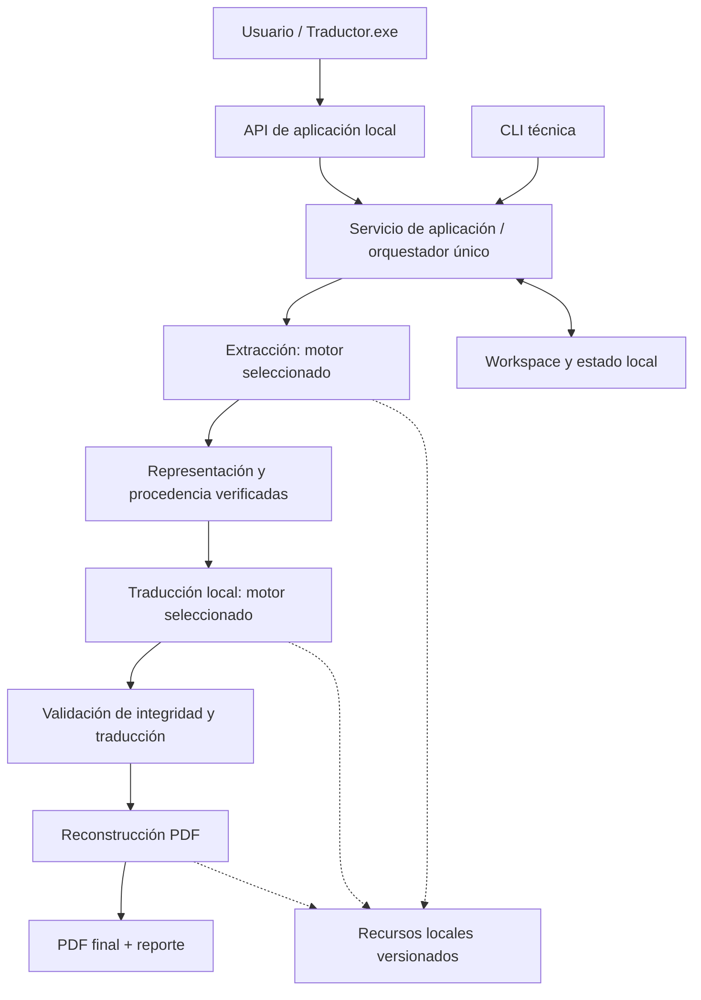

# Pipeline Professionalization — Investigación tecnológica y hoja de ruta experimental

| Metadato | Valor |
| --- | --- |
| Versión | 0.1.0 |
| Fecha de corte | 2026-11-26 |
| Naturaleza | Informe consolidado de investigación predecisional; propuesta de hoja de ruta |
| Estado | DRAFT — pendiente de revisión y autorización experimental del owner |
| Baseline de contraste | `main@3aee1bc0a4c1d17f4c668b46fa28745436bd0648` |
| Alcance | Traductor científico PDF→PDF, EN→ES, uso personal, un host, ejecución local |
| Autoridad | No es ADR Maestro, NADR, Execution Plan, Exit Review ni certificación; no autoriza implementación |
| Ubicación | `docs/architecture/adr/pipeline_professionalization/` |

## Resumen ejecutivo

El proyecto ha consolidado una arquitectura técnica de extremo a extremo, pero no ha acreditado aún su objetivo funcional: producir de forma repetible un PDF científico íntegro y fielmente traducido del inglés al español. La inversión adicional debe dirigirse primero a demostrar capacidad funcional con tecnologías existentes, en lugar de continuar construyendo infraestructura alrededor de motores cuya suficiencia no está demostrada.

El owner ha precisado tres condiciones determinantes: uso exclusivamente personal, independencia de servicios remotos y hardware fijo. No se busca comercialización, ni ampliar RAM a 64 GB, ni contratar servicios externos. La aplicación deseada podrá exponerse por una API local y utilizarse mediante un ejecutable sencillo.

La propuesta de esta investigación es evaluar separadamente **extracción documental** y **traducción especializada**, con herramientas disponibles localmente y sin cuotas externas; después componer únicamente los mejores candidatos y contrastar su salida PDF con una referencia externa completa. Se conserva la baseline Git, no la obligación de conservar toda su implementación. Si la evidencia justifica reemplazar o simplificar componentes, se propondrá la decisión arquitectónica correspondiente.

**Candidatos de primera evaluación:**
- Extracción: MiniCPM-OCR 1.0, PaddleOCR-VL 1.6, MinerU (backend local compatible), Docling y pdf-inspector. PyMuPDF como control histórico.
- Traducción: Hy-MT2 7B, Index-Translate 9B y TranslateGemma 12B cuantizados. Un traductor especializado ligero como control si aporta discriminación.
- Referencia de producto: BabelDOC / PDFMathTranslate-next, con traductor local y sin dependencia remota durante el ensayo.

La selección es de **candidatos**, no de ganadores. Se comenzará por las alternativas de mayor potencial de calidad realizables en el host. No existe aún un benchmark propio de estas herramientas. Un buen ranking público, una instalación correcta o una CI verde no equivalen a traducción científica conforme.

## 1. Contexto, alcance y autoridad

### 1.1. Punto de partida verificado

El [PR66](https://github.com/RDsanchez-git/translator_pdf/pull/66) integró G1–G5 mediante merge commit [3aee1bc](https://github.com/RDsanchez-git/translator_pdf/commit/3aee1bc0a4c1d17f4c668b46fa28745436bd0648). La comprobación Git posterior al merge confirmó que su árbol es idéntico al candidato `35ee09b913f1e3f1bf3523227979cc0d1e29bacf`, con padres `1d21cfe958cc1de8a33824fed748cd6fe9260f42` y el candidato. El árbol es `ea01a48afa8d33d8f3c791742caf0e5a863c1345`. La protección de main figura activa. La rama general se preservó.

El [PR95](https://github.com/RDsanchez-git/translator_pdf/pull/95) se mantiene abierto y Draft, sin merge, HEAD `00b27caa6b3d35a3a42808298646efe93bcc2b93`. Los incrementos G6 no forman parte de la baseline integrada. El contraejemplo focal de absorción de prosa traducible en una región protegida se observó con código `d9bddf98182020a77b4c59e09bed472eefaa0655` y PyMuPDF 1.27.2.3; los dos commits siguientes sólo modificaron los tres documentos LIVING. Se trata de una observación sintética atribuida al owner, no de una frecuencia medida sobre el corpus ni de un PDF final incorrectamente publicado.

Estado de partida: 25/30 Tasks integradas, 27/30 acumuladas incluyendo G6; son métricas de ejecución del plan, no porcentajes de calidad. PPPR suspendido, G6/W6.1 bloqueado, Exit Review NOT_RUN, DF-01 y DF-02 OPEN, 14 GAP P1 históricos OPEN, issue #34 OPEN, CV FAIL/DEFERRED por limitación histórica del corpus, PRODUCT_DISPATCH=BLOCKED, PRODUCT_READINESS=NOT_CERTIFIED, PERSONAL_ACCEPTANCE=NOT_EVALUATED. GF-01/02 RESOLVED en el checkpoint G6 preservado. No se alteran estados, criterios, oráculos, documentos FROZEN ni autorizaciones. El encabezado del Plan integrado describe el candidato en el momento premerge: para el hecho posterior de integración prevalece el acto Git verificado.

Fuentes internas: [Plan PPPR](../pdf-pdf-product-readiness/plans/PHASE_PPPR_EXECUTION_PLAN.md), [Findings Register](../pdf-pdf-product-readiness/reviews/FASE_PPPR_DEFERRED_FINDINGS_REGISTER.md), [Evidence Log](../pdf-pdf-product-readiness/reviews/FASE_PPPR_EXIT_REVIEW_EVIDENCE_LOG.md), [ADR Maestro PPPR](../pdf-pdf-product-readiness/ADR/ADR_PPPR_MASTER.md). Consultar el historial de PR95 para los resultados que no están materializados en main.

### 1.2. Motivación de la investigación

La dificultad no radica solamente en conectar componentes. Un PDF representa instrucciones de dibujo y texto posicionado, no necesariamente una estructura lógica recuperable sin ambigüedad. Los motores nativos pueden extraer texto correctamente y aun así equivocarse en la propiedad semántica de regiones; los modelos visuales pueden inferir estructuras útiles y aun así inventar o perder caracteres. La traducción remota generalista añade límites de ventana, cuotas y dependencia del proveedor sin garantizar calidad científica.

Gate 6 aporta conocimiento y componentes valiosos: AST tipado para activos vectoriales, aislamiento físico, compilación PDF vectorial, admisión y reservas G3, refinamiento de chunks, admisión científica R4–R6 y corrección bbox. Su no integración no invalida esos incrementos. La recuperación posterior de cualquiera requiere evaluación de autonomía y compatibilidad, no cherry-picks indiscriminados.

El problema que queremos resolver no es completar por inercia una lista de Tasks, sino obtener una herramienta útil bajo condiciones reales. Una prueba que rechaza explícitamente una entrada no es un éxito funcional; un PDF aparentemente correcto que pierde prosa es un fallo más grave.

### 1.3. Relación con la gobernanza existente

Se mantiene la autoridad de [PROJECT_SCOPE](../../PROJECT_SCOPE.md), [ENGINEERING_PRINCIPLES](../../ENGINEERING_PRINCIPLES.md) y [Metodología v1.3.0](../../1_METHODOLOGY_FOR_ORDERED_PIPELINE_CHANGES.md). El alcance actual incluye AST plano tipado, normalización, segmentación, passthrough, chunking, validación, ensamblado y prompting estructurado. Delega extracción a terceros y excluye entrenar OCR propio y cargar ML pesado dentro del core determinista.

La exploración compara también alternativas que podrían modificar esas decisiones. Tal cambio requeriría una propuesta sucesora explícita bajo la jerarquía de autoridad; no se deroga nada mediante este informe. Este artefacto único se conserva por petición expresa del owner como insumo durable para una futura decisión, no como nota descartable ni como matriz paralela. Aún no existe una fase de implementación aprobada llamada Pipeline Professionalization. La carpeta es organizativa.

La hoja de ruta de §8 es un protocolo de investigación propuesto, no un Execution Plan de implementación. Si se decide continuar, se seguirá la precedencia auditoría/evidencia → ADR de visión → NADR aplicable o sucesor cuando sea necesario → Execution Plan → código y verificaciones. Evitar documentos vacíos, gates ceremoniales o nuevas normas sin una necesidad demostrada.

## 2. Requisitos del producto y restricciones del host

### 2.1. Condiciones fijadas por el owner

| Condición | Interpretación para la investigación |
| --- | --- |
| Uso personal | No se diseña SaaS, facturación, autenticación multiusuario ni distribución comercial. |
| Local y gratuito | Sin pagos por llamada, límites de páginas o tokens impuestos por terceros; sí existen límites técnicos, energía y almacenamiento. |
| Autosuficiencia | Después del aprovisionamiento autorizado, ejecución con red externa bloqueada; ningún download, API externa, telemetría requerida o fallback remoto. |
| Calidad científica EN→ES | Traducción fiel, sin resúmenes, invenciones ni cambios de contenido STEM. |
| Aplicación utilizable | API local para desacoplar interfaz y motor; ejecutable de escritorio o lanzador sencillo. |
| Hardware fijo | No se contempla ampliación de RAM ni compra de GPU. |
| Objetividad | La calidad y la integridad preceden a la comodidad de integración; la viabilidad en el host es filtro obligatorio. |

Gratuito, descargable, código abierto y offline no son sinónimos. Se comprobará licencia del código, pesos, modelos auxiliares, binarios, fuentes y dependencias de la configuración elegida; las restricciones no comerciales y AGPL no excluyen por sí solas el uso personal. Acceso inicial gated, aceptación de licencia y descarga autorizada son distintos de dependencia remota durante inferencia. API de localhost no implica SaaS. Una instalación que sólo funciona gracias a una caché accidental o a red disponible no acredita independencia.

### 2.2. Hardware y presupuesto de recursos

Datos declarados por el owner mediante PowerShell y nvidia-smi el 26/11/2026:

| Recurso | Valor y consecuencia |
| --- | --- |
| CPU | Intel Core i5-10500H, 6 núcleos físicos / 12 hilos; CPU como ruta base. |
| RAM | 32 GB instalados; capacidad fija. Medir RAM disponible real y memoria comprometida. |
| GPU | NVIDIA GTX 1650 Max-Q, 4.096 MiB VRAM; Intel UHD integrada. Aceleración parcial opcional. |
| Driver | 610.88, CUDA UMD 13.3 reportada. No implica CUDA Toolkit instalado ni soporte de kernels BF16/FP8 o de cualquier versión de vLLM. |
| Disco C: | 41.427.001.344 bytes libres ≈ 41,43 GB decimales / 38,58 GiB. |
| Recuperación posible | Owner estima ~17 GB en imágenes Docker antiguas; ~58 GB libres sólo si se recupera realmente ese espacio. No es autorización para borrar. |
| Temperatura | Lectura puntual GPU 74 °C al 0%: medir carga sostenida, sin diagnosticar a partir de una muestra. |

La RAM del sistema no sustituye de forma transparente a la VRAM de una GPU. El offload parcial de llama.cpp es una opción, no un requisito; el motor debe poder funcionar en CPU si los kernels de la GPU no son compatibles. El presupuesto de memoria incluye pesos, KV cache, proyector visual, modelos auxiliares, activaciones, buffers y sistema operativo. No sumar VRAM y RAM como si fueran una única memoria sin coste.

Estrategia de recursos: instalación aislada por candidato, selección de un único backend y una única cuantización por prueba inicial, sin bajar repositorios completos de pesos; liberar extractor antes de cargar traductor; conservar artefactos de evidencia compactos fuera de Git. Antes de cualquier descarga calcular pico de disco (archivo final + descarga temporal/caché + venv/WSL/Docker + salidas + margen de sistema). Propuesta de reserva conservadora inicial: 10 GiB libres en C: durante preparación y ejecución, ajustable por owner antes de medir. Si no cabe, reducir el conjunto concurrente de instalaciones, no asumir ampliación. Evitar doble copia de modelos entre host y contenedor.

No ejecutar docker system prune indiscriminadamente. Antes de recuperar espacio inventariar imágenes, contenedores, volúmenes, bundles de Tectonic y recursos irreproducibles; eliminar sólo los objetos expresamente autorizados. Medir espacio después; preservar evidencias y workspace G6. No usar datos G6 desde G5 sin compatibilidad demostrada.

## 3. Método de investigación y estado del conocimiento

Fuentes: documentación oficial, repositorios públicos, model cards, archivos de pesos y licencia, benchmark OmniDocBench, publicaciones y issues. Para el encaje interno se inspeccionó el código del commit de baseline y para el antecedente G6 su evidencia histórica. El mapa generado PIPELINE_GRAPH es auxiliar descriptivo, no autoridad ni sustituto del código vigente.

Se distinguen tres niveles de evidencia:
1. **Documental:** proveedor publica capacidades, interfaz y condiciones; no demuestra funcionamiento en este host.
2. **Empírica aislada:** versión, configuración y recursos exactos reproducibles, comparados con un oráculo explícito.
3. **Composición:** documento completo procesado por la combinación seleccionada, con salida física evaluada y red bloqueada.

El presente informe sólo aporta nivel 1 sobre nuevas tecnologías y evidencia estática interna. No se descargaron pesos, instalaron runtimes, ejecutaron pruebas de candidatos ni enviaron documentos. Resultados históricos internos no se transfieren automáticamente a una nueva composición.

Orden de selección: disponibilidad local/licencia personal y viabilidad técnica → integridad y calidad semántica/STEM → consumo y tiempo reales → esfuerzo de adaptación. No se elige por cantidad de estrellas, novedad, tamaño del modelo o promedio del leaderboard. Se permiten resultados negativos e inconclusos; ningún promedio compensa una alteración crítica.

## 4. Línea E — extracción documental

### 4.1. Familias tecnológicas y qué aporta cada una

- **Nativa:** interpreta streams, fuentes, glifos, coordenadas y estructura física. Puede preservar identidad exacta del texto digital; no garantiza propiedad semántica ni OCR correcto en páginas escaneadas.
- **Visual/documental:** detecta layout y reconoce regiones mediante modelos especializados. Puede recuperar matemáticas y estructura que el parser nativo no interpreta; puede confundir símbolos, inventar texto o perder procedencia.
- **Híbrida:** explota evidencia nativa y visual. Se evaluará únicamente si una insuficiencia concreta de las soluciones individuales lo justifica, no como obligación de ejecutar varios modelos sobre toda página.

Nuestro contrato vigente preserva figuras, tablas complejas, ecuaciones y código conforme a su clasificación legítima; captions y prosa traducible mantienen obligación de traducción. No convertir automáticamente una ecuación reconocida a LaTeX en reemplazo de su original ni rasterizar todos los vectores para ocultar un problema. El reconocimiento puede servir como evidencia auxiliar, mientras el activo visual original se conserva si la política lo requiere. Las políticas para tablas simples, referencias, texto mixto y activos deben seguir el alcance normativo aplicable.

### 4.2. Candidatos principales

| ID | Motor y versión objeto de estudio | Local/licencia declarada | Salida e integración | Principal hipótesis y riesgo |
| --- | --- | --- | --- | --- |
| E1 | [MiniCPM-OCR 1.0](https://github.com/OpenBMB/MiniCPM-OCR) (1.3B, octubre 2026) | Apache-2.0; [GGUF](https://huggingface.co/openbmb/MiniCPM-OCR-1.0-gguf), layout CPU y reconocimiento por servicio local | SDK Python, JSON/Markdown, detección de regiones, tablas HTML y fórmulas LaTeX | Calidad matemática y tamaño viable; verificar cajas, activos, cobertura, uso real de CPU y dependencias del proyector. |
| E2 | [PaddleOCR-VL 1.6](https://huggingface.co/PaddlePaddle/PaddleOCR-VL-1.6) (0.9B) | Apache-2.0; [tutorial oficial](https://www.paddleocr.ai/main/en/version3.x/pipeline_usage/PaddleOCR-VL.html) con CPU x64 | SDK/CLI, resultados estructurados, layout, tablas, fórmulas | Alto potencial; medir versión CPU exacta, recursos auxiliares, dependencias Windows/Linux. |
| E3 | [MinerU](https://github.com/opendatalab/MinerU), familia 2.5 Pro | Uso personal local; licencia propia basada en Apache con condiciones adicionales; [licencia vigente](https://github.com/opendatalab/MinerU/blob/master/LICENSE.md) a verificar en revisión instalada | JSON/Markdown, regiones y activos; biblioteca/proceso | Alto potencial documental; CPU depende de backend. No atribuir puntuación VLM 2.5 Pro al pipeline CPU distinto. |
| E4 | [Docling](https://github.com/docling-project/docling) | Código MIT, pesos auxiliares según configuración; [offline documentado](https://docling-project.github.io/docling/usage/advanced_options/) | DoclingDocument, JSON, procedencia y representación de tablas; SDK | Interfaz semántica rica, parser nativo/híbrido. Revisar origen de coordenadas, contenido vectorial y políticas de exportación. |
| E5 | [pdf-inspector](https://github.com/firecrawl/pdf-inspector) | MIT, motor Rust local; OCR local opcional | Python, CLI, coordenadas, fuentes, páginas, tablas, Markdown | Control nativo fuerte y rápido, posible sustitución de capa física/textual. No acredita reconocimiento científico avanzado ni aislamiento vectorial. |
| E0 | PyMuPDF (baseline) | AGPL/comercial; local | Adaptador existente | Control de referencia, incluyendo rechazo explícito de vectores no representados. |

**E1.** El SDK de MiniCPM-OCR convierte páginas a imágenes, detecta layout y reconoce regiones. El reconocimiento puede servirse mediante llama.cpp/Ollama locales; el ejemplo oficial usa PP-DocLayoutV3, proyector visual y contexto 8192. Ver [guía de modelo](https://github.com/OpenBMB/MiniCPM-OCR/blob/main/docs/minicpm_ocr_1dot0_en.md) y [despliegue llama.cpp](https://github.com/OpenBMB/MiniCPM-OCR/blob/main/docs/llamacpp_deploy.md). El archivo Q8 principal de la investigación anterior (~0,81 GB) excluye proyector, layout, runtime y caché. El evaluador auxiliar MiniCPM-OCR Jev puede investigar errores, no certificarlos por sí solo. No instalar la suite completa de extras sin comprobar necesidad y espacio.

**E2.** PaddleOCR-VL y PP-StructureV3 pertenecen al ecosistema PaddleOCR; no son la misma configuración. Probar el modelo 1.6 con el backend de CPU soportado y confirmar versión efectiva de todos los modelos. No usar una imagen GPU de 10–15 GB si existe ruta CPU más liviana. Verificar explícitamente que la API/SDK representa el pipeline completo y no sólo el servicio VLM.

**E3.** MinerU ofrece diversos modos; su backend pipeline y su modalidad VLM pueden tener capacidades, requisitos y resultados diferentes. Seleccionar el mejor modo realmente realizable en CPU o GPU de 4 GB, con modelos locales y sin llamadas remotas. Si el modo 2.5 Pro no es viable, registrar ese hecho; una prueba de otro backend no es prueba del modelo de leaderboard.

**E4.** Docling documenta prefetch de modelos y uso offline. [docling-parse](https://github.com/docling-project/docling-parse) es una alternativa de parser nativo con licencia MIT. La salida nativa debe estudiarse antes de mapearla al modelo de dominio existente. Etiquetas desconocidas, múltiples procedencias, captions y tablas requieren evidencia, no conversión automática a párrafo.

**E5.** pdf-inspector expone [API Python](https://github.com/firecrawl/pdf-inspector/blob/main/docs/python.md) y [runtime OCR](https://github.com/firecrawl/pdf-inspector/blob/main/docs/ocr-runtime.md). El motor ofrece detección de PDF digital/escaneado/mixto, texto posicionado, detección de codificación rota y OCR selectivo PP-OCRv6 Small con PDFium y ONNX Runtime externos a la instalación base. `offline=True` con modelos locales es la vía documentada; una recomendación de servicio hospedado no debe activar dicho servicio. El muestreo de ocho páginas por defecto es inadecuado como prueba de cobertura completa: verificar página a página. Su Markdown puede filtrar paginación, recombinar texto o normalizar caracteres, por lo que la evidencia de procedencia/elementos posicionados interesa más que una exportación Markdown sola.

### 4.3. Evidencia comparativa publicada

[OmniDocBench](https://github.com/opendatalab/OmniDocBench), tabla end-to-end v1.6_full consultada el 26/11/2026 (el repositorio también anuncia v1.7), mide la extracción de páginas hacia Markdown. Overall promedia exactitud de texto a partir de distancia de edición, TEDS de tablas y CDM de fórmulas. Read Order Edit es una métrica distinta que no integra directamente ese promedio. Los valores ↑ son mejores cuanto más altos; ↓ cuanto más bajos. No son porcentajes de PDFs traducidos con éxito.

| Modelo | Overall ↑ | Texto edit ↓ | Fórmula CDM ↑ | Tabla TEDS ↑ | Orden edit ↓ |
| --- | ---: | ---: | ---: | ---: | ---: |
| Sangfor-OCR | 97.12 | 0.0288 | 98.59 | 95.65 | 0.1174 |
| Youtu-Parsing Omni | 97.11 | 0.0260 | 96.84 | 97.13 | 0.1100 |
| OXR 1.0 | 97.03 | 0.0244 | 96.93 | 96.61 | 0.1216 |
| TeleOCR | 96.91 | 0.0267 | 96.59 | 96.82 | 0.1184 |
| OvisOCR3 | 96.6861 | 0.025846 | 97.66 | 94.99 | 0.1133 |
| OvisOCR2 | 96.47 | 0.0265 | 97.49 | 94.58 | 0.1120 |
| MiniCPM-OCR 1.0 | 96.44 | 0.0316 | 98.08 | 94.40 | 0.1269 |
| PaddleOCR-VL 1.6 | 96.34 | 0.0326 | 97.53 | 94.76 | 0.1278 |
| MinerU2.5-Pro | 95.75 | 0.0360 | 97.45 | 93.42 | 0.1200 |
| GLM-OCR | 95.22 | 0.0440 | 97.18 | 92.83 | 0.1330 |

Datos redondeados de la tabla pública; la diferencia de décimas no es significancia estadística demostrada. No se han reproducido. No garantizan extracción fiel del vector original, ni ausencia de prosa omitida, ni resultados en Windows con CPU, ni rendimiento de una variante cuantizada. MiniCPM-OCR informa cifras de throughput medidas en RTX 5090; no proyectarlas al i5-10500H.

Para parsers nativos, [pdf-inspector](https://github.com/firecrawl/pdf-inspector#benchmark) publica otro ensayo sobre [opendataloader-bench](https://github.com/opendataloader-project/opendataloader-bench) (200 PDFs, OCR desactivado, M4 Pro, resultados del 31/07/2026). Overall: pdf-inspector 0.875, LiteParse 0.873, OpenDataLoader 0.831, PyMuPDF4LLM 0.735, MarkItDown 0.589. Table TEDS: 0.814 frente a 0.401 de PyMuPDF4LLM. Es comparación del desarrollador con versiones declaradas, no frente al adaptador propio ni al leaderboard anterior. Los resultados publicados tienen [rama reproducible](https://github.com/firecrawl/opendataloader-bench/tree/abi/pdf-parser-benchmark-results). Usarlos para justificar una sonda, no declarar un ganador.

### 4.4. Reserva tecnológica y exclusiones iniciales

| Alternativa | Motivo de interés | Disposición |
| --- | --- | --- |
| [MiniCPM-V 4.7](https://github.com/OpenBMB/MiniCPM-V) | Modelo visual generalista, 1B y MoE 35B-A3B, GGUF y Apache-2.0 | No priorizar sobre su variante OCR especializada; 3B activos no significan que sólo se almacenan 3B. |
| [OXR 1.0](https://github.com/SoMarkAI/OXR) | Reconocimiento de fórmulas, química, código, tablas y coordenadas; licencia personal/no comercial | Reserva de alta calidad; despliegue GPU/vLLM específico, CPU/4 GB no acreditados. |
| [Youtu-Parsing Omni](https://huggingface.co/tencent/Youtu-Parsing-Omni) | 5B, tablas y orden excelentes en benchmark | Reserva; comprobar backend, memoria y licencia de pesos antes de descargar. |
| [TeleOCR](https://huggingface.co/XingChen-AGI/TeleOCR) | 1.2B y alto score | Cribado documental de compatibilidad CPU, licencia exacta y SDK; promover si es viable. |
| OvisOCR3 / OvisOCR2 | Modelos compactos de alto rendimiento publicado | Cribado de disponibilidad, pesos, interfaz, licencia y backend local; no ignorarlos por novedad. |
| Sangfor-OCR | Mayor puntuación de la tabla consultada | Disponibilidad de pesos y ejecución local no confirmadas; no seleccionar sólo por ranking. |
| [GLM-OCR](https://github.com/zai-org/GLM-OCR) | Reconocimiento visual especializado | Reserva, evaluar si cubre una limitación específica. |
| [Marker](https://github.com/datalab-to/marker) | Conversión estructurada, tablas y matemáticas | Reserva; condiciones de pesos y consumo deben verificarse. |
| [olmOCR](https://github.com/allenai/olmocr) | Extracción visual linealizada | Reserva por recursos y necesidad de salida posicionada. |
| [GROBID](https://github.com/grobidOrg/grobid) | Estructura académica y XML/TEI | Complementario, no extractor PDF universal. |
| LiteParse / OpenDataLoader | Controles nativos competitivos | Reserva si E5/E0 dejan duda material; no descargar por duplicar comparaciones. |

La primera criba de reservas es de documentación, no una campaña de instalaciones. Si aparece un candidato superior con ruta viable demostrable, promoverlo antes de fijar la matriz empírica. Una vez congelado el conjunto experimental, cualquier ampliación se justifica por una incertidumbre discriminante, no por perseguir rankings diarios.

## 5. Línea T — traducción especializada local

### 5.1. Candidatos

| ID | Modelo | Licencia de pesos declarada | Ruta local | Hipótesis y límite |
| --- | --- | --- | --- | --- |
| T1 | [Hy-MT2 7B](https://huggingface.co/tencent/Hy-MT2-7B-GGUF) | Apache-2.0 | GGUF / llama.cpp | Traducción especializada multilingüe; Q8 inicial por calidad si cabe. |
| T2 | [Index-Translate 9B](https://huggingface.co/IndexTeam/Index-Translate-9B-GGUF) | Apache-2.0 | GGUF / llama.cpp | Instrucciones de traducción, terminología y formato; medir conservación de invariantes. |
| T3 | [TranslateGemma 12B](https://huggingface.co/google/translategemma-12b-it) | Gemma; condiciones de acceso/uso | Transformers local; variante GGUF compatible a validar | Especializado multilingüe; verificar plantilla nativa de traducción, conversión, revisión y soporte exactos del backend. |
| T0 | [MarianMT EN→ES](https://huggingface.co/Helsinki-NLP/opus-mt-en-es) o [MADLAD-400 3B](https://huggingface.co/google/madlad400-3b-mt) | Apache-2.0 declarada | Transformers/CTranslate2 según arquitectura | Control ligero independiente si permite discriminar mejora o si la velocidad de T1–T3 resulta insuficiente. |

Hy-MT2 tiene además una variante 1.8B; Index-Translate una variante 2B; TranslateGemma 4B. Son opciones de rendimiento o control, no sustitutos cuya calidad se deba presuponer. [Argos Translate](https://github.com/argosopentech/argos-translate) y [NLLB-200](https://huggingface.co/facebook/nllb-200-distilled-600M) (CC BY-NC 4.0 en el checkpoint indicado) quedan como alternativas secundarias. Los modelos 27B/30B/35B cuantizados no se incluyen en la primera ronda con 32 GB fijos; tamaño teórico de pesos no demuestra viabilidad ni latencia. Tampoco se solicita ampliar hardware.

Fuentes: [Hy-MT2 model card](https://huggingface.co/tencent/Hy-MT2-7B), [archivos oficiales GGUF](https://huggingface.co/tencent/Hy-MT2-7B-GGUF/tree/main), [Index-Translate repo](https://github.com/bilibili/Index-Translate), [archivos GGUF](https://huggingface.co/IndexTeam/Index-Translate-9B-GGUF/tree/main), [TranslateGemma card](https://huggingface.co/google/translategemma-12b-it). Los resultados publicados por desarrolladores no constituyen una comparación propia EN→ES científica.

### 5.2. Dimensionamiento inicial y backend

| Modelo | Peso de referencia (GB decimales) | Observación |
| --- | ---: | --- |
| Hy-MT2 7B Q4_K_M | ~4.62 | Posible variante de rendimiento |
| Hy-MT2 7B Q8_0 | ~7.98 | Preferida para iniciar si cabe |
| Index-Translate 9B Q8_0 | ~9.79 | Preferida para iniciar si cabe |
| TranslateGemma 12B Q8 | ~13 (estimación) | Verificar archivo, licencia, procedencia y compatibilidad antes de descargar |

Son tamaños de archivo declarados o estimaciones, no RAM medida. La cuantización concreta se registra; Q8 no equivale a precisión completa. Seleccionar Q6/Q4 sólo mediante decisión previa o tras un límite observado; repetir un subconjunto idéntico para cuantificar degradación. No comparar un resultado de T1 Q8 con una configuración publicada distinta sin explicitarlo. No descargar todos los formatos a la vez.

[llama.cpp](https://github.com/ggml-org/llama.cpp), MIT, es el backend inicial de investigación para GGUF por su ejecución CPU y descarga parcial de capas a GPU. Usar binario/compilación compatible con el hardware, modelo local y plantilla del checkpoint. La API compatible con OpenAI es un transporte, no garantía de equivalencia semántica con Groq. [Ollama](https://github.com/ollama/ollama) es opción de operación local más simple si ofrece control suficiente sobre artefacto y plantilla. [CTranslate2](https://github.com/OpenNMT/CTranslate2) es opción para modelos encoder-decoder compatibles; no asumir soporte para cualquier arquitectura. No mantener tres motores instalados sin necesidad.

Fijar versión real del modelo, SHA-256 del archivo, conversión/quant, tokenizer, plantilla, idioma de destino, parámetros de generación, ventana, límite de salida, threads, capas GPU y configuración. Una prueba repetida puede variar incluso con seed y temperature bajas; medir, no prometer determinismo absoluto.

### 5.3. Implicaciones semánticas

Un traductor especializado debe recibir la unidad que su interfaz nativa espera. No forzar automáticamente nuestros prompts históricos de salida JSON; comparar con una estrategia nativa de texto contextual y, si hace falta, un contrato de respuesta estructurado por unidad. El identificador de segmento se asigna externamente; no pedir al modelo que invente identidad. No usar al mismo modelo como árbitro único de su calidad.

Proteger fórmulas, código e identificadores mediante una política de passthrough o marcadores comprobables; verificar correspondencia, multiplicidad, orden permitido y restitución. Un marcador perdido o duplicado es error, no licencia para reconstruir arbitrariamente. Medir terminología entre unidades, negaciones, modales, unidades, números, decimales, signos y referencias. Si se requiere chunking, derivarlo del tokenizer y límite efectivo de la configuración local, no de límites Groq heredados. Las llamadas locales eliminan cuotas externas, no la obligación de limitar memoria, tiempo y tamaño de entrada.

## 6. Referencia completa PDF→PDF y alternativas de arquitectura

### 6.1. Herramientas integrales investigadas

| Proyecto | Enfoque | Disposición |
| --- | --- | --- |
| [BabelDOC](https://github.com/funstory-ai/BabelDOC) | AGPL-3.0; IR física/semántica, traducción, recomposición PDF; [documentación](https://funstory-ai.github.io/BabelDOC/), [paper ACL 2026](https://aclanthology.org/2026.acl-demo.25/) | Referencia completa prioritaria con traductor local y recursos offline. |
| [PDFMathTranslate](https://github.com/PDFMathTranslate/PDFMathTranslate) / [next](https://github.com/PDFMathTranslate/PDFMathTranslate-next) | AGPL-3.0; CLI/GUI de traducción científica; next utiliza BabelDOC | Facilita ensayos, no contar next y BabelDOC como extractores independientes. |
| [PDF Craft](https://github.com/oomol-lab/pdf-craft) | MIT; conversión, OCR y traducción de libros/documentos | Reserva para limitaciones concretas, validar dependencia del traductor. |
| [RetainPDF](https://github.com/wxyhgk/retain-pdf) | MIT; traducción y retención de formato | Reserva; operación completamente offline no acreditada. |

BabelDOC reporta representación intermedia y recursos offline. Hay reportes públicos de pérdida de contenido y problemas de ajuste de prosa con fórmulas ([#615](https://github.com/funstory-ai/BabelDOC/issues/615), [#620](https://github.com/funstory-ai/BabelDOC/issues/620)). No se han reproducido ni se afirma que persistan en toda versión. Son casos para el protocolo de evaluación, no motivo automático de exclusión. No afirmar que Hy-MT2 funciona con su prompting simplemente por compartir endpoint OpenAI-compatible; validar respuesta real.

### 6.2. Estrategias comparadas

| Estrategia | Ventaja | Coste / incertidumbre |
| --- | --- | --- |
| A — Adoptar motor PDF→PDF completo | Menos mantenimiento propio; salida temprana de referencia | Control semántico, fidelidad STEM, compatibilidad de modelo y diagnóstico. |
| B — Sustituir extracción e inferencia en pipeline propio | Reutiliza fronteras, compilador y controles existentes | Adaptación de IR, contratos y estado; riesgo de mantener complejidad innecesaria. |
| C — Simplificar profundamente | Reusar IR de terceros y responsabilidades mínimas necesarias | Rediseño normativo, migración de identidades, posible sustitución del compilador. |

El owner ha mostrado interés en B para su herramienta personal. Es hipótesis preferente de integración, no obligación de salvar todo el código. Se conserva A como comparación funcional y C como opción si demuestra ventaja. No adoptar un nuevo conjunto de tecnologías sólo por estar disponibles. Seleccionar con la menor complejidad compatible con la calidad y las restricciones.

## 7. Encaje técnico con la baseline y arquitectura objetivo hipotética

### 7.1. Ruta existente

El [Atlas D-1/D-2](../pipeline-stabilization/handoff/ATLAS_RUTA_OPERATIVA_UNICA_PDF_PDF.md) y [Evidencia y cierre](../pipeline-stabilization/handoff/EVIDENCIA_Y_CIERRE.md) describen la ruta lógica única CLI → OCR → G3 → G5 → PDF. El término OCR Router no implica que todas las páginas se rastericen ni que todo extractor sea OCR. La ruta foreground del producto reutiliza los mismos componentes, no una segunda ruta de traducción. PPPR fortaleció contratos dentro de esa topología.

| Frontera, inspeccionada en la baseline | Consecuencia |
| --- | --- |
| [core/extraction/provider.py](../../../../core/extraction/provider.py) | ExtractionProvider.extract(pdf_path) devuelve DocumentLayout. Puerto apropiado, no compatibilidad automática. |
| [apps/bootstrap/provider_factory.py](../../../../apps/bootstrap/provider_factory.py) | Sólo PyMuPDF habilitado actualmente; Docling existe pero no es seleccionable sin cambio. |
| [infra/extraction/providers/docling_provider.py](../../../../infra/extraction/providers/docling_provider.py) | Adaptador existente reduce etiquetas desconocidas a PARAGRAPH con warning; no constituye prueba de calidad de Docling ni mapeo suficiente. |
| [apps/bootstrap/pipeline_factory.py](../../../../apps/bootstrap/pipeline_factory.py) y [core/layout/models.py](../../../../core/layout/models.py) | Conversión DocumentLayout → borrador → AST; revisar si pierde procedencia, geometría o tipos ricos. |
| [apps/llm_workers/adapters.py](../../../../apps/llm_workers/adapters.py) | translate(PromptEnvelope) → InferenceResult; posible frontera, no garantía de que un modelo especializado satisfaga el dialecto actual. |
| [apps/bootstrap/provider_stack_factory.py](../../../../apps/bootstrap/provider_stack_factory.py) y [runtime/engine.py](../../../../runtime/engine.py) | Composición con Groq, scopes y barreras explícitas; el runtime integrado mantiene configuración histórica llama3-70b-8192 y bloqueo productivo. No habilitar un endpoint local fingiendo ser un scope de laboratorio. |
| [apps/cli/pdf_product.py](../../../../apps/cli/pdf_product.py) | Orquestación foreground OCR→G3→G5 con preflight y recuperación; candidato a servicio de aplicación compartido. |
| [apps/api/server.py](../../../../apps/api/server.py) | Archivo existente vacío en el checkpoint inspeccionado; no constituye API implementada ni validada. |

Los extractores y traductores seleccionados disponen de interfaces programáticas (SDK, bindings o proceso/servicio local). Por tanto son integrables a nivel de invocación; la compatibilidad semántica, física y operacional aún no se acredita.

La traducción de formatos debe permanecer en infraestructura/adaptadores; los modelos pesados no ingresan al core. Mantener functional core, imperative shell, DTOs inmutables, instanciación explícita, OCP y trazabilidad. Si se conserva el AST, el mapping tendrá que ser total respecto del alcance admitido o rechazar explícitamente lo no representable. Si se reemplaza, se debe preservar su responsabilidad real mediante una decisión sucesora y compatibilidad de persistencia.

### 7.2. Arquitectura de producto local (hipótesis, no implementación)

El dibujo expresa dependencias lógicas, no exige microservicios ni un proceso separado para cada bloque. Cargar modelos de forma secuencial en este host. CLI y API deben reutilizar la misma operación de aplicación y sus contratos, no duplicar la lógica del pipeline. El almacenamiento de recursos incluye pesos, tokenizer, proyector, layout, binarios, fuentes y bundle Tectonic si se conserva; las referencias identifican versiones y hashes.

La aplicación es un nodo personal. No se necesitan Redis, Celery, Kubernetes, autenticación multiusuario, billing, proveedores externos, service discovery ni múltiples backends simultáneos por defecto. SQLite y controles de recuperación existentes pueden conservarse donde resuelven un problema medido; no convertir la ausencia de cuotas externas en ausencia de límites locales.

### 7.3. API y ejecutable: propuesta de responsabilidades

[FastAPI](https://github.com/fastapi/fastapi) (MIT) es candidato, no selección aprobada. API ligada a loopback (127.0.0.1), sin exposición LAN/internet por defecto. Puede utilizarse un único proceso local con worker secuencial, o un proceso separado para aislar dependencias y liberar memoria. El protocolo interno llama.cpp es independiente del contrato de producto. Una aplicación gráfica o web local puede lanzarlo y consumirlo.

Contrato conceptual mínimo, a definir tras elegir el motor:

| Operación hipotética | Semántica |
| --- | --- |
| POST /v1/jobs | Admitir un PDF y dirección EN→ES; validar tipo/tamaño/recursos, retornar job_id y estado. |
| GET /v1/jobs/{id} | Progreso, etapa, errores atribuibles y estado terminal. |
| GET /v1/jobs/{id}/result | Entregar PDF sólo tras validación/publicación final; diagnóstico separado si incompleto. |
| Cancelación (si la necesidad se acredita) | Solicitud explícita, sin fingir que un trabajo en curso fue cancelado antes de confirmarlo. |
| GET /health | Estado local y disponibilidad de recursos, sin contactar servidores externos. |

Evitar estados paralelos que contradigan la FSM real: mapear la vista API a estados durables. Identidad de documento y generación separadas; no reutilizar salida o receipt bajo cambios de extractor, traductor, tokenizer, configuración o formato de IR. Reintentos idempotentes cuando corresponda y publicación atómica; no exponer un archivo parcial como resultado correcto. Límites de admisión, concurrencia inicialmente 1 y manejo de disco lleno. Sanitizar nombres/rutas y verificar que sólo se lea/escriba dentro del workspace autorizado. No aceptar rutas arbitrarias o URL remotas del usuario como operación de red implícita. No registrar texto privado innecesario; loopback no equivale a autenticación, por lo que revisar CSRF/origin/host o token local según el frontend y threat model. No introducir servicios distribuidos para resolverlo.

Empaquetado hipotético: instalador/lanzador Windows con ejecutable ligero, runtime, directorio de modelos y recursos, workspace separado y licencias. No incrustar gigabytes en un único .exe por principio. Definir forma de empaquetado sólo cuando el núcleo PDF→PDF funcione. El usuario abre la herramienta, elige PDF, traduce y obtiene salida legible y diagnóstico claro; la complejidad de los motores queda encapsulada.

## 8. Hoja de ruta experimental propuesta

El objetivo es **decidir una composición funcional**, no acumular infraestructura experimental. Se permiten dos líneas independientes E y T; su ejecución en este host será secuencial por recursos. No condicionar la investigación de traducción al éxito de extracción ni viceversa. No repetir PPPR ni intentar cerrar DF-01/02 como prerrequisito de una evaluación externa. Las siguientes etapas son deliberadamente acotadas y requieren autorización de aprovisionamiento/ensayo antes de ejecutarse.

### R0 — Preparación y criba (antes de instalar)

1. Inventariar recursos reales del host, espacio, temperaturas, versión de Windows/Python, CPU backend, driver, dependencias y aislamiento. Confirmar si Windows nativo o WSL es la ruta mínima por candidato; WSL/Docker también consumen disco y RAM. No dar por instalado un toolkit CUDA por nvidia-smi.
2. Completar la criba documental de reservas de §4.4 (en particular OvisOCR3, TeleOCR, Youtu y OXR), confirmar modelo y ruta local, licencia personal, binario y tamaños. Promover sólo si supera filtros y hay expectativa de calidad diferenciada.
3. Elegir y registrar los casos de prueba, referencias, propiedades y criterio de calidad antes de ver resultados. Reusar corpus de regresión PPPR permitido, no etiquetarlo como holdout; corpus faltante continúa faltante. No descargar ni enviar archivos privados automáticamente. Reservar ejemplos no usados para ajustes si existen y hay autorización; registrar cuando no haya independencia.
4. Proponer manifiesto de recursos por candidato y cuantización inicial, límites de tiempo, memoria y espacio aceptables para uso personal. El owner decide el tiempo tolerable de traducción (p. ej., por artículo/libro) antes de elegir por rendimiento; no fijarlo por conveniencia después de medir. Aprovisionamiento online separado de ejecución offline.

**Salida:** matriz finita de candidatos, casos, versiones, recursos, presupuestos y permisos; sin código productivo. Si falta permiso o una variante local viable, registrar bloqueo y continuar con otro candidato autorizado.

### R1 — Evaluar extracción (línea E)

**Matriz inicial:** E1, E2, E3, E4, E5 contra E0, sujetos a R0. Primera ronda en ese orden provisional, con promoción fundada de reservas antes de fijar el conjunto. E0 se usa como control, no para declarar calidad por coincidencia con el parser histórico.

**Casos propuestos:** seleccionar una muestra pequeña estratificada de páginas y documentos completos permitidos: prosa digital sencilla y multicolumna, ecuaciones inline y display, figuras vectoriales con caption separado, tablas simples y complejas, prosa junto a regiones protegidas, glyphs/símbolos problemáticos, página escaneada/mixta si está dentro del alcance admitido, notas y continuidad entre páginas. Incluir un positivo de región protegida legítima y el contraejemplo DF-01 de propiedad semántica; incluir el caso DF-02 de delimitador matemático o equivalente con referencia física. No inventar referencias desconocidas.

**Protocolo:** mismo PDF SHA-256 y páginas para todos; capturar la salida nativa estructurada, texto, región/página, coordenadas con unidad y origen, rotación, reading order, labels, avisos, activo o recorte y relaciones caption; no pasar por el AST propio en esta etapa. Conservar artefactos originales para comparar sin transformar su evidencia. Etiquetar los casos no soportados como rechazo explícito, no omitirlos de la denominación.

**Métricas:**
- Cobertura de contenido: cantidad de regiones y unidades de referencia representadas, separando traducibles/protegidas/ambiguas; omisiones, duplicados e invenciones por caso y severidad. Comprobar bidireccionalmente fuente→salida y salida→fuente.
- Texto digital: CER/WER o distancia de edición con normalización declarada (no normalizar silenciosamente diferencias significativas STEM); texto escaneado: usar transcripción de referencia autorizada.
- Orden de lectura: pares de orden esperados respetados, inversión de columnas, continuidad y correspondencia de captions; si existe orden ambiguo, documentarlo.
- Matemática y tablas: correspondencia de símbolos/estructura, números, unidades, celdas y asociaciones; exactitud LaTeX/CDM/TEDS como auxiliares cuando haya referencia suficiente; no convertir puntuación estructural en garantía de literalidad.
- Procedencia y visual: vínculo por página/caja/región, contexto de figura y caption, recuperación de contenido original; IoU u otra métrica geométrica si hay anotación, más revisión física. Pixel match no es propiedad semántica.
- Operación: tiempo por página/documento, cold/warm, memoria RSS/commit máxima de árbol de procesos, pico VRAM, espacio instalado/temporal, error/truncamiento/timeout y estado de red.

**Falsador material:** admitir prosa traducible como passthrough sin representación traducible, perder/inventar contenido significativo, intercambiar orden científico o asociar una figura incorrectamente. Rechazar explícitamente preserva integridad, pero reduce cobertura funcional. Una puntuación promedio alta no compensa ese falsador.

**Salida:** ranking por calidad y cobertura, errores atribuibles, viabilidad local y selección de un candidato principal más un alternativo sólo si tiene una ventaja material complementaria. No construir adaptadores para mejorar una salida mala durante la comparación.

### R2 — Evaluar traducción (línea T)

**Matriz:** T1, T2, T3; control ligero T0 si se justifica. Usar el mejor formato nativo que permita el mismo objetivo de traducción y el presupuesto fijo. Registrar variante/quant/plantilla. Evaluar los tres sobre el mismo texto fuente verificado, sin depender de cuál extractor gane R1.

**Casos propuestos:** fragmentos científicos con traducción humana de referencia permitida cuando exista; negación/modalidad, causalidad/correlación, cantidades, unidades y signos, terminología, símbolos griegos, expresiones inline, código, identificadores, citas y continuidad entre párrafos. Ejemplos de instrucciones maliciosas embebidas en texto fuente se tratan como datos y se traducen, nunca como instrucciones del sistema. Incluir textos de extensión creciente hasta una unidad realista, sin truncar en silencio. Definir marcadores de contenido protegido y sus expectativas antes de ejecutar.

**Protocolo:** misma entrada lógica, idioma destino y referencias; identidad de unidad externa, traducción nativa sin imponer JSON arbitrario en la primera comparación, configuración fija, captura de salida completa y causa de finalización. Evaluar por unidad y por documento/contexto cuando corresponda. Una única pasada de comparación con repetición corta de caso material si se necesita discriminar inestabilidad; una variación de quant o segmentación sólo si una hipótesis concreta lo requiere. No usar el conjunto de comprobación final para ajustar prompts.

**Métricas:**
- Fidelidad semántica: revisión bilingüe de adecuación y fluidez, omisiones/adiciones, negaciones, modalidad, sentido causal, errores de terminología, gramática. Usar errores críticos/mayores/menores con justificación y unidad identificada; no una impresión global.
- STEM: igualdad de identificadores, expresiones protegidas, cantidad/multiplicidad de marcadores, signos, números y unidades (equivalencias de formato explícitamente aceptadas); no permitir traducción de código ni inferir que un cambio es equivalente por similitud textual.
- Consistencia entre unidades y ausencia de salida ajena a la traducción (comentarios, resúmenes, instrucciones obedecidas).
- Métricas automáticas chrF/COMET/BLEU u otras sólo si referencia y recursos autorizados lo permiten; no descargar otro modelo evaluador por defecto ni sustituir revisión científica con una puntuación. Preferir revisión ciega o anonimizada respecto del modelo; si no es posible, registrar limitación.
- Tiempo por unidad/documento, tokens de entrada/salida cuando se midan con tokenizer adecuado, memoria de pico, errores de contexto, truncamientos, RAM/VRAM y coste de espacio. No extrapolar tokens/s aislados como tiempo de un libro sin medir un documento completo.

**Falsadores:** cambio de significado científico, alteración material STEM, contenido omitido o inventado, marcadores perdidos/duplicados, truncamiento presentado como éxito. Un rechazo detectado cuenta contra cobertura; un resultado no revisable queda inconcluso. El owner no se presume experto de todas las disciplinas: delimitar competencia y no atribuir certificación científica por aceptación personal.

**Salida:** traductor principal y, sólo si aporta valor demostrado, alternativa. Si ninguno alcanza calidad suficiente en el host, informar resultado negativo; no elegir el menos malo como si hubiera pasado.

### R3 — Composición mínima y comparación PDF→PDF

Con E* y T* elegidos por evidencia, procesar un documento completo representativo y después un documento de confirmación distinto que no haya sido utilizado para elegir ajustes, si es posible. No multiplicar 5 extractores por 3 modelos. Usar como máximo el ganador y una alternativa motivada en la frontera donde aparezca una insuficiencia. Comparar con BabelDOC/PDFMathTranslate-next utilizando el mismo traductor local si admite su protocolo y el mismo PDF, o declarar la diferencia de modelo; no forzar compatibilidad inexistente.

Primero validar si una salida nativa puede consumirse por G5 sin perder contenido. Si requiere ajuste, documentar el contrato mínimo y falsador; no implementar un adaptador productivo sin la autorización/gobernanza posterior. Ensayo externo de composición o testigo descartable autorizado no equivale a reabrir dispatch de PPPR. Conservar los PDF resultantes y su identidad, examinar texto extraído de salida, inspección física y linaje, cobertura de páginas, imágenes, regiones, fórmulas, tablas, captions, jerarquía, fuentes, solapamientos, legibilidad, overflow y páginas omitidas. No exigir número de páginas idéntico si el español necesita reflujo; exigir correspondencia y legibilidad.

**Éxito de investigación:** al menos una combinación realiza el recorrido local de PDF completo y satisface los criterios predefinidos en el alcance de prueba. La certificación o ampliación del alcance queda separada. Si no hay combinación viable, aislar la frontera dominante, conservar resultados y emitir decisión negativa/inconclusa antes de ampliar alcance.

### R4 — Decisión arquitectónica

Comparar A/B/C por calidad de resultado completo, cobertura admitida, recursos, mantenimiento, capacidad de observar errores y cantidad de código propio estrictamente necesaria. Distinguir qué capacidades se conservan de qué implementación se conserva. Si se justifica B, definir adaptador semántico exacto y dialecto de traducción nativo; si A, decidir qué control propio rodea el motor; si C, establecer contrato sucesor e impacto de persistencia. Revisar cambios requeridos a PROJECT_SCOPE/NADR/ADR sin editar FROZEN de forma retrospectiva. Recuperar de G6 sólo incrementos autónomos justificados.

Entregar una recomendación fundada, resultados positivos/negativos/inconclusos, artefactos reproducibles, coste de integración y decisión explícita del owner. Recién entonces formalizar ejecución de desarrollo conforme a metodología. El resultado puede ser no adoptar ninguno o usar una herramienta externa directamente para uso personal mientras se reconsidera el proyecto; no se presume que implementar sea siempre la mejor opción.

### R5 — Producto local (posterior a decisión y autorización)

Implementar únicamente la composición aprobada. Después de comprobar su recorrido PDF→PDF, exponer API local y CLI sobre la misma frontera; empaquetar lanzador/ejecutable con recursos locales. Verificar instalación limpia sin conexión tras aprovisionamiento, arranque, selección y traducción de PDF, manejo de error, reinicio, cancelación si se implementa, falta de recursos, disco lleno y publicación de salida no parcial. No diseñar GUI compleja antes de demostrar utilidad.

## 9. Contrato de evidencia experimental y criterio de parada

### 9.1. Registro mínimo por ejecución

Un registro por candidato/configuración/caso, no una nueva base de datos de investigación. Puede ser JSON/CSV y un informe humano consolidado. Identidad y versiones exactas; hash del PDF/texto de entrada y de resultados; fuente de oráculo, propiedades esperadas y permisos; host y recursos; configuración y código del auxiliar; métricas y errores; salida nativa o PDF; enlace/ruta a evidencia local; estado y justificación. Guardar los hashes y resultados agregados en repo sólo si está autorizado y es necesario para trazabilidad; no commitear corpus privado, pesos, caches ni datos personales. Los scripts experimentales temporales permanecen fuera del repo productivo salvo decisión expresa.

Taxonomía para observaciones experimentales (no estados de la FSM): PASS en el alcance probado; FAIL por incumplimiento material; INCONCLUSIVE por instrumento/oráculo insuficiente; BLOCKED por recursos/permisos; NOT_RUN. Reportar denominadores completos. No convertir BLOCKED en FAIL del motor ni INCONCLUSIVE en PASS; no hacer una media de celdas faltantes. Reproducir sólo resultados que cambien una decisión o expliquen una incertidumbre material.

### 9.2. Criterios previos y selección

Filtros obligatorios: ejecución local sin red externa y sin cuotas; licencia personal válida; cabe en recursos fijos; no hay éxito aparente con pérdida crítica en el conjunto. Umbrales de calidad y tolerancia de tiempo para uso personal se documentan antes de medir, sin inventar valores ya aprobados. Se propone cero alteraciones STEM críticas, cero pérdida silenciosa de contenido traducible, cero defectos mayores de significado y ninguna salida ilegible aceptada para el conjunto de confirmación. Registrar limitaciones menores y alcance no soportado; mantener normas aplicables, sin relajar criterios PPPR por vía de este documento.

Entre candidatos que superan los filtros, comparar cobertura e integridad primero, calidad lingüística y visual segundo (ambas relevantes al éxito), recursos y mantenimiento después. Si el resultado no discrimina calidad, preferir simplicidad de operación y mejor evidencia de reproducibilidad. No producir score ponderado arbitrario que oculte fallos fatales. Reportar resultados por estrato además del agregado.

### 9.3. Prueba de independencia offline

Aprovisionar sólo recursos autorizados, registrar versión/hash y rutas locales de todos los archivos necesarios. Reiniciar entorno y ejecutar con red externa efectivamente bloqueada (loopback permitido para servicios locales; verificar tráfico con herramienta del host, no sólo variable de entorno). No usar opción -hf, descarga automática, modelo remoto, fallbacks cloud ni URL de entrada durante ejecución. Comprobar positivo completo y negativo al retirar temporalmente un recurso en un workspace aislado: error explícito, ningún intento remoto, ninguna salida conforme parcial. Incluir SDK, OCR, tokenizer, proyector, Tectonic y fuentes. Guardar instrucciones de recuperación offline y condiciones de licencias. Ausencia de red en un ensayo no prueba que toda versión futura sea autosuficiente.

### 9.4. Condición de parada

Una ronda de criba, una comparación por línea y una composición focal; sólo repetir una prueba ante incertidumbre discriminante justificada. No iniciar una nueva campaña de heurísticas alrededor de un proveedor que no supera condiciones de integridad. Si todos fallan, publicar la evidencia negativa y pedir decisión de alcance; si un candidato supera a los demás en el conjunto predefinido y confirma una traducción útil, detener la comparación e iniciar decisión arquitectónica. Revisión de nuevas versiones sólo por necesidad real, no porque aparezca un modelo nuevo cada semana.

## 10. Riesgos materiales y preguntas todavía abiertas

| Riesgo o incertidumbre | Acción discriminante |
| --- | --- |
| Score público no representa completitud de documento | R1, correspondencia bidireccional y pruebas de documento completo. |
| Fronteras geométricas confundidas con semánticas | Caso mixto DF-01 y captions; clasificación explícita. |
| Texto matemático erróneo proveniente del extractor | R1, referencia fuente física y caso DF-02; no reparar gramática inventando símbolos. |
| Cuantización/dependencias modernas incompatibles con GTX 1650 | R0 CPU primero, prueba mínima real, medir VRAM y errores. |
| El backend CPU de MinerU no es el VLM del leaderboard | Registrar variante exacta, comparar resultado de esa variante. |
| Disco ocupado por cachés y paquetes duplicados | Presupuesto antes de descarga, instalación secuencial, inventario de imágenes. |
| Modelos pueden traducir mal o romper marcadores/JSON | R2 nativo y falsadores, luego contrato específico. |
| Composición completa pierde o duplica prosa | R3, oráculo fuente/salida y revisión física; no confiar sólo en render. |
| Dependencia remota implícita | R0 manifiesto, R3 prueba offline, missing-resource negativo. |
| Coste hundido conduce a preservar abstracciones sin valor | R4 A/B/C, evidencia comparativa. |
| Uso de datos G6 en baseline G5 | Workspaces aislados y sin migración no autorizada. |
| API/exe añaden complejidad antes de tener producto | Posponer implementación hasta evidencia funcional. |

Preguntas a resolver antes de ejecutar: configuración exacta de los casos y referencias autorizadas; presupuesto de tiempo tolerable; tamaños finales de descarga e instalación; compatibilidad de TranslateGemma GGUF con runtime elegido; disponibilidad local de reservas de alto ranking; recursos preservados antes de cualquier limpieza de Docker. No es necesario investigar exhaustivamente otros cientos de repositorios antes de R0. La mejor evidencia siguiente es experimental, no otra selección por reputación.

## 11. Conclusión y próxima decisión

El punto de partida es una arquitectura ordenada, no un producto funcional certificado. Existen motores especializados descargables que hacen plausible una solución local personal sin cuotas ni dependencia remota. Los cinco extractores y tres traductores principales tienen rutas de integración programática potenciales, pero sólo una prueba de su salida nativa y de su composición permitirá decidir el diseño correcto. No está decidido que haya que reescribir el proyecto, ni que haya que conservarlo íntegro.

La recomendación es autorizar únicamente **R0 — preparación de la evaluación**, después de revisar este documento: fijar recursos, permisos, casos y versiones, completar la criba de reservas, presentar presupuesto de descarga y protocolo para R1/R2. No se autorizan por este informe descargas, borrado de Docker, ejecución de candidatos, egress de corpus, gasto, migración, merge de PR95, activación de producto ni cambios productivos. El owner conserva la decisión sobre cada operación material.

**La profesionalización consiste en conseguir una traducción útil y verificable con la mínima arquitectura robusta necesaria; no en multiplicar componentes ni en preservar código por el tiempo invertido.**

### Registro de fuentes y límites

Las referencias internas corresponden a la baseline indicada; las externas enlazan fuentes primarias consultadas durante esta ronda y contrastadas en la consolidación del 26/11/2026. Las tablas públicas pueden actualizarse: antes del ensayo registrar revisión, fecha y configuración exactas. Los enlaces a repositorios/pesos son puntos de aprovisionamiento propuestos, no descargas ejecutadas ni un lockfile. Para cada licencia prevalece el texto del checkpoint elegido. Las cifras de pesos que se presentan como aproximaciones deben recalcularse a partir del archivo seleccionado. No se hizo una auditoría exhaustiva de todas las dependencias, de todos los repositorios secundarios o del rendimiento en el host. No se verificó empíricamente calidad ni se adjudicó un ganador. La API, la reserva de espacio, el conjunto inicial y la secuencia R0–R5 son propuestas del Board para revisión; no decisiones previamente ratificadas por el owner.

## 12. R0 — Preparación y criba tecnológica: primer incremento documental (2026-11-26)

**Estado: IN_PROGRESS; preparación documental, no ejecución de R1/R2.** El owner aprobó el informe v0.1.0 e integró PR96 exclusivamente en `pipeline-professionalization@20a89514e0292a052d70dc2d6e1dfa4aa613b7ef`; posteriormente autorizó iniciar R0 y conservar sus resultados en este mismo documento. El encabezado original describe el momento predecisional y se preserva como antecedente; esta sección registra el avance posterior para revisión, no la aprobación de un nuevo diseño. Main permanece en `3aee1bc0a4c1d17f4c668b46fa28745436bd0648`, PR95 en `00b27caa6b3d35a3a42808298646efe93bcc2b93`, abierto/Draft/sin merge. No había PR parciales abiertos hacia la nueva rama al revalidar. No se reactiva PPPR.

### 12.1. Criba de reservas de §4.4

Fuentes primarias consultadas el 26/11/2026. Tamaños decimales publicados, redondeados por el catálogo; no son tamaños instalados, RAM medida ni prueba de ejecución. Los resultados públicos se toman de la misma tabla [OmniDocBench v1.6_full](https://github.com/opendatalab/OmniDocBench#end-to-end-evaluation), no se mezclan con v1.7 ni con métricas de otras pruebas. Los candidatos visuales necesitan demostrar procedencia y cobertura, no sólo Markdown de buena apariencia.

| Reserva | Evidencia documental nueva | Disposición R0 (provisional, no PASS experimental) |
| --- | --- | --- |
| OvisOCR3 | [Card](https://huggingface.co/ATH-MaaS/OvisOCR3), [archivos](https://huggingface.co/ATH-MaaS/OvisOCR3/tree/main): Apache-2.0, 0.9B según catálogo (0.8B en benchmark), BF16 `model.safetensors` 1.71 GB; interfaz Transformers y ejemplo vLLM 0.22.1 con GPU. | Reserva prioritaria para promoción: salida estructurada regional, tamaño compacto, buen orden y matemática publicados; probar CPU sólo tras verificar dependencias/operadores y recursos. No se acredita aún funcionamiento CPU en este host. |
| TeleOCR | [Card](https://huggingface.co/XingChen-AGI/TeleOCR), [archivos](https://huggingface.co/XingChen-AGI/TeleOCR/tree/main): Apache-2.0 declarada, ~1.2B según benchmark/autor, BF16 `model.safetensors` 2.83 GB; ruta Transformers con código propio `modeling_naviocr.py` y `trust_remote_code=True`. | Segunda reserva prioritaria: ventaja publicada en tablas respecto de E1/E2; revisar código, contrato de regiones/orden, CPU y dependencias exactas. No inferir seguridad por formato safetensors ni adjudicar cobertura a partir de Markdown. |
| Youtu-Parsing-Omni | [Card](https://huggingface.co/tencent/Youtu-Parsing-Omni), [archivos](https://huggingface.co/tencent/Youtu-Parsing-Omni/tree/main), [licencia](https://huggingface.co/tencent/Youtu-Parsing-Omni/blob/main/LICENSE): ~5B, repo 10.7 GB, Transformers 5.10.2 con código personalizado y vLLM; licencia propia con limitación territorial UE (host declarado en Argentina, revisar condiciones completas de revisión elegida). JSON con elementos y orden, coordenadas relativas. | Reserva no prioritaria: camino local publicado, pero configuración CPU y tiempo/memoria no acreditados; peso y complejidad mayores. Su resultado publicado se obtuvo con vLLM, no con la ruta CPU. |
| OXR 1.0 | [FAQ](https://github.com/SoMarkAI/OXR/blob/main/docs/FAQ.md), [pesos](https://huggingface.co/SoMarkAI/OXR-1.0/tree/main), [licencia](https://github.com/SoMarkAI/OXR/blob/main/LICENSE): BF16 `model.safetensors` 3.07 GB; CPU y offline declarados por autor, recomienda vLLM 0.25.1 y 24 GB VRAM para despliegue GPU; GGUF/ONNX comunitarios, no oficiales. Licencia basada en Apache-2.0 con términos adicionales, excepción personal explícita. | Reserva por operación: GPU original no encaja en 4 GB; CPU declarada no equivale a backend instalable/latencia suficiente en i5. No excluir universalmente ni promover por ranking. |
| OvisOCR2 | [Card](https://huggingface.co/ATH-MaaS/OvisOCR2): Apache-2.0 declarada, 0.8B, predecesor orientado a Markdown. | No duplicar OvisOCR3, que añade salida regional estructurada; conservar como alternativa sólo si existe una incompatibilidad concreta del sucesor. |
| Sangfor-OCR | OmniDocBench registra su incorporación el 26/11 y 97.12 Overall. En esta criba no se localizó checkpoint oficial con licencia y ruta local verificables. | No elegible por ahora; ausencia de evidencia localizada, no prueba de inexistencia. |
| MiniCPM-V 4.7, GLM-OCR, Marker, olmOCR, GROBID, LiteParse/OpenDataLoader | Se conserva el razonamiento y las fuentes de §4.4; ninguna nueva necesidad discriminante justifica duplicar los candidatos principales o incorporar más backends en esta ronda. | Reserva no prioritaria, sin nueva afirmación de inviabilidad/licencia ni campaña de instalaciones. |

OvisOCR3 es especialmente interesante por su modo nativo `document_structured`, que devuelve regiones con caja, categoría y contenido; también ofrece layout sin transcripción y Markdown. Las cajas están normalizadas respecto de la imagen (origen superior izquierdo), no son coordenadas PDF verificadas. La guía advierte que el postproceso Markdown puede filtrar referencias de imágenes y recortar repeticiones: conservar salida cruda, finish reason y referencias; no convertir truncamiento en éxito ni asumir que el recorte raster equivale al vector original. El contrato explícito justifica priorizar esta reserva frente a duplicar OvisOCR2, no declararla ganadora.

En la tabla histórica, OvisOCR3 obtiene 96.6861 Overall y 97.6571 CDM; TeleOCR 96.91 Overall y 96.8183 TEDS; MiniCPM-OCR 96.44 Overall y 98.0814 CDM; PaddleOCR-VL 1.6 96.34 Overall y 97.5304 CDM. La diferencia es una hipótesis discriminante en orden/tablas/matemática, no una ventaja significativa demostrada ni una transferencia de score a CPU/quant. No se congelan nuevos IDs de la matriz E ni se promueve definitivamente una reserva antes de resolver los filtros de §9.2.

### 12.2. Manifiesto preliminar por configuración principal

Se mantiene el orden provisional E1–E5/E0 y T1–T3 de §8, sujeto a los pendientes R0. Una configuración por candidato, CPU como base, concurrencia 1 y descarga selectiva posterior. Las siguientes referencias delimitan el recurso a dimensionar; no son instrucciones de instalación ni un lockfile completo.

| ID | Variante inicial propuesta, ruta nativa | Artefactos de referencia y pendientes |
| --- | --- | --- |
| E1 | MiniCPM-OCR 1.0 Q8, servicio llama.cpp local, SDK con PP-DocLayoutV3 CPU | [Guía](https://github.com/OpenBMB/MiniCPM-OCR/blob/main/docs/llamacpp_deploy.md): requiere para esa configuración Q8 principal 812 MB + F16 mmproj 901 MB + DSpark Q8 ~330 MB (~2.04 GB antes del layout, tokenizer/config y SDK); [repositorio](https://huggingface.co/openbmb/MiniCPM-OCR-1.0-gguf/tree/main), [draft](https://huggingface.co/openbmb/MiniCPM-OCR-1.0-DSpark-gguf). Guía CPU explícita con offload desactivado; falta revisión del build compatible, peso exacto del layout, Windows nativo/WSL. No omitir draft del presupuesto de la ruta documentada. |
| E2 | PaddleOCR-VL 1.6, PaddlePaddle CPU manual, pipeline completo (no sólo VLM) | [Tutorial](https://www.paddleocr.ai/latest/en/version3.x/pipeline_usage/PaddleOCR-VL.html) soporta x64 CPU; propone PaddlePaddle >=3.2.1. [Checkpoint](https://huggingface.co/PaddlePaddle/PaddleOCR-VL-1.6/tree/main) 1.92 GB safetensors (formato de referencia, no necesariamente el descargado por Paddle). Resolver bundle del backend, layout y auxiliares exactos, wheels y licencia por revisión. Sin Docker GPU. |
| E3 | MinerU local, candidato de familia 4.x Standard con ONNX CPU + llama.cpp; no presumir equivalencia con 2.5 Pro | [Configuración oficial](https://opendatalab.github.io/MinerU/usage/model_source/), [tiers](https://opendatalab.github.io/MinerU/usage/tiers/), [changelog](https://opendatalab.github.io/MinerU/reference/changelog/). La documentación 4.1 describe ruta Windows x64 y CPU, Standard con VLM y modelos pequeños, soporte CPU con 12 hilos disponibles en política automática. Seleccionar release exacta (4.2.0 aparece en changelog), bundle ONNX y GGUF/mmproj; verificar licencia de esa release y de pesos. Fuente local, sin server_url ni posproceso LLM remoto. Si no cabe, no sustituir silenciosamente por Basic y atribuirle el score de 2.5 Pro. |
| E4 | Docling PDF pipeline CPU con artefactos locales | [Opciones](https://docling-project.github.io/docling/reference/pipeline_options/), [offline](https://docling-project.github.io/docling/usage/advanced_options/). Fijar parser, layout, tablas, OCR, opciones de fórmulas, modelos y tamaños; desactivar servicios externos; conservar DoclingDocument y procedencia. No usar el adaptador histórico para juzgar salida nativa. |
| E5 | pdf-inspector Windows x64, extracción nativa y OCR selectivo local si requerido | [Python](https://github.com/firecrawl/pdf-inspector/blob/main/docs/python.md), [OCR runtime](https://github.com/firecrawl/pdf-inspector/blob/main/docs/ocr-runtime.md): PDFium, ONNX Runtime y PP-OCRv6 Small fijados, rutas explícitas y offline; seleccionar estrategia que examine todas las páginas. Pendientes versión/binarios/weights exactos y licencias. |
| E0 | PyMuPDF de baseline, control histórico | Mantener referencia Git y versión efectiva del host separadas; `pyproject.toml` exige Python >=3.11 pero no fija por sí solo PyMuPDF. Registrar versión instalada antes del ensayo; sin modificación del adaptador ni reactivación PPPR. |
| T1 | Hy-MT2 7B Q8_0 oficial, llama.cpp CPU | [Archivos](https://huggingface.co/tencent/Hy-MT2-7B-GGUF/tree/main): `HY-MT2-7B-Q8_0.gguf` 7.98 GB; Q6_K 6.16 GB, Q4_K_M 4.62 GB no se descargan inicialmente. |
| T2 | Index-Translate 9B Q8_0 oficial, llama.cpp CPU | [Archivos](https://huggingface.co/IndexTeam/Index-Translate-9B-GGUF/tree/main): `Index-Translate-9B.Q8_0.gguf` 9.79 GB; proyector visual Q8 621 MB publicado, no necesario para la entrada textual propuesta de R2 salvo requisito efectivo demostrado. No descargar pesos de otras cuantizaciones. |
| T3 | TranslateGemma 12B Q8_0, variante GGUF textual a verificar | [Google](https://huggingface.co/google/translategemma-12b-it) exige formato de idioma fuente/destino, y licencia Gemma. [Conversión comunitaria de referencia](https://huggingface.co/NikolayKozloff/translategemma-12b-it-Q8_0-GGUF/tree/main) 12.5 GB, no selección definitiva. [llama.cpp PR30096](https://github.com/ggml-org/llama.cpp/pull/30096), merge 07/10/2026, corrige parser Jinja: seleccionar build que lo incluya y verificar plantilla EN→ES sin fallback silencioso de idioma. Revisar origen/conversión/hash/licencia; no asumir equivalencia con Transformers BF16. |
| T0 | MarianMT EN→ES o MADLAD 3B | No aprovisionar por defecto. Decidir un único control ligero si discrimina calidad o tiempo según §5.1. |

El descubrimiento de MinerU 4.x mejora la plausibilidad de la ruta local; no reemplaza automáticamente la hipótesis original. La versión y configuración concretas deberán quedar fijadas antes de medir. Para todos los candidatos se necesita revisión exacta de código/pesos, identificadores de archivo, SHA-256 esperado cuando publicado y observado tras descarga autorizada, licencias transitivas, wheel/ejecutable y configuración. `main` de un repositorio público y una cifra redondeada no constituyen pins. Para modelos que ejecutan código propio, inspeccionar la revisión antes de ejecutar, usar directorio local y aislar credenciales/red. No se autoriza ejecutar código de terceros durante R0.

### 12.3. Recursos del host y presupuesto de admisión (propuesta)

Última declaración del owner: i5-10500H 6c/12t, 32 GB RAM, GTX 1650 Max-Q 4096 MiB, driver 610.88, CUDA UMD 13.3, 41.427.001.344 bytes libres. No se dispone de acceso al host en esta intervención; no se actualizaron mediciones ni se acreditó Toolkit, temperaturas sostenidas, RAM libre, Python o WSL. Los ~17 GB Docker son recuperación potencial, no presupuesto disponible. Mantener reserva propuesta de 10 GiB en C: (10.737.418.240 bytes), pendiente ratificación; deja como máximo histórico 30.689.583.104 bytes (~30.69 GB) para el pico incremental total. Una copia adicional transitoria de pesos Q8 de T1/T2/T3 consumiría por sí sola aproximadamente 15.96/19.58/25 GB con el archivo definitivo; no se presupone que todos quepan junto con runtimes, caché y salida. Dimensionar por candidato, no sumar todos los pesos como compra simultánea.

Condición propuesta: pico incremental = archivo final + copia temporal/caché no compartida + entorno/binarios + auxiliares + artefactos de prueba; no descargar si no se conoce una cota conservadora o si excede el espacio libre medido menos reserva. RAM: medir disponible y commit del SO en reposo; reservar inicialmente 4 GiB de RAM disponible para SO y trabajo ajeno (propuesta, no política aprobada); no contar pagefile como RAM disponible para inferencia. GPU opcional; CPU primero, sin asumir BF16 nativo ni sumar VRAM a RAM. Medir árbol completo de procesos y temperatura durante los futuros ensayos autorizados, sin estrés térmico en R0. Concurrencia 1; liberar cada candidato antes del siguiente; preservación de evidencia local y ninguna limpieza sin autorización.

Inventario restante a solicitar al owner mediante consultas de sólo lectura: versión/build Windows y arquitectura, Python/uv existentes, RAM instalada/libre y commit, espacio libre por volumen, nvidia-smi (driver, VRAM libre/total y temperatura en reposo), disponibilidad de WSL y binarios locales (llama.cpp, Tectonic, Docker) sin instalación; Docker sólo inventario de imágenes/volúmenes si daemon ya está operativo. No recabar nombres de usuario, seriales, credenciales, rutas privadas, variables de entorno completas ni contenido de documentos. Registrar agregados. Temperaturas sostenidas y velocidad quedan NOT_RUN hasta ensayo autorizado.

El owner debe fijar tolerancia de duración para artículo y libro (páginas/extensión representativas), reserva de disco/RAM y permiso de aprovisionamiento por lote. No se inventa un tiempo límite ni se declara viable un candidato por tamaño del peso. Proponer primero el manifiesto exacto y coste de E1; no descargar T1–T3 junto con E1 ni adelantar R2. Windows nativo si el backend documentado y wheels/build compatibles lo permiten; WSL sólo si es necesario y con su tamaño incremental incluido.

### 12.4. Casos y referencias: propuesta previa a resultados

Se verificó en el árbol Git de la rama aprobada el [manifest canónico v3.9](https://github.com/RDsanchez-git/translator_pdf/blob/20a89514e0292a052d70dc2d6e1dfa4aa613b7ef/tests/corpus/canonical/manifest.json) (blob `a3a435bf617cc66a0036a3f3d0e3993aeead0f44`), 21 entradas, seis PDF materializados en la ruta canónica (doc_01/02/03/04/05/07, 18 páginas declaradas), 15 ausentes en esa ruta. Existencia Git no equivale a comprobación física local ni permisos adicionales; archivos en otras rutas de corpus no se usan para enmascarar CV. No se recuperaron PDF. Los seis son regresión conocida, no holdout.

| Grupo provisional | Casos a fijar antes de R1 | Propiedad de referencia requerida |
| --- | --- | --- |
| E-digital | doc_01_single, doc_02_double, 3 páginas cada uno | Prosa, matemática, orden multicolumna, continuidad y notas si presentes; referencia fuente física. |
| E-matemática | doc_03_math, 3 páginas; foco página 3 DF-02 | Texto/capa física, glifos y delimitador; manifest declara scanned_noise, no afirmar OCR efectivo. Reutilizar evidencia existente, no reejecutar diagnóstico PPPR. |
| E-tablas y figuras | doc_04_table, doc_05_graph, doc_07_pesaran, 3 páginas cada uno | Celdas/asociaciones, figuras, captions, distinción semántica/geométrica, conservación de original. |
| E-controles sintéticos | Positivo de región protegida y adversarial DF-01 ya construido; reutilizar auxiliares/artefactos si están disponibles y autorizados, o proponer equivalentes controlados. | Prosa inequívocamente traducible permanece traducible o rechazo explícito; no se acredita por pixel match. |
| T-independiente | Proponer conjunto pequeño común de unidades EN verificadas, cubriendo negación/modalidad, causalidad, números/signos/unidades, fórmula, código/marcadores, terminología, contexto y texto con instrucciones embebidas. | Referencia bilingüe humana o propiedades explícitas donde no exista traducción; revisión según competencia declarada. No alimentar salida de E ni usar modelos como árbitro único. |
| R3-confirmación | Reservar documento distinto, autorizado y no usado para ajustes, si existe. | Identidad, independencia, correspondencia bidireccional, STEM y PDF legible. Si no existe, declarar limitación y no fingir holdout. |

La lista es finita y deliberadamente provisional; elegir páginas exactas, unidades, SHA-256 locales frente a manifest, referencias por propiedad y permisos antes de medir, sin alterar GT sellado. Si alguna referencia falta, no inferirla del motor evaluado. Se mantienen falsadores de §8–9 y propuesta de cero alteraciones críticas STEM, pérdida silenciosa, defectos mayores de significado y salida ilegible aceptada en confirmación; owner debe ratificar criterios y límites de tiempo antes de ejecución. Ningún promedio compensa un defecto material. No descargar modelos evaluadores, corpus adicional ni usar referencias privadas remotas.

### 12.5. Disposición y próximo checkpoint

| Entregable R0 | Situación |
| --- | --- |
| Estado de rama/informe | Revalidado; PR96 integrado; main y PR95 preservados. |
| Criba de reservas priorizadas | Realizada documentalmente; OvisOCR3/TeleOCR reservas preferentes condicionadas; no hay ganador ni selección experimental congelada. |
| Versiones y recursos | Manifiesto preliminar anterior; falta completar revisión exacta de binarios/dependencias, hashes y pico de instalación por candidato. |
| Host | Inventario histórico disponible; confirmación efectiva pendiente del owner. |
| Casos y criterios | Propuesta previa; pendiente seleccionar material exacto, referencias, permisos y tolerancia. |
| Aprovisionamiento y R1/R2 | NOT_RUN, no autorizados. |
| R0 global | IN_PROGRESS, no exit ni autorización implícita de la etapa siguiente. |

La revisión de metadata confirma que `.github/workflows/ci.yml` sólo enumera `main`, `pipeline_stabilization` y `pdf-pdf-product-readiness` para pull_request, y la rama general nueva figura no protegida. Se registra la limitación administrativa sin alterar workflow ni reglas; un PR documental a esta rama no hereda automáticamente una CI SUCCESS. Resolver mediante decisión específica antes de integrar incrementos que requieran esa cobertura. No retargetear artificialmente a main para provocar CI.

Próximo checkpoint: recibir inventario de sólo lectura y decisiones de presupuesto/casos; completar matriz final y presentar aprovisionamiento acotado para aprobación explícita. No extender la búsqueda a otros cientos de repositorios. No crear ADR/NADR/Execution Plan ni implementar adaptadores. En este incremento no hubo descargas de pesos/binarios, instalaciones, ejecuciones de candidatos, inferencias, egress de corpus, gastos, limpieza, migración, modificaciones productivas ni merge. Sólo documentación de investigación en rama temática para revisión.

### 12.6. R0 — Inventario efectivo del host: actualización aportada por el owner (2026-11-26)

Evidencia: salida de consultas PowerShell de sólo lectura facilitada por el owner, con venv activo. Se registran agregados y versiones, no rutas personales. Esta observación actualiza los valores históricos de §2.2/§12.3 sin modificar el informe aprobado ni convertir un snapshot en garantía de recursos bajo carga.

| Recurso | Observación |
| --- | --- |
| Windows | Microsoft Windows 10 Home, 10.0.19045, build 19045, 64 bits. |
| CPU | i5-10500H, 6c/12t según inventario previo; no se hizo nueva prueba de ISA/rendimiento. |
| RAM visible | 33.371.924 KiB = 31,83 GiB. |
| RAM física libre reportada | 15.218.100 KiB = 14,51 GiB (45,60% de la visible). No es medición de memoria pico de un candidato ni de commit del SO. |
| Disco C: | 433.852.661.760 bytes usados; 41.395.531.776 bytes libres = 41,40 GB / 38,55 GiB. |
| GPU | NVIDIA GeForce GTX 1650 with Max-Q Design; driver 610.88; total 4096 MiB, usada 0 MiB, libre reportada 3935 MiB; 56 °C, utilización 0%. No inferir que los 161 MiB restantes estén disponibles ni que la temperatura bajo carga sea adecuada. |
| Python | 3.11.9 en entorno activo. |
| uv | No localizado por PowerShell. |
| WSL | Predeterminada Ubuntu-20.04, versión 2; Ubuntu-20.04 y docker-desktop figuraban Running, WSL2. No se inventariaron dependencias Linux ni RAM atribuible a WSL. |
| Herramientas | Get-Command sólo devolvió docker.exe (Version 0.0.0.0 del ejecutable no acredita versión del producto/daemon); llama-cli, llama-server, ollama y tectonic no localizados por esa consulta. Ausencia en PATH no demuestra ausencia en disco. |

Presupuesto provisional recalculado, pendiente ratificación: reserva de disco 10 GiB deja 30.658.113.536 bytes (30,66 GB / 28,55 GiB) para pico incremental total; reserva de RAM de 4 GiB sobre el snapshot deja 10,51 GiB de memoria física libre para el árbol de procesos del ensayo. No equivale a límite medido de memoria comprometida ni permiso de usar pagefile para suplir RAM. No sumar VRAM como RAM intercambiable. Los pesos Q8 de T1 (~7,98 GB = 7,43 GiB), T2 (~9,79 GB = 9,12 GiB) y T3 comunitario (~12,5 GB = 11,64 GiB) no incluyen KV cache, buffers ni runtime. Con este snapshot T3 excede incluso el margen de RAM provisional en pesos si fueran completamente residentes en CPU; T1/T2 dejan poco margen, especialmente T2. Esto no demuestra inviabilidad definitiva: medir tras liberar aplicaciones no esenciales de forma voluntaria, sin migrar, borrar ni detener servicios por inferencia. No cambiar quant ni candidatos por anticipado.

Disposición: priorizar ruta Windows nativa documentada y compatible; WSL2 existente es alternativa si una dependencia concreta lo requiere, no una nueva instalación autorizada. Ubuntu 20.04 y Docker Desktop en ejecución son una posible fuente de consumo concurrente aún no atribuido. No usar docker prune ni wsl --shutdown como parte de este inventario. Registrar memoria disponible/commit antes de cada ensayo y, si interesa recuperar margen, comparar snapshots con aplicaciones no necesarias cerradas por el owner de forma segura. No se ejecutaron candidatos.

Pendientes de R0: una consulta focal de memoria disponible/comprometida y límite de commit, confirmar CPU ISA/backend y versión/binario seleccionado en el manifiesto de aprovisionamiento, presupuesto de tiempo para artículo de 20 páginas y libro de 300 páginas, aceptación explícita de reservas RAM/disco, selección de casos/referencias y permisos. Inventario de Docker sólo si recuperar espacio resulta necesario y se autoriza; no incluir los 17 GB potenciales como espacio disponible. Temperatura sostenida, latencia y pico de RAM/VRAM permanecen NOT_RUN. Estado R0 IN_PROGRESS; no se autoriza R1/R2, instalación, descarga, ejecución de modelos, limpieza, gasto, egress de corpus, cambios de código ni merge. Se mantiene PR97 Draft para revisión.

### 12.7. R0 — Memoria comprometida y prioridad de calidad ratificada por el owner (2026-11-26)

El owner completó la consulta de sólo lectura `Win32_PerfFormattedData_PerfOS_Memory` y manifestó: «Si, estaría dispuesto a esperar horas por un libro de digamos 500 paginas pero que sea la traducción excelente calidad científica.» Se registra esta preferencia explícita, sin convertirla en un máximo de horas aprobado ni en garantía de calidad de un motor.

| Parámetro | Observación aportada por el owner |
| --- | --- |
| AvailableMBytes | 13953 MiB = 13,63 GiB de memoria física disponible. |
| CommittedBytes | 23.249.616.896 bytes = 21,65 GiB. |
| CommitLimit | 39.273.123.840 bytes = 36,58 GiB. |
| PercentCommittedBytesInUse | 59 % reportado. |
| Margen de compromiso calculado | 16.023.506.944 bytes = 14,92 GiB; no equivale a RAM física libre. |
| Margen físico provisional | 9,63 GiB si se acepta la reserva propuesta de 4 GiB. |
| Margen de disco provisional | 28,55 GiB según §12.6 si se acepta la reserva de 10 GiB. |

La consulta de commit pendiente de §12.6 queda satisfecha como snapshot. La diferencia respecto de FreePhysicalMemory de la consulta anterior no constituye por sí sola una fuga ni una medida de consumo de WSL. No se presume memoria intercambiable entre RAM, VRAM y pagefile. Inventario general suficiente para avanzar en preparación documental; antes de cada ensayo verificar disponibilidad y commit actual, y medir consumo de árbol de procesos bajo carga sólo con autorización.

**Decisión del owner:** priorizar calidad científica frente a velocidad; acepta procesamiento de varias horas para un libro de aproximadamente 500 páginas, con excelente calidad como objetivo. El ejemplo de 300 páginas de §12.6 queda actualizado a 500 para la discusión de utilidad personal. No se ha definido duración máxima para artículo de 20 páginas ni para libro de 500; no se interpreta «horas» como aceptación de días, latencia ilimitada o garantía de rendimiento. Proponer un límite operativo finito antes de medir; registrar tiempo de extracción, traducción, validación y reconstrucción separadamente. La extrapolación de páginas/tokens aislados no acredita tiempo de un libro completo.

Consecuencia experimental: conservar T1–T3 y preferencia inicial Q8 condicionada a recursos; no reducir precisión únicamente para mejorar velocidad ni descartar candidatos sólo por latencia publicada en otro hardware. Q8 no garantiza mayor fidelidad científica y cualquier cambio de quant necesita justificación y comparación según §5.2. Si no cabe una variante con margen real, declarar bloqueo y evaluar alternativa compatible autorizada. Calidad se contrasta con referencias, falsadores e invariantes de §8–9, no con tamaño de pesos. Un rechazo explícito preserva integridad pero no demuestra cobertura funcional. No prometer traducción excelente antes de R1/R2/R3 ni certificación científica por aceptación personal.

Pendientes: ratificación explícita de reservas 10 GiB disco/4 GiB RAM y concurrencia 1; fijar máximos de tiempo aceptables antes de comparar; cerrar casos, referencias y permisos, matriz de variantes y manifiesto exacto de aprovisionamiento. No hace falta repetir inventario general ni abrir otra campaña de búsqueda tecnológica. R0 IN_PROGRESS; PR97 Draft; sin descargas, instalaciones, inferencia, limpieza, gasto, envío de corpus, cambios productivos ni merge. La CI de la rama destino sigue sin acreditarse.
